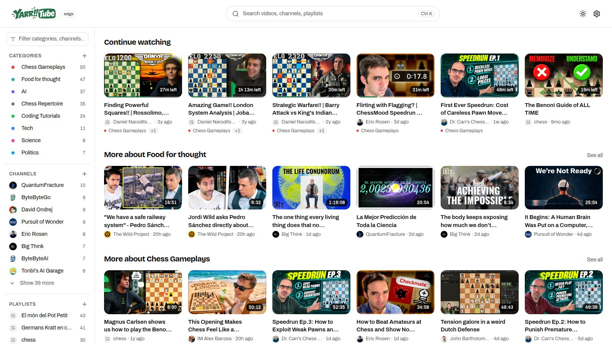
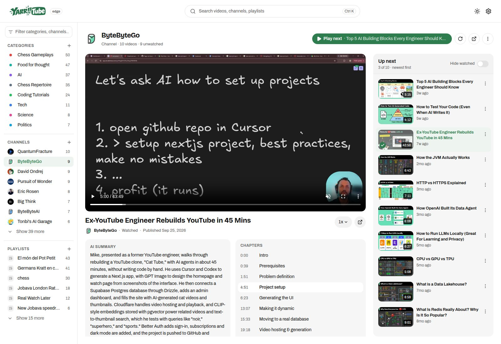
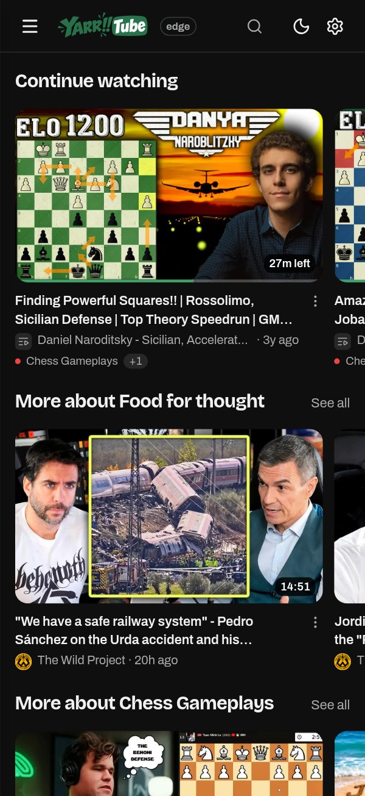
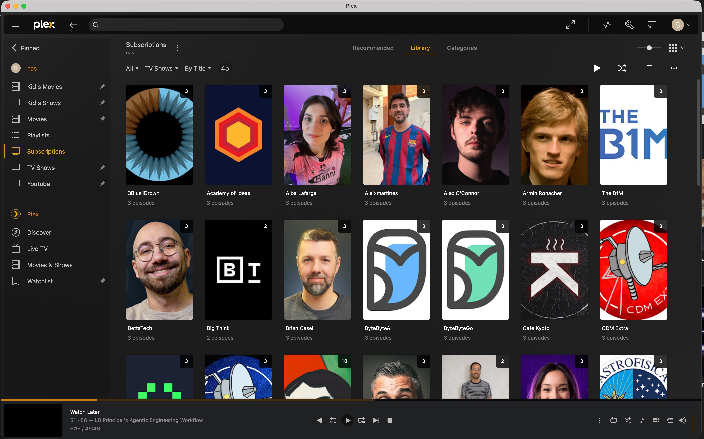

<h1>
<p align="center">
  
</h1>
  <p align="center">
    Self-hosted YouTube synchronizer for your media server, built on top of <a href="https://github.com/yt-dlp/yt-dlp">yt-dlp</a>.
    <br />
    <b>No ads, no algorithm.</b>
    <br />
    <a href="#about">About</a>
    ·
    <a href="#quick-start">Quick start</a>
    ·
    <a href="doc/INSTALLATION.md">Installation</a>
    ·
    <a href="doc/PLEX.md">Plex</a>
    ·
    <a href="doc/CATEGORIES.md">Categories</a>
    ·
    <a href="doc/AI.md">AI</a>
    ·
    <a href="doc/ARCHITECTURE.md">Architecture</a>
    ·
    <a href="doc/DEVELOPMENT.md">Development</a>
    ·
    <a href="LICENSE">License</a>
    <br />
    
  </p>
</p>

# About

Yarrtube is a self-hosted service that watches tracked YouTube playlists and channels and automatically downloads new videos as they're published.

Yarrtube is designed to run on your NAS via Docker alongside the rest of your media stack (Plex, Jellyfin, etc.), but it runs on any laptop too.

# Main Features

**Track & download**

- Track public YouTube playlists, or whole channels and get new videos as they're published.
- Pick the video quality and how many videos to keep, and how often each channel and playlist is checked.
- Subtitles and chapters come with every video.

**Watch**

- Watch everything from the browser, on desktop and mobile, in light or dark mode.
- Pick up where you left off: Continue watching, "Play next" and an "Up next" queue.
- Group channels and playlists into categories ("Science", "Kids", ...) and watch each one as a single feed. See [Categories](doc/CATEGORIES.md).

**Plex, Kodi and Jellyfin**

- Each channel and playlist is a TV show, with episodes, metadata, subtitles and chapters.
- Plex: watched state and resume position sync both ways, and every category becomes an auto-updating smart playlist. See the [Plex guide](doc/PLEX.md).

**AI (optional)**

- A short AI summary of every video, instead of the YouTube description.
- Give a category a prompt and AI adds the videos that fit it, from any channel or playlist.
- Runs on your own [Ollama](https://ollama.com) server, or on Anthropic with your API key. See [AI](doc/AI.md).

<p align="center">
  
</p>

<p align="center">
  
  
</p>

# Quick start

You need Docker and a [YouTube Data API v3 key](doc/INSTALLATION.md#requirements). Save this as `compose.yaml`, fill in the key and paths, and run `docker compose up -d`:

```yaml
services:
  yarrtube:
    container_name: yarrtube
    image: ghcr.io/sergigp/yarrtube:latest
    restart: always
    ports:
      - 8080:8080
    environment:
      - YOUTUBE_API_KEY=your-youtube-data-api-v3-key
      - PUID=1000
      - PGID=1000
      - TZ=Europe/Madrid
    volumes:
      - /path/on/host/config:/config
      - /path/on/host/videos:/videos
```

Then open http://localhost:8080. Every option is in [Installation](doc/INSTALLATION.md).

# Motivation

This is a personal project. I'm an experienced software engineer coming back from a sabbatical, and I wanted a real project to get my hands dirty again, both with writing code and with AI-assisted coding. I wanted to build something that I would actually use, and that would be useful to others too. Yarrtube is the result. If you are a recruiter/dev you can take a look at the [architecture](doc/ARCHITECTURE.md).

It also solves an actual problem at home: I wanted a reliable, ad-free and no-algorithm way to watch specific channels and playlists in Plex, especially for my kids. Yarrtube keeps the playlists and channels I care about mirrored to disk, so they just show up in Plex. **No ads and no algorithm**.
