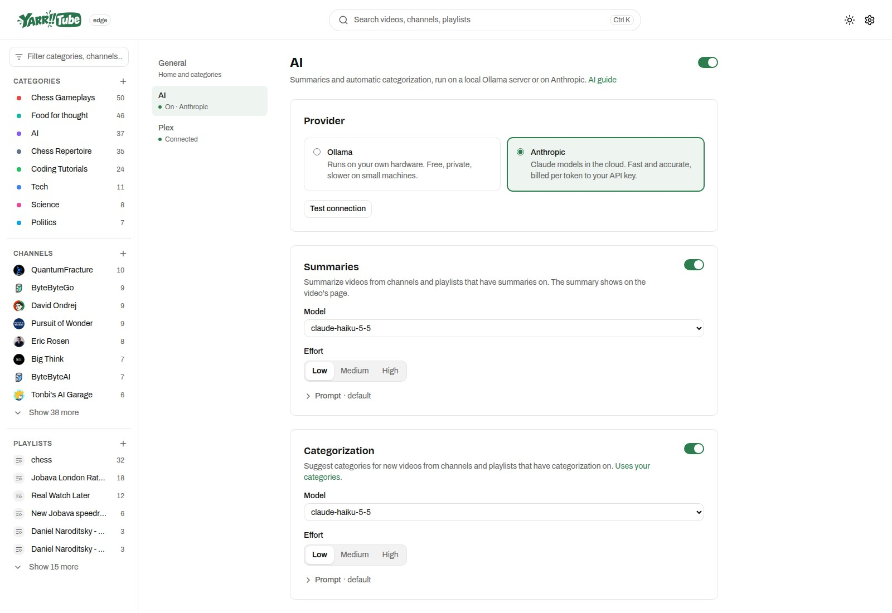

# AI

AI is optional and off by default. With it on, yarrtube can:

- **Summarize videos**: a short summary on the video's page, in place of the
  YouTube description. A video is summarized from its subtitles once it's
  downloaded, so a video without subtitles gets no summary.
- **Categorize videos**: add each video to the categories it fits, from any
  channel or playlist. A video is judged from its summary, so this needs
  summaries on too, and only against categories with an **AI prompt**
  describing the videos they should hold. How it works, and how to ask the AI again, is in
  [Categories](CATEGORIES.md#let-ai-fill-them).

## Setup

Pick a provider:

- **Ollama**: runs on your own machine. Free and private, but slow on small
  hardware.
- **Anthropic**: runs on Anthropic's servers, billed to your API key. Fast,
  and better answers, but each video costs a little.

### Ollama

1. Install [Ollama](https://ollama.com) on a machine yarrtube can reach.
2. Pull a model, e.g. `ollama pull qwen3:4b` (the model yarrtube's settings
   start with).
3. In **Settings → AI**, set the **Ollama URL**, e.g.
   `http://192.168.1.10:11434`.

### Anthropic

Set `YARRTUBE_ANTHROPIC_API_KEY` (see [Installation](INSTALLATION.md)). The
key is never stored, returned or logged.

### Turn it on

1. In **Settings → AI**, turn on **AI features** and pick the provider.
   **Test connection** checks it answers.
2. Turn on **Summaries** and/or **Categorization**, each with its own model.
   You can tune the prompts and other parameters in the advanced settings.
3. On each channel or playlist (add or edit dialog), tick **Summarize
   videos** and/or **Categorize videos**.
4. For categorization, give each category an **AI prompt** with **Edit
   category**, e.g. "Videos about physics, astronomy or biology". A category
   without one never gets AI videos.

  

Everything runs in the background: look for _Summarizing …_ and
_Categorizing …_ in the Tasks page (**AI** tab).

## What to expect

From my own tests:

- **Ollama** with `qwen3` on a spare MacBook Air M2: summarizing and
  categorizing a 10–12 minute video took about 5 minutes, with some wrong
  categories.
- **Anthropic** with Haiku 5.5: a few seconds per video, and much more
  accurate. Summarizing and categorizing 400 videos cost under $2
  (November 2026).

## Troubleshooting

- **No Anthropic option in Settings → AI**: yarrtube isn't reading
  `YARRTUBE_ANTHROPIC_API_KEY`. Check it's set on the container and restart
  it.
- **No summary**: check the video has subtitles, that its channel or
  playlist has **Summarize videos** ticked, and use **Test connection**.
- **Ollama errors**: check the **Ollama URL** is reachable from yarrtube and
  the model is pulled (`ollama list`).
- Still stuck? Look for failed _Summarizing …_ or _Categorizing …_ tasks in
  the Tasks page and for errors in the log.
