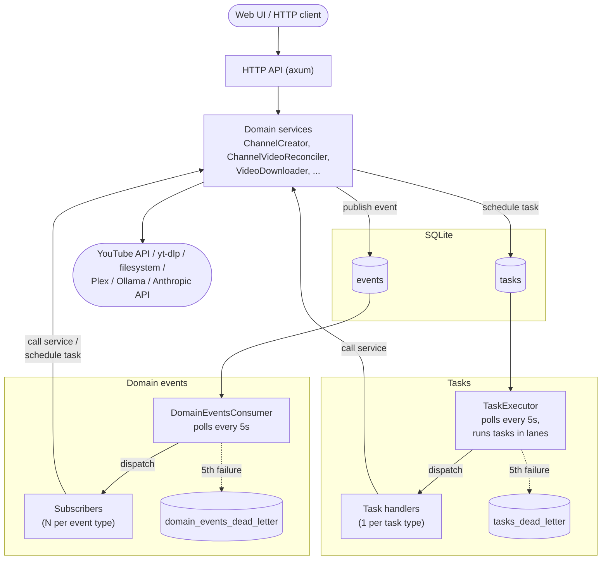
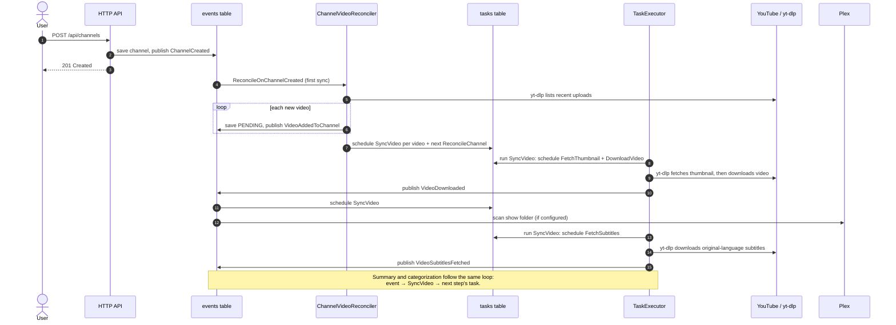

# Architecture

Yarrtube is a single process (`yarrtube serve`) backed by one SQLite database.
An HTTP request does as little as it can: it validates the input, saves state
and publishes a **domain event**. The long-running and failure-prone work
(listing a channel, running `yt-dlp` downloads, writing show folders, calling
Plex or an LLM) happens later in the background, driven by events and tasks.

The queues are SQLite tables rather than a message broker, so the whole
application ships as one container with nothing else to run.

## Overview



The background has two queues:

- A **domain event** records something that happened (`ChannelCreated`,
  `VideoDownloaded`). The `DomainEventsConsumer` hands it to every subscriber
  of its type. A subscriber is small: it schedules a task or calls one
  service.
- A **task** is one unit of work due at a given time (`DownloadVideo`,
  `ReconcileChannel`). The `TaskExecutor` hands it to the handler of its
  type. Tasks can be scheduled in the future, recur by scheduling their own
  next run, and are limited by lane (see [Task lanes](#task-lanes)).

An event or task that fails is retried with a growing delay, and moved to its
dead-letter table on the 5th failure. A video's own steps (download,
subtitles, summary, ...) also keep a retry state on the video, so a step
that keeps failing backs off for up to a day between attempts and ends up
`FAILED` until the user retries it (see
[`video-retries`](../openspec/specs/video-retries/spec.md)).

The code is split into three layers (`application`, `domain`,
`infrastructure`); its conventions are in the
[Rust Architect skill](../.claude/skills/rust-architect/SKILL.md).

## Example: track a channel and download its videos

What happens when a user adds a channel. Playlists follow the same flow with
their own events and reconciler.

1. **The request.** `POST /api/channels` resolves the channel on YouTube,
   saves it and publishes `ChannelCreated`.
2. **The channel sync.** The `ReconcileOnChannelCreated` subscriber runs
   `ChannelVideoReconciler`, which lists the channel's recent uploads with
   `yt-dlp`, saves each new video as `PENDING` (publishing
   `VideoAddedToChannel`), schedules a `SyncVideo` task for every stored
   video, and schedules the next `ReconcileChannel` task one interval later
   (3 hours by default).
3. **The video sync.** `SyncVideo` runs `VideoReconciler`, the one place
   that decides what a video needs next. It looks at the video's stored
   state and schedules a task for each step still missing: thumbnail and
   download first, then subtitles, chapters and a quality upgrade once
   downloaded, then summary and categorization. A step already queued, or
   waiting for its next retry, is skipped. It also repairs what it finds
   broken (a missing file, missing metadata).
4. **Each step.** The task runs, stores its result and publishes an event
   (`VideoDownloaded`, `VideoSubtitlesFetched`, `VideoSummaryGenerated`).
   A subscriber of that event schedules `SyncVideo` again, which schedules
   the following step. Other subscribers react on the side, e.g. asking Plex
   to scan the show folder.
5. **Every interval after that.** `ReconcileChannel` repeats step 2. Since
   it schedules a `SyncVideo` for every stored video, not only the new ones,
   it is also the safety net: it picks up a step lost in a crash, a retry
   that is now due, captions YouTube published late, or a members-only or
   private video its creator has since made public (an `UNAVAILABLE`
   download is tried again on every video sync unless YouTube gave a
   permanent reason, such as a removed or copyright-blocked video).

So the flow is driven by stored state rather than by a chain of calls: the
video sync can run any number of times, and the system converges to
"everything downloaded and enriched" even when a step fails or is lost.



## Task lanes

The `TaskExecutor` runs each task in its type's lane, and each lane has its
own concurrency cap, so a slow kind of work never starves the others:

| Lane | Tasks | At a time |
|---|---|---|
| `Download` | `DownloadVideo`, `UpgradeQuality` | `YARRTUBE_DOWNLOAD_CONCURRENCY` (2 by default) |
| `Thumbnail` | `FetchThumbnail` | 1 |
| `Subtitles` | `FetchSubtitles`, `FetchChapters` | 1 |
| `VideoSync` | `SyncVideo` | 1 |
| `Plex` | `SyncPlexWatchState`, `SyncPlexLabels` | 1 |
| `Summaries` | `SummarizeVideo`, `CategorizeVideo` | 1 |
| `Light` | `ReconcileChannel`, `ReconcilePlaylist`, file deletes | 1 |
| `Exclusive` | `UpdateYtdlp` | alone, with nothing else running |

Two tasks about the same video never run at the same time either, whatever
their lanes, so the steps of a video never race each other.

## Integrations

Every external system sits behind a port (a trait) with a real adapter and a
`Fake*` double for tests.

- **YouTube**: `yt-dlp` for listings, downloads, thumbnails and captions,
  and the YouTube Data API for playlist and channel lookups. `yt-dlp`
  updates itself hourly, running alone in the `Exclusive` lane.
- **LLM** ([AI features](AI.md)): summaries and categorization go through
  one port, `LlmServerRepository`, with an Ollama adapter and an Anthropic
  one; a router picks the adapter from the saved provider. An unreachable
  provider makes the step wait without spending a retry attempt.
- **Plex** ([Plex](PLEX.md), [Categories](CATEGORIES.md)): reached only
  from the background, never from an HTTP request. Three jobs: scan a show
  folder after a download, new subtitles or a show move, sync watch state both ways
  (every 5 minutes), and sync category labels and smart playlists (every 15
  minutes).

## Videos on disk

Each tracked playlist or channel is laid out as a TV show, so Plex, Kodi and
Jellyfin read it without configuration:

```
<storage path>/
├── tvshow.nfo
├── poster.jpg                                  channels only (avatar copy)
└── Season <year>/                              Season 1/ for a playlist
    └── S<year>E<MMDDii> - <title>.{mp4,jpg,nfo,<lang>.srt}  S01E<nnn> - <title>.* for a playlist
```

- **Episode numbers** are assigned once and stored on the video, so files
  never rename. Channels number by publish date plus a per-day index;
  playlists take the next number in playlist order, never reusing one.
- **Staging**: `yt-dlp` writes into `<videos root>/.downloads/`, then files
  are moved into the season folder, so players never see a partial file.

## Testing

| Layer | Where | What it covers |
|---|---|---|
| Rust unit tests | inline in `src/domain/**` | Pure logic: validation, state transitions, invariants. No I/O. |
| Rust behavior tests | HTTP handlers, tasks, subscribers | The real wiring (services + in-memory SQLite), faking only external boundaries. Assert the response, the persisted state and the events/tasks produced. |
| Rust repository tests | inline in the SQLite repositories | Queries and mapping against in-memory SQLite with migrations applied. |
| Web tests | `web/` (Vitest, Testing Library) | Pure logic and components, with only `fetch` mocked. |
| Contract tests | next to each adapter, `#[ignore]`d | Adapters against the real `yt-dlp`, YouTube and Anthropic APIs, so the fakes stay honest. Local only. |
| End-to-end tests | `e2e-tests/` (Playwright) | The real Docker image driven through real browsers against fake YouTube, Plex and LLM services. Runs in CI on every pull request. |

`scripts/run-tests.sh --all` runs every suite; see
[DEVELOPMENT.md](DEVELOPMENT.md).
