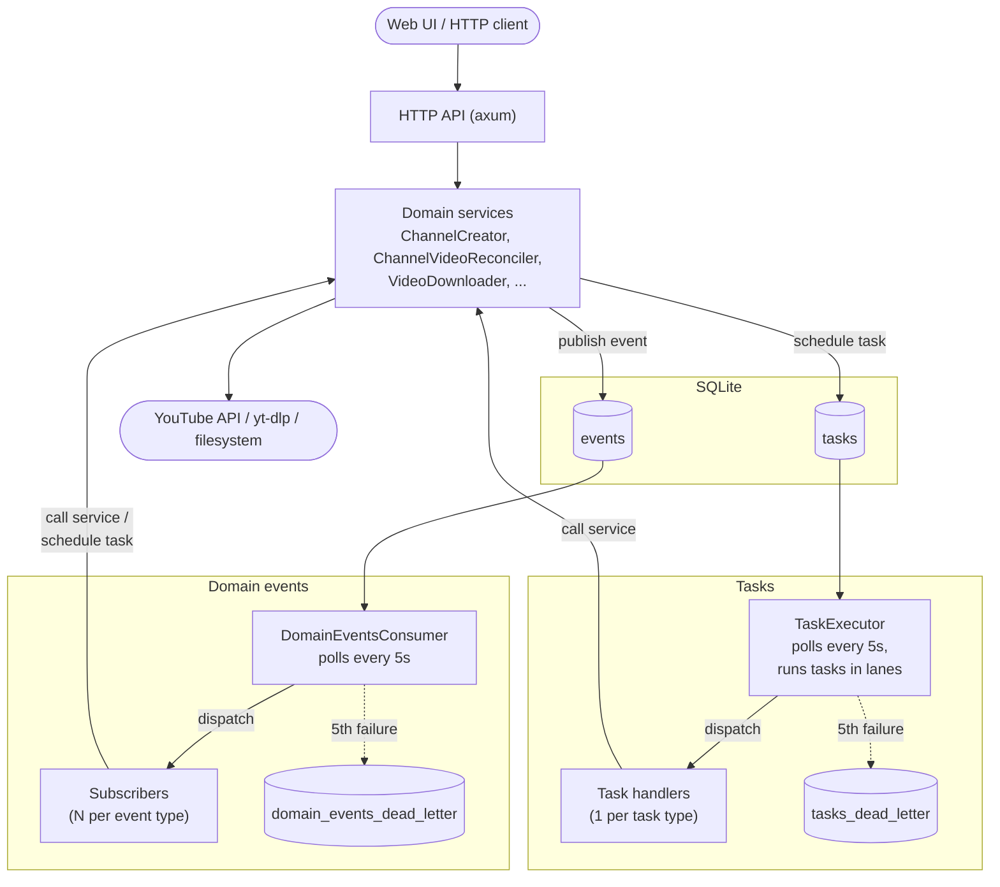
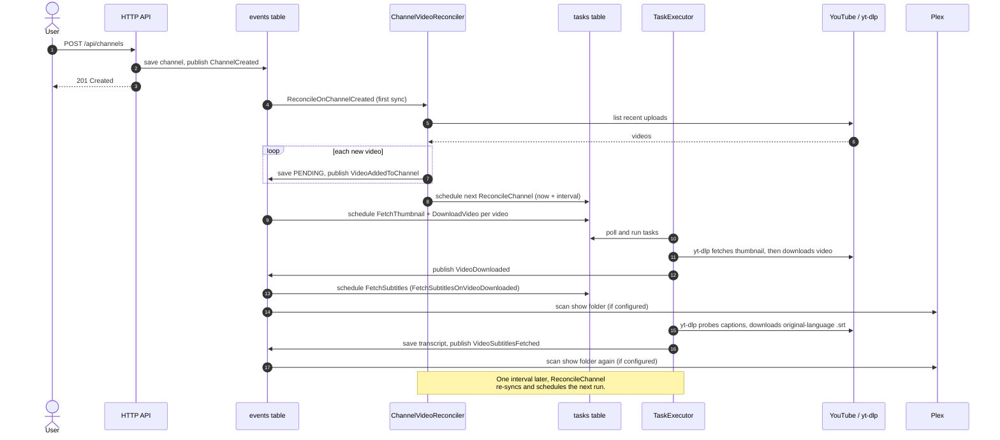

# Architecture

Yarrtube is a single process (`yarrtube serve`) backed by one SQLite database.
Inside it, the HTTP API does only the synchronous part of each request: it
validates the input, saves state and publishes a **domain event**. Everything
slow or fallible (talking to YouTube, running `yt-dlp`, touching the
filesystem) happens later in the background in an event-driven fashion.

## Architecture Overview



For more information on the architectural decisions and conventions used in Yarrtube you can take a look at the [Rust Architect skill](../.claude/skills/rust-architect/SKILL.md).

## Example: track a channel and download its videos and subtitles

To illustrate this domain-driven flow we can take a look at what happens when a user adds a channel subscription and all the videos end up downloaded, with their subtitles:

1. `POST /api/channels` saves the channel and publishes `ChannelCreated` domain event.
2. The `ReconcileOnChannelCreated` subscriber runs asynchronously, polling the domain events table (which acts like a queue), and runs the first channel sync.
   - The sync writes the channel's show files (`tvshow.nfo`, and
     `poster.jpg` from its avatar), as every later sync does too.
   - The sync reads the channel's most recent uploads from YouTube using the YouTube API.
   - It saves each new video as `PENDING` and publishes one
     `VideoAddedToChannel` domain event per video.
   - It schedules the next `ReconcileChannel` task one reconcile interval
     later: the channel's own interval as stored when the sync finishes
     (3 hours by default, editable per channel and playlist from the web UI).
3. For each `VideoAddedToChannel`, two asynchronous subscribers schedule a task each:
   - `FetchThumbnailOnVideoAddedToChannel` schedules a `FetchThumbnail`
     task.
   - `DownloadVideoOnVideoAddedToChannel` schedules a `DownloadVideo` task.
4. The `TaskExecutor` runs them. Both call `yt-dlp` inside the video's
   staging folder (`<videos root>/.downloads/<youtube id>`), take its
   episode number from the publish time `yt-dlp` reports, and move the
   result into the show's season folder (see below). The thumbnail usually
   arrives first, so the UI can show it while the video is still downloading.
   A finished download publishes `VideoDownloaded`, which has two
   subscribers:
   - `FetchSubtitlesOnVideoDownloaded` schedules a `FetchSubtitles` task.
   - `ScanPlexFolderOnVideoDownloaded` asks Plex to scan the show folder,
     when the scan trigger is configured.
5. The `TaskExecutor` runs `FetchSubtitles` in its own lane, one at a time,
   so a large backfill never floods YouTube or delays downloads. It probes
   the video's caption tracks, writes the original-language track as
   `<episode>.<lang>.srt` (`<lang>` being the base language code, e.g. `es`
   for `es-US`) and stores its plain-text transcript (`video_transcripts`),
   then publishes `VideoSubtitlesFetched`, whose
   `ScanPlexFolderOnVideoSubtitlesFetched` subscriber asks Plex to scan the
   show folder again so the subtitle shows up. A video with no
   original-language captions records its first such check
   (`subtitles_first_missing_at`) and becomes `UNAVAILABLE` once both its
   publish date and that first check are 7 days old; any failure, or a probe
   where yt-dlp warned (it can withhold caption tracks silently), leaves it
   `MISSING`.
6. Every interval, the `ReconcileChannel` task runs the sync again and schedules
   the next one. New uploads repeat steps 3–5. The sync also schedules a
   `FetchThumbnail` for any video still missing its thumbnail, and a
   `FetchSubtitles` for any downloaded video whose subtitles are still
   `MISSING`: that backfills an upgraded library and retries videos whose
   captions weren't available yet.



## Videos on disk

Each tracked playlist or channel is a TV show under its storage path:

```
<storage path>/
├── tvshow.nfo                                  ShowFileWriter, on every sync
├── poster.jpg                                  channels only (avatar copy)
└── Season <year>/                              Season 1/ for a playlist
    └── S<year>E<MMDDii> - <title>.{mp4,jpg,nfo,<lang>.srt}  S01E<nnn> - <title>.* for a playlist
```

- **Episode number** (`ChannelEpisodeNumber` / `PlaylistEpisodeNumber`) is
  assigned once and stored on the video, so files never rename. Channels:
  publish date plus a per-day index, assigned in the database
  (`VideoRepository::assign_episode_number`). Playlists: the next number
  from `Playlist::last_episode`, assigned by `PlaylistVideoReconciler`, so
  a removed video's number is never reused.
- **Staging**: `yt-dlp` writes into `.downloads/<youtube id>`, then files
  are moved into the season folder, so players never see a partial file.
- **Legacy layout** (per-video folders from 0.8.x) is still served;
  `VideoRelocator` moves it into the TV layout via `migrate-layout` or
  reconcile.

## Testing

Several layers, from fast/isolated to slow/real:

- **Rust unit tests** — inline `mod tests` in domain value objects and
  entities (`src/domain/**`). Pure logic: parsing/validation, state
  transitions, invariants. No I/O.
- **Rust behavior tests** — inline `mod tests` in HTTP handlers,
  subscribers, tasks and services. Exercise the real wiring (service +
  real SQLite repos via `Connection::open_in_memory()`) with `Fake*`
  doubles only at the external boundaries (YouTube API, yt-dlp,
  filesystem). Assert the full outcome: response, persisted state, and
  events/tasks produced.
- **Rust repository tests** — inline `mod tests` in the SQLite repos,
  run against in-memory SQLite with migrations applied. Verify queries,
  mapping and persistence.
- **Web tests** (`web/`, Vitest + jsdom + Testing Library) — unit tests
  for pure logic in `src/lib/` and hooks, and component tests that render
  through the real `QueryClient`/router with only `fetch` mocked. Assert
  user-visible behavior.
- **Smoke tests** (`smoke-tests/`, Playwright) — end-to-end against the
  real Docker image, hitting the real YouTube API and downloading a real
  video with `yt-dlp`. No doubles. Covers the full create → download →
  playback flow; run manually (locally or via the `workflow_dispatch`
  workflow), not on every PR.
