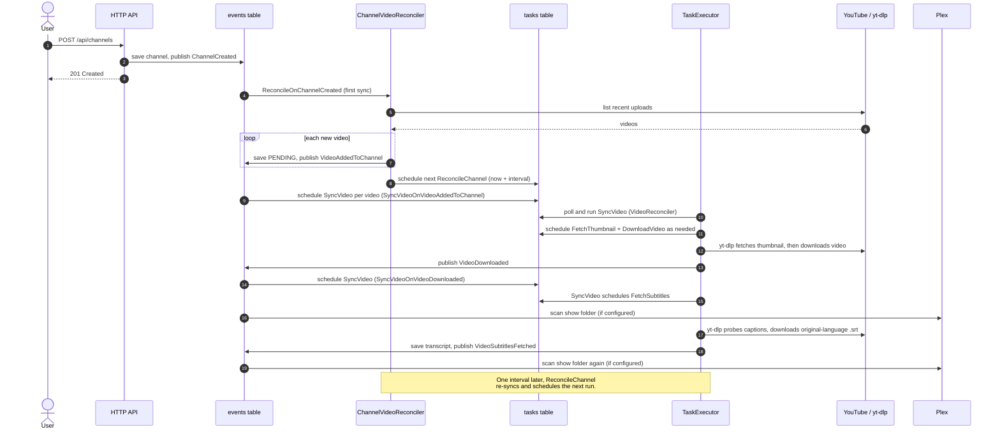

# Architecture

Yarrtube is a single process (`yarrtube serve`) backed by one SQLite database.
Inside it, the HTTP API does only the synchronous part of each request: it
validates the input, saves state and publishes a **domain event**. Everything
slow or fallible (talking to YouTube, running `yt-dlp`, touching the
filesystem) happens later in the background in an event-driven fashion.

## Architecture Overview


For more information on the architectural decisions and conventions used in Yarrtube you can take a look at the [Rust Architect skill](../.claude/skills/rust-architect/SKILL.md).

## Example: track a channel and download its videos and subtitles

To illustrate this domain-driven flow we can take a look at what happens when a user adds a channel subscription and all the videos end up downloaded, with their subtitles:

1. `POST /api/channels` saves the channel and publishes `ChannelCreated` domain event.
2. The `ReconcileOnChannelCreated` subscriber runs asynchronously, polling the domain events table (which acts like a queue), and runs the first channel sync.
   - The sync writes the channel's show files (`tvshow.nfo`, and
     `poster.jpg` from its avatar), as every later sync does too.
   - The sync reads the channel's most recent uploads from YouTube using the YouTube API.
   - It saves each new video as `PENDING` and publishes one
     `VideoAddedToChannel` domain event per video.
   - It runs `VideoReconciler` for every stored video (see step 6), which
     already schedules the new videos' tasks.
   - It schedules the next `ReconcileChannel` task one reconcile interval
     later: the channel's own interval as stored when the sync finishes
     (3 hours by default, editable per channel and playlist from the web UI).
3. For each `VideoAddedToChannel`, the `SyncVideoOnVideoAddedToChannel`
   subscriber schedules a `SyncVideo` task (own `VideoSync` lane). The
   `VideoReconciler` it runs schedules, as the video's stored state needs,
   a `FetchThumbnail` task, a `DownloadVideo` task and a `FetchSubtitles`
   task.
4. The `TaskExecutor` runs them. The download calls `yt-dlp` inside the
   video's staging folder (`<videos root>/.downloads/<youtube id>`), takes
   its episode number from the publish time `yt-dlp` reports, and moves the
   result into the show's season folder (see below). The thumbnail task is
   scheduled first, so it usually arrives first and the UI can show it
   while the video is still downloading.
   A finished download publishes `VideoDownloaded`, which has two
   subscribers:
   - `SyncVideoOnVideoDownloaded` schedules a `SyncVideo` task, whose
     reconciler schedules the `FetchSubtitles` task.
   - `ScanPlexFolderOnVideoDownloaded` asks Plex to scan the show folder,
     when the scan trigger is configured.
5. The `TaskExecutor` runs `FetchSubtitles` in its own lane, one at a time,
   so a large backfill never floods YouTube or delays downloads. It probes
   the video's caption tracks, writes the original-language track as
   `<episode>.<lang>.srt` (`<lang>` being the base language code, e.g. `es`
   for `es-US`) and stores its plain-text transcript (`video_transcripts`),
   then publishes `VideoSubtitlesFetched`, whose
   `ScanPlexFolderOnVideoSubtitlesFetched` subscriber asks Plex to scan the
   show folder again so the subtitle shows up. A video with no
   original-language captions records its first such check
   (`subtitles_first_missing_at`) and becomes `UNAVAILABLE` once both its
   publish date and that first check are 7 days old; any failure, or a probe
   where yt-dlp warned (it can withhold caption tracks silently), leaves it
   `MISSING`.
6. Every interval, the `ReconcileChannel` task runs the sync again and schedules
   the next one. New uploads repeat steps 3–5. Once membership is up to
   date, the sync runs `VideoReconciler` inline for every stored video of
   the channel, including the ones it just added, holding each video's lock
   so it never overlaps a `SyncVideo` task of the same video. Per video it
   assigns the channel's categories, resets a `DOWNLOADED` video whose file
   is missing or not mp4, recovers an `ERRORED` video after its 24h
   cooldown, regenerates missing metadata (relocating a video still in the
   previous layout), warns about a stranded video, and schedules every step
   still needed (`FetchThumbnail`, `DownloadVideo`, `FetchSubtitles`, each
   skipped when one is already pending). That backfills an upgraded library
   and retries videos whose captions weren't available yet. Only then does
   it sweep files of the show folder that no stored video accounts for.



## Videos on disk

Each tracked playlist or channel is a TV show under its storage path:

```
<storage path>/
├── tvshow.nfo                                  ShowFileWriter, on every sync
├── poster.jpg                                  channels only (avatar copy)
└── Season <year>/                              Season 1/ for a playlist
    └── S<year>E<MMDDii> - <title>.{mp4,jpg,nfo,<lang>.srt}  S01E<nnn> - <title>.* for a playlist
```

- **Episode number** (`ChannelEpisodeNumber` / `PlaylistEpisodeNumber`) is
  assigned once and stored on the video, so files never rename. Channels:
  publish date plus a per-day index, assigned in the database
  (`VideoRepository::assign_episode_number`). Playlists: the next number
  from `Playlist::last_episode`, assigned by `PlaylistVideoReconciler`, so
  a removed video's number is never reused.
- **Staging**: `yt-dlp` writes into `.downloads/<youtube id>`, then files
  are moved into the season folder, so players never see a partial file.
- **Legacy layout** (per-video folders from 0.8.x) is still served;
  `VideoRelocator` moves it into the TV layout via `migrate-layout` or
  reconcile.

## Testing

Several layers, from fast/isolated to slow/real:

- **Rust unit tests** — inline `mod tests` in domain value objects and
  entities (`src/domain/**`). Pure logic: parsing/validation, state
  transitions, invariants. No I/O.
- **Rust behavior tests** — inline `mod tests` in HTTP handlers,
  subscribers, tasks and services. Exercise the real wiring (service +
  real SQLite repos via `Connection::open_in_memory()`) with `Fake*`
  doubles only at the external boundaries (YouTube API, yt-dlp,
  filesystem). Assert the full outcome: response, persisted state, and
  events/tasks produced.
- **Rust repository tests** — inline `mod tests` in the SQLite repos,
  run against in-memory SQLite with migrations applied. Verify queries,
  mapping and persistence.
- **Web tests** (`web/`, Vitest + jsdom + Testing Library) — unit tests
  for pure logic in `src/lib/` and hooks, and component tests that render
  through the real `QueryClient`/router with only `fetch` mocked. Assert
  user-visible behavior.
- **YouTube contract tests** — `#[ignore]`d `youtube_contract_tests`
  modules next to each YouTube adapter, run against the real `yt-dlp` and
  Data API. They pin down what the fakes assume, so a YouTube change is
  told apart from a bug of ours. Run locally only (they need the network
  and an API key), not in CI.
- **End-to-end tests** (`e2e-tests/`, Playwright) — the real Docker image
  driven through real browsers against a fake YouTube and a Plex stub, one
  daemon per parallel worker. Covers add → download → playback and the
  rest of the UI flows; runs in CI on every pull request.

`scripts/run-tests.sh` runs every suite; see
[DEVELOPMENT.md](DEVELOPMENT.md).
