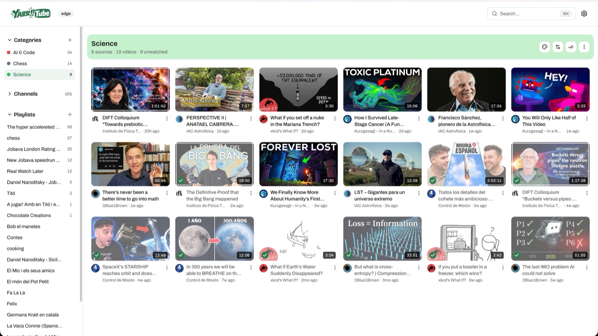
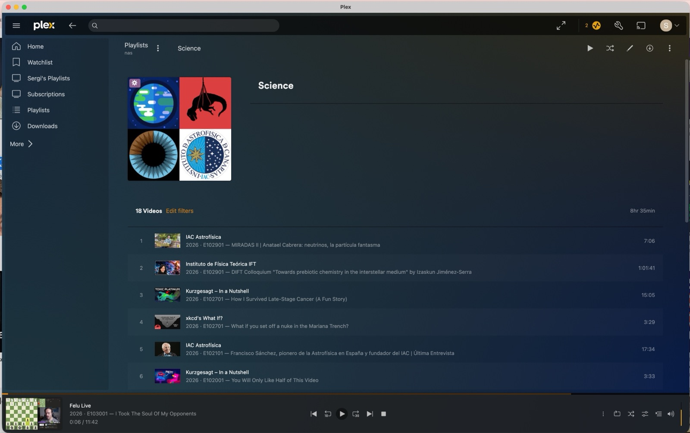

# Categories

A category is a topic you define, like "Science" or "Kids", that groups
channels and playlists. You can then watch by topic instead of by source:
one feed of everything new in "Kids", whichever channel it came from. A
channel or playlist can be in several categories.

  

## Create one

- Press **+** next to **Categories** in the sidebar, and pick a name and a
  color.
- Add channels and playlists with **Manage sources**, or from the
  **Categories** field when adding or editing a channel or playlist.
- New videos from those sources join the category on their own.

## What you get

- **A category page** with every video of its sources in one grid, playable
  as a single queue.
- **"More about \<category\>" rows on Home** for the categories with the
  most unwatched videos.
- **Colored chips** on video cards and **unwatched counts** in the sidebar.
- **Mark all watched** for the whole category at once.

## In Plex

Each category becomes a **smart playlist** in Plex: its unwatched episodes,
newest first, across all its channels and playlists.

It needs the Plex integration working: a TV Shows library and the scan
trigger, steps 1 and 2 of the [Plex guide](PLEX.md). Nothing else to set up.

  

Good to know:

- Playlists are visible only to the Plex user whose token yarrtube uses
  (`YARRTUBE_PLEX_TOKEN`). Managed and shared users, like a kid's profile,
  don't get them.
- A category with episodes in several Plex libraries gets one playlist per
  library, e.g. `Science · Subscriptions` and `Science · Kids TV`.
- A playlist shows up within 15 minutes after Plex imports its first episode, and
  follows renames and deletes of its category. A playlist you delete in Plex
  comes back; delete the category instead.
- yarrtube builds the playlists from Plex labels named after your
  categories. It owns the labels of its episodes, so labels you add to them by
  hand are removed. If you restrict shared users by label, don't use a
  category name as a restriction label.
- No playlist? Look for _Syncing Plex category labels_ in the Tasks page
  (**Other** tab) and for `failed to reach Plex` in the log.

## Turning them off

Don't need categories? Turn off **Enable categories** in **Preferences**: all
category UI is hidden, and your categories are kept for when you turn it back
on.
