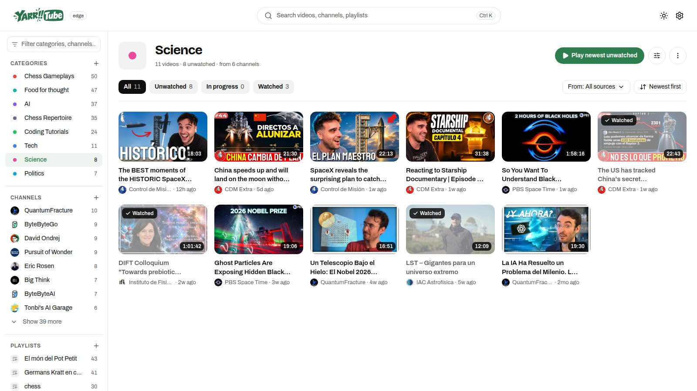
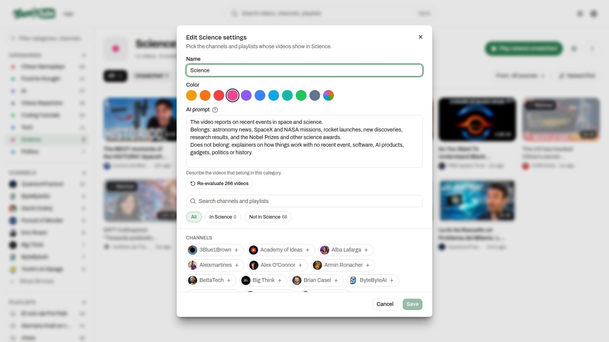
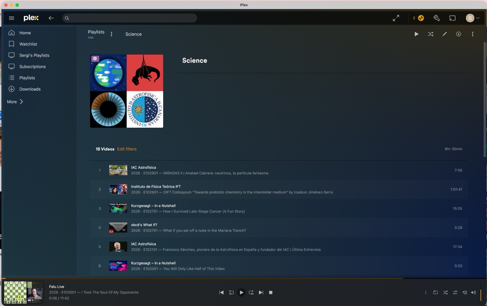

# Categories

A category is a topic you define, like "Science" or "Kids", that groups
channels and playlists. You can then watch by topic instead of by source:
one feed of everything new in "Kids", whichever channel it came from. A
channel or playlist can be in several categories.

  

## Create one

- Press **+** next to **Categories** in the sidebar, and pick a name, a color
  and its channels and playlists, all in one dialog.
- Change any of them later with **Edit category** on its page (or **Edit
  settings** in its sidebar **⋮** menu), or add a source from the
  **Categories** field when adding or editing a channel or playlist.
- New videos from those sources join the category on their own.

## What you get

- **A category page** with every video of its sources in one grid, playable
  as a single queue.
- **"More about \<category\>" rows on Home** for the categories with the
  most unwatched videos.
- **Colored chips** on video cards and **unwatched counts** in the sidebar.
- **Mark all watched** for the whole category at once.

## Fix a video by hand

Every video's **⋮** menu has **Edit categories…**: every category as a chip,
filled when the video is in it. Click a chip to add the video to that
category or take it out.

- A chip with a lock, marked **From \<channel or playlist\>**, comes from the
  video's source: change the source's categories instead.
- A chip marked **AI** was decided by the AI (see below). Clicking it replaces
  the AI's answer with yours.
- What you set by hand is never changed by the AI.

## Let AI fill them

With [AI](AI.md) set up, a category can also gather videos from any channel
or playlist: give it an **AI prompt** with **Edit category**, describing the
videos it should hold, and the AI adds every video that fits.

  

The AI never overrides you: change a video's categories by hand (see above)
and your choice stays.

## In Plex

Each category becomes a **smart playlist** in Plex, newest first, across all
its channels and playlists. It needs the Plex integration set up, see the
[Plex guide](PLEX.md). **Settings → Plex** has the playlist options.

  

Don't need categories at all? Turn them off in **Settings → General**; your
categories are kept for when you turn them back on.
