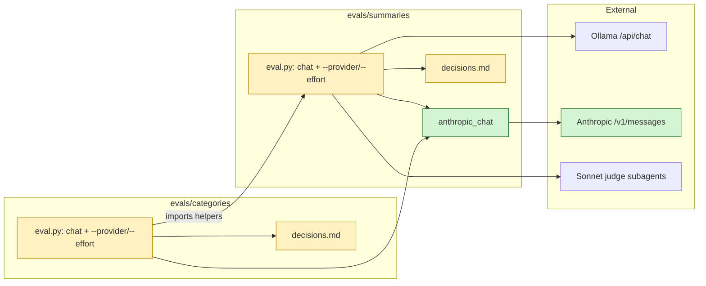

# Proposal

## Why

`add-anthropic-provider` makes Anthropic an alternative to Ollama, with
`claude-haiku-5-5` and effort `medium` as provisional defaults. Nothing has
measured those yet. The summary and categories evals only talk to Ollama, so
they can't say whether Haiku beats `qwen3:4b` or which effort is enough. This
change makes them able to, and runs them before the app work starts.

## What Changes

- `evals/summaries/eval.py` and `evals/categories/eval.py` take
  `--provider ollama|anthropic` (default `ollama`, so existing runs and
  commands are unchanged) and `--effort low|medium|high` (Anthropic only,
  default `medium`).
- With `--provider anthropic`, each model call is a `POST /v1/messages`
  shaped the way the app's Anthropic adapter will send it:
  - `model`, `max_tokens`, `system` and one user message
  - `output_config.effort`, plus `output_config.format` (JSON schema) when the
    call has a schema
  - no `temperature`, no `num_ctx`, no `thinking` field, so the model's
    default adaptive thinking applies
  - authenticated with `YARRTUBE_ANTHROPIC_API_KEY`
- Anthropic replies map onto what the evals already record:
  - `stop_reason: max_tokens` is "hit the output limit"
  - `stop_reason: refusal`, and a 400 such as "prompt is too long", become
    error rows
  - a connect error, 401/403, or no credit stops the run, which can be resumed
    with `--run`
  - `usage.input_tokens` / `output_tokens` go into each call's stats
- The summaries eval cuts parts with a context of 131072 tokens for
  Anthropic, the same cap the app will use, instead of `NUM_CTX`.
- A run's `meta` records provider and effort, and its report shows them.
- Every run prints its input and output token totals and an estimated cost,
  using Haiku/Sonnet/Opus prices kept in one table in the script.
- The judge is unchanged: Claude Sonnet subagents (external), or `qwen3:8b`
  locally. Haiku never judges its own summaries.
- New results are recorded in `evals/summaries/decisions.md` and
  `evals/categories/decisions.md`:
  - Haiku at `low` and `medium` effort, compared with the current `qwen3:4b`
    baseline
  - the effort chosen as the default for each feature
  - whether `claude-haiku-5-5` stays the default model
- READMEs document the new flags and the env var.

## Capabilities

### New Capabilities

None. The evals are development tooling, not a product capability.

### Modified Capabilities

None. No daemon behaviour changes, and `skip_specs: true` is set.

## Impact

- `evals/summaries/eval.py`, `evals/categories/eval.py` (which imports the
  summaries eval's helpers)
- `evals/summaries/README.md`, `evals/categories/README.md`,
  `evals/*/decisions.md`
- `evals/*/results/<run-id>/` holds the new runs
- No Rust, web or Docker changes. Needs network access and an Anthropic key.
  Spend is small: about 10 summary cases and the categories golden set on
  Haiku, a few cents to about $1 per run.

