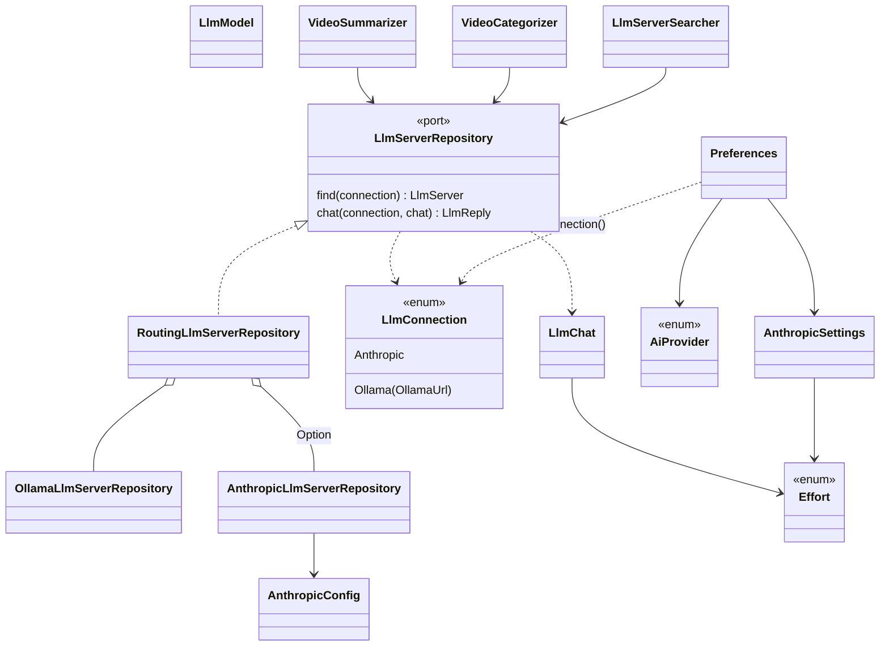
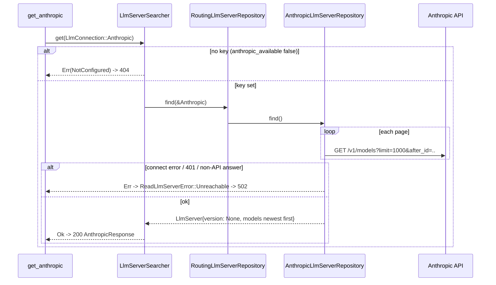
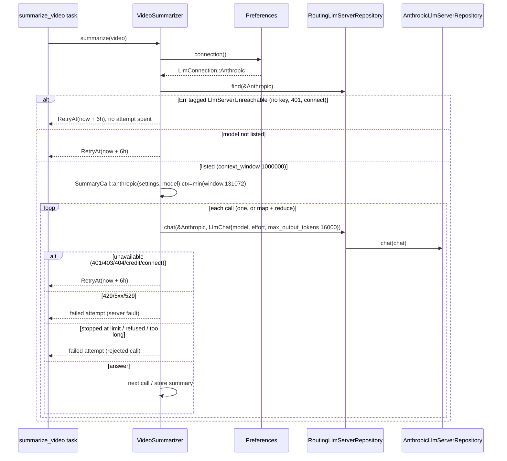
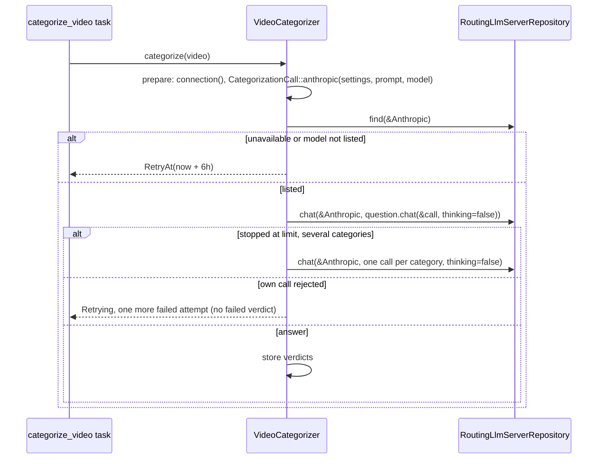
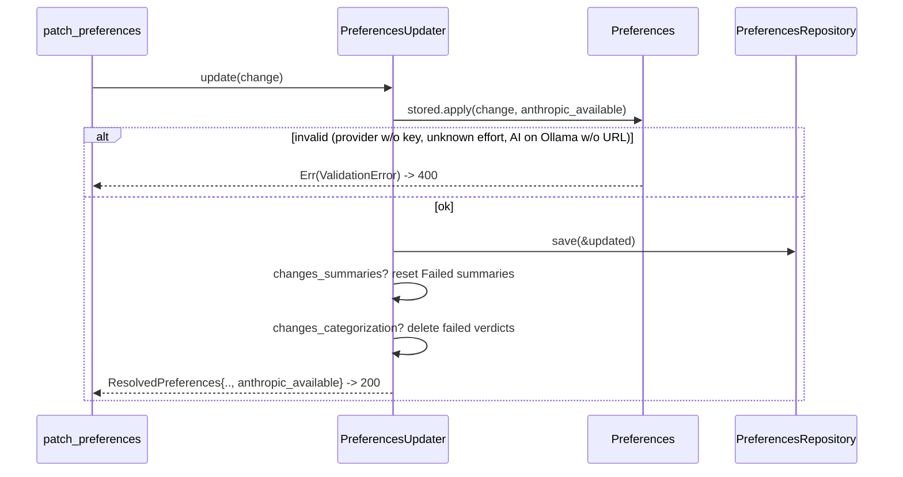

# Design

## Diagrams











## Types & Signatures

```rust
// src/domain/llm_server/llm_connection.rs
/// Which provider a call goes to; the Anthropic key lives in infrastructure.
#[derive(Debug, Clone, PartialEq, Eq)]
pub enum LlmConnection {
    Ollama(OllamaUrl),
    Anthropic,
}
```

```rust
// src/domain/llm_server/effort.rs
#[derive(Debug, Clone, Copy, PartialEq, Eq, Default)]
pub enum Effort { #[default] Low, Medium, High }

impl Effort {
    /// `Effort must be "low", "medium" or "high" (got "<value>")`
    pub fn new(value: &str) -> Result<Self, ValidationError>;
    pub fn as_str(&self) -> &'static str;
}
```

```rust
// src/domain/llm_server/llm_chat.rs
pub struct LlmChat {
    pub model: String,
    pub system: String,
    pub user: String,
    pub context_length: u32,   // Ollama only
    pub temperature: f64,      // Ollama only
    pub thinking: bool,        // Ollama only
    pub effort: Effort,        // Anthropic only
    pub max_output_tokens: u32,
    pub format: Option<serde_json::Value>,
    pub timeout: Duration,
}
```

```rust
// src/domain/llm_server/llm_model.rs
pub struct LlmModel {
    pub name: String,
    pub display_name: Option<String>, // Anthropic
    pub size_bytes: Option<u64>,      // Ollama
    pub thinking: bool,               // Ollama capability; false for Anthropic
    pub context_window: Option<u32>,  // Anthropic max_input_tokens
}

// src/domain/llm_server/llm_server.rs
pub struct LlmServer {
    pub version: Option<String>, // None for Anthropic
    pub models: Vec<LlmModel>,
}
```

```rust
// src/domain/llm_server/errors.rs
pub enum ReadLlmServerError {
    /// 404 `Anthropic isn't configured: set YARRTUBE_ANTHROPIC_API_KEY`
    NotConfigured,
    /// 502 `Could not reach Ollama at <url>: ..` / `Could not reach Anthropic: ..`
    Unreachable { connection: LlmConnection, source: anyhow::Error },
}
// LlmServerUnreachable stays the tag; Display: "the LLM provider is unavailable"
```

```rust
// src/domain/preferences/ai_provider.rs
#[derive(Debug, Clone, Copy, PartialEq, Eq, Default)]
pub enum AiProvider { #[default] Ollama, Anthropic }

impl AiProvider {
    /// `AI provider must be "ollama" or "anthropic" (got "<value>")`
    pub fn new(value: &str) -> Result<Self, ValidationError>;
    pub fn as_str(&self) -> &'static str;
}
```

```rust
// src/domain/preferences/anthropic_settings.rs
#[derive(Debug, Clone, PartialEq)]
pub struct AnthropicSettings {
    pub summaries_model: SummaryModel,             // default claude-haiku-5-5
    pub summaries_effort: Effort,                  // default Low
    pub categorization_model: CategorizationModel, // default claude-haiku-5-5
    pub categorization_effort: Effort,             // default Low
}
impl Default for AnthropicSettings { fn default() -> Self; }

// src/domain/preferences/summary_model.rs, categorization_model.rs
impl SummaryModel { pub fn anthropic_default() -> Self; }
impl CategorizationModel { pub fn anthropic_default() -> Self; }
```

```rust
// src/domain/preferences/preferences.rs
pub struct Preferences {
    // ..existing fields..
    pub ai_provider: AiProvider,
    pub anthropic: AnthropicSettings,
}

impl Preferences {
    /// Where AI calls go: `None` only for Ollama without a URL.
    pub fn connection(&self) -> Option<LlmConnection>;
    /// Also rejects Anthropic without a key (`Set YARRTUBE_ANTHROPIC_API_KEY
    /// to use Anthropic`); AI on Ollama still needs a URL.
    pub fn apply(
        self,
        change: PreferencesChange,
        anthropic_available: bool,
    ) -> Result<Self, ValidationError>;
    /// + provider, anthropic summaries model/effort
    pub fn changes_summaries(&self, other: &Self) -> bool;
    /// + provider, anthropic categorization model/effort
    pub fn changes_categorization(&self, other: &Self) -> bool;
}

// src/domain/preferences/preferences_change.rs
pub struct PreferencesChange {
    // ..existing fields..
    pub ai_provider: Option<AiProvider>,
    pub anthropic_summaries_model: Option<SummaryModel>,
    pub anthropic_summaries_effort: Option<Effort>,
    pub anthropic_categorization_model: Option<CategorizationModel>,
    pub anthropic_categorization_effort: Option<Effort>,
}

// src/domain/preferences/resolved_preferences.rs
pub struct ResolvedPreferences {
    pub preferences: Preferences,
    pub categorization_context_length: ContextLength,
    pub anthropic_available: bool,
}
impl ResolvedPreferences {
    pub fn new(preferences: Preferences, categories: &[Category], anthropic_available: bool) -> Self;
}
```

```rust
// src/domain/services/preferences_updater.rs, preferences_searcher.rs
impl PreferencesUpdater { pub fn new(/* ..existing.. */, anthropic_available: bool) -> Self; }
impl PreferencesSearcher { pub fn new(/* ..existing.. */, anthropic_available: bool) -> Self; }

// src/domain/services/llm_server_searcher.rs
impl LlmServerSearcher {
    pub fn new(repository: Arc<dyn LlmServerRepository>, anthropic_available: bool) -> Self;
}
pub trait LlmServerSearcherApi: Send + Sync {
    /// Ollama: models sorted by name; Anthropic: as listed, newest first.
    fn get(&self, connection: LlmConnection) -> Result<LlmServer, ReadLlmServerError>;
}
```

```rust
// src/domain/services/video_summarizer.rs (private)
/// Cap on the Anthropic context the input budget is computed from.
const ANTHROPIC_MAX_CONTEXT: u32 = 131_072;
const ANTHROPIC_SUMMARY_MAX_OUTPUT_TOKENS: u32 = 16_000;

struct SummaryJob {
    connection: LlmConnection,
    call: SummaryCall,
    prompt: SummaryPrompt,
    owner: VideoOwner,
}

/// What each call of one generation sends, resolved from the provider.
struct SummaryCall {
    model: String,
    context_length: ContextLength,
    max_output_tokens: u32,
    temperature: f64,
    thinking: bool,
    effort: Effort,
}
impl SummaryCall {
    fn ollama(settings: &SummarySettings, installed: &LlmModel) -> Self;
    fn anthropic(settings: &AnthropicSettings, listed: &LlmModel) -> Self;
}
```

```rust
// src/domain/video_category/categorization_call.rs
/// What each call of one categorization sends, resolved from the provider.
pub struct CategorizationCall {
    pub model: String,
    pub prompt: CategorizationPrompt,
    pub context_length: ContextLength,
    pub temperature: f64,
    pub effort: Effort,
}
impl CategorizationCall {
    pub fn ollama(settings: &CategorizationSettings, context_length: ContextLength) -> Self;
    /// context = min(model window, 131072); temperature unused; the prompt
    /// is shared with Ollama, so it comes from `CategorizationSettings`
    pub fn anthropic(
        settings: &AnthropicSettings,
        prompt: CategorizationPrompt,
        listed: &LlmModel,
    ) -> Self;
}

// src/domain/video_category/categorization_question.rs
impl CategorizationQuestion {
    pub fn chat(&self, call: &CategorizationCall, thinking: bool) -> LlmChat;
}

// src/domain/services/video_categorizer.rs (private)
struct CategorizationJob {
    preferences: Preferences,
    connection: LlmConnection,
    call: CategorizationCall,
    thinking: bool, // always false on Anthropic: Retry Without Thinking never applies
    owner: VideoOwner,
    summary: SummaryText,
    pending: Vec<Category>,
}
```

```rust
// src/infrastructure/repositories/llm_server_repository.rs (moved from ollama_llm_server_repository.rs)
pub trait LlmServerRepository: Send + Sync {
    fn find(&self, connection: &LlmConnection) -> anyhow::Result<LlmServer>;
    fn chat(&self, connection: &LlmConnection, chat: &LlmChat) -> anyhow::Result<LlmReply>;
}

/// Sends each connection to its provider's adapter.
pub struct RoutingLlmServerRepository {
    ollama: OllamaLlmServerRepository,
    /// `None` without `YARRTUBE_ANTHROPIC_API_KEY`: Anthropic is unavailable.
    anthropic: Option<AnthropicLlmServerRepository>,
}
impl RoutingLlmServerRepository {
    pub fn new(ollama: OllamaLlmServerRepository, anthropic: Option<AnthropicLlmServerRepository>) -> Self;
}
impl LlmServerRepository for RoutingLlmServerRepository { /* .. */ }

/// Test double, as today, recording the connection with each chat.
pub struct FakeLlmServerRepository { /* .. */ }
impl FakeLlmServerRepository { pub fn connections(&self) -> Vec<LlmConnection>; }
```

```rust
// src/infrastructure/repositories/ollama_llm_server_repository.rs
impl OllamaLlmServerRepository {
    pub fn find(&self, url: &OllamaUrl) -> anyhow::Result<LlmServer>;
    pub fn chat(&self, url: &OllamaUrl, chat: &LlmChat) -> anyhow::Result<LlmReply>;
}
```

```rust
// src/infrastructure/repositories/anthropic_llm_server_repository.rs
const ANTHROPIC_VERSION: &str = "2023-06-01";

#[derive(Clone)]
pub struct AnthropicConfig {
    /// e.g. `https://api.anthropic.com`; `YARRTUBE_ANTHROPIC_API_URL` overrides it in tests
    pub api_url: String,
    pub api_key: AnthropicApiKey,
}

/// Never printed: `Debug` shows `AnthropicApiKey(***)`.
#[derive(Clone)]
pub struct AnthropicApiKey(String);
impl AnthropicApiKey { pub fn new(value: String) -> Self; }

/// Anthropic's API: `GET /v1/models` (paged), `POST /v1/messages`.
pub struct AnthropicLlmServerRepository {
    config: AnthropicConfig,
    check_timeout: Duration,
}
impl AnthropicLlmServerRepository {
    pub fn new(config: AnthropicConfig) -> Self;
    pub fn find(&self) -> anyhow::Result<LlmServer>;
    /// Errors tagged `LlmServerUnreachable`: connect, 401, 403, 404, 400 credit.
    /// Plain errors: 429, 5xx, 529. `LlmReply::refused*`: other 400s, refusal.
    pub fn chat(&self, chat: &LlmChat) -> anyhow::Result<LlmReply>;
    fn message_body(chat: &LlmChat) -> serde_json::Value;
}
```

```rust
// src/infrastructure/infrastructure_container.rs
pub struct InfrastructureSettings {
    // ..existing fields..
    pub anthropic: Option<AnthropicConfig>,
}
pub struct InfrastructureContainer {
    // ..existing..
    pub llm_server_repository: Arc<dyn LlmServerRepository>, // RoutingLlmServerRepository
    pub anthropic_available: bool,
}

// src/serve.rs
/// `YARRTUBE_ANTHROPIC_API_KEY` (non-empty) plus `YARRTUBE_ANTHROPIC_API_URL`
/// (default `https://api.anthropic.com`).
fn anthropic_config() -> Option<AnthropicConfig>;
```

```rust
// src/application/http/llm/mod.rs (replaces http/ollama)
pub async fn get_ollama(State(s): State<LlmServerSearcher>, Query(q): Query<OllamaQuery>)
    -> Result<Json<OllamaResponse>, ApiError>;    // GET /api/llm/ollama
pub async fn get_anthropic(State(s): State<LlmServerSearcher>)
    -> Result<Json<AnthropicResponse>, ApiError>; // GET /api/llm/anthropic

// src/application/http/llm/dto.rs
pub struct OllamaResponse { pub version: String, pub models: Vec<OllamaModelResponse> } // unchanged
pub struct AnthropicResponse { pub models: Vec<AnthropicModelResponse> }
pub struct AnthropicModelResponse { pub name: String, pub display_name: String, pub context_window: u32 }
```

```rust
// src/application/http/preferences/dto.rs
// response + patch body gain:
//   ai_provider: "ollama" | "anthropic"
//   anthropic_summaries_model, anthropic_summaries_effort,
//   anthropic_categorization_model, anthropic_categorization_effort
// response only: anthropic_available: bool (ignored in a patch)

// src/infrastructure/repositories/sqlite_preferences_repository.rs
// StoredPreferences gains the same optional keys (JSON document: no SQL migration)
```

```ts
// web/src/api/types.ts
export type AiProvider = 'ollama' | 'anthropic'
export type Effort = 'low' | 'medium' | 'high'
export interface Preferences { /* ..existing.. */ ai_provider: AiProvider; anthropic_available: boolean
  anthropic_summaries_model: string; anthropic_summaries_effort: Effort
  anthropic_categorization_model: string; anthropic_categorization_effort: Effort }
export interface AnthropicModel { name: string; display_name: string; context_window: number }
export interface AnthropicServer { models: AnthropicModel[] }

// web/src/api/client.ts, queries.ts
getOllama(url) // -> GET /api/llm/ollama?url=
getAnthropic() // -> GET /api/llm/anthropic
useAnthropic(enabled: boolean); useCheckAnthropic()

// web/src/test/helpers.tsx
anAnthropicServer(overrides?), anAnthropicModel(overrides?) // aPreferences gains the new fields
```

## Call Stack

1. **Anthropic check.** `GET /api/llm/anthropic` → `llm::get_anthropic` →
   `LlmServerSearcher::get(LlmConnection::Anthropic)`.
   - Without a key → `Err(NotConfigured)` → 404.
   - Otherwise → `RoutingLlmServerRepository::find(&Anthropic)` →
     `AnthropicLlmServerRepository::find()` → `GET {api_url}/v1/models?limit=1000[&after_id=<last_id>]`
     with headers `x-api-key` and `anthropic-version`, while `has_more`.
   - Result: `LlmServer { version: None, models: [LlmModel { name: id, display_name, context_window: max_input_tokens, .. }] }`
     → `AnthropicResponse`.
2. **Ollama check.** `GET /api/llm/ollama?url=` → `llm::get_ollama` →
   `LlmServerSearcher::get(LlmConnection::Ollama(url))` →
   `RoutingLlmServerRepository::find` → `OllamaLlmServerRepository::find(&url)`
   (unchanged).
3. **Summary on Anthropic.** `summarize_video` task → `VideoSummarizer::summarize(video)` → `prepare`:
   - `preferences.connection()` → `Some(Anthropic)`.
   - `check_server(&connection, "claude-haiku-5-5")` → `find`. An error tagged
     `LlmServerUnreachable` or a model that isn't listed gives
     `Skip::Unavailable` → `RetryAt(+6h)`.
   - `SummaryCall::anthropic(&preferences.anthropic, &listed)`: context
     `min(window, 131072)`, max output 16000, effort, temperature and thinking
     unused.
   - The input budget comes from `call.context_length` (existing
     `SummaryInput`, map-reduce).
   - `ask` → `chat(&connection, &LlmChat { model, system, user, effort, max_output_tokens: 16000, format: None, timeout: MIN_CHAT_TIMEOUT, .. })`
     → `AnthropicLlmServerRepository::chat` → `POST {api_url}/v1/messages`
     with `{model, max_tokens, system, messages: [{role: user, content}], output_config: {effort}}`.
   - The reply maps to `LlmReply` / tagged error / plain error as in
     `llm-connection` "Anthropic Call Outcomes". The existing `Failure` /
     `Skip` handling is unchanged.
4. **Categorization on Anthropic.** `categorize_video` task → `VideoCategorizer::categorize(video)` → `prepare`:
   - `connection()`, then `check_server` → `CategorizationCall::anthropic(&preferences.anthropic, prompt, &listed)`,
     with `thinking = false`.
   - `ask` → `CategorizationQuestion::chat(&call, false)` →
     `LlmChat { effort, format: Some(schema), max_output_tokens: max(1365 × n, 3072).min(context), .. }`
     → `chat(&connection, ..)` → `POST /v1/messages` with
     `output_config: {effort, format: {type: json_schema, schema}}`, the
     schema with `additionalProperties: false` on every object.
   - A limit stop takes the existing no-thinking fallback path.
5. **Ollama runs.** The same flow with `connection = Ollama(url)`, and
   `SummaryCall::ollama` / `CategorizationCall::ollama` built from the saved
   Ollama settings (Auto context length included). The behaviour is unchanged.
6. **Save.** `PATCH /api/preferences` → DTO → `PreferencesChange` (parses
   `AiProvider::new`, `Effort::new`) → `PreferencesUpdater::update(change)`:
   - `stored.apply(change, anthropic_available)`: rejects `ai_provider`
     Anthropic without a key, and AI on Ollama without a URL.
   - `save`, then the existing resets when `changes_summaries` /
     `changes_categorization`, which now also compare `ai_provider` and the
     Anthropic settings.
   - Returns `ResolvedPreferences::new(.., anthropic_available)`.
7. **Read.** `GET /api/preferences` → `PreferencesSearcher::get()` →
   `ResolvedPreferences { anthropic_available, .. }`.
8. **Startup.** `serve` → `anthropic_config()` → `InfrastructureSettings { anthropic }`
   → `InfrastructureContainer::new`, which builds
   `RoutingLlmServerRepository::new(OllamaLlmServerRepository::new(), anthropic.map(AnthropicLlmServerRepository::new))`
   and sets `anthropic_available = anthropic.is_some()`. That value is passed
   to `LlmServerSearcher`, `PreferencesSearcher` and `PreferencesUpdater`.

## Test Plan

### 1. Behaviour tests

HTTP `application/http/llm/tests.rs`:
1. `it_should_list_ollama_models_at_the_llm_path`: `GET /api/llm/ollama?url=` returns 200 with the version and models sorted by name.
2. `it_should_list_anthropic_models_in_the_listed_order`: with a key and a fake that lists `claude-sonnet-5-5` then `claude-haiku-5-5`, the response is 200 with both in that order, each with its display name and context window.
3. `it_should_answer_404_when_anthropic_isnt_configured`: without a key, the response is 404 with `Anthropic isn't configured: set YARRTUBE_ANTHROPIC_API_KEY`.
4. `it_should_answer_502_when_anthropic_cant_be_reached`: with an unreachable fake, the response is 502 and the message starts `Could not reach Anthropic: `.

HTTP `application/http/preferences/tests.rs`:

5. `it_should_read_the_anthropic_defaults_and_availability`: `ai_provider` is `ollama`, both Anthropic models are `claude-haiku-5-5` with effort `low`, and `anthropic_available` reflects the key.
6. `it_should_save_the_anthropic_provider_and_settings`: with a key, the patch is saved and returned, and the Ollama settings are unchanged.
7. `it_should_reject_the_anthropic_provider_without_a_key`: 400 with `Set YARRTUBE_ANTHROPIC_API_KEY to use Anthropic`, and nothing is saved.
8. `it_should_reject_an_unknown_provider`: 400 with `AI provider must be "ollama" or "anthropic" (got "openai")`.
9. `it_should_reject_an_unknown_effort`: 400 with `Effort must be "low", "medium" or "high" (got "max")`.
10. `it_should_enable_ai_on_anthropic_without_an_ollama_url`: 200.
11. `it_should_ignore_a_sent_anthropic_available`: without a key, a patch with `anthropic_available: true` is still read as `false`.
12. `it_should_reset_failed_summaries_when_the_provider_changes`: a Failed summary becomes Pending with no failed attempts.
13. `it_should_reset_failed_verdicts_when_the_anthropic_categorization_effort_changes`: the `failed` verdict is deleted and the categorization is Pending.

Task `application/tasks/summarize_video_task/tests.rs`:

14. `it_should_summarize_with_the_anthropic_model_and_effort`: with the provider on Anthropic and a fake listing `claude-haiku-5-5` (1000000 window), the chat goes to `Anthropic` with that model, effort `low` and 16000 max output, and the summary is stored with the model id.
15. `it_should_budget_from_the_capped_anthropic_context`: a 400000-character Spanish transcript is summarized in parts, every part within the budget of 131072.
16. `it_should_wait_when_the_anthropic_model_isnt_listed`: no chat is made, the summary keeps its status and attempts, and `RetryAt` is +6h.
17. `it_should_wait_when_anthropic_is_unavailable_during_a_call`: a chat error tagged unreachable means nothing is stored, attempts are unchanged and the retry is +6h.

Task `application/tasks/categorize_video_task/tests.rs`:

18. `it_should_categorize_with_the_anthropic_model_and_effort`: one chat with the Anthropic model, effort, schema and 12285 max output for 9 categories, and the verdicts are stored.
19. `it_should_fall_back_per_category_without_dropping_thinking_on_anthropic`: a batch limit stop leads to one call per category, and the chats show no call marked as a retry without thinking.
20. `it_should_count_an_own_call_limit_stop_as_a_failed_attempt_on_anthropic`: the category stays pending with no `failed` verdict, and the categorization is Retrying with 1 attempt.
21. `it_should_wait_when_anthropic_is_unavailable_for_categorization`: the check is unreachable, so no verdict is stored, attempts are unchanged and the retry is +6h.

Web `web/src/components/AiSettingsView.test.tsx`:

22. `it hides the provider choice without an Anthropic key`.
23. `it saves only ai_provider when switching to Anthropic and shows its settings`.
24. `it lists Anthropic models and marks a saved one not listed as (not available)`.
25. `it shows Effort and Prompt only under Anthropic's Advanced and saves only the changed effort`.
26. `it shows "Connected to Anthropic, <n> models" after testing the connection`.
27. `it says the key isn't set when Anthropic is saved without one`.

### 2. Infrastructure tests

`AnthropicLlmServerRepository` (mockito):
1. `it_should_send_the_api_key_and_version_headers`.
2. `it_should_post_the_message_with_model_max_tokens_and_effort`.
3. `it_should_send_the_schema_as_structured_output`.
4. `it_should_send_no_temperature_or_thinking`.
5. `it_should_read_the_text_blocks_and_usage`.
6. `it_should_report_a_max_tokens_stop_as_stopped_at_the_limit`.
7. `it_should_report_a_refusal_stop_as_refused`.
8. `it_should_report_prompt_too_long_as_refused_as_too_long`.
9. `it_should_report_another_bad_request_as_refused`.
10. `it_should_report_a_low_credit_balance_as_unreachable`: uses Anthropic's recorded error body.
11. `it_should_report_a_rejected_key_as_unreachable`: 401 and 403.
12. `it_should_report_an_unknown_model_as_unreachable`: 404.
13. `it_should_report_a_connect_error_as_unreachable`.
14. `it_should_fail_on_an_overloaded_api_as_a_server_fault`: 529, 429 and 500 give plain errors.
15. `it_should_list_models_across_pages`.
16. `it_should_fail_the_check_on_an_answer_that_isnt_the_api`.
17. `it_should_never_print_the_api_key`: `Debug` of the config, and error messages.
18. `it_should_list_models_and_answer_on_the_real_api`: contract test, `#[ignore]`, needs `YARRTUBE_ANTHROPIC_API_KEY`.

`RoutingLlmServerRepository`:

19. `it_should_route_an_ollama_connection_to_ollama` (mockito Ollama).
20. `it_should_route_an_anthropic_connection_to_anthropic` (mockito Anthropic).
21. `it_should_report_anthropic_without_a_key_as_unreachable`.

`SqlitePreferencesRepository`:

22. `it_should_round_trip_the_provider_and_anthropic_settings`.
23. `it_should_read_preferences_without_provider_keys_as_their_defaults`.

`serve.rs` env parsing:

24. `it_should_have_no_anthropic_config_for_an_empty_key`.
25. `it_should_default_the_anthropic_api_url`.
