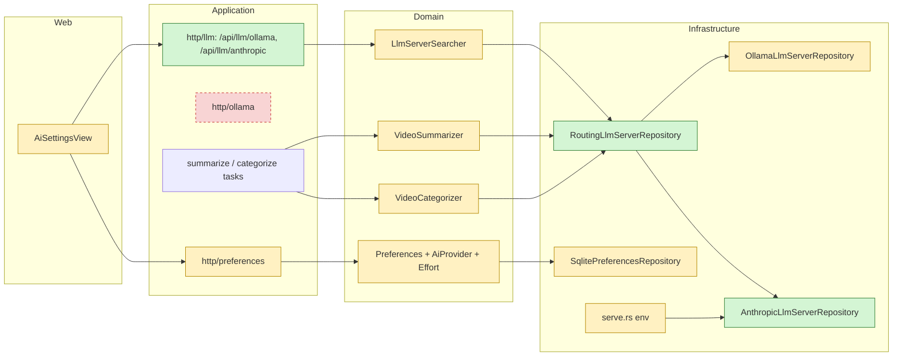

# Proposal

## Why

AI features (summaries, categorization) only run on a user-hosted Ollama
server. That means owning hardware that can run a model, and small local
models are slow: the evals average about 5 minutes per summary with
`qwen3:4b`. Letting users run the same features on Anthropic's API with their
own key removes the hardware requirement. Users can also pick a stronger model
at a known cost (Haiku: about $0.003 per summary).

Depends on `add-anthropic-evals`. Its results confirm the default model
(`claude-haiku-5-5`) and default effort (`medium`) assumed here.

## What Changes

- **Provider choice.** A new `ai_provider` preference, `ollama` (default) or
  `anthropic`. One provider serves every AI feature, and the model is still
  chosen per feature.
- **API key from the environment.** `YARRTUBE_ANTHROPIC_API_KEY` holds the
  key. The key is never stored in the database, never accepted over HTTP, and
  never returned.
  - A read-only `anthropic_available` preference tells the web UI whether a
    key is set. Without one, Anthropic is not offered.
  - Picking `anthropic`, or turning AI on with it, while no key is set is
    rejected.
- **Separate settings per provider.** The existing Ollama settings stay as
  they are. New per-feature Anthropic settings:
  - `anthropic_summaries_model` and `anthropic_categorization_model`, default
    `claude-haiku-5-5`
  - `anthropic_summaries_effort` and `anthropic_categorization_effort`,
    `low`/`medium`/`high`, default `medium`
  - Prompts stay shared between providers.
- **Anthropic calls.** They send the model, effort, `max_tokens`, `system`,
  the user message and, for categorization, the JSON schema as structured
  output.
  - No temperature (the API rejects it), no context length, and the model's
    default adaptive thinking.
  - The context used for the input budget is the model's context window,
    capped at 131072 tokens.
  - The categorizer's "retry without thinking" step never applies.
- **Model list.** `GET /api/llm/anthropic` lists the models the key can use,
  from Anthropic's `GET /v1/models`, newest first.
  - The saved model id is pinned exactly. A saved id the API no longer lists
    shows `(not available)` in the picker.
  - Before a run, a model that isn't listed makes the run wait 6 hours, as an
    uninstalled Ollama model does.
- **BREAKING (HTTP API).** `GET /api/ollama?url=` moves to
  `GET /api/llm/ollama?url=` with the same contract. The web UI is the only
  client.
- **Errors reuse the Ollama retry strategy.** Each Anthropic outcome maps to an
  existing class:
  - Re-queue in 6 hours without spending an attempt: can't connect, 401/403,
    404 for an unknown model, credit balance too low, no key set.
  - Server fault, a failed attempt that never leads to Failed on its own:
    429, 5xx, 529.
  - Rejected call: `stop_reason: max_tokens`, `stop_reason: refusal`, 400
    "prompt is too long", any other 400, an empty answer.
- **Failed resets.** Changing the provider, or any Anthropic summary or
  categorization setting, resets Failed summaries and `failed` verdicts, as an
  Ollama URL or settings change does.
- **AI page.** The "Ollama" section becomes "Provider":
  - an Ollama / Anthropic choice, shown only when a key is set
  - the Ollama URL field while Ollama is selected
  - "Test connection" for either provider
  - For Anthropic, each feature section shows "Model" (the Anthropic list) and,
    under "Advanced", "Effort" and "Prompt". Context length, temperature and
    thinking are not shown.
- **Docs.** `doc/INSTALLATION.md` (the env var), `doc/AI.md` (the provider,
  costs, error mapping) and `doc/ARCHITECTURE.md`.

## Capabilities

### New Capabilities

- `llm-connection`: checking the configured LLM provider (Ollama at a URL, or
  Anthropic with the env key), listing its models, and how each provider's
  replies and failures count (an answer, stopped at the limit, refused,
  unavailable, server fault). It replaces `ollama-connection`.

### Modified Capabilities

- `ollama-connection`: all requirements removed and moved to `llm-connection`
  under `GET /api/llm/ollama`.
- `preferences`:
  - new `ai_provider` and `anthropic_available`, plus the four Anthropic
    settings and their validation
  - "AI Needs An Ollama URL" applies only to Ollama, and AI on Anthropic needs
    a key set
- `ai-settings-ui`:
  - a Provider section with the provider choice and a test for either provider
  - the Anthropic model picker with `(not available)`
  - Effort under "Advanced"
  - the Ollama-only fields shown only for Ollama
- `video-summaries`:
  - "Summary Settings Sent To Ollama" applies only to Ollama
  - new "Summary Settings Sent To Anthropic"
  - "Ollama Unavailable" covers Anthropic being unavailable
  - "Failed Summaries Reset" covers the provider and the Anthropic settings
- `video-categorization`:
  - "Categorization Request Settings" applies only to Ollama
  - new "Categorization Request Settings For Anthropic"
  - "Ollama Unavailable For Categorization" and "Failed Verdicts Reset" cover
    Anthropic
- `video-retries`: "What Counts As A Failed Attempt" and "Waiting For Ollama"
  cover the Anthropic outcomes.

## Impact

- Rust domain:
  - `domain/llm_server`: the trait takes a provider connection instead of an
    `OllamaUrl`; models gain a context window; `LlmChat` gains effort
  - `domain/preferences`: `AiProvider`, `Effort`, Anthropic settings
  - `VideoSummarizer`, `VideoCategorizer`, `PreferencesUpdater`,
    `LlmServerSearcher`
- Rust infrastructure:
  - new `AnthropicLlmServerRepository` (raw `reqwest`; there's no Rust SDK)
  - a routing repository that picks the adapter by provider
  - the stored preferences JSON gains keys, so no SQL migration is needed
  - composition root and `serve.rs` env reading:
    `YARRTUBE_ANTHROPIC_API_KEY`, plus `YARRTUBE_ANTHROPIC_API_URL` for tests
- HTTP:
  - `application/http/ollama` becomes `application/http/llm` with
    `/api/llm/ollama` and `/api/llm/anthropic`
  - preferences DTOs
- Web:
  - `api/types.ts`, `api/client.ts`, `api/queries.ts`, the fixture builders
  - `AiSettingsView.tsx`, `lib/aiSettingsForm.ts` and their tests
- e2e: the AI settings spec follows the moved endpoint through the UI. No new
  e2e scenario: the Anthropic flows are covered by Vitest, Rust tests and an
  agent manual check.
- Contract suite: one ignored test against the real Anthropic API (lists
  models, one tiny call). It runs with `--contract` when the key is set.
- Cost: none unless the user picks Anthropic. Calls are billed to the user's
  key.

