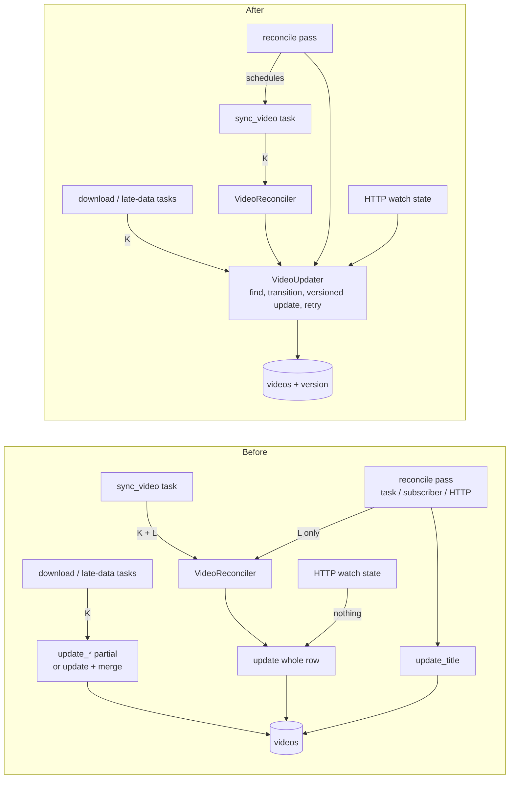

## Inventory: every writer of `videos`

Legend: **K** = task key `video:{id}`, **L** = `VideoLock`, **P** = column-specific write, **M** = merge-on-save (`with_watch_state_of`), **G** = re-read guard before writing (`record_unless_deleted`, `is_still_downloaded_as`), **—** = nothing.

| Service (method) | Entry point(s) | Columns written | Protected by |
|---|---|---|---|
| `VideoDownloader` (`start_download`, `mark_downloaded`/`errored`/`excluded` via `update`) | `download_video` task | whole row | K, M (watch fields only), G (deleted) |
| `VideoDownloader` / `ThumbnailFetcher` / `VideoRelocator` → `assign_episode_number` | the tasks below and the reconcile pass | `season`, `episode` | atomic single-statement write |
| `ThumbnailFetcher` (`update_thumbnail`) | `fetch_thumbnail` task | `thumbnail_filename` | K, P |
| `SubtitleFetcher` (`update_subtitles`) | `fetch_subtitles` task | subtitle state, file, checks | K, P, G |
| `ChapterFetcher` (`update_chapters`) | `fetch_chapters` task | chapters, checks, settled | K, P |
| `QualityUpgrader` (`update_quality`) | `upgrade_quality` task | quality, height, checks, settled | K, P, G |
| `VideoSummarizer` (`update_summary`) | `summarize_video` task | `summary_state` | K, P |
| `VideoReconciler` (`reset_for_redownload` via `update`) | `sync_video` task | whole row | K, L |
| same | reconcile pass (`reconcile_{channel,playlist}` task, `*Created` subscriber, HTTP force-reconcile) via `InternalVideoReconciler` | whole row | L only |
| `VideoRelocator` (`relocate_to_episode` via `update`) | reconcile pass and `sync_video` task (through `VideoReconciler`), `migrate-layout` CLI | whole row | L (inside a sync), nothing from the CLI |
| `Channel`/`PlaylistVideoReconciler` (`save` new, `update_title`, `delete`) | reconcile pass | insert, `title`, row delete | P (title) |
| `Channel`/`PlaylistDeleter` (`delete`) | HTTP `DELETE /channels`, `/playlists` | row delete | — |
| `VideoWatchStateUpdater` (`update_watch_state`, `mark_watched` via `update`, every copy of the YouTube video) | HTTP `POST /videos/{id}/progress`, `/watched`, `/{channels,playlists,categories}/{id}/watched` | whole row | **—** |
| `PreferencesUpdater` (`reset_unavailable_summaries`) | HTTP `PATCH /preferences` | `summary_state` (bulk) | single statement |

`VideoLock` is acquired in exactly one place, `VideoReconciler::reconcile`. The other files that name it only construct it. Category edits write `video_categories` and verdict rows, not `videos`, so they are out of scope (they keep `CategoryLock`). `ShowLocks` covers moving a source, not video rows, and is also out of scope.

## Real races today

1. **Progress POST loses late data** (frequent: progress is posted every few seconds, and late-data tasks run right after a download, when people start watching).
   `HTTP find(A)` → `fetch_subtitles: update_subtitles(A, Fetched)` → `HTTP update(A)` writes `subtitle_state = Missing` back. The `.srt` stays on disk but isn't recorded, so the next sync fetches it again. The same happens with chapters, thumbnail and quality. A reverted `downloaded_height` makes the next quality check download the whole video again.
2. **Mark-watched reverts another copy's download** (the most damaging).
   `HTTP find copies [B: InProgress]` → `download_video(B): assign_episode_number, update(Downloaded, filename)` → `HTTP update(B)` writes InProgress, `filename = NULL` and `episode = NULL` back. B is now "stranded": it gets downloaded again, and because it has no episode number any more, the orphan sweep deletes the mp4 that was just downloaded.
3. **Progress lost at the end of a download** (window of a few milliseconds).
   `download: find (merge watch)` → `HTTP update(progress)` → `download: update` loses the progress.
4. **Reconcile-pass relocation vs keyed late-data task.** The pass holds L but not K. `relocator: read A` → `fetch_subtitles(A): move .srt, update_subtitles` → `relocator: move files, update(A)` with a stale snapshot, so the subtitle columns are reverted and the `.srt` can be moved under it. This is rare (legacy layout only).
5. **Reconcile-pass reset vs quality upgrade.** `upgrade: is_still_downloaded_as = true` → `pass: reset_for_redownload(A) → Pending` → `upgrade: move file, update_quality` writes the height and `settled = true` onto a Pending row, and its new file is then swept as an orphan.

## Options

**(a) Only task keys.** Every mutation goes through a `video:{id}` task, `VideoLock` is dropped, and the whole entity is saved.
- + One mechanism, no schema change.
- − HTTP writes must stay synchronous, and a key is held for minutes (a download, an LLM call). A progress POST would either wait minutes, fail with 409, or bypass the key. Bypassing means a second mechanism again. This doesn't fix races 1–3.

**(b) Optimistic versions, and the reconcile pass schedules `sync_video` tasks** (recommended).
- + Covers every writer, HTTP included, with no waiting. There is one write path (`update` of the whole entity), so the skill's "save the entity" rule holds again. All six partial-update methods, `with_watch_state_of` and `VideoLock` go away. Fixes races 1–5. Responsibilities are separate: keys stop *work* from overlapping, versions stop *writes* from being lost.
- − A migration, a `version` field on the entity, and a typed stale-write error (a small deviation from the skill, see Decisions). Transitions must be pure so they can be re-applied. Reconcile passes queue per-video syncs instead of running them inline (see proposal Impact).
- Variant b′: versions only, keeping the inline reconcile and `VideoLock`. This is smaller, but race 4's filesystem overlap stays.

**(c) Document the partial updates as the rule** ("each concern writes only its columns"), and add `update_watch_state` and `update_location` partial writes.
- + Smallest diff, and it fixes races 1–3.
- − It writes the deviation from the skill into the rules. Every new field still asks which method owns it. Cross-concern transitions (`reset_for_redownload` touches download, subtitle, chapter and quality fields) still need whole-row writes and still race (races 4 and 5). `VideoLock` stays. Idea 8 becomes a partial-update method per `LateData<T>`.

## Write paths



## Interaction with idea 8 (`DownloadState` enum, `LateData<T>`)

This change comes first and makes 8 a pure domain refactor. With one versioned whole-row `update`, splitting `Video` into `DownloadState` and `LateData<T>` changes only the entity and row mapping, with no per-concern write methods to redesign. Under (c), 8 would need a partial write per `LateData<T>`. Under (b), `LateData<T>` transitions are plain closures passed to `VideoUpdater`. The `version` belongs to the aggregate, not to any sub-part, so it survives the split unchanged. If 8 also splits the storage into child tables (e.g. per late-data concern), `version` stays on the `videos` root row, and `update` writes the root and its child rows in one transaction, guarded by the root's version. Splitting a part into its own aggregate (own repository, own version) is possible later, but `reset_for_redownload` spans download and every late-data part, so they should stay one aggregate.

## Decisions

- The stale write is a domain error, `StaleVideo`, in `domain/video/errors.rs`. Infra raises it inside `anyhow`, and only `VideoUpdater` downcasts it. This is the one exception to "repositories return untyped errors", because retrying needs to tell this case apart.
- `VideoUpdater::update` takes `Fn(Video) -> Option<Video>`. Returning `None` declines the write, which replaces the ad-hoc row guards (for example, "already settled"). The closure must have no side effects: it may run more than once. Events and file moves happen after `update` returns. There are at most 5 attempts, then an error.
- `version` is part of `Video`'s derived equality, so tests asserting a stored video spell out its version.
- `is_still_downloaded_as` and `record_unless_deleted` stay. They guard *file* moves, not the row write.

## Files

- `migrations/0026_video_version.sql`: adds `videos.version INTEGER NOT NULL DEFAULT 0`.
- `src/domain/video/video.rs`: adds the `version` field and `with_title`, and removes `with_watch_state_of`.
- `src/domain/video/errors.rs`: adds `StaleVideo`.
- `src/domain/services/video_updater.rs`: the new service, find → transition → versioned update → retry.
- `src/domain/services/mod.rs`: exports `VideoUpdater`.
- `src/infrastructure/repositories/sqlite_video_repository.rs`: `save` becomes `insert`, `update` is versioned, the six `update_*` methods go, and `assign_episode_number` and `reset_unavailable_summaries` bump the version.
- `src/domain/services/{video_downloader,quality_upgrader,subtitle_fetcher,chapter_fetcher,thumbnail_fetcher,video_summarizer,video_relocator,video_reconciler,video_watch_state_updater,channel_video_reconciler,playlist_video_reconciler}.rs`: write through `VideoUpdater`.
- `src/domain/services/internal_video_reconciler.rs`: schedules `Task::SyncVideo` per video instead of calling `VideoReconciler`.
- `src/domain/services/video_reconciler.rs`: drops `VideoLock`.
- `src/domain/show/show_work.rs`: only a *running* `sync_video` blocks a show move, so the syncs a pass queues don't (source-relocation: a pending reconcile never blocks a move).
- `src/infrastructure/shared/video_lock.rs`: deleted. `src/infrastructure/shared/mod.rs` and `infrastructure_container.rs`: unwired.
- Test seeds in `src/application/**`: `save(` becomes `insert(`, and `VideoLock` construction is removed.

## Types & Signatures

```rust
// domain/video/video.rs
pub struct Video { /* ...existing... */ pub version: u32 }
impl Video {
    pub fn with_title(self, title: impl Into<String>, now: DateTime<Utc>) -> Self;
    /// The video as stored after one more `update`.
    pub fn next_version(self) -> Self;
}

// domain/video/errors.rs
#[derive(Debug, Clone, PartialEq, Eq)]
pub struct StaleVideo(pub VideoId); // impl Display + Error

// infrastructure/repositories/sqlite_video_repository.rs
pub trait VideoRepository: Send + Sync {
    /// Inserts a new video at version 0; fails if the id exists.
    fn insert(&self, video: &Video) -> anyhow::Result<()>;
    /// Stores every mutable column and bumps `version`, only if the stored
    /// version equals `video.version`; else fails with `StaleVideo`. A
    /// missing row is a no-op.
    fn update(&self, video: &Video) -> anyhow::Result<()>;
    fn assign_episode_number(&self, id: &VideoId, published_at: DateTime<Utc>)
        -> anyhow::Result<EpisodeNumber>;            // now also bumps version
    fn reset_unavailable_summaries(&self, now: DateTime<Utc>) -> anyhow::Result<()>; // bumps version
    // removed: save, update_title, update_subtitles, update_summary,
    //          update_thumbnail, update_chapters, update_quality
    // unchanged: find, find_many, delete, find_by_youtube_id, list_downloaded,
    //            find_downloaded_by_title, next_episode_number
}

// domain/services/video_updater.rs
pub const MAX_UPDATE_ATTEMPTS: usize = 5;
pub struct VideoUpdater { video_repository: Arc<dyn VideoRepository> }
impl VideoUpdater { pub fn new(video_repository: Arc<dyn VideoRepository>) -> Self; }
pub trait VideoUpdaterApi: Send + Sync {
    /// Applies `transition` to the stored video and stores the result,
    /// re-reading and re-applying when another writer stored first.
    /// `Ok(None)` if the video is gone or `transition` declines.
    fn update<F>(&self, id: &VideoId, transition: F) -> anyhow::Result<Option<Video>>
    where F: Fn(Video) -> Option<Video>;
}

// domain/services/internal_video_reconciler.rs
impl InternalVideoReconciler {
    pub fn new(
        video_repository: Arc<dyn VideoRepository>,
        video_file_repository: Arc<dyn VideoFileRepository>,
        task_repository: Arc<dyn TaskRepository>,   // replaces video_reconciler
        clock: Arc<dyn Clock>,
        videos_path: impl Into<String>,
    ) -> Self;
}
// VideoReconciler::new loses `video_lock: Arc<VideoLock>`.
```

## Call Stack

**Progress POST** `record_video_progress(id, position, duration, was_watched)` → `VideoWatchStateUpdater::update` → `find_copies(id)` → for each copy, `VideoUpdater::update(copy.id, |v| Some(v.update_watch_state(position, duration, was_watched, now)))` → loop { `repo.find` → transition → `repo.update` (on `StaleVideo`, retry) }. `mark_*_watched` works the same way with `mark_watched(now)`.

**Download** `download_video` task → `VideoDownloader::download(id, quality, dir, last)` → `VideoUpdater::update(id, |v| (!v.is_download_settled()).then(|| v.start_download(now)))` → yt-dlp → `assign_episode_number` → move files → `VideoUpdater::update(id, |v| Some(v.mark_downloaded(..).with_episode_number(..).record_downloaded_quality(..)))` → publish `VideoDownloaded`. Errors go through `update(id, |v| Some(v.mark_errored*/mark_excluded(now)))`.

**Late data** `fetch_{thumbnail,subtitles,chapters}` / `upgrade_quality` / `summarize_video` task → fetcher → (file moves) → `VideoUpdater::update(id, |v| Some(v.with_thumbnail | mark_subtitles_fetched | record_*_check | record_downloaded_quality | mark_summary_*(..)))`.

**Reconcile pass** `reconcile_channel` task / `ChannelCreated` subscriber / `POST /channels/{h}/reconcile` → `ChannelVideoReconciler::{reconcile,initial_reconcile,force_reconcile}(id)` → `sync_membership_with_youtube` (`repo.insert` new; `VideoUpdater::update(id, |v| Some(v.with_title(t, now)))`; `repo.delete`) → `InternalVideoReconciler::reconcile(desired)` → for each id, `task_repository.schedule(Task::SyncVideo { video_id }, now)` → orphan sweep. Playlists work the same way.

**Sync** `sync_video` task (K) → `VideoReconciler::reconcile(id)` (no lock) → `reset_if_broken` / `recover_if_due` → `VideoUpdater::update(id, |v| Some(v.reset_for_redownload(now)))`. `repair_metadata` → `VideoRelocator::relocate` → `VideoUpdater::update(id, |v| Some(v.relocate_to_episode(..)))` → `schedule_steps`.

## Test Plan

**1. Behaviour tests (application layer)**
1. `reconcile_channel_task::it_should_schedule_a_sync_of_every_stored_video`: after the pass, `list_non_completed()` holds one `SyncVideo` per stored video, and each video row is unchanged.
2. `reconcile_playlist_task::it_should_schedule_a_sync_of_every_stored_video`: the same, for a playlist.
3. `reconcile_channel_task::it_should_leave_a_broken_video_to_its_sync`: a Downloaded video with a missing file stays Downloaded after the pass, and its `SyncVideo` is scheduled. This replaces the inline-reset assertions.
4. `reconcile_playlist_task::it_should_schedule_one_sync_of_a_video_added_by_the_pass`: one pending `SyncVideo` for the new video.
5. `reconcile_channel_task::it_should_keep_download_fields_when_refreshing_title`: a download is recorded during the fake listing, and afterwards the row has the download's status and file plus the new title.
6. `sync_video_task::it_should_reset_a_broken_video`: reset to Pending, with a thumbnail fetch and a download scheduled. This is a regression test, now without `VideoLock`.
7. `download_video_task::it_should_keep_watch_state_recorded_during_download`: a watch update in the `on_download` hook is kept, with `with_watch_state_of` gone.
8. `download_video_task::it_should_skip_if_video_deleted_during_download`: a row deleted in the hook stays absent.
9. `upgrade_quality_task::it_should_keep_watch_progress_recorded_while_upgrading`: a progress update in the `on_download` hook, and afterwards the row has both the progress and the new height.
10. `fetch_subtitles_task::it_should_keep_watch_progress_recorded_while_fetching`: the same, for subtitles.
11. `fetch_chapters_task::it_should_keep_watch_progress_recorded_while_fetching`: the same, for chapters (`on_fetch` hook).
12. `summarize_video_task::it_should_keep_watch_progress_recorded_while_summarizing`: the same, for the summary (`on_chat` hook).
13. `http::videos::it_should_record_progress_on_every_copy_keeping_their_download_fields`: two copies, one Downloaded and one InProgress with a file and episode recorded. After the POST, both have the position and keep their status and file.

**Behaviour tests (domain service, justified: retry is unreachable from an adapter)**

14. `video_updater::it_should_apply_the_transition_on_top_of_a_concurrent_write`: the first call of the transition stores a concurrent change, and the result has both changes at version + 2.
15. `video_updater::it_should_skip_if_the_video_is_gone`: `Ok(None)`, and no row.
16. `video_updater::it_should_skip_if_the_transition_declines`: `Ok(None)`, and the row and version are unchanged.
17. `video_updater::it_should_fail_if_the_video_keeps_changing`: every attempt is made stale, giving `Err` after `MAX_UPDATE_ATTEMPTS`.

**2. Infrastructure tests (`SqliteVideoRepository`)**

18. `it_should_insert_a_new_video_at_version_zero`.
19. `it_should_fail_to_insert_an_existing_video`.
20. `it_should_bump_the_version_on_update`.
21. `it_should_fail_to_update_a_stale_video`: `StaleVideo` can be downcast from the error, and the row is unchanged.
22. `it_should_not_recreate_a_deleted_video_on_update`.
23. `it_should_bump_the_version_when_assigning_an_episode_number`.
24. `it_should_bump_the_version_when_resetting_unavailable_summaries`.
