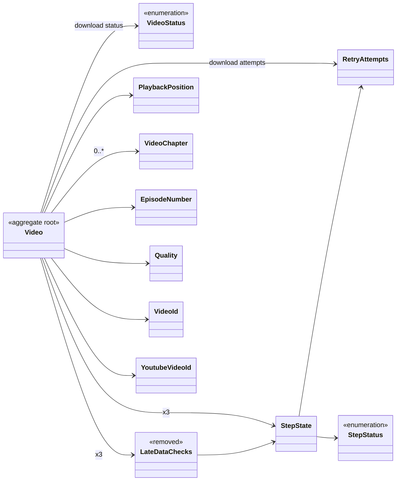
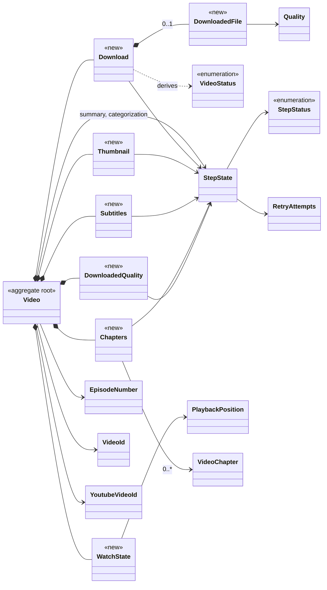

# Design

Behaviour-preserving. Same table, columns, stored values, `version`
semantics, API bytes. Concrete types only: no generic step wrapper, some
duplication accepted (late-data `record`/`is_due`/`retry` exist three times,
in `Subtitles`, `Chapters`, `DownloadedQuality`).

## Files

- `src/domain/video/video.rs`: `Video` becomes the aggregate root over the
  value objects below; keeps cross-concern transitions and reads only.
- `src/domain/video/download.rs`: `Download`, the download step (`StepState`
  + `started` + failure reason + file).
- `src/domain/video/downloaded_file.rs`: `DownloadedFile`, what a finished
  download recorded (filename, quality tier, duration).
- `src/domain/video/thumbnail.rs`: `Thumbnail`, the thumbnail step + its file.
- `src/domain/video/subtitles.rs`: `Subtitles`, late-data step + subtitle file.
- `src/domain/video/chapters.rs`: `Chapters`, late-data step + found chapters.
- `src/domain/video/downloaded_quality.rs`: `DownloadedQuality`, late-data
  step + downloaded height.
- `src/domain/video/watch_state.rs`: `WatchState`, watched/position/played.
- `src/domain/video/late_video_data.rs`: `YOUNG_FOR`, `RECHECK_AFTER`
  (constants only, moved from `late_data_checks.rs`).
- `src/domain/video/late_data_checks.rs`: deleted.
- `src/domain/video/video_fixtures.rs` (`#[cfg(test)]`): every test-only
  `Video` / value-object constructor, moved out of production files.
- `src/domain/video/mod.rs`: module list and re-exports.
- `src/infrastructure/repositories/sqlite_video_repository.rs`: `row_to_video`
  and the INSERT/UPDATE params map flat columns to/from the value objects.
- `src/application/http/videos/dto.rs`: `StepResponse` and `VideoResponse`
  read the new paths; output unchanged.
- `src/domain/video/{video_sync_plan,home_video_view}.rs`,
  `src/domain/show/show_work.rs`, `src/domain/services/*.rs` (downloader,
  thumbnail_fetcher, subtitle_fetcher, chapter_fetcher, quality_upgrader,
  video_summarizer, video_categorizer, categorization_resetter,
  video_reconciler, internal_video_reconciler, video_relocator,
  layout_migrator, video_watch_state_updater, video_searcher, *_view_searcher,
  category_video_collector, subtitle_reader, *_video_reconciler,
  plex_label_syncer, video_retrier): field paths and moved reads only.
- `src/domain/video_category/categorization_question.rs`,
  `src/domain/video_summary/summary_input.rs`: field paths only
  (`download.duration_seconds()`, `chapters.found`).
- Test modules under `src/application/**` and repository tests: construction
  of seeded/expected videos only.
- `scripts/run-tests.sh`, `CLAUDE.md`, `doc/DEVELOPMENT.md`: incidental
  tooling riding in this PR, not part of the refactor (the test script
  installs or builds what the repo produces itself when missing).

## Types & Signatures

### Field map (current field -> new home -> columns, unchanged)

| Current field | New home | Column(s) |
|---|---|---|
| `id`, `youtube_id`, `title` | `Video` | `id`, `youtube_id`, `title` |
| `created_at`, `updated_at`, `synced_at`, `version` | `Video` | same names |
| `episode_number` | `Video` | `season`, `episode` |
| `status` | `download.status()` (derived from `state` + `started`) | `status` |
| `download_attempts` | `download.state.attempts` | `download_failed_attempts`, `last_errored_at` |
| `download_failure` | `download.failure` | `download_failure` |
| `filename` | `download.file.filename` | `filename` |
| `quality` | `download.file.quality` | `quality` |
| `duration_seconds` | `download.file.duration_seconds` | `duration_seconds` |
| `thumbnail` | `thumbnail.state` | `thumbnail_status`, `thumbnail_failed_attempts`, `thumbnail_last_failed_at` |
| `thumbnail_filename` | `thumbnail.filename` | `thumbnail_filename` |
| `subtitles` (`LateDataChecks`) | `subtitles.state`, `subtitles.last_checked_at` | `subtitles_status`, `subtitles_failed_attempts`, `subtitles_last_checked_at` |
| `subtitle_filename` | `subtitles.filename` | `subtitle_filename` |
| `chapters_checks` | `chapters.state`, `chapters.last_checked_at` | `chapters_status`, `chapters_failed_attempts`, `chapters_last_checked_at` |
| `chapters` | `chapters.found` | `chapters` (JSON, NULL = never checked) |
| `quality_checks` | `downloaded_quality.state`, `.last_checked_at` | `quality_status`, `quality_failed_attempts`, `quality_last_checked_at` |
| `downloaded_height` | `downloaded_quality.height` | `downloaded_height` |
| `summary` | `summary: StepState` (unchanged) | `summary_*` |
| `categorization` | `categorization: StepState` (unchanged) | `categorization_*` |
| `watched_at` | `watch.watched_at` | `watched_at` |
| `playback_position` | `watch.position` | `playback_position_seconds` |
| `last_played_at` | `watch.last_played_at` | `last_played_at` |

`status` mapping: read `IN_PROGRESS` -> `started: true`, `state.status` =
`Retrying` if `download_failed_attempts > 0` else `Pending`; `DOWNLOADED` <->
`Done`; others same name. `file` is `Some` when `filename` and `quality` are
both set (see tasks 5.1 pre-flight: no row has one without the other, nor a
file on a non-`DOWNLOADED` row).

### Before / after (types)

Same aggregate, same id, same `videos` row: the types `Video` is made of
change, not the entity. Field-level detail is in the field map above.

Before: `Video` holds loose values plus three shared step types.



After: `Video` owns one type per concern; `LateDataChecks` is gone and
`VideoStatus` is derived by `Download`, no longer stored.



Download step: `StepState` semantics plus `started` (In Progress) on top of
Pending/Retrying.

```mermaid
stateDiagram-v2
  [*] --> Pending
  Pending --> InProgress: start()
  Retrying --> InProgress: start() (attempts kept)
  InProgress --> Done: succeed(file)  [DOWNLOADED]
  InProgress --> Retrying: fail(reason, now)
  InProgress --> Failed: fail() on attempt 11
  Retrying --> Pending: retry()
  Failed --> Pending: retry()
  Pending --> Unavailable: unavailable()
  InProgress --> Unavailable: unavailable()
  Retrying --> Unavailable: unavailable()
  Done --> Pending: Video::reset_for_redownload
  note right of InProgress
    started = true over Pending/Retrying
    is_due = true, next_attempt_at = None
    retry() leaves it unchanged
  end note
```

### New types

```rust
// download.rs
pub struct Download {
    pub state: StepState,
    /// In Progress: running on top of a Pending or Retrying state.
    pub started: bool,
    /// Why the last attempt failed; kept while started, cleared on success,
    /// unavailable and retry.
    pub failure: Option<String>,
    /// Some only once Done.
    pub file: Option<DownloadedFile>,
}
impl Download {
    pub fn pending() -> Self;
    pub fn status(&self) -> VideoStatus;
    pub fn is_downloaded(&self) -> bool;
    pub fn is_due(&self, now: DateTime<Utc>) -> bool;              // started || state.is_due
    pub fn next_attempt_at(&self) -> Option<DateTime<Utc>>;       // None while started
    pub fn is_in_legacy_layout(&self) -> bool;
    pub fn filename(&self) -> Option<&str>;                       // file's, once Done
    pub fn duration_seconds(&self) -> Option<i64>;                // file's, once Done and known
    pub fn start(self) -> Self;
    pub fn succeed(self, file: DownloadedFile) -> Self;
    pub fn fail(self, reason: impl Into<String>, now: DateTime<Utc>) -> Self;
    pub fn unavailable(self) -> Self;
    pub fn retry(self) -> Self;                                    // unchanged while started
    pub fn with_file(self, file: Option<DownloadedFile>) -> Self;
}

// downloaded_file.rs
pub struct DownloadedFile {
    pub filename: String,
    pub quality: Quality,
    pub duration_seconds: Option<i64>,
}
impl DownloadedFile {
    pub fn is_in_legacy_layout(&self) -> bool;
    pub fn with_filename(self, filename: impl Into<String>) -> Self;
    pub fn with_quality(self, quality: Quality) -> Self;
}

// thumbnail.rs
pub struct Thumbnail {
    pub state: StepState,
    pub filename: Option<String>,
}
impl Thumbnail {
    pub fn pending() -> Self;
    pub fn basename(&self) -> Option<String>;
    pub fn succeed(self, filename: impl Into<String>) -> Self;
    /// A download's thumbnail, else the one fetched ahead; Done if either.
    pub fn record_download(self, filename: Option<String>) -> Self;
    pub fn fail(self, now: DateTime<Utc>) -> Self;
    pub fn retry(self) -> Self;
    pub fn with_filename(self, filename: Option<String>) -> Self;  // relocation
}

// subtitles.rs
pub struct Subtitles {
    pub state: StepState,
    pub last_checked_at: Option<DateTime<Utc>>,
    pub filename: Option<String>,
}
impl Subtitles {
    pub fn pending() -> Self;
    pub fn language(&self) -> Option<String>;                      // only while Done
    pub fn is_due(&self, now: DateTime<Utc>) -> bool;
    pub fn is_unsettled(&self) -> bool;
    pub fn fetched(self, filename: impl Into<String>, now: DateTime<Utc>) -> Self;
    pub fn record_check(self, outcome: LateDataOutcome, published_at: DateTime<Utc>, now: DateTime<Utc>) -> Self;
    pub fn retry(self) -> Self;
}

// chapters.rs
pub struct Chapters {
    pub state: StepState,
    pub last_checked_at: Option<DateTime<Utc>>,
    /// None = never checked, Some(vec![]) = checked, none found.
    pub found: Option<Vec<VideoChapter>>,
}
impl Chapters {
    pub fn pending() -> Self;
    pub fn is_due(&self, now: DateTime<Utc>) -> bool;
    pub fn is_unsettled(&self) -> bool;
    /// Some non-empty = Complete, Some([]) = Incomplete, None = Failed (keeps found).
    pub fn record_check(self, found: Option<Vec<VideoChapter>>, published_at: DateTime<Utc>, now: DateTime<Utc>) -> Self;
    pub fn retry(self) -> Self;
    /// Checks back to Pending, never checked; found chapters kept (redownload).
    pub fn reset_checks(self) -> Self;
}

// downloaded_quality.rs
pub struct DownloadedQuality {
    pub state: StepState,
    pub last_checked_at: Option<DateTime<Utc>>,
    pub height: Option<u32>,
}
impl DownloadedQuality {
    pub fn pending() -> Self;
    pub fn is_due(&self, now: DateTime<Utc>) -> bool;
    pub fn is_unsettled(&self) -> bool;
    /// Overwrites height (even with None); degraded = Failed check.
    pub fn record_download(self, quality: Quality, height: Option<u32>, degraded: bool, published_at: DateTime<Utc>, now: DateTime<Utc>) -> Self;
    pub fn record_check(self, probed_height: Option<u32>, published_at: DateTime<Utc>, now: DateTime<Utc>) -> Self;
    pub fn retry(self) -> Self;
}

// watch_state.rs
pub struct WatchState {
    pub watched_at: Option<DateTime<Utc>>,
    pub position: PlaybackPosition,
    pub last_played_at: Option<DateTime<Utc>>,
}
impl WatchState {
    pub fn unwatched() -> Self;
    pub fn is_watched(&self) -> bool;
    pub fn is_in_progress(&self, now: DateTime<Utc>) -> bool;
    pub fn mark_watched(self, now: DateTime<Utc>) -> Self;
    /// Body of today's update_watch_state, given the known duration.
    pub fn record_playback(self, position: PlaybackPosition, duration_seconds: Option<i64>, was_watched: bool, now: DateTime<Utc>) -> Self;
}
```

### Video

```rust
pub struct Video {
    pub id: VideoId,
    pub youtube_id: YoutubeVideoId,
    pub title: String,
    pub episode_number: Option<EpisodeNumber>,
    pub download: Download,
    pub thumbnail: Thumbnail,
    pub subtitles: Subtitles,
    pub chapters: Chapters,
    pub downloaded_quality: DownloadedQuality,
    pub summary: StepState,
    pub categorization: StepState,
    pub watch: WatchState,
    pub created_at: DateTime<Utc>,
    pub updated_at: DateTime<Utc>,
    pub synced_at: Option<DateTime<Utc>>,
    pub version: u32,
}
```

Delegation rule: reads of one concern go to the concern
(`video.download.is_due(now)`); every write goes through a `Video` method
(it owns `updated_at`); `Video` keeps a read only when it spans concerns or
encodes a policy no concern owns.

| Video pub fn | Disposition |
|---|---|
| `create`, `with_title`, `next_version`, `with_episode_number` | kept |
| `start_download`, `mark_errored`, `mark_unavailable` | kept, delegate to `Download` |
| `mark_downloaded` | kept: `Download::succeed` + `Thumbnail::record_download` + `synced_at` |
| `retry` | kept: `retry()` on every concern |
| `reset_for_redownload` | kept: download/thumbnail/subtitles/downloaded_quality `pending()`, `chapters.reset_checks()`, `synced_at` None |
| `relocate_to_episode` | kept: `DownloadedFile::with_filename` + `Thumbnail::with_filename` + episode number |
| `record_downloaded_quality` | kept: `DownloadedFile::with_quality` + `DownloadedQuality::record_download` |
| `with_thumbnail`, `record_thumbnail_failure` | kept, delegate to `Thumbnail` |
| `mark_subtitles_fetched`, `record_subtitles_check` | kept, delegate to `Subtitles` |
| `record_chapters_check` | kept, delegates to `Chapters::record_check` |
| `record_quality_check` | kept, delegates to `DownloadedQuality` |
| `mark_summary_generated`, `record_summary_failure`, `mark_categorized`, `record_categorization_failure`, `reset_categorization` | kept |
| `update_watch_state` | kept: known duration from `download.file` + `WatchState::record_playback` (no `updated_at`, as today) |
| `mark_watched` | kept, delegates (no `updated_at`, as today) |
| `is_thumbnail_due`, `is_thumbnail_fetchable`, `is_subtitle_fetchable`, `is_chapters_fetchable`, `is_quality_checkable`, `is_summarizable`, `is_downloaded_and_unwatched`, `is_quick_watch` | kept (span concerns) |
| `is_categorization_due` | kept (policy: Done counts as due) |
| `is_download_due` | moved: `download.is_due` |
| `next_download_at` | moved: `download.next_attempt_at` |
| `is_downloaded` | moved: `download.is_downloaded` |
| `is_in_legacy_layout` | moved: `download.is_in_legacy_layout` |
| `thumbnail_basename` | moved: `thumbnail.basename` |
| `subtitle_language` | moved: `subtitles.language` |
| `is_watched`, `is_in_progress` | moved: `watch.*` |
| `is_categorizable` | deleted: `video.summary.status == StepStatus::Done` |
| `is_categorization_pending`, `is_categorization_failed`, `next_categorization_at` | deleted: read `video.categorization` |
| `mark_download_failed`, `mark_summary_failed`, `mark_categorization_failed`, `with_chapters`, `mark_subtitles_unavailable` (test) | moved to `video_fixtures.rs` |
| private `record_quality_outcome` | moved into `DownloadedQuality` |
| private `known_duration_seconds` | kept |

### Test fixtures (`video_fixtures.rs`, `#[cfg(test)]`)

```rust
pub fn downloaded_video(youtube_id: &str, filename: &str, now: DateTime<Utc>) -> Video;
impl Video {
    pub fn mark_download_failed(self, reason: &str, now: DateTime<Utc>) -> Self;
    pub fn mark_summary_failed(self, now: DateTime<Utc>) -> Self;
    pub fn mark_categorization_failed(self, now: DateTime<Utc>) -> Self;
    pub fn with_chapters(self, chapters: Vec<VideoChapter>, now: DateTime<Utc>) -> Self;
    pub fn mark_subtitles_unavailable(self, now: DateTime<Utc>) -> Self;
    pub fn map_file(self, change: impl FnOnce(DownloadedFile) -> DownloadedFile) -> Self;
    pub fn lasting(self, duration_seconds: Option<i64>) -> Self;
}
// Per type, only what the tests use (from today's LateDataChecks fixtures):
impl Subtitles { pub fn checked(at: Option<DateTime<Utc>>, failed: u32) -> Self; pub fn done_at(..) -> Self; pub fn unavailable_at(..) -> Self; }
impl Chapters { pub fn checked(..) -> Self; pub fn done_at(..) -> Self; }
impl DownloadedQuality { pub fn checked(..) -> Self; pub fn done_at(..) -> Self; }
```

## Call Stack

Download (`DownloadVideoTask` -> `VideoDownloader::download`):
- `find_downloadable`: `video.download.status()` settled check;
  `wait_for_next_attempt`: `video.download.next_attempt_at()`, reason from
  `video.download.failure`.
- `start_download` -> `VideoUpdater::update(id, |v| v.start_download(now))`
  -> `Download::start`.
- `record_downloaded(video_id, downloaded, files, quality, number)` ->
  `Video::mark_downloaded(quality, filename, thumbnail_filename, duration, now)`
  -> `Download::succeed(DownloadedFile{..})`, `Thumbnail::record_download(..)`
  -> `with_episode_number` -> `record_downloaded_quality(quality, height,
  degraded, published_at, now)` -> `DownloadedFile::with_quality`,
  `DownloadedQuality::record_download` -> `record_chapters_check(Some(ch),
  published_at, now)` -> `Chapters::record_check`.
- failure -> `Video::mark_errored(reason, now)` -> `Download::fail`;
  permanent -> `Video::mark_unavailable(now)` -> `Download::unavailable`.

Sync plan (`VideoReconciler` -> `VideoSyncPlan::for_video(video, ..)`):
`is_thumbnail_due(now)`, `download.is_due(now)`, `is_subtitle_fetchable() &&
subtitles.is_due(now)`, `is_chapters_fetchable() && chapters.is_due(now)`,
`is_quality_checkable() && downloaded_quality.is_due(now)`,
`is_summarizable() && summary.is_due(now)`, `is_categorization_due(now)`.

Retry (`POST /api/videos/{id}/retry` -> `VideoRetrier`):
`Video::retry(now)` -> `Download::retry`, `Thumbnail::retry`,
`Subtitles::retry`, `Chapters::retry`, `DownloadedQuality::retry`,
`StepState::retry` x2.

Watch (`PUT .../watch-state` -> `VideoWatchStateUpdater`):
`Video::update_watch_state(position, reported, was_watched, now)` ->
`WatchState::record_playback(position, known_duration, was_watched, now)`.

Persistence (`SqliteVideoRepository`):
`read_row` (unchanged) -> `row_to_video(row)` builds each value object
(`decode_download`, `decode_step`, `decode_late_step(status, failed,
last_checked_at) -> StepState`); `insert`/`update` params read
`video.download.status().as_str()`, `video.download.file.as_ref().map(..)`,
etc. Same 41 columns, same order.

API (`VideoResponse::from(VideoView)`): `status` <-
`download.status().as_str()`, `quality`/`filename`/`duration_seconds` <-
`download.file`, `thumbnail_filename` <- `thumbnail.filename`, `chapters` <-
`chapters.found`, `subtitle_language` <- `subtitles.language()`, `watched` /
`position_seconds` <- `watch`; `StepResponse::download(&Download)`, and
`From<StepState>` for the others (late-data steps pass `.state`).

## Test Plan

No acceptance or behaviour test changes its assertions; only how seeded and
expected `Video`s are built. Today's `video.rs` and `late_data_checks.rs`
unit tests move to the type that now owns the rule, same assertions.

1. Value object tests (moved, plus the download's new shape):
   - `watch_state`: moved watch-threshold tests if any; `video.rs` keeps
     `it_should_build_a_pending_video` etc. rewritten to new paths.
   - `subtitles` / `chapters` / `downloaded_quality`:
     `it_should_be_due_if_never_checked`,
     `it_should_be_due_once_a_day_has_passed_since_the_last_check`,
     `it_should_make_missing_data_unavailable_once_the_video_is_a_week_old`,
     `it_should_make_found_data_done_even_on_a_young_video` (from
     `late_data_checks.rs`, on `Subtitles`); `subtitle_language` test on
     `Subtitles`.
   - `download`: `it_should_stay_due_while_started`,
     `it_should_keep_its_attempts_when_started_from_retrying`,
     `it_should_leave_a_started_download_unchanged_on_retry`,
     `it_should_have_no_next_attempt_while_started`.
2. Infrastructure (`sqlite_video_repository`):
   - `it_should_round_trip_every_download_state`: Pending, In Progress from
     Pending, In Progress from Retrying (attempts + failure kept), Retrying,
     Failed, Downloaded with file, Unavailable.
   - existing round-trip tests (`step_state`, `late_data_checks`,
     `subtitle_checks`, chapters none/empty/some, quality, thumbnail,
     duration, watch) kept, rewritten to new paths.

Commit order (one PR, each commit green on `scripts/run-tests.sh --only web
--only rust`): 1. fixtures + `WatchState`; 2. `Subtitles`, `Chapters`,
`DownloadedQuality` (delete `LateDataChecks`); 3. `Thumbnail` + summary /
categorization reads; 4. `Download` + `DownloadedFile`.
