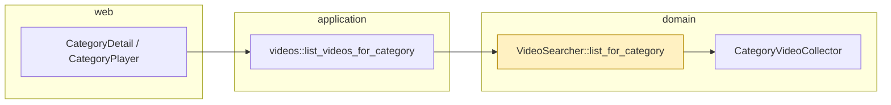

# Proposal

## Why

A category's videos are ordered by sync time (when yarrtube recorded them), not when YouTube published them, so a newly published video assigned to a category doesn't reliably appear on top of the category page.

## What Changes

- The category videos endpoint orders videos by publish time, newest first.
- A video without generated metadata (no known publish time) is ordered by its sync time instead.
- Home sections ("Latest", category sections) are unchanged.

## Capabilities

### New Capabilities

### Modified Capabilities
- `video-listing`: "List Videos For A Category" orders by publish time, falling back to sync time.

## Impact

- `src/domain/services/video_searcher.rs` (`list_for_category`).
- `GET /api/categories/{id}/videos` response order; the web UI category grid and player queue show it as returned.

