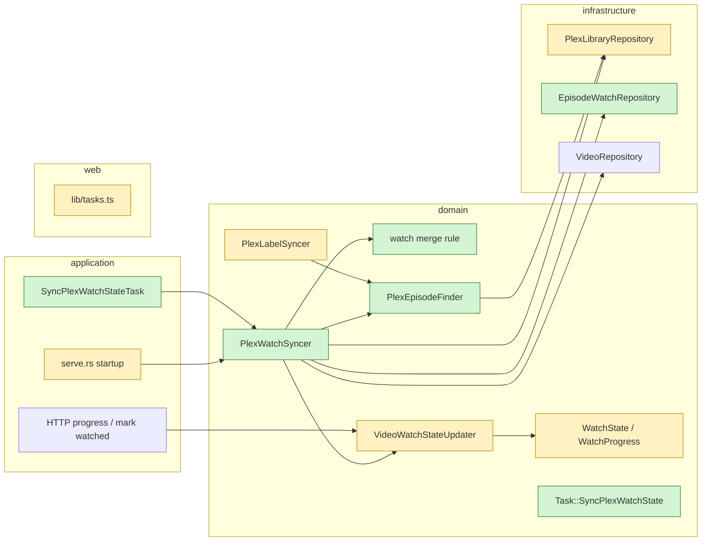

# Proposal

## Why

Watch state lives in two places that never talk: a video watched in Plex
still shows as unwatched (and in "Continue watching" at the wrong spot) in
the web UI, and a video watched in the web UI stays unwatched in Plex, its
smart playlists included. A spike against Plex Media Server confirmed that
the episode listing yarrtube already reads carries the token user's watch
state (`viewCount`, `viewOffset`, `lastViewedAt`), and that `/:/scrobble`,
`/:/unscrobble` and `/:/progress` set it, so the two can be kept in sync.

## What Changes

- When the Plex integration is configured (the same three variables as the
  scan trigger and labels), each downloaded video's watch state is kept in
  sync with its Plex episode, both ways: watched, unwatched, and where
  playback stopped. Watching in either place shows up in the other.
- Both sides reduce to one shared state per video: unplayed, in progress at
  a position, or watched. A **Plex watch sync** compares, per video, the
  yarrtube state, the Plex state and the state both last agreed on: the side
  that changed since is copied to the other; when both changed, the most
  recently played side wins.
- A change pulled from Plex applies to every stored copy of the YouTube
  video, like any watch change in yarrtube, and is then pushed to the Plex
  episodes of those other copies. Plex playback counts as played: it sets
  the last played time, so a video started in Plex shows under "Continue
  watching".
- A position of 30 seconds or less counts as unplayed on both sides, like
  yarrtube's own "Continue watching": a video sampled for a few seconds
  never lands in Plex's Continue Watching.
- What both sides last agreed on is tied to the Plex server and token:
  switching the token (e.g. to another Plex user) re-seeds from yarrtube
  and never unwatches anything in yarrtube.
- The sync runs every 5 minutes in the Plex task lane, and right away again
  while a backlog of changes remains. On the first sync after the upgrade,
  whatever was watched or started on either side is copied to the other.
- An episode Plex hasn't imported yet, an episode Plex re-imported under a
  new identity, or a Plex server that is down is handled like the label
  sync: retried by a later sync, never affecting downloads.
- The tasks view describes the new task in plain language (**Other** tab).
- `doc/PLEX.md` documents the watch sync and its limits.

Out of scope: other Plex users (managed/shared/Home users: only the token's
user is synced), Plex webhooks (instant sync), syncing play counts or the
watched date itself.

## Capabilities

### New Capabilities
- `plex-watch-sync`: keeping each downloaded video's watch state (watched,
  playback position) in sync with its Plex episode in both directions,
  conflict resolution, first-sync seeding, retries and failure handling.

### Modified Capabilities
- `watch-state`: a video's watch state and last played time can now also be
  set from Plex playback, not only by progress reports and marks in the web
  UI.

## Impact

- Schema: new migration with one table, the per-video state both sides
  last agreed on and the Plex episode it was agreed with.
- Domain: new `plex_watch` module (agreed state entity, pure merge rule),
  new shared `WatchProgress` value (unplayed / in progress / watched),
  `PlexEpisode` gains its watch state, new `PlexWatchSyncer` service,
  `Task::SyncPlexWatchState` in `TaskLane::Plex`; `VideoWatchStateUpdater`
  gains adopting a state from Plex; the Plex episode lookup moves out of
  `PlexLabelSyncer` into a shared service (no behaviour change).
- Infrastructure: `PlexLibraryRepository` reads episode watch fields and
  gains scrobble / unscrobble / progress calls; new SQLite repository.
- Application: `SyncPlexWatchStateTask`; daemon startup requests the sync.
- Web: task description for the watch sync.
- No API, DTO or environment variable change.

