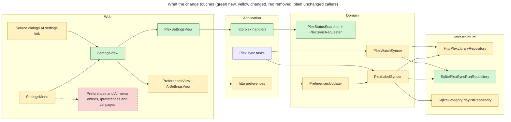

# Proposal

## Why

Settings are spread over two sibling pages (Preferences and AI), and the
Plex integration has none: whether it works, when it last synced and what
went wrong are only in the NAS logs, and the category playlists' behaviour
is fixed. Plex Web and the Mac app draw no watched badge on playlist items
(a long-standing Plex limitation), so a playlist that keeps watched
episodes can't show which ones they are; some users want them to drop out
instead.

## What Changes

- **One Settings page** with a section nav (left rail on desktop, tabs on
  phones) and one route per section: `/settings/general` (today's
  Preferences), `/settings/ai` (today's AI page, unchanged inside) and
  `/settings/plex` (new). `/settings` opens General; `/preferences` and
  `/ai` redirect to their sections. Each section keeps its own saving.
- The gear menu shows **Tasks**, **Settings** and **Report a bug**
  (Preferences and AI entries go). Links to `/ai` in the source dialogs
  point at `/settings/ai`. The theme stays in the header toggle.
- **Plex section**:
  - **Connection**, from what the latest Plex sync saw, never a live call
    when the page opens: reachable or the error, the Plex Media Server
    version, the libraries holding yarrtube's folders, and when that was.
    When Plex isn't configured: the three env vars and a link to
    `doc/PLEX.md`.
  - **Syncs**: for "Watch state" and "Labels & playlists": last run and
    its result or error, next run, running now, and a **Sync now** button
    that moves the pending sync to now (never a second one), disabled with
    "Syncing…" while it runs.
  - **Category playlists**: watched episodes **stay** (default, today's
    behaviour) or **drop out**, and order **newest first** (default) or
    **oldest first**. Greyed out while categories are off. Changing either
    replaces every category playlist on a label sync that runs at once.
- Each Plex sync records its outcome (finished at, error, Plex version,
  libraries found), so status survives restarts; the version comes from
  the `/identity` call the syncs already make.
- Playlists left from before #194 (unwatched-only, their query unknown)
  are replaced once by the first label sync after the upgrade.
- `doc/CATEGORIES.md` and `doc/PLEX.md` say the playlist options exist and
  that Plex Web and the Mac app show no watched badge in playlists.

Out of scope: Plex connection settings in the UI (URL, token and path stay
env-only), the Plex server name, toggles to turn the watch sync or the
playlists off, and moving the theme out of the header.

## Capabilities

### New Capabilities
- `plex-status`: what the Plex syncs record about each run, the Plex
  status endpoint, and requesting a sync now.
- `plex-settings-ui`: the Plex section of the Settings page.

### Modified Capabilities
- `web-ui`: the gear menu and the Settings page with its sections replace
  the Preferences view and its route; dialog links to the AI page move.
- `ai-settings-ui`: the AI page becomes the AI section at `/settings/ai`.
- `preferences`: two new preferences for the category playlists.
- `plex-category-labels`: playlists follow the two preferences and are
  replaced when they change or when their query is unknown.

## Impact

- API: new `GET /api/plex` and `POST /api/plex/syncs/{kind}`;
  `GET/PATCH /api/preferences` gain `plex_playlist_watched` and
  `plex_playlist_order`.
- Domain: `PlexWatchSyncer` and `PlexLabelSyncer` record each run; the
  label syncer reads the playlist preferences; the preferences updater
  requests a label sync when they change; new `PlexStatusSearcher` and
  `PlexSyncRequester`.
- Infrastructure: `PlexLibraryRepository::server_id`/`viewer_id` become
  one `identity()` carrying the version; `create_smart_playlist` takes the
  playlist options; new `plex_sync_runs` table; `category_playlists`
  stores each playlist's options.
- Web: new `SettingsView` shell and `PlexSettingsView`; `PreferencesView`
  and `AiSettingsView` move under it; `SettingsMenu`, routes in `App.tsx`,
  dialog links.
- Users: `/preferences` and `/ai` bookmarks keep working (redirect).
  Existing playlists are replaced once after the upgrade, so a playlist
  pinned in a Plex client may need pinning again.

