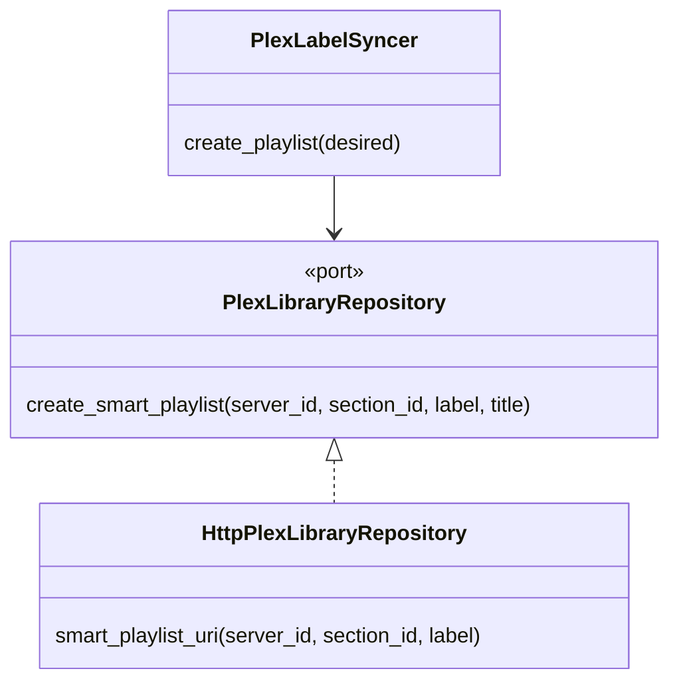
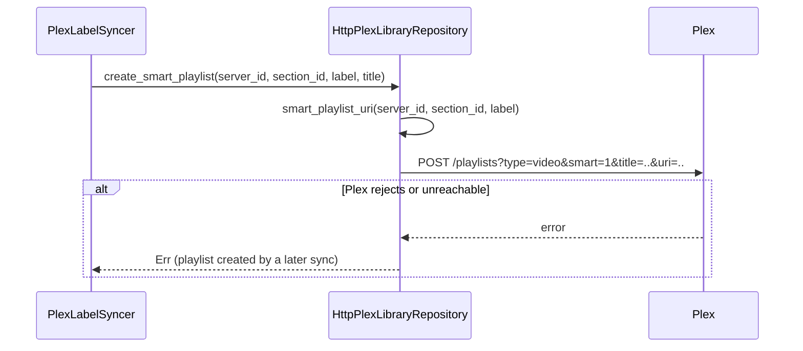

# Design

## Diagrams





## Types & Signatures

```rust
// src/infrastructure/repositories/plex_library_repository.rs
/// The section's episodes labelled `label`, watched or not, newest air
/// date first, then highest episode number first.
/// `…/all?type=4&episode.label={label}&sort=originallyAvailableAt%3Adesc%2Cindex%3Adesc`
fn smart_playlist_uri(server_id: &str, section_id: &str, label: &str) -> String;
```

## Call Stack

**Playlist creation** (unchanged except the URI) — `PlexLabelSyncer::reconcile_playlists` → `create_playlist(desired)` → `PlexLibraryRepository::create_smart_playlist(&server_id, &section_id, &label, &title)` → `smart_playlist_uri(server_id, section_id, label)` → `POST /playlists`.

**Upgrade** — user deletes a category playlist in Plex → next label sync: `stored_playlists()` puts its row in `gone` → row deleted → `create_playlist` recreates it with the new URI (existing behaviour, `it_should_recreate_a_playlist_deleted_in_plex`).

## Test Plan

Behaviour tests: none new; the existing `sync_plex_labels_task` suite (notably `it_should_recreate_a_playlist_deleted_in_plex`) runs as a regression.

Infrastructure tests — `src/infrastructure/repositories/plex_library_repository.rs` (mockito):
1. `it_should_create_a_smart_playlist_filtered_by_label` (existing, updated) — exact `uri` is `…/sections/19/all?type=4&episode.label=Sci%20%26%20Tech&sort=originallyAvailableAt%3Adesc%2Cindex%3Adesc`, no `episode.unwatched`.
