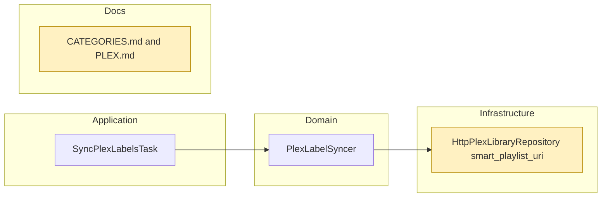

# Proposal

## Why

A category's Plex smart playlist lists only its unwatched episodes, while
the web UI's category page lists every downloaded video, watched or not.
The two views of the same category disagree: a video watched in either
place vanishes from Plex but stays in the web UI. Their order disagrees
too: Plex sorts by air date, a day with no time, so a channel's same-day
episodes come out in an arbitrary order, where the web UI orders by exact
publish time.

## What Changes

- Each category smart playlist lists **every** labelled episode of its
  library, watched or not; Plex shows each one's watched / in-progress
  state, which the watch sync already keeps in line with yarrtube.
- The playlist sorts newest air date first, then **highest episode number
  first**, so a channel's same-day episodes (`MMDDii`) come newest first.
  Episodes of different shows on the same day stay in Plex's order (the
  NFO air date has no time).
- Only playlists created from now on use the new query. Existing ones keep
  the old one until deleted in Plex: the next label sync recreates a
  deleted playlist (existing behaviour) with the new query.
- `doc/CATEGORIES.md` and `doc/PLEX.md` stop saying watched episodes leave
  the playlists.

Out of scope: replacing existing playlists automatically, one copy per
YouTube video in Plex (a video tracked by a channel and a playlist of the
category is still two episodes), sub-day ordering across shows.

## Capabilities

### New Capabilities
<!-- None. -->

### Modified Capabilities
- `plex-category-labels`: playlists list watched episodes too and sort
  same-day episodes newest first.

## Impact

- Infrastructure: `smart_playlist_uri` in
  `src/infrastructure/repositories/plex_library_repository.rs` drops
  `episode.unwatched=1` and sorts `originallyAvailableAt:desc,index:desc`.
- Docs: `doc/CATEGORIES.md` (In Plex), `doc/PLEX.md` (Watch state).
- Users: existing playlists stay unwatched-only until deleted in Plex, then
  come back with the new query within 15 minutes.

