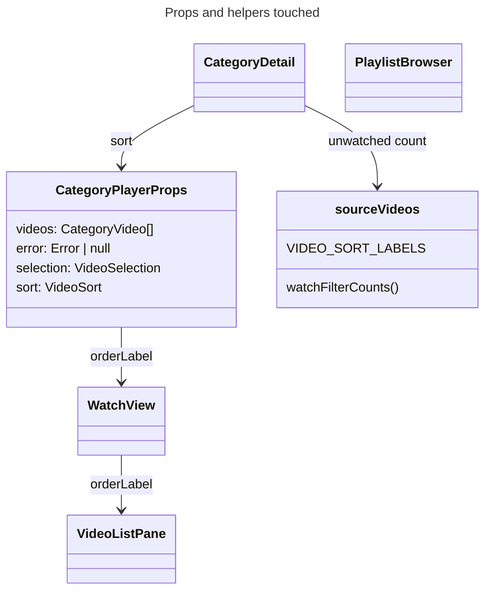
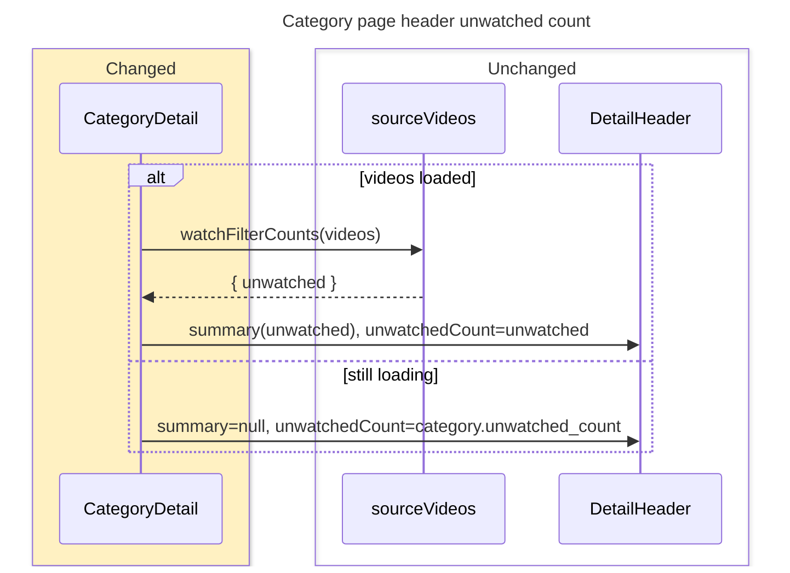

# Design

## Diagrams

Colours: green = new, yellow = changed, red = removed, plain = unchanged.





## Types & Signatures

```ts
// web/src/components/CategoryPlayer.tsx
interface CategoryPlayerProps {
  videos: CategoryVideo[] | undefined
  error: Error | null
  selection: VideoSelection<CategoryVideo>
  /** The order `videos` is in, named in the queue header. */
  sort: VideoSort
}
```

No other signature changes.

## Call Stack

1. Queue order label: `CategoryDetail` → `<CategoryPlayer sort={sort}>` → `WatchView orderLabel={VIDEO_SORT_LABELS[sort].toLowerCase()}` → `VideoListPane`.
2. Failed refresh: `PlaylistBrowser` / `CategoryDetail` render the error only when `error && !videos`; otherwise the loaded videos.
3. Queue position: `VideoListPane` computes `position = shown.findIndex(selected)` and total `shown.length`.
4. Header count: `CategoryDetail` → `unwatched = videos ? watchFilterCounts(videos).unwatched : category.unwatched_count` → `sourceSummary({ unwatchedCount: unwatched })` and `DetailHeader unwatchedCount={unwatched}`.

Bug 4 decision: `playlist-crud` says a hidden playlist adds nothing to *category unwatched counts*; that is the sidebar badge's number and stays as is. The category page header counts what it lists, like the playlist header that shows hidden counts and "Confirm Bulk Mark Watched", which counts hidden videos too. Backend unchanged.

## Test Plan

Vitest, mockApi only. One test = one red-green cycle.

1. `CategoryDetail.test.tsx` — "names the remembered order in the queue header": "Oldest first" remembered, playing the oldest video → queue reads "1 of 3 · oldest first".
2. `PlaylistDetail.test.tsx` — "keeps the loaded videos when a refresh fails": videos route succeeds then returns 500; after refetch the cards remain and "Failed to load videos" is absent.
3. `CategoryDetail.test.tsx` — "keeps the loaded videos when a refresh fails": same for a category.
4. `PlaylistDetail.test.tsx` (or the existing queue tests) — "counts only listed rows in the queue position with watched hidden": 3 watched + 2 unwatched, "Hide watched" on, playing the first unwatched → "1 of 2 · playlist order".
5. `CategoryDetail.test.tsx` — "counts unwatched videos of hidden playlists in the header": `unwatched_count` 1 from the API, 2 unwatched videos listed → meta line "… · 2 unwatched · …", matching the chip.
6. `CategoryDetail.test.tsx` — "confirms marking every listed unwatched video": same fixture, "Mark all watched" → "Mark 2 videos in "<name>" watched?".
