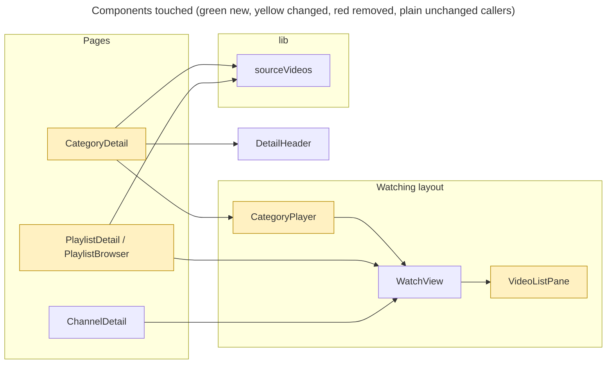

# Proposal

## Why

An audit of the source pages redesign (#202) found four small web UI bugs: the category queue always claims "newest first", a failed background refresh blanks a loaded playlist or category grid, the queue position counts rows hidden by "Hide watched", and a category's header unwatched count disagrees with its own "Unwatched" chip when a member playlist hides its count.

## What Changes

- The category watching queue's header names the order actually used ("newest first" or "oldest first"), from the category's remembered sort.
- The playlist and category browse pages keep their loaded videos on screen when a background refresh fails; the error shows only when nothing has loaded.
- The queue's "<i> of <n>" counts only the listed rows: with "Hide watched" on, hidden rows are left out of both numbers.
- A category page's header counts every downloaded, unwatched video it lists, including those from playlists whose unwatched count is hidden, matching its "Unwatched" chip and the "Mark all watched" confirmation. The sidebar category badge keeps leaving hidden playlists out (unchanged; backend untouched).

## Capabilities

### New Capabilities

### Modified Capabilities
- `web-ui`: "Watching Queue" (position among listed rows), "Category View" (header unwatched count includes hidden playlists; a failed refresh keeps the grid), "Category Playback" (queue order label follows the sort), plus a new requirement that the playlist and category browse pages keep loaded videos on a failed refresh.

## Impact

- `web/src/components/CategoryPlayer.tsx`, `CategoryDetail.tsx`, `PlaylistDetail.tsx`, `VideoListPane.tsx` and their tests.
- No API, backend or DTO change.

