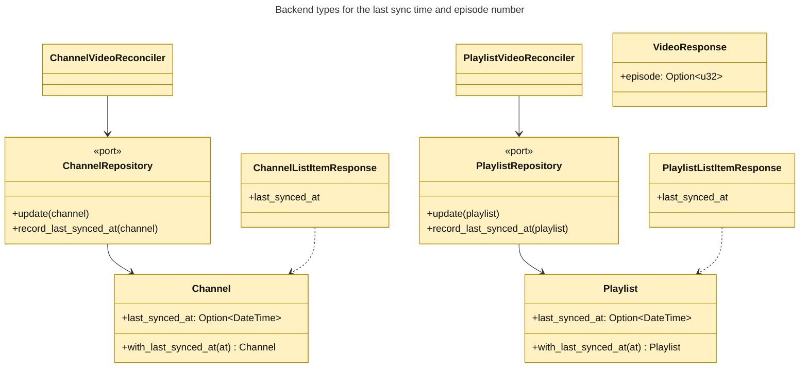
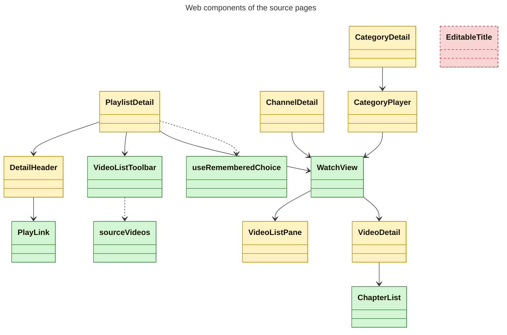
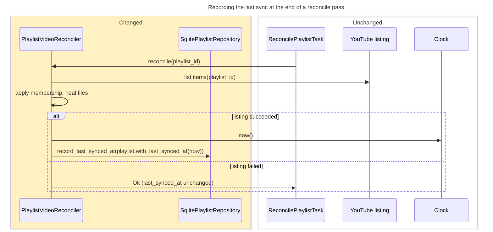
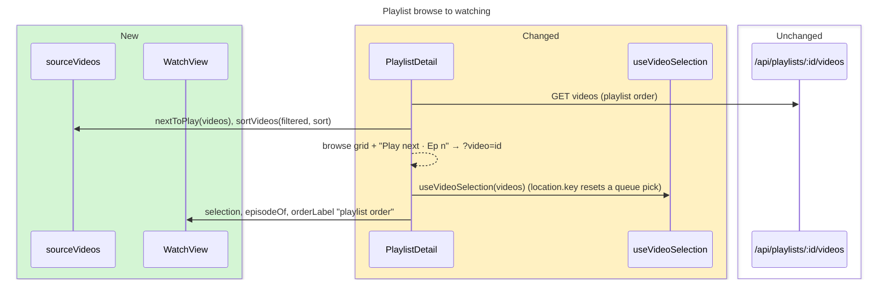
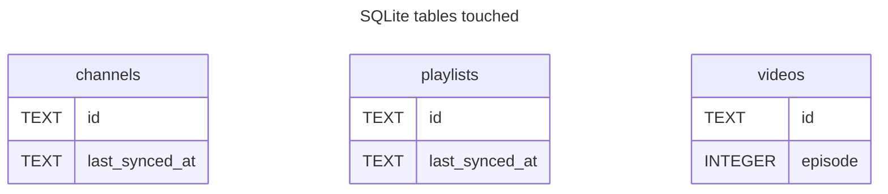

# Design

## Diagrams

Colours: green = new, yellow = changed, red = removed, plain = unchanged.











## Types & Signatures

```sql
-- migrations/0033_source_last_synced_at.sql
ALTER TABLE channels ADD COLUMN last_synced_at TEXT;
ALTER TABLE playlists ADD COLUMN last_synced_at TEXT;
```

```rust
// src/domain/channel/channel.rs (same on Playlist in src/domain/playlist/playlist.rs)
pub last_synced_at: Option<DateTime<Utc>>,
pub fn with_last_synced_at(self, last_synced_at: DateTime<Utc>) -> Self;

// src/domain/channel/channel_view.rs, src/domain/playlist/playlist_view.rs
pub last_synced_at: Option<DateTime<Utc>>,

// src/infrastructure/repositories/sqlite_channel_repository.rs (same on PlaylistRepository)
/// `update` writes every field but `last_synced_at`.
fn record_last_synced_at(&self, channel: &Channel) -> anyhow::Result<()>;

// src/domain/services/channel_video_reconciler.rs, playlist_video_reconciler.rs (private)
fn record_sync(&self, channel: &Channel, membership: &MembershipChanges) -> anyhow::Result<()>;

// src/application/http/channels/dto.rs, playlists/dto.rs
pub last_synced_at: Option<DateTime<Utc>>, // ChannelListItemResponse / PlaylistListItemResponse

// src/application/http/videos/dto.rs (VideoResponse, CategoryVideoResponse)
pub episode: Option<u32>,
```

```ts
// web/src/api/types.ts
interface ChannelListItem { last_synced_at: string | null }
interface PlaylistListItem { last_synced_at: string | null }
interface Video { episode: number | null }

// web/src/lib/sourceVideos.ts
interface WatchableVideo { id; watched; position_seconds; published_at; status?: VideoStatus } // no status (a category video) = downloaded
function isDownloaded(video: WatchableVideo): boolean
type WatchFilter = 'all' | 'unwatched' | 'in_progress' | 'watched'
type VideoSort = 'playlist' | 'newest' | 'oldest'
function isInProgress(video: WatchableVideo): boolean
function matchesWatchFilter(video: WatchableVideo, filter: WatchFilter): boolean
function watchFilterCounts(videos: readonly WatchableVideo[]): Record<WatchFilter, number>
function sortVideos<T extends WatchableVideo>(videos: readonly T[], sort: VideoSort): T[]
function nextToPlay<T extends WatchableVideo>(videos: readonly T[]): T | null // first downloaded, unwatched
function newestUnwatched<T extends WatchableVideo>(videos: readonly T[]): T | null
function sourceKey(source: Pick<HomeVideoSource, 'kind' | 'id'>): string
function videoSources(videos: readonly { source: HomeVideoSource }[]): VideoSourceOption[]
function sourcesSummary(sources: readonly Pick<VideoSourceOption, 'kind'>[]): string | null
function sourceSummary(args: { kind?: string; videoCount: number; unwatchedCount?: number; syncedAgo?: string | null }): string
function asHomeVideo(video: Video, source: HomeVideoSource): HomeVideo

// web/src/lib/markWatchedConfirmation.ts — never null now
function markWatchedConfirmation(name: string, unwatchedCount: number): MarkWatchedConfirmation

// web/src/lib/sourcePath.ts
function categoryPath(id: string): string

// web/src/lib/playFrom.ts (moved from VideoPlayer)
function playFrom(element: HTMLVideoElement, seconds: number): void

// web/src/hooks/useRememberedChoice.ts
function useRememberedChoice<T extends string>(key: string, choices: readonly T[], initial: T): readonly [T, (value: T) => void]

// web/src/components/DetailHeader.tsx
type HeaderBadge = { kind: 'avatar'; src: string | null } | { kind: 'playlist' } | { kind: 'color'; color: string }
interface HeaderAction { /* … */ iconOnDesktop?: boolean } // replaces menuOnDesktop
interface DetailHeaderProps { badge; nameHref?; nameLinkLabel?; summary: string | null; chips?; primaryAction?; compact?; /* videos, tint, avatarSrc, showAvatar, summaryPrefix, onRename removed */ }

// new components
function PlayLink(props: { to: string; label: string; title?: string; compact?: boolean })
function VideoListToolbar(props: { counts; filter; onFilterChange; sorts; sort; onSortChange; children? })
function ChoiceMenu<T extends string>(props: { label; icon?; prefix?; value: T; choices; onChange })
function WatchView<T extends Video>(props: { noun; videos; error; selection: VideoSelection<T>; basePathOf; sourceNameOf; detailSourceOf?; episodeOf?; orderLabel? })
function ChapterList(props: { chapters: Chapter[]; videoElement: HTMLVideoElement | null })

// changed components
VideoListPane: + episodeOf?, orderLabel?        // "Up next" header, Hide watched (yarrtube.queue.hideWatched)
VideoDetail: channel → source?: VideoDetailSource; + episodeLabel?, videoElement?
CategoryPlayer: + selection: VideoSelection<CategoryVideo>
VideoGrid: + labelOf?: (video: HomeVideo) => string | null
```

localStorage keys: `yarrtube.playlist.<id>.filter|sort`, `yarrtube.category.<id>.filter|sort|source`, `yarrtube.queue.hideWatched`.

## Call Stack

1. Reconcile (task, sync endpoint, subscriber) → `{Channel,Playlist}VideoReconciler::reconcile(id)` → list on YouTube → membership + filesystem steps → `record_sync(source, membership)` → when the listing succeeded: `repository.record_last_synced_at(&source.with_last_synced_at(clock.now()))` (`UPDATE … SET last_synced_at = ?2 WHERE id = ?1`).
2. `GET /api/{channels,playlists}` → `*ViewSearcher` → `*View { last_synced_at }` → `*ListItemResponse { last_synced_at }`.
3. `GET /api/{playlists,channels,categories}/:id/videos` → `VideoResponse { episode: video.episode_number.map(|n| n.episode()) }`.
4. `/playlists/:id` → `PlaylistDetail` → no `?video=`: `DetailHeader(summary=sourceSummary(..), primaryAction=PlayLink(nextToPlay))` + `PlaylistBrowser` (`useRememberedChoice` filter/sort → `VideoListToolbar` → `VideoGrid(asHomeVideo(..), labelOf=Ep n)`); `?video=`: compact `DetailHeader(nameHref)` + `WatchView(useVideoSelection(videos))`.
5. `/channels/:id` → `ChannelDetail` → compact `DetailHeader(PlayLink(newestUnwatched))` + `WatchView`.
6. `/categories/:id` → `CategoryDetail` → `useRememberedChoice(sort)` → `queue = sortVideos(videos, sort)` → `CategoryBrowser` (filter, source, `ChoiceMenu` "From") or `CategoryPlayer(selection)` → `WatchView`.
7. Mark all watched (header ⋮ or sidebar row) → `ConfirmDialog(markWatchedConfirmation(name, count))` → confirm → mark endpoint.

## Test Plan

Backend (acceptance through the primary adapters):

1. `reconcile_playlist_task::it_should_record_when_the_playlist_was_synced` — after a pass, the stored playlist has `last_synced_at = clock.now()`.
2. `reconcile_playlist_task::it_should_keep_the_last_sync_if_listing_fails` — a failed listing leaves `last_synced_at` as it was.
3. `reconcile_channel_task::it_should_record_when_the_channel_was_synced` — same for a channel.
4. `reconcile_channel_task::it_should_keep_the_last_sync_if_listing_fails` — same for a channel.
5. `playlists::it_should_list_playlists_with_their_last_sync` — `GET /api/playlists` returns `last_synced_at`.
6. `channels::it_should_list_channels_with_their_last_sync` — `GET /api/channels` returns `last_synced_at`.
7. `videos::it_should_include_the_episode_number_when_listing_playlist_videos` — `episode: Some(7)`.
8. `videos::it_should_include_the_episode_number_when_listing_channel_videos` — the stored `MMDDii` number.

Infrastructure (SQLite repositories, channel and playlist each):

9. `it_should_record_only_the_last_sync` — `record_last_synced_at` changes no other column.
10. `it_should_keep_the_last_sync_when_updating_from_a_stale_read` — `update` from an entity read before the sync keeps `last_synced_at`.
11. `sqlite_migrations::…` — rows existing before 0033 read `last_synced_at = None`.

Web (Vitest, mocked `fetch` only):

12. `lib/sourceVideos.test.ts` — next to play (gaps, started, all watched, skips a video not downloaded), newest unwatched (skips one still downloading), counts and filters (in progress ⊂ unwatched, a video not downloaded only under all), sorting (undated last), sources and summaries.
13. `hooks/useRememberedChoice.test.ts` — default, restore, stale value, late-valid value, key change, storage failure.
14. `PlaylistDetail.test.tsx` — browse header/meta/chips/"Ep n" cards; Play next target; no Play next when all watched; filter + sort remembered; category chips; card → watching, name → back; queue position + episode; Hide watched remembered; header action layout mobile/desktop.
15. `ChannelDetail.test.tsx` — "Channel · …" meta; Play next newest unwatched, hidden once playing; skips a newest video still downloading.
15b. `PlaylistDetail.test.tsx` — a failed episode: no Play next, "Unwatched" chip matching the header.
16. `CategoryDetail.test.tsx` — colour dot, meta "from 2 playlists", Play newest unwatched, chips + From + sort remembered, Edit category.
17. `DetailHeader.test.tsx` — badge/name/meta, placeholder, name link, icon vs ⋮ layout, always-confirm mark all watched.
18. `VideoDetail.test.tsx` — source link + episode; desktop chapter list seeks.
