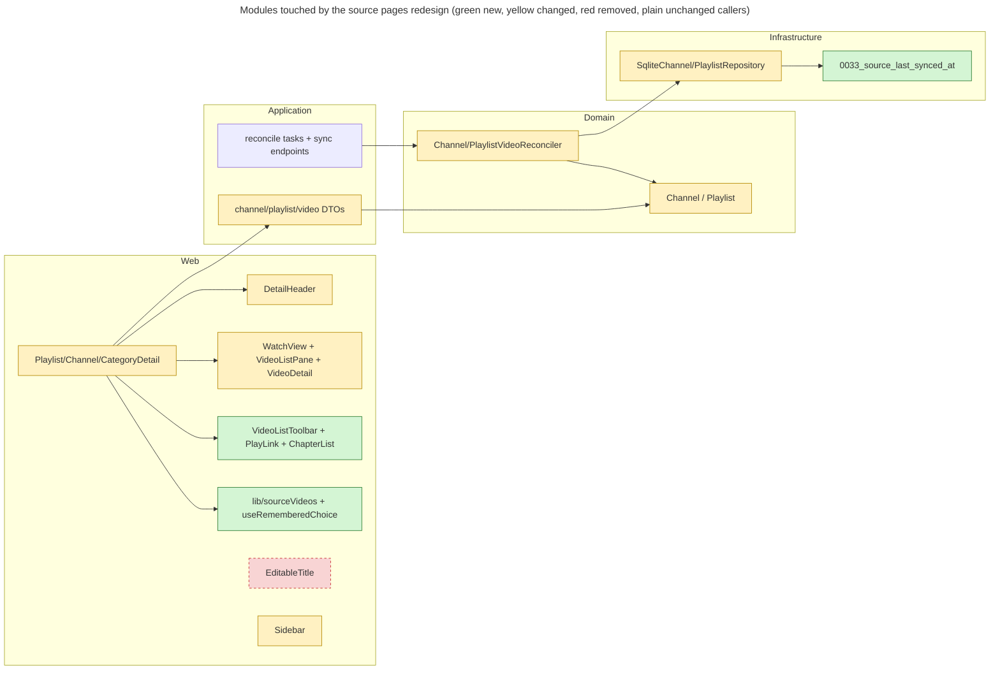

# Proposal

## Why

The playlist, channel and category pages predate the home redesign (#200): a playlist opens straight into its first video with no overview and no way to find where you left off; the header lays out six icon buttons, two of them bulk and irreversible-adjacent; the queue has no context; chapters sit in a cropped horizontal strip; the category header is a full-width tinted block with a "0 sources" summary. This brings the three pages in line with the approved Claude Design mockups ("Channel, playlist, category").

## What Changes

- **Playlist browse page**: `/playlists/:id` without `?video=` shows a header, a toolbar (watch-state chips All / Unwatched / In progress / Watched with counts; sort playlist order / newest / oldest) and the videos as home-style cards labelled "Ep N · <age>". Picking a card (`?video=`) shows the watching layout. **BREAKING** for links that relied on `/playlists/:id` opening the player.
- **Play next**: the playlist header's primary action plays the first video in playlist order not watched yet (resuming from its saved position); a channel's plays its newest unwatched video; a category's "Play newest unwatched" its newest unwatched video.
- **Remembered toolbar**: filter and sort are remembered per playlist, and filter, source and sort per category, in this browser (localStorage); storage failures fall back to the defaults.
- **Page header**: badge (avatar, playlist icon or colour dot), name, one meta line (e.g. "Playlist · 32 videos · 29 unwatched · synced 14d ago"), the playlist's category chips, the primary action, then Sync and Open-on-YouTube as icon buttons (plus "Edit category" on a category); everything else (mark all watched, home and count settings, edit settings, AI, delete) behind "⋮". On phones the header stacks, the primary action goes full width and every action is behind "⋮".
- **Mark all watched always confirms**, from a page header or a sidebar row, whatever the unwatched count: there is no undo.
- **Watching layout** (channel, playlist, category): compact header (a playlist's or category's name links back to its browse page); queue headed "Up next" with the playing video's position ("1 of 32 · playlist order") and a remembered "Hide watched" switch; episode numbers in a playlist's queue; video info with the source's avatar and link, publish date and episode on one line, its actions grouped right; on desktop, the chapters as a compact list beside the AI summary instead of the rail (phones keep the pinned rail).
- **Category page**: colour dot instead of the tinted header, meta "69 videos · 50 unwatched · from 9 channels and playlists", one toolbar line with the chips, a "From: <source>" dropdown and the sort (newest first by default). **BREAKING**: in-place rename is dropped; the category is renamed from "Edit category".
- **API**: videos listed for a playlist, channel or category carry their `episode` number; `GET /api/channels` and `GET /api/playlists` carry `last_synced_at`, recorded at the end of each reconcile pass that listed the source on YouTube (new column, migration 0033).

## Capabilities

### New Capabilities

None.

### Modified Capabilities

- `web-ui`: page header layout, category view and playback, bulk mark-watched confirmation, video detail meta line, summary and watched control; new playlist browse page, Play next, remembered filters and sort, watching queue header; in-place category rename removed.
- `player-chapters`: on desktop the chapters move from the rail under the player to a list beside the AI summary; the rail stays on phones.
- `video-listing`: listed videos include their episode number.
- `playlist-crud`: listed playlists include their last sync time.
- `channel-crud`: listed channels include their last sync time.
- `playlist-reconciliation`: a reconcile pass records the playlist's last sync time.
- `channel-video-sync`: a reconcile pass records the channel's last sync time.
- `e2e-tests`: page header coverage follows the new layout.

## Impact

- Web (`web/src`): `PlaylistDetail`, `ChannelDetail`, `CategoryDetail`, `CategoryPlayer`, `DetailHeader`, `VideoDetail`, `VideoListPane`, `VideoPlayer`, `VideoGrid`, `MarkWatchedButton`, `Sidebar`; new `WatchView`, `VideoListToolbar`, `PlayLink`, `ChapterList`, `lib/sourceVideos`, `lib/playFrom`, `hooks/useRememberedChoice`; `useVideoSelection` follows navigation; `EditableTitle` removed; `api/types` + fixtures.
- Backend: `Channel`/`Playlist` entities and views, channel/playlist reconcilers, SQLite channel/playlist repositories, channel/playlist/video DTOs, migration `0033_source_last_synced_at.sql`.
- e2e: `helpers/video.js` (`enterWatching`, `chooseHeaderAction`, downloaded detection) and the specs that open a playlist or use header actions.

