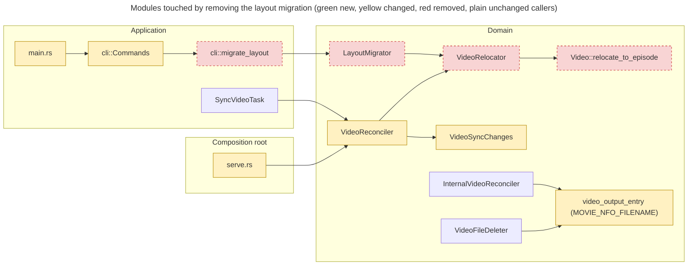

# Proposal

## Why

The 0.9.0 move from the per-video-folder layout to the TV-show layout was a
one-off: `yarrtube migrate-layout` plus reconcile relocating stragglers.
With 1.0 shipping, every library meant to migrate has done so, and the
migration code (≈1,900 lines: `LayoutMigrator`, `VideoRelocator`) and its
upgrade guide are dead weight.

## What Changes

- **BREAKING** Remove the `yarrtube migrate-layout` subcommand (and
  `--dry-run`) and `LayoutMigrator`.
- **BREAKING** A video sync no longer moves a legacy-layout video into its
  season folder when it repairs missing metadata. A legacy video with no
  metadata is left alone: no metadata is written next to it (that would be a
  new file in the old layout).
- Remove `VideoRelocator`, `Video::relocate_to_episode`, `MOVIE_NFO_FILENAME`
  and the `relocated` sync outcome.
- Unchanged: legacy-layout files already on disk stay playable, protected
  from orphan cleanup and deletable as a unit; moving a playlist or channel
  to another folder (`source-relocation`, `ShowMover`) is untouched.
- Docs: delete `doc/UPGRADING-TO-0.9.0.md` and its references (CLAUDE.md,
  CHANGELOG 0.9.0 entry link, ARCHITECTURE "Legacy layout"). The 0.9.0
  announcement in `announcements/announcements.json` links to the guide; it
  is no longer shown to anyone who dismissed it; it and the CHANGELOG link
  are retargeted to the guide as of the `v0.9.0` tag.

## Capabilities

### New Capabilities

### Modified Capabilities
- `layout-migration`: removed entirely (subcommand, dry run, skips,
  idempotency).
- `tv-show-layout`: "Legacy Layouts Are Not Served As Shows" no longer
  mentions the migration subcommand reporting or moving legacy videos.
- `video-sync`: "Sync Repairs Missing Metadata" no longer relocates a
  legacy video; it skips a legacy video entirely.
- `video-download`: the legacy flat layout scenario no longer defers to
  `migrate-layout`.
- `video-subtitles`: a legacy video never gets subtitles (no "once
  `migrate-layout` has moved it").
- `logging`: a `sync_video` run no longer reports a relocation.

## Impact

- CLI: `src/application/cli/{mod.rs,migrate_layout.rs}`, `src/main.rs`.
- Domain: `src/domain/services/{layout_migrator.rs,video_relocator.rs,video_reconciler.rs,mod.rs}`,
  `src/domain/video/{video.rs,video_sync_changes.rs,video_output_entry.rs,mod.rs}`.
- Composition root: `src/serve.rs` (`video_relocator`).
- Tests: relocation tests in `sync_video_task/tests.rs`, migrator/relocator
  unit tests (deleted with their modules).
- Docs: `doc/UPGRADING-TO-0.9.0.md`, `doc/ARCHITECTURE.md`, `CLAUDE.md`,
  `CHANGELOG.md`, `announcements/announcements.json`.
- Users still on the 0.8.x layout must upgrade through a 0.9.x–0.10.x image
  first; 1.0 has no way to migrate them.

