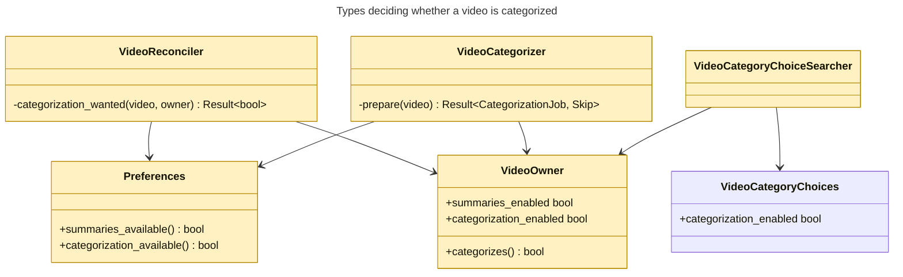
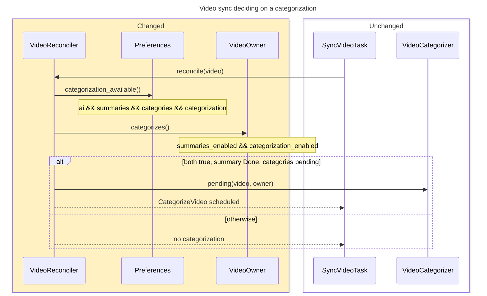
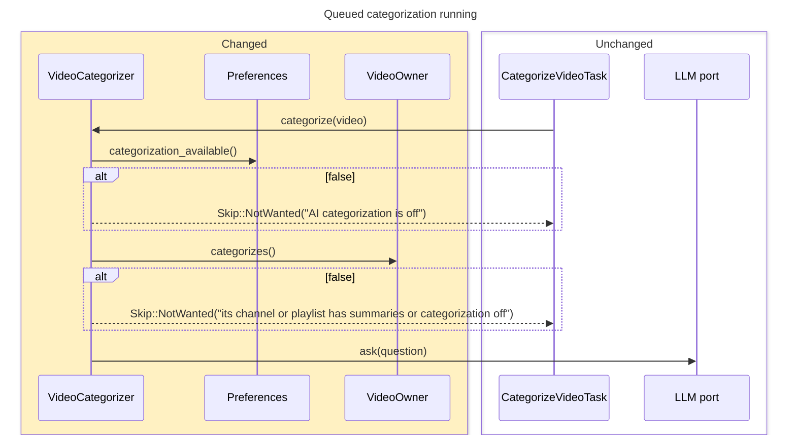
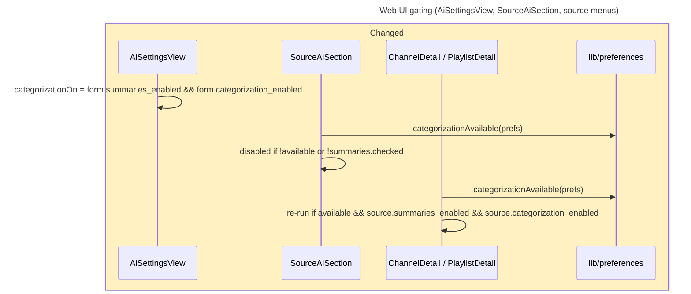

# Design

## Diagrams

Colours: green = new, yellow = changed, red = removed, plain = unchanged.









## Types & Signatures

```rust
// src/domain/preferences/preferences.rs
impl Preferences {
    /// AI, summaries, categories and categorization on.
    pub fn categorization_available(&self) -> bool;
}
```

```rust
// src/domain/video/video_owner.rs
impl VideoOwner {
    /// The source categorizes its videos: summaries and categorization both on.
    pub fn categorizes(&self) -> bool;
}
```

```ts
// web/src/lib/preferences.ts
/** AI, summaries, categories and categorization on. */
export function categorizationAvailable(preferences: Preferences | undefined): boolean

// web/src/lib/sourceAi.ts (new)
/** The source categorizes its videos: summaries and categorization both on. */
export function sourceCategorizes(source: { summaries_enabled: boolean; categorization_enabled: boolean }): boolean
```

```tsx
// web/src/components/SourceAiSection.tsx
// AiCheckbox gains an optional blocker shown instead of the hint:
interface AiCheckboxProps {
  // ...existing
  /** Set while another option must be checked first, e.g. "Needs Summarize videos." */
  blockedBy?: string
}
```

The source API error message stays `Turn on AI categorization before enabling it for a channel` (or `for a playlist`). The UI never sends this request while summaries are off.

## Call Stack

1. **Video sync**: `SyncVideoTask` → `VideoReconciler::reconcile(video)` → `categorization_wanted(video, owner)` = `owner.categorizes() && preferences.categorization_available() && summary Done && !pending(video, owner).is_empty()`.
2. **Queued categorization**: `CategorizeVideoTask` → `VideoCategorizer::prepare(video)`: `categorization_available()` → summary Done → `owner.categorizes()`, else `Skip::NotWanted`.
3. **Source create/update**: `ChannelCreator` / `ChannelUpdater` / `PlaylistCreator` / `PlaylistUpdater` → `ensure_categorization_available(categorization_enabled)` → `preferences.categorization_available()` (now includes summaries). No code change in these services.
4. **Video categories read**: `GET /api/videos/{id}/categories` → `VideoCategoryChoiceSearcher` → `VideoCategoryChoices { categorization_enabled: owner.categorizes() }`.
5. **AI page**: `AiSettingsView` → the Categorization `Switch` gets `disabled={aiOff || !form.summaries_enabled}`. `categorizationOn = form.summaries_enabled && form.categorization_enabled` drives Model `disabled`, Advanced/Effort/Prompt visibility and the "Needs summaries." line.
6. **Source dialogs** (add + edit channel/playlist): `SourceAiSection` → categorization `AiCheckbox` with `blockedBy="Needs Summarize videos."` while `categorizationAvailable && !summaries.checked`. Then `disabled = blockedBy || (!available && !enabledOnSource)`. A global unavailable hint takes precedence over `blockedBy`.
7. **Source menus**: `ChannelDetail` / `PlaylistDetail` → `enabled: categorizationAvailable && sourceCategorizes(source)` picks "Re-run AI categorization" vs "Clear AI categories".

## Test Plan

**1. Behaviour tests (Rust, application layer)**

1. `src/application/tasks/sync_video_task/tests.rs` `it_should_not_schedule_a_categorization_when_the_source_has_summaries_off`: source with categorization on, summaries off, Done summary and pending categories → no `CategorizeVideo` task.
2. `src/application/tasks/sync_video_task/tests.rs` `it_should_not_schedule_a_categorization_when_ai_summaries_are_off`: preferences with AI, categories and categorization on, summaries off → no `CategorizeVideo` task.
3. `src/application/tasks/categorize_video_task/tests.rs` `it_should_skip_the_categorization_when_ai_summaries_are_off`: a queued run with summaries off in the preferences → the model is not called and no verdict is stored.
4. `src/application/tasks/categorize_video_task/tests.rs` `it_should_skip_the_categorization_when_the_source_has_summaries_off`: a queued run whose source has summaries off → the model is not called.
5. `src/application/http/channels/tests.rs` `it_should_fail_to_enable_categorization_on_a_channel_while_summaries_are_off`: PATCH with `categorization_enabled` true and summaries off in the preferences → 409 with `Turn on AI categorization before enabling it for a channel`, nothing changed.
6. `src/application/http/playlists/tests.rs` `it_should_enable_categorization_on_a_playlist_with_its_summaries_off`: AI fully on, playlist `summaries_enabled` false, PATCH `categorization_enabled` true → 200, stored true.
7. `src/application/http/videos/tests.rs` `it_should_report_categorization_off_for_a_video_whose_source_has_summaries_off`: `GET /api/videos/{id}/categories` → `categorization_enabled` false.

**2. Web tests (Vitest, colocated)**

8. `web/src/lib/preferences.test.ts` `categorizationAvailable` is false with summaries off.
9. `web/src/components/AiSettingsView.test.tsx`: with summaries off, the Categorization switch is disabled, "Needs summaries." is shown and Model is disabled.
10. `web/src/components/AiSettingsView.test.tsx`: turning Summaries off on the page (unsaved) disables a checked Categorization switch, which stays checked, and hides Advanced/Prompt.
11. `web/src/components/AddChannelDialog.test.tsx`: "Categorize videos" is disabled with "Needs Summarize videos." until "Summarize videos" is checked; submitting both sends both true.
12. `web/src/components/EditPlaylistDialog.test.tsx`: a playlist with summaries and categorization off has "Categorize videos" disabled with "Needs Summarize videos.", enabled after checking "Summarize videos".
13. `web/src/components/EditChannelDialog.test.tsx`: unchecking "Summarize videos" keeps "Categorize videos" checked and disabled, and sends only `summaries_enabled` false.
14. `web/src/components/ChannelDetail.test.tsx`: a channel with categorization on and summaries off offers "Clear AI categories", not "Re-run AI categorization".

**3. Infrastructure tests**

None. No adapter changes.
