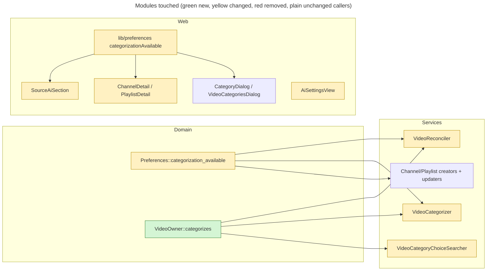

# Proposal

## Why

AI categorization judges a video from its summary, yet the AI page and the source dialogs let categorization be on while summaries are off. That combination is accepted and then nothing gets categorized, with nothing saying why.

## What Changes

- AI categorization counts as available only while summaries are on too: AI, summaries, categories and categorization. This applies to the daemon (`Preferences::categorization_available`) and to the web UI's mirror (`categorizationAvailable`).
- A channel or playlist categorizes its videos only while it has both `summaries_enabled` and `categorization_enabled` on. Its stored `categorization_enabled` is kept as is: turning summaries off makes categorization inactive without clearing it, and turning summaries back on restores it.
- Creating or updating a source with `categorization_enabled` `true` is rejected while global summaries are off, as it already is while AI, categories or categorization are off. A source may still store `categorization_enabled` `true` with its own `summaries_enabled` `false` (inactive).
- `GET /api/videos/{id}/categories`'s `categorization_enabled` reports the effective value (source summaries and categorization both on), so the dialog offers "Clear AI categories" for a source whose summaries are off.
- AI page: the "Categorization" switch is disabled while "Summaries" is off (as edited on the page, before saving), with "Needs summaries." under the card's description. "Model", "Advanced", "Effort" and "Prompt" follow the switch's effective state.
- Source add and edit dialogs: "Categorize videos" is disabled while "Summarize videos" is unchecked, keeping its checked state, with the hint "Needs Summarize videos."
- Source actions menu: "Re-run AI categorization" is offered only when the source has summaries and categorization both on; otherwise "Clear AI categories".
- `doc/CATEGORIES.md` and `doc/AI.md` say that categorization needs summaries, on the AI page and on each source.

## Capabilities

### New Capabilities

None.

### Modified Capabilities

- `source-categorization`: a source's categorization is effective only while its summaries are on too, and enabling it needs global summaries on.
- `video-categorization`: a video's categorization is scheduled only while summaries are on, globally and on its source.
- `video-category-editing`: `categorization_enabled` in a video's categories is the source's effective value.
- `ai-settings-ui`: the "Categorization" switch depends on the "Summaries" switch.
- `web-ui`: "Categorize videos" depends on "Summarize videos" and on global summaries, and the source menu's re-run/clear choice follows the effective value.

## Impact

- Domain: `src/domain/preferences/preferences.rs`, `src/domain/video/video_owner.rs`, and the services that read them: `video_reconciler.rs`, `video_categorizer.rs`, `video_category_choice_searcher.rs`, plus the source creators and updaters (through `categorization_available`).
- Web: `web/src/lib/preferences.ts`, `AiSettingsView.tsx`, `SourceAiSection.tsx`, `ChannelDetail.tsx`, `PlaylistDetail.tsx`.
- API: no shape change. The `categorization_enabled` value in `GET /api/videos/{id}/categories` is now effective rather than stored. Source requests with categorization on are rejected while global summaries are off.
- Docs: `doc/CATEGORIES.md`, `doc/AI.md`.

