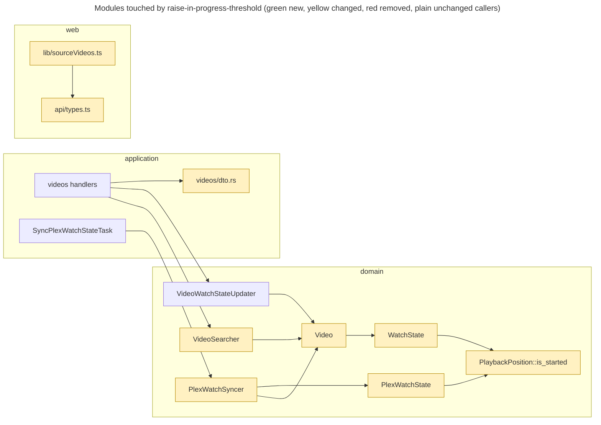

## Why

A video counts as started (in progress) once playback passes 30 seconds, whatever its length, so every video opened and abandoned after a minute or two fills "Continue watching" for a week. Started should mean a meaningful share of the video was watched.

## What Changes

- A position counts as started only when it is past 30 seconds **and** reaches 20% of the video's duration or 10 minutes, whichever comes first. With no known duration, past 30 seconds is enough (as today).
- The rule applies everywhere a video is classed as unplayed / in progress / watched: "Continue watching" on home, the Plex watch sync (both what yarrtube pushes and what it reads from Plex), and the "In progress" filter of source and category video lists.
- A rewatch of a watched video makes it unwatched only once the rewatch counts as started by the same rule (replaces the 10% rewatch threshold, in yarrtube and when reading Plex).
- Video list responses (source, category and home videos) gain `in_progress`, so the web UI no longer derives it from `position_seconds > 0`.
- The saved position is still recorded below the threshold, and the player still resumes from it; the thumbnail progress bar keeps showing the saved position.
- Below the threshold the Plex watch sync treats a position as unplayed: a newer local playback under the threshold can reset an episode's resume position in Plex.

## Capabilities

### New Capabilities

(none)

### Modified Capabilities

- `watch-state`: rewatch threshold follows the started rule; started rule defined.
- `video-listing`: "Continue watching" uses the started rule; listed videos report `in_progress`.
- `plex-watch-sync`: short positions and short rewatches follow the started rule.

## Impact

- `src/domain/video/playback_position.rs` (started rule takes the duration), `watch_state.rs`, `video.rs`
- `src/domain/plex/plex_watch_state.rs`, `src/domain/services/plex_watch_syncer.rs`, `video_searcher.rs`
- `src/application/http/videos/dto.rs` (`in_progress` on video responses)
- `web/src/api/types.ts`, `web/src/lib/sourceVideos.ts`, test fixture builders
- Existing tests whose positions assumed the 30-second rule

