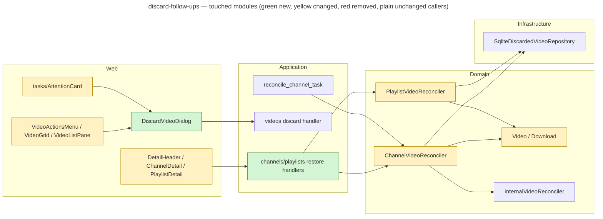

# Proposal

## Why

Using discard (#207) showed three gaps. A discarded video doesn't take a channel's slot, so the next reconcile fetches a replacement: discarding one of a channel's 3 videos still leaves 3, when the user wanted 2. The action only exists in the video detail pane, so a video can't be discarded from a card, a list row or a failing download in the tasks view. And a discard can't be undone, so a mistaken discard loses the video for good.

## What Changes

- A Discarded video **counts** toward a channel's `video_limit`, stored or remembered by the channel: a channel with `video_limit` 3 and one discarded upload among its 3 most recent keeps 2 videos. Unavailable videos still don't count (YouTube's verdict, not the user's). Partly reverts #207's rule for Discarded only.
- "Discard" (renamed from "Don't download") wherever a video is shown: a **Discard…** item in the "⋮" menu of every video card (home, playlist, category) and list row (channel, playlist), the detail pane's button, and a **Discard** button on a failing download's **Needs attention** card in the tasks view. Each asks for confirmation first.
- New per-source **Restore discarded videos** action in a channel's or playlist's page header "⋮" menu, behind a confirmation. It calls `POST /api/channels/{handle}/discarded/restore` or `POST /api/playlists/{id}/discarded/restore` (204, 404 for an unknown source). The source forgets every discarded video it remembers, puts its stored Discarded videos back to Pending, and runs one reconcile pass. A video still in the playlist or within the channel's limit is then downloaded again. The rest stay forgotten, so they come back only if they return to the source.
- Discard is no longer irreversible: its confirmation says the video can be restored from its channel's or playlist's menu.
- **Behaviour change for existing users**: a channel that got a replacement for a discarded video evicts the oldest one on its next reconcile.

Assumptions (recorded here so they aren't re-litigated):
- A remembered discarded upload counts too: it takes its slot without being stored, the same as a stored Discarded one. Remembered ids no longer widen the listing; only stored Unavailable videos do.
- Restore resets stored Discarded videos in place, keeping their id and episode number, instead of deleting and re-adding them.
- Restore is always offered, even when the source has nothing discarded. It then just runs a reconcile, which is harmless. There is no count of discarded videos.
- The tasks view offers Discard only on a download task's card. A failing subtitle or summary task belongs to a video that is already downloaded, and that video is discarded from the library.
- Cards on the home, playlist and category pages only show Downloaded videos, so their Discard confirmation always says the files will be deleted.

## Capabilities

### New Capabilities

### Modified Capabilities
- `video-discard`: no longer irreversible. A source can restore its discarded videos.
- `channel-video-sync`: Discarded videos, stored or remembered, count toward `video_limit`. Only Unavailable ones widen discovery.
- `web-ui`: Discard in every video menu and on failing download cards in the tasks view, the button renamed "Discard", and "Restore discarded videos" in a channel's or playlist's page header.

## Impact

- Domain:
  - `ChannelVideoReconciler`: the limit window skips only Unavailable videos, and the listing is widened by the stored Unavailable count only.
  - `video_window` doc updated.
  - New `Download::restore` / `Video::restore`.
  - New `restore_discarded` on `ChannelVideoReconcilerApi` and `PlaylistVideoReconcilerApi`.
  - New `RestoreDiscardedVideosError`.
- Application: `POST /channels/{handle}/discarded/restore` and `POST /playlists/{id}/discarded/restore` handlers.
- Infrastructure: none new. `DiscardedVideoRepository::delete_all` is reused.
- Web:
  - `api/client.ts` and `api/queries.ts`: restore calls and hooks. `useDiscardVideo` also refreshes the tasks list.
  - New `DiscardVideoDialog`, extracted from `DiscardVideoButton`.
  - `VideoActionsMenu`, `VideoGrid`, `VideoListPane`, `tasks/AttentionCard`, `DetailHeader`, `ChannelDetail`, `PlaylistDetail`.

