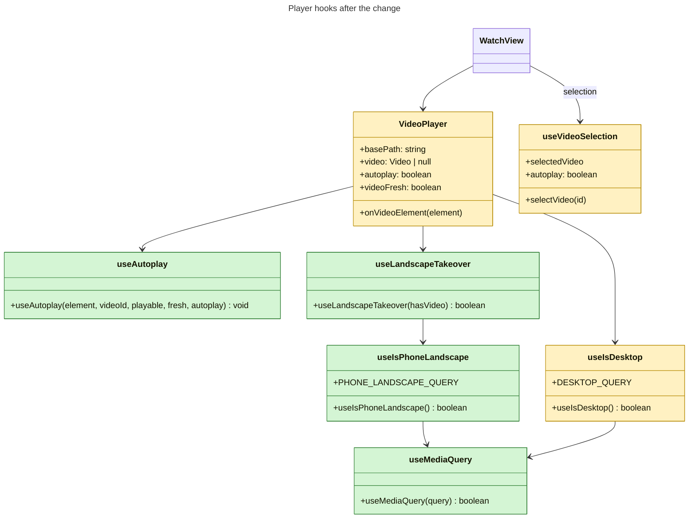
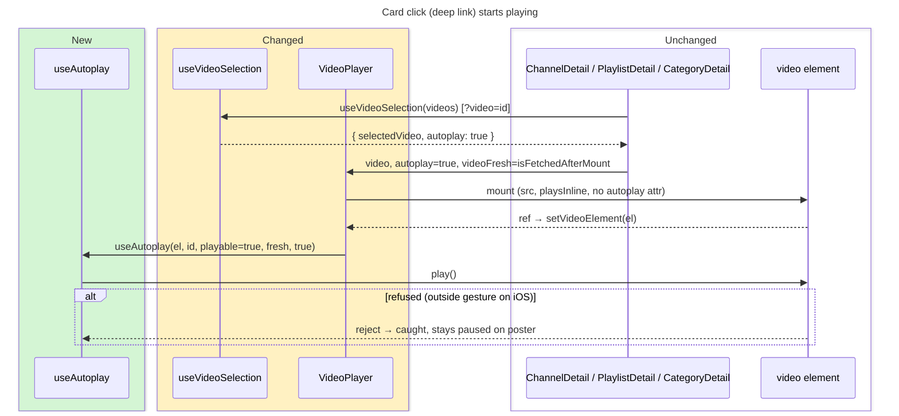
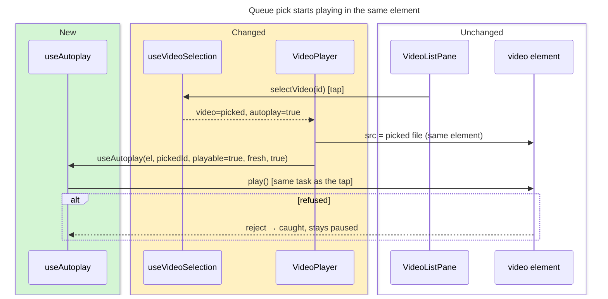
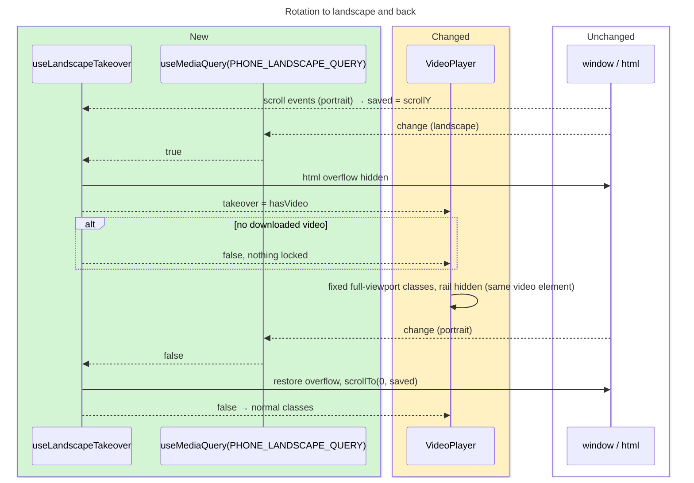

## Decisions

- **Desktop gets the same autoplay.** `useVideoSelection` is viewport-agnostic and a deep link already autoplays on desktop; a queue pick is the same intent everywhere.
- **`play()` instead of the `autoplay` attribute.** iOS ignores unmuted `autoplay` on a `<video>` mounted outside a gesture. `useAutoplay` calls `element.play()` once per newly selected video id:
  - Queue pick: the `<video>` is never remounted (only `src` changes), and React flushes the effects of a discrete event (the tap) in the same task, so `play()` runs inside the tap's user activation, on an element the user has usually played already. Reliable on iOS.
  - Card click / deep link: the `<video>` mounts after the fetch, outside the gesture. `play()` is still tried; iOS (Safari and home-screen app) may refuse.
  - Refused (`NotAllowedError`, or any rejection): caught and ignored. The video stays paused on its poster with native controls; one tap on play starts it. No error UI, no muted fallback (sound would silently be off).
- **Not autoplayed:** the default video; re-renders/list polls of the same id; a selected video whose download finishes while selected (`playable` false when the id is first seen in a list fetched since mount marks it consumed). A list only read from the react-query cache (`isFetchedAfterMount` false) can still show a since-downloaded video as downloading, so it never consumes: the Home card of a video that finished after its source was last open still starts.
- **Phone-landscape query, not the width breakpoint:** `(orientation: landscape) and (pointer: coarse) and (max-height: 32rem)`. A phone in landscape is 568–932 px wide, so it crosses the 48rem desktop breakpoint (`useIsDesktop` true, `md:` styles apply); its height stays ≤ ~480 px. `pointer: coarse` excludes short desktop windows; `max-height: 32rem` excludes tablets (≥ 744 px tall in landscape).
- **CSS takeover, no Fullscreen API:** iPhone has no element `requestFullscreen`, and `webkitEnterFullscreen` needs a gesture a rotation isn't. Takeover = same DOM, other classes: the player root becomes `fixed inset-0 z-30 bg-black` (above the header's z-20, below the sidebar/dialogs) padded by `env(safe-area-inset-*)` (`viewport-fit=cover` is already set), the video `object-contain` at full size, no `md:` sizing classes, no chapter rail. The `<video>` keeps its place in the tree, so it is never remounted and playback continues.
- **Scroll position:** in landscape the page switches to the desktop layout (`main` scrolls, the document doesn't), so the document's `scrollY` is clamped while landscape and lost on return. `useLandscapeTakeover` records `window.scrollY` on `scroll` events only while the phone-landscape query does not match (checked live via `matchMedia(...).matches`, so the clamp's own scroll event is ignored), locks `<html>` overflow while active, and on release restores the overflow and `scrollTo(0, saved)` in a layout effect.

## Diagrams

Colours: green = new, yellow = changed, red = removed, plain = unchanged.









## Types & Signatures

```ts
// web/src/hooks/useMediaQuery.ts
/** Whether `query` matches, kept current. */
export function useMediaQuery(query: string): boolean
```

```ts
// web/src/hooks/useIsDesktop.ts
export const DESKTOP_QUERY = '(min-width: 48rem)'
export function useIsDesktop(): boolean // = useMediaQuery(DESKTOP_QUERY)
```

```ts
// web/src/hooks/useIsPhoneLandscape.ts
/** A phone held sideways: touch, landscape, and too short to be a tablet. */
export const PHONE_LANDSCAPE_QUERY =
  '(orientation: landscape) and (pointer: coarse) and (max-height: 32rem)'
export function useIsPhoneLandscape(): boolean
```

```ts
// web/src/hooks/useAutoplay.ts
/**
 * Calls `element.play()` once per newly selected `videoId`, when `autoplay`
 * and the video is `playable` the first time its id is seen in a `fresh`
 * list (fetched since mount, not only cached); waits for the element to
 * mount. A refused play is ignored (stays paused).
 */
export function useAutoplay(
  element: HTMLVideoElement | null,
  videoId: string | null,
  playable: boolean,
  fresh: boolean,
  autoplay: boolean,
): void
```

```ts
// web/src/hooks/useLandscapeTakeover.ts
/**
 * Whether the player takes over the screen: a phone in landscape and
 * `hasVideo`. While it does, the page can't scroll; once it ends the page
 * scrolls back to where it was in portrait.
 */
export function useLandscapeTakeover(hasVideo: boolean): boolean
```

```ts
// web/src/hooks/useVideoSelection.ts
export interface VideoSelection<T> {
  selectedVideo: T | null
  /** Start the selected video: it was deep-linked or picked from the list. */
  autoplay: boolean
  selectVideo: (id: string) => void
}
```

```ts
// web/src/components/VideoPlayer.tsx (<video> loses `autoPlay`, root gains
// `data-landscape-takeover` while taking over)
interface VideoPlayerProps {
  // …existing props
  /** `video` comes from a list fetched since the page opened, not only cached. */
  videoFresh: boolean
}
// web/src/components/WatchView.tsx, CategoryPlayer.tsx: new prop `videosFresh: boolean`,
// from the list query's `isFetchedAfterMount` in Channel/Playlist/CategoryDetail
```

```ts
// web/src/test/viewport.ts
export const viewport: { desktop: boolean; phoneLandscape: boolean }
export function useDesktopViewport(): void
/** Turns the emulated phone and notifies `matchMedia` change listeners. */
export function rotatePhone(orientation: 'landscape' | 'portrait'): void
```

## Call Stack

1. **Card click / deep link**: `ChannelDetail|PlaylistDetail|CategoryDetail` → `useVideoSelection(videos)` (deep-linked → `autoplay: true`) → `WatchView({ videosFresh: isFetchedAfterMount })` → `VideoPlayer({ video, autoplay, videoFresh })` → `<video ref>` → `setVideoElement(el)` → `useAutoplay(el, video.id, filename !== null, videoFresh, autoplay)` → `el.play().catch(() => {})`.
2. **Queue pick**: `VideoListPane.onSelect(id)` → `selectVideo(id)` → `setPick({ id, at })` → `useVideoSelection` (manual → `autoplay: true`) → `VideoPlayer` (same `<video>`, new `src`) → `useAutoplay(el, id, true, videoFresh, true)` → `el.play()`.
3. **Rotation**: `matchMedia(PHONE_LANDSCAPE_QUERY)` change → `useMediaQuery` → `useIsPhoneLandscape()` → `useLandscapeTakeover(filename !== null)` → layout effect: lock `<html>` overflow / on release restore it and `window.scrollTo(0, saved)` → `VideoPlayer` swaps classes, drops the chapter rail.

## Test Plan

1. Behaviour tests (Vitest, `matchMedia`/`play` stubbed in `src/test/`):
   1. `useVideoSelection.test.tsx` › `lets a manual pick override the deep link, with autoplay` — a pick reports `autoplay: true` (replaces the "without autoplay" test).
   2. `VideoPlayer.test.tsx` › `starts playing a downloaded video selected with autoplay` — `play()` called once, no `autoplay` attribute. (Update `ChannelDetail.test.tsx` / `CategoryDetail.test.tsx` attribute assertions to `play()` in this cycle.)
   3. `does not start a video selected without autoplay` — `play()` not called.
   4. `starts each newly picked video in the same video element` — rerender with another id + autoplay: `play()` called again, same `<video>` node.
   5. `does not start the video again when it re-renders` — same id rerendered (poll): `play()` called once.
   6. `does not start a video that finishes downloading while selected` — pending → downloaded, same id: `play()` not called.
   7. `starts a video the cache still showed downloading once the list is refreshed` — not playable while `fresh` false, then downloaded and fresh: `play()` called once. Plus `PlaylistDetail.test.tsx` › `autoplays a video opened from home that the cached list still shows downloading`.
   8. `stays paused without an error when the browser refuses to play` — `play()` rejects `NotAllowedError`: no unhandled rejection, no error text.
   9. `takes over the screen with a downloaded video on a phone in landscape` — root has `data-landscape-takeover`, video `object-contain`.
   10. `hides the chapter rail while taking over` — rail gone in landscape, back in portrait.
   11. `does not take over without a downloaded video` — pending video and no video: no takeover in landscape.
   12. `keeps the same video element when rotating in and out` — same node before/after both rotations.
   13. `locks page scroll while taking over and scrolls back on return` — `<html>` overflow hidden while active; restored and `scrollTo(0, 400)` after.
2. End-to-end (`e2e-tests/tests/mobileWatch.spec.js`, `@mobile`, WebKit iPhone 13):
   1. `home card opens the video playing …` — existing test also asserts the video is playing before `assertVideoPlays` calls `play()`.
   2. `picking a video in the queue starts it playing @mobile` — after a queue tap, `paused === false` and `currentTime` grows.
   3. `rotating to landscape fills the screen with the video and back restores the page @mobile` — viewport 844×390: video box = viewport, header hidden; back to 390×664: same element (marked via a JS property), still playing, `scrollY` restored.
