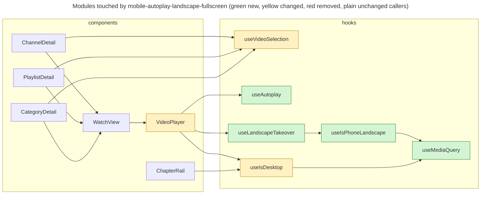

## Why

On a phone, watching means an extra tap on play after every pick, and iPhone often ignores even the deep-link autoplay because the `<video autoplay>` mounts after the data fetch, outside the tap. Rotating the phone to watch keeps the page around a small player, since iPhone can't enter fullscreen from a rotation.

## What Changes

- Picking a video in the watching queue starts it playing, like opening a card (deep link) already does. Applies on every viewport, desktop included.
- The player starts playback by calling `play()` on the `<video>` (reused across picks, never remounted) instead of the `autoplay` attribute; a refused `play()` leaves the video paused with no error.
- The default video (no deep link, no pick), list refreshes, and a selected video that finishes downloading while selected never start by themselves.
- On a phone held in landscape with a downloaded video in the player (playing or paused), the player takes over the screen: fixed full viewport, black, video letterboxed, safe-area insets respected, chapter rail and page hidden, page scroll locked, native controls usable. Rotating back to portrait restores the page and its scroll position without interrupting playback. No video, or a video not downloaded: no takeover. No Fullscreen API.
- `playsInline` stays.

## Capabilities

### New Capabilities

(none)

### Modified Capabilities

- `web-ui`: a picked or deep-linked video starts playing (new requirement); phone landscape player takeover (new requirement).

## Impact

- `web/src/hooks/useVideoSelection.ts` (autoplay also for a pick)
- `web/src/components/VideoPlayer.tsx` (play on selection, landscape takeover)
- New `web/src/hooks/useAutoplay.ts`, `useMediaQuery.ts`, `useIsPhoneLandscape.ts`, `useLandscapeTakeover.ts` (all under `web/src/hooks/`); `useIsDesktop.ts` built on `useMediaQuery`
- `web/src/test/setup.ts`, `web/src/test/viewport.ts` (query-aware `matchMedia` stub with change events)
- Tests: `VideoPlayer.test.tsx`, `useVideoSelection.test.tsx`, `ChannelDetail.test.tsx`, `CategoryDetail.test.tsx`; e2e `mobileWatch.spec.js`
- `CHANGELOG.md`

