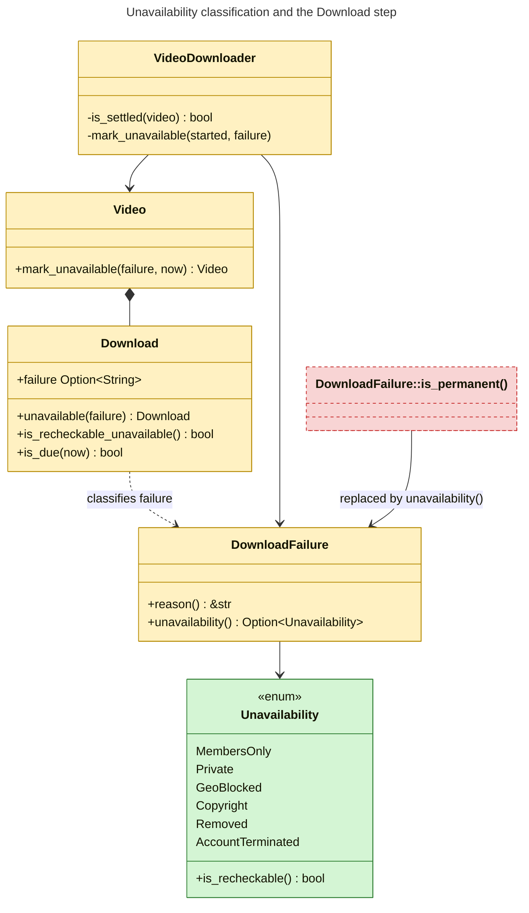
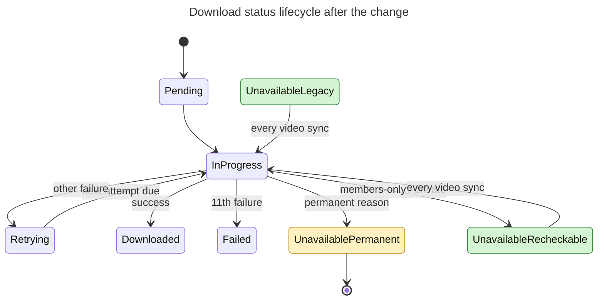
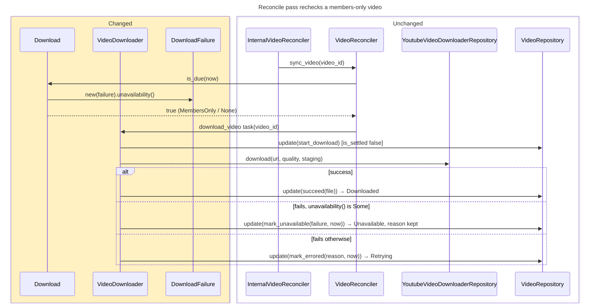

# Design

## Context

- Every reconcile pass (channel or playlist) schedules a `sync_video` for every stored video (`InternalVideoReconciler::schedule_syncs`). The sync schedules a download when `Download::is_due` is true. So making a recheckable Unavailable download "due" is enough to retry it once per pass, with no new scheduling.
- `Download::unavailable()` currently clears `failure`. The `videos.download_failure` column already exists and is written for every status, so keeping the reason needs no schema change.
- `VideoDownloader::is_settled` gates both `find_downloadable` and `start_download`.

## Goals / Non-Goals

**Goals:** members-only and private videos get downloaded once they become public, without the user doing anything. Legacy Unavailable rows (no reason) fix themselves.

**Non-Goals:** showing the Unavailable reason in the API or UI (`dto.rs` still filters `failure` to failing downloads); letting the user's Retry reset Unavailable; detecting "members first" videos apart from members-only forever.

## Decisions

- Keep the reason as text in `Download.failure` and classify it on read with `DownloadFailure::unavailability()`, instead of adding an enum column. There's no migration, and legacy rows (`failure = NULL`) naturally read as "unknown → recheckable".
- Recheck from video sync (`is_due`) rather than resetting the status to Pending in the reconcilers. The status stays Unavailable between attempts, so the channel window (Unavailable doesn't count toward `video_limit`) stays stable, and this covers channels and playlists in one place.
- An attempt on a recheckable Unavailable download that fails transiently goes through `Download::fail` like any other: it becomes Retrying under the normal policy.

## Diagrams

Colours: green = new, yellow = changed, red = removed, plain = unchanged.







## Types & Signatures

```rust
// src/domain/video/download_failure.rs
/// Why YouTube won't serve a video. Recheckable ones may become public later.
#[derive(Debug, Clone, Copy, PartialEq, Eq)]
pub enum Unavailability {
    MembersOnly,
    Private,
    GeoBlocked,
    Copyright, // "claimed content" and "copyright"
    Removed,   // "has been removed", "no longer available"
    AccountTerminated,
}

impl Unavailability {
    /// MembersOnly and Private.
    pub fn is_recheckable(self) -> bool;
}

impl DownloadFailure {
    /// The unavailability the reason names, matched case-insensitively
    /// against the token allowlist; replaces `is_permanent()`.
    pub fn unavailability(&self) -> Option<Unavailability>;
}
```

```rust
// src/domain/video/download.rs
impl Download {
    /// Unavailable, its failed attempts cleared and `failure`'s reason kept.
    pub fn unavailable(self, failure: &DownloadFailure) -> Self;

    /// Unavailable (not discarded, not started) with a recheckable reason or
    /// none recorded.
    pub fn is_recheckable_unavailable(&self) -> bool;

    /// Also true for a recheckable Unavailable download.
    pub fn is_due(&self, now: DateTime<Utc>) -> bool;
}
```

```rust
// src/domain/video/video.rs
impl Video {
    pub fn mark_unavailable(self, failure: &DownloadFailure, now: DateTime<Utc>) -> Self;
}
```

```rust
// src/domain/services/video_downloader.rs
impl VideoDownloader {
    /// Downloaded, Failed, Discarded, or Unavailable unless recheckable.
    fn is_settled(video: &Video) -> bool;
    /// `failure.unavailability().is_some()` → mark_unavailable, else fail_retryably.
    fn record_failed(&self, started: Video, failure: DownloadFailure) -> anyhow::Result<VideoStepOutcome>;
}
```

## Call Stack

1. Reconcile pass → `InternalVideoReconciler::schedule_syncs(desired)` → `sync_video` task → `VideoReconciler` builds `VideoSyncPlan` → `Download::is_due(now)` → `is_recheckable_unavailable()` → `DownloadFailure::new(failure).unavailability()` → schedules `download_video`.
2. `download_video` task → `VideoDownloader::find_downloadable(video_id)` (`is_settled` false) → `start_download(video_id)` → adapter `download(url, quality, staging)` →
   - success: `Video::succeed_download(...)` (unchanged)
   - clean failure: adapter `diagnose` → `record_failed(started, failure)` → `failure.unavailability()`:
     - `Some(_)`: `mark_unavailable(started, &failure)` → `Video::mark_unavailable(&failure, now)` → `Download::unavailable(&failure)`; outcome `Settled`
     - `None`: `fail_retryably` (unchanged)

## Test Plan

Behaviour tests:

1. `download_video_task`: `it_should_keep_the_reason_when_marking_the_video_unavailable`: a members-only failure → Unavailable with `failure` = the reason, 0 attempts.
2. `sync_video_task`: `it_should_schedule_a_download_for_a_members_only_unavailable_video`: Unavailable with a members-only reason → `download_video` scheduled now.
3. `sync_video_task`: `it_should_schedule_a_download_for_an_unavailable_video_without_a_reason`: legacy Unavailable, `failure` None → download scheduled.
4. `sync_video_task`: `it_should_not_schedule_a_download_for_a_permanently_unavailable_video`: Unavailable "has been removed" → nothing scheduled.
5. `download_video_task`: `it_should_download_a_members_only_unavailable_video_that_became_public`: Unavailable members-only, the fake download succeeds → Downloaded.
6. `download_video_task`: `it_should_keep_a_still_members_only_video_unavailable_without_counting_an_attempt`: fails members-only again → Unavailable, 0 attempts, task settled.
7. `download_video_task`: `it_should_settle_a_private_video_that_is_now_removed`: Unavailable private, fails "has been removed" → Unavailable with the new reason. A second task run attempts no download.
8. `download_video_task`: `it_should_not_attempt_a_permanently_unavailable_video`: Unavailable copyright → no download call, video unchanged.
9. `download_video_task`: `it_should_retry_a_members_only_video_that_fails_transiently`: Unavailable members-only, fails "HTTP Error 503" → Retrying with 1 attempt.

Infrastructure tests (SqliteVideoRepository):

10. `it_should_round_trip_an_unavailable_download_with_its_reason`: save Unavailable with a failure reason → find returns the same reason.
