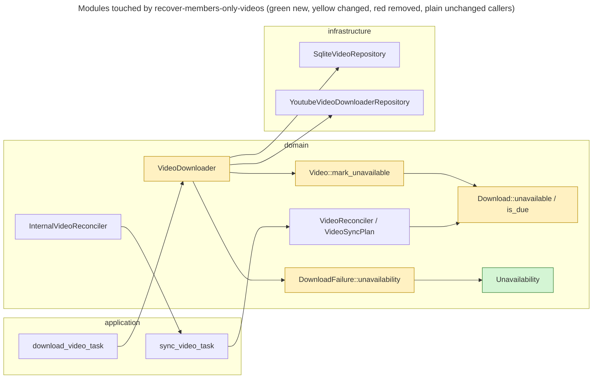

# Proposal

## Why

Issue #209: creators often publish a video for channel members first and make it public later. yarrtube marks a members-only video Unavailable, which is final, so it never gets downloaded after it goes public. The only workaround is deleting and re-adding the channel. Private videos have the same problem when a creator later makes them public.

## What Changes

- Unavailable reasons are split into **recheckable** (members-only, private video) and **permanent** (copyright/claimed-content block, region block, removed or no longer available, terminated account).
- An Unavailable download keeps its diagnosed failure reason, which is currently cleared.
- A video sync treats a recheckable Unavailable download as due, so every reconcile pass (which syncs every stored video) tries it again. There's no separate schedule and no attempt counting. If an attempt fails with a recheckable or permanent reason again, the video goes straight back to Unavailable. If it succeeds, the video is Downloaded.
- An Unavailable download with no recorded reason (stored before this change) is treated as recheckable. One attempt records its reason, so existing stuck videos fix themselves and no data migration is needed.
- Unavailable videos still don't count toward a channel's `video_limit`, and the user's Retry still leaves Unavailable steps as they are.

## Capabilities

### New Capabilities

None.

### Modified Capabilities

- `video-download`: Unavailable is final only for permanent reasons. The reason is kept. A recheckable Unavailable download is due.
- `video-sync`: the sync schedules a download for a recheckable Unavailable video.
- `video-retries`: the Step Status vocabulary no longer calls Unavailable final for the download.

## Impact

- `src/domain/video/download_failure.rs`: `is_permanent()` becomes `unavailability() -> Option<Unavailability>`, with `Unavailability::is_recheckable()`.
- `src/domain/video/download.rs`: `unavailable(failure)` keeps the reason. `is_due` covers a recheckable Unavailable download.
- `src/domain/video/video.rs`: `mark_unavailable` takes the failure.
- `src/domain/services/video_downloader.rs`: classification goes through `unavailability()`. `is_settled` no longer settles a recheckable Unavailable download.
- No schema change: the existing `videos.download_failure` column stores the reason. No API or UI change.

