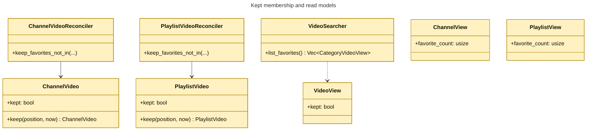
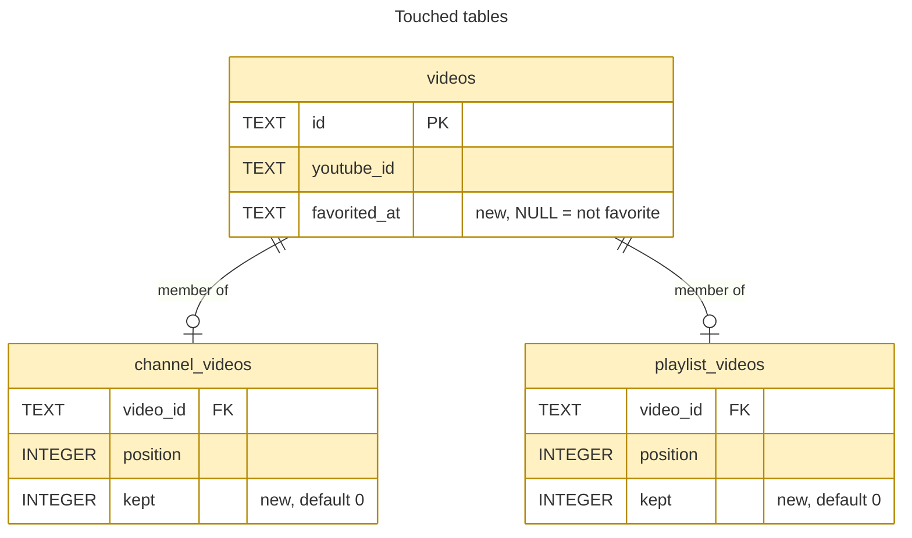
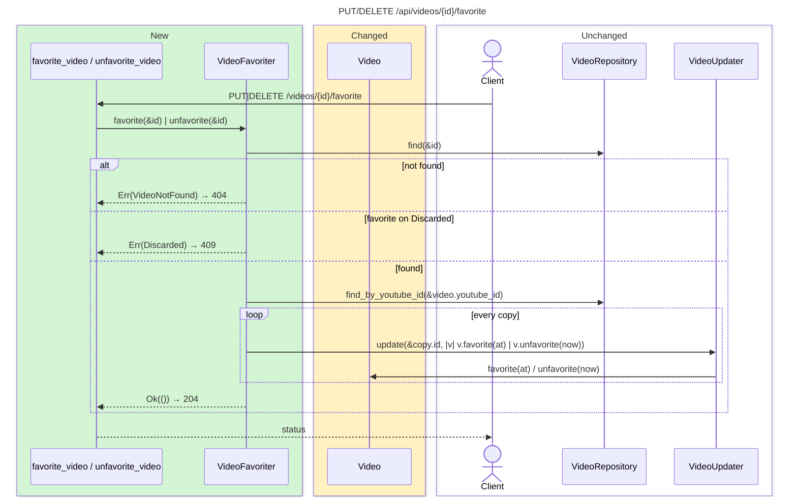
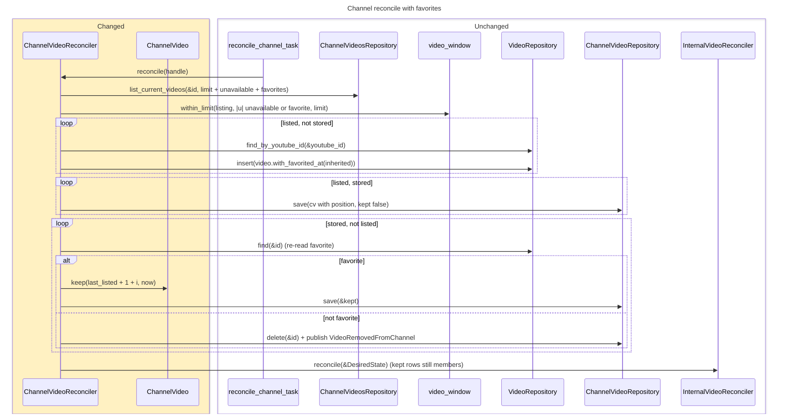
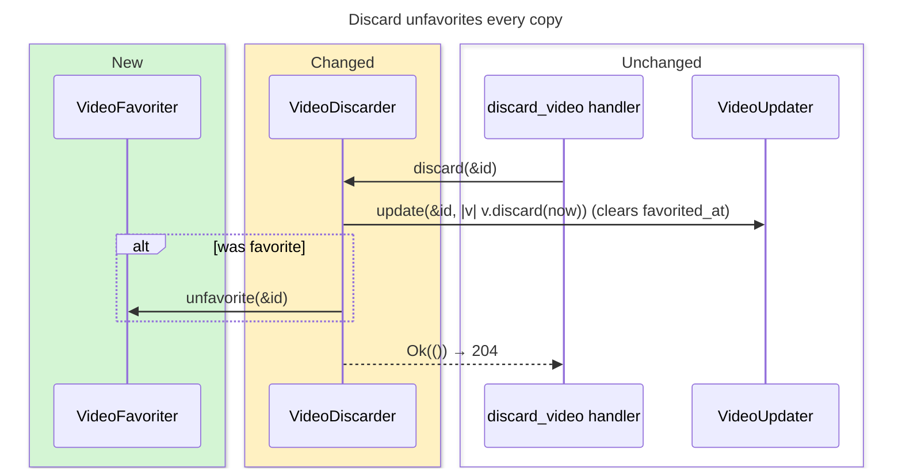

# Design

Requirements: `specs/`. Motivation: proposal.md.

Key decisions (one line each, so they aren't "fixed" later):
- **Favorite is a column on every copy (`videos.favorited_at`), not a table keyed by YouTube id.** Every read model already loads `Video`. `VideoFavoriter` writes all copies, the same way `VideoWatchStateUpdater` does. When a source is deleted, its copies' favorites go with them, so nothing is left orphaned.
- **A new copy inherits the favorite.** Both reconcilers' `add_video` read `find_by_youtube_id` and copy the earliest `favorited_at`.
- **Kept is stored on the membership row (`channel_videos.kept`, `playlist_videos.kept`), not derived.** The UI needs it to warn before unfavoriting, and only the reconcile pass knows what YouTube listed.
- **A kept row stays a member of its source.** `DesiredState` is therefore unchanged: the filesystem reconcile protects a kept video's files, and its sync and download keep running.
- **No Season 00.** Playlist episode numbers come from a counter that never decreases, so a kept video's number can never collide with a new one.
- **Kept rows are re-positioned after the last listed position**, keeping their previous relative order, so `ORDER BY position` stays correct.
- **Favorites are skipped when counting the channel window**, alongside Unavailable. The listing asks for one extra upload per stored favorite, kept ones included. That over-fetches slightly but stays simple.
- **The favorite is re-read before a video is removed**, the same way `remember_if_discarded` re-reads the discard. A video favorited during the listing is kept.
- **Unfavoriting does nothing else.** The next reconcile evicts a kept video through the normal path (`VideoRemovedFrom*`, which deletes its files).
- **Discard unfavorites every copy.** `Video::discard` clears its own `favorited_at`, then `VideoDiscarder` calls `VideoFavoriter::unfavorite`.
- **The favorites list reuses `CategoryVideoView` / `CategoryVideoResponse`.** It's the same shape: the video, its source and its categories.
- **An Unavailable favorite isn't kept.** No view shows it, so no one could unfavorite it; the keep step checks `!is_skipped()` before `is_favorite_now`.
- **Only source views know `kept`.** The Favorites, category and home views send none, so unfavoriting there doesn't ask for confirmation.

## Diagrams

Colours: green = new, yellow = changed, red = removed, plain = unchanged.

```mermaid
---
title: Favorite types
---
classDiagram
  class VideoFavoriterApi {
    <<trait>>
    +favorite(video_id) Result~(), FavoriteVideoError~
    +unfavorite(video_id) Result~(), FavoriteVideoError~
  }
  class VideoFavoriter
  class FavoriteVideoError {
    <<enum>>
    VideoNotFound
    Discarded
    Repository
  }
  class Video {
    +favorited_at: Option~DateTime~
    +favorite(at) Option~Video~
    +unfavorite(now) Option~Video~
    +is_favorite() bool
    +discard(now) Option~Video~
  }
  class VideoUpdater
  class VideoRepository {
    <<trait>>
    +find_by_youtube_id(id)
    +list_favorites() Vec~Video~
  }
  class VideoDiscarder
  VideoFavoriterApi <|.. VideoFavoriter
  VideoFavoriter --> VideoRepository
  VideoFavoriter --> VideoUpdater
  VideoFavoriter ..> FavoriteVideoError
  VideoUpdater --> Video
  VideoDiscarder --> VideoFavoriter
  class VideoFavoriterApi:::new
  class VideoFavoriter:::new
  class FavoriteVideoError:::new
  class Video:::changed
  class VideoRepository:::changed
  class VideoDiscarder:::changed
  classDef new fill:#d4f5d4,stroke:#2e7d32
  classDef changed fill:#fff1c2,stroke:#b58900
  classDef removed fill:#f8d4d4,stroke:#c62828,stroke-dasharray:4
```













## Types & Signatures

```sql
-- migrations/0035_video_favorites.sql
ALTER TABLE videos ADD COLUMN favorited_at TEXT;
ALTER TABLE channel_videos ADD COLUMN kept INTEGER NOT NULL DEFAULT 0;
ALTER TABLE playlist_videos ADD COLUMN kept INTEGER NOT NULL DEFAULT 0;
CREATE INDEX IF NOT EXISTS idx_videos_favorited_at ON videos (favorited_at);
```

```rust
// src/domain/video/video.rs
pub struct Video {
    // ...
    /// When the YouTube video was favorited; `None` when it isn't a favorite.
    pub favorited_at: Option<DateTime<Utc>>,
}
impl Video {
    /// Favorited at `at`; `None` when already a favorite or Discarded.
    pub fn favorite(self, at: DateTime<Utc>) -> Option<Self>;
    /// No longer a favorite; `None` when it wasn't one.
    pub fn unfavorite(self, now: DateTime<Utc>) -> Option<Self>;
    pub fn is_favorite(&self) -> bool;
    /// For a new copy: the favorite time of an existing copy.
    pub fn with_favorited_at(self, at: Option<DateTime<Utc>>) -> Self;
    // discard(now) additionally clears favorited_at
}
```

```rust
// src/domain/video/errors.rs
pub enum FavoriteVideoError {
    VideoNotFound(VideoId),
    Discarded(VideoId),
    Repository(anyhow::Error),
}
```

```rust
// src/domain/services/video_favoriter.rs
#[derive(Clone)]
pub struct VideoFavoriter {
    video_repository: Arc<dyn VideoRepository>,
    video_updater: VideoUpdater,
    clock: Arc<dyn Clock>,
}
pub trait VideoFavoriterApi: Send + Sync {
    /// Every copy of the video's YouTube video favorited now; already-favorite copies unchanged.
    fn favorite(&self, video_id: &VideoId) -> Result<(), FavoriteVideoError>;
    /// Every copy of the video's YouTube video unfavorited.
    fn unfavorite(&self, video_id: &VideoId) -> Result<(), FavoriteVideoError>;
}
```

```rust
// src/domain/services/video_discarder.rs
pub struct VideoDiscarder {
    // ...
    video_favoriter: VideoFavoriter,
}
```

```rust
// src/domain/channel_video/channel_video.rs
pub struct ChannelVideo {
    // ...
    /// A favorite no longer among the channel's listed uploads, kept anyway.
    pub kept: bool,
}
impl ChannelVideo {
    /// Kept at `position`, after the listed uploads.
    pub fn keep(self, position: i64, now: DateTime<Utc>) -> Self;
}
```

```rust
// src/domain/playlist_video/playlist_video.rs
pub struct PlaylistVideo {
    // ...
    pub kept: bool,
}
impl PlaylistVideo {
    pub fn keep(self, position: i64, now: DateTime<Utc>) -> Self;
}
```

```rust
// src/domain/services/channel_video_reconciler.rs (private helpers)
impl ChannelVideoReconciler {
    /// Earliest favorite time among stored copies of `youtube_id`.
    fn inherited_favorite(&self, youtube_id: &YoutubeVideoId) -> anyhow::Result<Option<DateTime<Utc>>>;
    /// Stored videos not in `current_youtube_ids`: favorites kept after `last_listed_position`, the rest removed.
    fn keep_or_remove_videos_not_in(
        &self,
        channel: &Channel,
        stored_videos: &[(ChannelVideo, Video)],
        current_youtube_ids: &HashSet<&str>,
        last_listed_position: i64,
    ) -> anyhow::Result<usize>;
    /// Re-reads the stored video: favorite now?
    fn is_favorite_now(&self, video: &Video) -> anyhow::Result<bool>;
}
// src/domain/services/playlist_video_reconciler.rs — the same three helpers over PlaylistVideo.
```

```rust
// src/domain/video/video_view.rs
pub struct VideoView {
    pub video: Video,
    pub metadata: Option<VideoMetadata>,
    pub summary: Option<VideoSummary>,
    /// Kept by its channel or playlist; `false` outside a source listing.
    pub kept: bool,
}
// src/domain/video/home_video_view.rs
pub struct HomeVideoView { /* ... */ pub favorite: bool }
// src/domain/channel/channel_view.rs
pub struct ChannelView { /* ... */ pub favorite_count: usize }
// src/domain/playlist/playlist_view.rs
pub struct PlaylistView { /* ... */ pub favorite_count: usize }
```

```rust
// src/domain/services/video_searcher.rs
pub trait VideoSearcherApi: Send + Sync {
    // ...
    /// Favorite, unskipped videos once per YouTube video (channels first), most recently favorited first.
    fn list_favorites(&self) -> Result<Vec<CategoryVideoView>, ListVideosError>;
}
```

```rust
// src/infrastructure/repositories/sqlite_video_repository.rs
pub trait VideoRepository: Send + Sync {
    // ...
    /// Every video with a `favorited_at`.
    fn list_favorites(&self) -> anyhow::Result<Vec<Video>>;
}
// sqlite_channel_video_repository.rs / sqlite_playlist_video_repository.rs: `kept` read and written by save/list.
```

```rust
// src/application/http/videos/mod.rs
pub async fn favorite_video(State(video_favoriter): State<VideoFavoriter>, Path(id): Path<String>) -> Result<StatusCode, ApiError>;
pub async fn unfavorite_video(State(video_favoriter): State<VideoFavoriter>, Path(id): Path<String>) -> Result<StatusCode, ApiError>;
pub async fn list_favorite_videos(State(video_searcher): State<VideoSearcher>) -> Result<Json<Vec<CategoryVideoResponse>>, ApiError>;
// src/application/http/mod.rs
//   .route("/videos/{id}/favorite", put(videos::favorite_video).delete(videos::unfavorite_video))
//   .route("/favorites/videos", get(videos::list_favorite_videos))
//   ApiServices.video_favoriter: VideoFavoriter
```

```rust
// src/application/http/videos/dto.rs
pub struct VideoResponse { /* ... */ pub favorite: bool, pub kept: bool }
pub struct HomeVideoResponse { /* ... */ pub favorite: bool }
pub struct CategoryVideoResponse { /* ... */ pub favorite: bool }
// src/application/http/channels/dto.rs, playlists/dto.rs
pub struct ChannelResponse { /* ... */ pub favorite_count: usize }
pub struct PlaylistResponse { /* ... */ pub favorite_count: usize }
```

```ts
// web/src/api/types.ts
interface Video { /* ... */ favorite: boolean; kept: boolean }
interface HomeVideo { /* ... */ favorite: boolean }
interface CategoryVideo { /* ... */ favorite: boolean }
interface ChannelListItem { /* ... */ favorite_count: number }
interface PlaylistListItem { /* ... */ favorite_count: number }
// web/src/api/client.ts
export function favoriteVideo(id: string): Promise<void>
export function unfavoriteVideo(id: string): Promise<void>
export function fetchFavoriteVideos(): Promise<CategoryVideo[]>
// web/src/api/queries.ts
export function useFavoriteVideos(): UseQueryResult<CategoryVideo[], Error>
export function useSetVideoFavorite(): (videoId: string, favorite: boolean) => Promise<void>
// web/src/lib/sourceDelete.ts
export function deleteSourceDescription(kind: 'channel' | 'playlist', favoriteCount: number): string
// web/src/components/FavoriteButton.tsx
export function FavoriteButton(props: { videoId: string; title: string; favorite: boolean; kept?: { sourceName: string } }): JSX.Element
// web/src/components/UnfavoriteKeptDialog.tsx
export function UnfavoriteKeptDialog(props: { open: boolean; title: string; sourceName: string; onConfirm: () => void; onCancel: () => void }): JSX.Element
// web/src/components/FavoritesDetail.tsx — route `/favorites` in App.tsx
export function FavoritesDetail(): JSX.Element
// web/src/components/VideoActionsMenu.tsx — new prop
favorite?: { favorite: boolean; kept?: { sourceName: string } }
```

## Call Stack

**Favorite** — `PUT /api/videos/{id}/favorite`
1. `favorite_video(id)` → `VideoId::new(id)` → `run_blocking(video_favoriter.favorite(&id))`
2. `VideoFavoriter::favorite` → `video_repository.find(&id)` (none → `VideoNotFound`; Discarded → `Discarded`)
3. → `video_repository.find_by_youtube_id(&video.youtube_id)` → `at = clock.now()` → for each copy `video_updater.update(&copy.id, |v| v.favorite(at))`
4. errors: `VideoNotFound` → 404, `Discarded` → 409, `Repository` → 500; Ok → 204

**Unfavorite** — `DELETE /api/videos/{id}/favorite`
1. `unfavorite_video(id)` → `video_favoriter.unfavorite(&id)`
2. `find(&id)` (none → 404) → `find_by_youtube_id` → each copy `update(|v| v.unfavorite(now))` → 204

**Discard**
1. `VideoDiscarder::discard(&id)` → (existing) `discard_stored` (`Video::discard` clears `favorited_at`) → `delete_pending_tasks`
2. → if `before.is_favorite()`: `video_favoriter.unfavorite(&id)` (map error to `DiscardVideoError::Repository`) → `publish_discarded`

**Channel reconcile** — `ChannelVideoReconciler::sync_membership_with_youtube(channel, on_listing_failure)`
1. `stored = list_stored_videos(channel)`; `skipped_ids` = stored ids that are Unavailable **or favorite**
2. `list_current_videos(channel, skipped_ids.len(), …)` → `video_window::within_limit(listing, |u| skipped_ids.contains(u), limit)`
3. new: `add_video(channel, youtube_id, current, now)` → `Video::create(..).with_favorited_at(self.inherited_favorite(&youtube_id)?)`
4. known: `refresh_known_video` also saves `kept: false` when the row was kept
5. `keep_or_remove_videos_not_in(channel, &stored, &current_ids, last_listed_position)`: for each stored not listed, in stored order → `!video.is_skipped() && is_favorite_now(video)` → favorite: `channel_video_repository.save(&cv.keep(last_listed_position + 1 + i, now))`, else (existing) remember-if-discarded, delete, publish `VideoRemovedFromChannel`
6. `desired_state` unchanged → `internal_video_reconciler.reconcile(&desired)`

**Playlist reconcile** — `PlaylistVideoReconciler::sync_membership_with_youtube`
1. new: `add_video(numbering, youtube_id, current, now)` → inherited favorite as above
2. known: `refresh_known_video` also clears `kept`
3. `keep_or_remove_videos_not_in(playlist, &stored, &current_ids, max listed position)` as for channels (`!video.is_skipped() && is_favorite_now(video)`, re-reading the favorite), publishing `VideoRemovedFromPlaylist` for removed ones

**Favorites list** — `GET /api/favorites/videos`
1. `list_favorite_videos` → `video_searcher.list_favorites()`
2. → `video_repository.list_favorites()` → drop `is_skipped` → `with_sources` → `channels_first` → `once_per_youtube_video` → sort by `Reverse(favorited_at)` → `category_view(sourced, &by_video, summaries_available)` → `CategoryVideoResponse`

**Source listings**
- `list_for_channel` / `list_for_playlist`: `self.view(video, summaries_shown)` → `VideoView { kept: cv.kept, .. }`
- `ChannelViewSearcher::channel_view` / `PlaylistViewSearcher`: `favorite_count = videos.filter(|v| v.is_favorite() && !v.is_skipped()).count()`

**Web**
- `FavoriteButton` / `VideoActionsMenu` → `kept` ? `UnfavoriteKeptDialog` → `useSetVideoFavorite()(id, false)` : `useSetVideoFavorite()(id, !favorite)` → `favoriteVideo` / `unfavoriteVideo` → invalidate library + `['favorites']`
- `VideoGrid` → `keptOf(video)` → `ThumbnailOverlay` "Kept" badge and `VideoActionsMenu` `favorite.kept`
- `Sidebar` → `SidebarFavorites` row (`FAVORITES_PATH`) above `SidebarCategories` → `/favorites` → `FavoritesDetail` → `useFavoriteVideos()` → `VideoGrid` + `CategoryPlayer`-like selection (`useVideoSelection`)
- `Sidebar` row / `DetailHeader` delete → `deleteSourceDescription(kind, item.favorite_count)`

## Test Plan

### 1. Behaviour tests

HTTP — `src/application/http/videos/tests.rs`:
1. `it_should_favorite_a_video` — 204; video favorite, `favorited_at` = now.
2. `it_should_favorite_every_copy_of_the_youtube_video` — channel + playlist copies both favorite, same time.
3. `it_should_keep_the_favorite_time_when_favorited_again` — 204, `favorited_at` unchanged.
4. `it_should_unfavorite_every_copy_of_the_youtube_video` — 204, neither copy favorite.
5. `it_should_ignore_unfavorite_of_a_video_that_is_not_a_favorite` — 204, no write.
6. `it_should_fail_to_favorite_a_discarded_video` — 409, not favorite.
7. `it_should_fail_to_favorite_an_unknown_video` — 404 (and unfavorite 404).
8. `it_should_unfavorite_every_copy_when_discarding_a_favorite` — discard channel copy → playlist copy not favorite.
9. `it_should_report_favorite_and_kept_in_a_channel_list` — `favorite`, `kept` in `VideoResponse`.
10. `it_should_report_favorite_on_home_cards` — `HomeVideoResponse.favorite`.
11. `it_should_list_favorites_most_recently_favorited_first`.
12. `it_should_list_a_favorite_tracked_twice_once_from_its_channel`.
13. `it_should_omit_unavailable_favorites_from_the_favorites_list`.
14. `it_should_list_no_favorites` — 200, `[]`.

HTTP — `src/application/http/channels/tests.rs`, `playlists/tests.rs`:
15. `it_should_list_a_channel_with_its_favorite_count`.
16. `it_should_list_a_playlist_with_its_favorite_count`.

Tasks — `src/application/tasks/reconcile_channel_task/tests.rs`:
17. `it_should_request_one_more_upload_per_favorite` — limit 3, two favorites (one kept) → requests 5.
18. `it_should_not_count_a_favorite_toward_the_limit` — limit 3, A B C D with B favorite → all four stored.
19. `it_should_keep_a_favorite_that_ages_out` — C not listed → stored, kept, no `VideoRemovedFromChannel`.
20. `it_should_keep_a_favorite_deleted_on_youtube`.
21. `it_should_keep_the_pending_download_of_a_kept_favorite` — download task still pending.
22. `it_should_place_kept_videos_after_the_listed_ones` — order A, B, C, D.
23. `it_should_stop_keeping_a_kept_video_listed_again` — `kept` false, recency position.
24. `it_should_evict_a_kept_video_once_unfavorited` — removed, `VideoRemovedFromChannel` published.
25. `it_should_keep_a_video_favorited_during_the_listing` — favorite written while listing → kept.
26. `it_should_store_a_new_copy_of_a_favorite_as_a_favorite` — channel stores a YouTube video already favorite in a playlist.
27. `it_should_not_delete_the_files_of_a_kept_favorite` — filesystem reconcile leaves its episode files.

Tasks — `src/application/tasks/reconcile_playlist_task/tests.rs`:
28. `it_should_keep_a_favorite_removed_from_the_playlist` — stays `S01E004`, kept, no `VideoRemovedFromPlaylist`.
29. `it_should_not_reuse_the_episode_number_of_a_kept_favorite` — next new video `7`.
30. `it_should_place_kept_videos_after_the_listed_ones_in_a_playlist`.
31. `it_should_stop_keeping_a_video_re_added_to_the_playlist`.
32. `it_should_remove_a_kept_video_once_unfavorited_from_the_playlist`.
33. `it_should_keep_a_video_favorited_during_the_playlist_listing`.
34. `it_should_store_a_new_playlist_copy_of_a_favorite_as_a_favorite`.
34a. `it_should_keep_a_video_favorited_while_new_playlist_items_are_added` — favorite written while new items are added → kept (re-read).
34b. `it_should_remove_an_unavailable_favorite_from_the_playlist`.

Tasks — `reconcile_channel_task/tests.rs` (audit):
34c. `it_should_remove_an_unavailable_favorite_no_longer_listed`.

Domain — `channel_video.rs`, `playlist_video.rs`:
34d. `it_should_keep_a_channel_video_at_a_new_position` / `it_should_keep_a_playlist_video_at_a_new_position` — position, `kept`, `created_at` = now.

Web — Vitest + `mockApi`:
35. `FavoriteButton.test.tsx` "favorites a video" — `PUT /api/videos/v1/favorite`, toggle becomes "Remove from favorites".
36. "unfavorites a favorite without asking" — `DELETE`, no dialog.
37. "asks before unfavoriting a kept video" — dialog text names title and source; confirm sends `DELETE`.
38. "sends nothing when unfavoriting a kept video is cancelled".
39. "tells the user when favoriting fails" — toggle unchanged.
40. `VideoActionsMenu.test.tsx` "offers Add to favorites and Remove from favorites".
41. `VideoGrid.test.tsx` "shows a star on favorite cards and a Kept badge on kept ones".
42. `Sidebar.test.tsx` "shows Favorites above Categories" / "above Channels with categories off" / "marks Favorites active on /favorites".
43. `FavoritesDetail.test.tsx` "lists favorites in server order with their source" / "says No favorites yet" / "drops a video once unfavorited".
44. `lib/sourceDelete.test.ts` — 0, 1 and 2 favorites wording.
45. `Sidebar.test.tsx` "warns how many favorites deleting a channel deletes".
45a. `VideoGrid.test.tsx` "asks before unfavoriting a kept card from its menu".

End-to-end — `e2e-tests/tests/favorites.spec.js`:
45b. "star a video: it shows under Favorites, and unstarring takes it off" — covers the three favorite routes for the route-coverage check.

### 2. Infrastructure tests

`SqliteVideoRepository`:
46. `it_should_round_trip_a_favorite_video` — `favorited_at` written and read back; `None` round-trips.
47. `it_should_list_only_favorite_videos`.

`SqliteChannelVideoRepository`:
48. `it_should_round_trip_a_kept_channel_video`.

`SqlitePlaylistVideoRepository`:
49. `it_should_round_trip_a_kept_playlist_video`.
