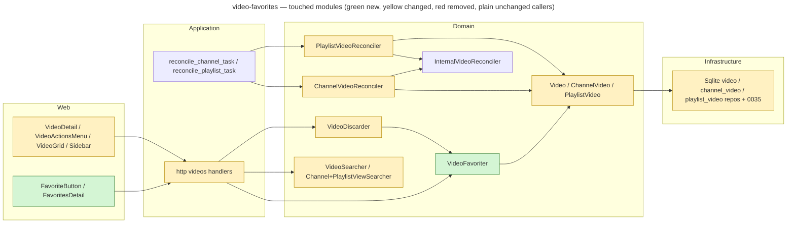

# Proposal

## Why

Channels keep only their latest `video_limit` uploads, and playlists follow YouTube's membership, so any video can be deleted from disk by a later sync. There is no way to say "keep this one" and no place to find the videos you care about most.

## What Changes

- A video can be **favorited** and **unfavorited** (`PUT` / `DELETE /api/videos/{id}/favorite`, 204). A favorite belongs to the YouTube video, like watch state: every stored copy becomes a favorite, and a copy stored later by another source starts favorited. A Discarded video can't be favorited (409); an unknown one answers 404.
- **Favorites are never evicted.** A channel favorite that ages out of the latest `video_limit` uploads, or disappears from YouTube, stays stored and downloaded. So does a playlist favorite removed from the YouTube playlist. Such a video is **kept**: its membership row is flagged and moved after the listed videos, in their previous order. When it is listed again it stops being kept.
- **Favorites don't count toward `video_limit`.** A channel holds its latest `video_limit` uploads that aren't skipped or favorites, plus every favorite. The listing asks for one more upload per stored favorite, the same way it does for Unavailable videos.
- A not-yet-downloaded favorite keeps downloading and retrying when it leaves the window. The filesystem reconcile protects its files, since it is still a member of its source.
- Unfavoriting a kept video makes it an ordinary video that has left its source, so the next reconcile removes it and deletes its files. The web UI warns before doing this.
- **Discarding a video unfavorites** its YouTube video, on every copy.
- `GET /api/favorites/videos` lists the favorite videos, one per YouTube video, skipping Unavailable and Discarded ones, most recently favorited first. Each comes with its source and categories, the same shape as a category's videos.
- Listings: every listed video reports `favorite`. Channel and playlist videos also report `kept`. Channels and playlists report their `favorite_count`.
- Web UI:
  - a star toggle in the video detail pane, and "Add to favorites" / "Remove from favorites" in the video actions menu
  - a filled star on favorite cards and a "Kept" badge on kept videos in source lists
  - a "Favorites" sidebar entry above Categories, shown even when categories are off, opening a Favorites view at `/favorites`
  - a confirmation before unfavoriting a kept video
  - the source delete confirmation says how many favorited videos it will delete. Deleting a source still deletes its favorites (v1).
- Not changed from the discussion: a playlist favorite removed from the playlist is **not** moved to `Season 00`. A playlist's episode numbers are assigned once from a counter that never decreases (`tv-show-layout`), so a kept video's number can never be reused and its files stay where they are.
- Out of scope: a Plex "Favorite" label or smart playlist; keeping favorites in a standalone folder when their source is deleted; sorting or filtering on the Favorites view.

## Capabilities

### New Capabilities
- `video-favorites`: favoriting and unfavoriting a YouTube video across its copies, and listing the favorites.

### Modified Capabilities
- `channel-video-sync`: favorites widen the listing, don't count toward `video_limit`, and are kept instead of evicted. Kept videos sit after the listed ones.
- `playlist-reconciliation`: a favorite removed from the YouTube playlist is kept instead of removed.
- `video-discard`: discarding a video unfavorites its YouTube video.
- `video-listing`: listed videos report `favorite`; channel and playlist videos also report `kept`.
- `channel-crud`: listed channels report their favorite count.
- `playlist-crud`: listed playlists report their favorite count.
- `web-ui`: favorite controls, card star, Kept badge, Favorites sidebar entry and view, unfavorite-kept warning, favorite count in the source delete confirmation.

## Impact

- Domain:
  - `Video.favorited_at` with `favorite` / `unfavorite` / `is_favorite`; `Video::discard` clears it
  - `ChannelVideo.kept` / `PlaylistVideo.kept`
  - new `VideoFavoriter` + `FavoriteVideoError`
  - `VideoDiscarder` unfavorites copies
  - `ChannelVideoReconciler` and `PlaylistVideoReconciler`: keep favorites, new copies inherit the favorite, favorites skipped when counting the window
  - `VideoSearcher::list_favorites`, `VideoView.kept`
  - `ChannelView` / `PlaylistView.favorite_count`
- Application: favorite/unfavorite handlers and `GET /favorites/videos`; DTOs gain `favorite`, `kept`, `favorite_count`.
- Infrastructure: migration `0035_video_favorites.sql`: `videos.favorited_at`, plus `kept` on `channel_videos` and `playlist_videos`. Repositories encode and decode these columns. New `VideoRepository::list_favorites`.
- Web:
  - API layer: `api/types.ts`, `api/client.ts`, `api/queries.ts`
  - new `FavoriteButton`, `UnfavoriteKeptDialog`, `FavoritesDetail` and `lib/sourceDelete.ts`
  - changed `VideoDetail`, `VideoActionsMenu`, `VideoGrid`, `ThumbnailOverlay`, `Sidebar`, `ChannelDetail`, `PlaylistDetail` and `App.tsx` (route)
- Behaviour change for existing users: none until something is favorited. The migration defaults every row to not favorite and not kept.

