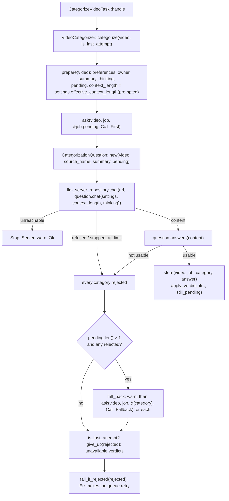

# Design

## Files

Rust:

- `src/domain/video_category/categorization_question.rs`: the question over N categories, the schema keyed by name, per-category answers, the cap scaling with N.
- `src/domain/services/video_categorizer.rs`: one call for the pending categories, then the fallback, one call per rejected category.
- `src/domain/preferences/context_length.rs`: `ContextLength::auto(prompted)`. `categorization_default` is gone.
- `src/domain/preferences/categorization_settings.rs`: `context_length: Option<ContextLength>`, where `None` is Auto, like `prompt`.
- `src/domain/preferences/preferences_change.rs`: `categorization_context_length: Option<Option<ContextLength>>`, where `Some(None)` means back to Auto.
- `src/domain/preferences/resolved_preferences.rs` (new): the preferences plus the categorization context length that Auto resolves to now, as returned by the searcher and the updater.
- `src/domain/preferences/categorization_prompt.rs`: ships `v2-batch.md`.
- `src/domain/services/preferences_searcher.rs`, `preferences_updater.rs`: take the `CategoryRepository` and return `ResolvedPreferences`.
- `src/domain/llm_server/llm_reply.rs`: `output_tokens`, for the per-call log.
- `src/domain/llm_server/llm_chat.rs`: `timeout`, a per-request value that replaces the adapter's fixed `CHAT_TIMEOUT`.
- `src/domain/services/video_summarizer.rs`: sets `timeout` to 30 minutes, unchanged behaviour.
- `src/infrastructure/repositories/ollama_llm_server_repository.rs`: reads `eval_count` into `output_tokens` and uses `chat.timeout`. The `chat_timeout` field and constant are gone.
- `src/infrastructure/repositories/sqlite_preferences_repository.rs`: stores the context length only when it is overridden. A stored `4096` and invalid values read as Auto.
- `src/application/http/preferences/dto.rs`: `categorization_context_length` accepts `null` on PATCH, and the response gets `categorization_context_length_is_auto`. Built from `ResolvedPreferences`.
- `src/application/http/preferences/mod.rs`, `src/application/tasks/categorize_video_task.rs`: tests. `ApiServices` wiring gets the category repository for both services.

Web:

- `web/src/api/types.ts`, `web/src/test/helpers.tsx`: `categorization_context_length_is_auto`, and a nullable context length in the patch.
- `web/src/lib/aiSettingsForm.ts` (+ test): an `auto` flag in the form, and the patch it produces.
- `web/src/components/AiSettingsView.tsx` (+ test): the "Auto context length" switch, the read-only field and the hint.

Prompts, eval, docs:

- `prompts/categorization/README.md`: `v2-batch` is shipped.
- `evals/categories/eval.py`: the fallback for `--batch`, Auto `num_ctx` and per-call cap mirroring the app, and the report's fallback section.
- `evals/categories/README.md`, `decisions.md`: the fallback, and a decision entry.
- `doc/AI.md`, `doc/CATEGORIES.md`: one call per video, the fallback, Auto context length.

## Types & Signatures

```rust
// domain/preferences/context_length.rs
const AUTO_TOKENS_PER_CATEGORY: u32 = 1820;
const AUTO_MIN: u32 = 4096;
impl ContextLength {
    /// 1,820 per category with an AI prompt, rounded up to a multiple of
    /// 1,024, within 4,096..=131,072.
    pub fn auto(prompted_categories: usize) -> Self;
}

// domain/preferences/categorization_settings.rs
pub struct CategorizationSettings {
    // ...
    /// The length the user saved; `None` is Auto.
    pub context_length: Option<ContextLength>,
}
impl CategorizationSettings {
    pub fn effective_context_length(&self, prompted_categories: usize) -> ContextLength;
}

// domain/preferences/resolved_preferences.rs
/// The preferences as read, with what the categorization context length is now.
pub struct ResolvedPreferences {
    pub preferences: Preferences,
    pub categorization_context_length: ContextLength,
}

// domain/services/preferences_searcher.rs / preferences_updater.rs
fn get(&self) -> Result<ResolvedPreferences, ReadPreferencesError>;
fn update(&self, change: PreferencesChange) -> Result<ResolvedPreferences, UpdatePreferencesError>;

// domain/llm_server/llm_reply.rs
pub struct LlmReply { /* ... */ pub output_tokens: u32 }

// domain/llm_server/llm_chat.rs
pub struct LlmChat { /* ... */ pub timeout: std::time::Duration }

// domain/video_category/categorization_question.rs
pub const OUTPUT_TOKENS_PER_CATEGORY: u32 = 1365;
pub const MIN_OUTPUT_TOKENS: u32 = 3072;

pub struct CategorizationQuestion { /* video details */ categories: Vec<Category> }
impl CategorizationQuestion {
    pub fn new(video: &Video, source_name: &str, summary: &SummaryText, categories: &[Category]) -> Self;
    /// Every category as `### <name>\n<prompt>`, then the JSON keyed by name.
    pub fn user_message(&self) -> String;
    pub fn chat(&self, settings: &CategorizationSettings, context_length: ContextLength, thinking: bool) -> LlmChat;
    /// 1,365 per category, at least 3,072, at most `context_length`.
    pub fn max_output_tokens(&self, context_length: ContextLength) -> u32;
    /// The cap at 5 tokens/s, at least 30 minutes.
    pub fn timeout(&self, context_length: ContextLength) -> Duration;
    /// Each category with its usable answer, if any, read after the last `</think>`.
    pub fn answers(&self, content: &str) -> Vec<(&Category, Option<CategorizationAnswer>)>;
}
fn answer_schema(names: &[&str]) -> serde_json::Value; // {name: {reason, belongs}}, all required

// domain/services/video_categorizer.rs
struct CategorizationJob { /* ... */ context_length: ContextLength } // Auto resolved in `prepare`

/// Which call of a categorization; only for the log.
enum Call { First, Fallback }

impl VideoCategorizer {
    /// One call about `categories`, storing each usable verdict; the ones
    /// rejected, with why.
    fn ask<'a>(&self, video: &Video, job: &CategorizationJob, categories: &'a [Category], call: Call)
        -> Result<Vec<(&'a Category, String)>, Stop>;
    /// `rejected` of a call about several categories, each asked again alone.
    fn fall_back<'a>(&self, video: &Video, job: &CategorizationJob, rejected: Vec<(&'a Category, String)>)
        -> Result<Vec<(&'a Category, String)>, Stop>;
    /// Applies one category's verdict, guarded by `still_pending` (unchanged).
    fn store(&self, video: &Video, job: &CategorizationJob, category: &Category, answer: CategorizationAnswer) -> anyhow::Result<()>;
}
```

```ts
// web/src/api/types.ts
categorization_context_length: number              // the resolved value
categorization_context_length_is_auto: boolean
// PreferencesPatch
categorization_context_length?: number | null      // null = back to Auto

// web/src/lib/aiSettingsForm.ts
categorization_context_length_auto: boolean
```

## Call Stack

Categorization run (`CategorizeVideoTask::handle(task, is_last_attempt)`):



Read or save preferences:

```
get_preferences      -> PreferencesSearcher::get()
                          -> preferences_repository.find()
                          -> category_repository.list()      (count with ai_prompt)
                          -> ResolvedPreferences { preferences, settings.effective_context_length(n) }
                     -> PreferencesResponse::from(resolved)

update_preferences   -> preferences_change(request)         (null -> Some(None))
                     -> PreferencesUpdater::update(change)
                          -> stored.apply(change) -> repository.save(&updated)  (resets unchanged)
                          -> category_repository.list() -> ResolvedPreferences
```

Eval, `--batch`:

```
run_calls -> ask_batch(meta, system, video, pending, max_output(len(pending), num_ctx))
          -> failed = categories with "error", if len(pending) > 1
          -> for each failed: ask_batch(.., {name: prompt}, max_output(1, num_ctx))
             row {..., "fallback": true, "batch_call": <the failed call's stats>}
render    -> "## Fallbacks": videos that fell back, fallback calls, their output
             tokens, and the tokens spent on the failed batch calls
```

## Test Plan

1. Behaviour tests (application layer)

`categorize_video_task.rs`. The existing tests are rewritten to the batch answer shape and keep their names:

1. `it_should_ask_about_every_pending_category_in_one_call`: 3 pending, one chat whose user message lists the three, and 3 verdicts stored.
2. `it_should_send_the_video_details_and_category_prompts_with_the_categorization_settings`: the exact `LlmChat`, with the schema keyed by the three names, the Auto context length and a 4,095-token cap.
3. `it_should_cap_the_output_at_3072_for_one_category`.
4. `it_should_cap_the_output_at_the_context_length`: override 8192, 9 categories, cap 8192.
4a. `it_should_wait_longer_for_a_call_about_more_categories`: 9 categories give a 2,457 s timeout, 1 category gives 30 min.
5. `it_should_ask_with_the_auto_context_length`: 9 categories with a prompt, `context_length` 16384.
6. `it_should_store_the_usable_answers_of_a_partly_usable_call`: "Sicilian" stored, "Tech" asked alone.
7. `it_should_ask_each_category_alone_when_the_call_hits_the_output_limit`: 1 batch plus N single calls, all stored.
8. `it_should_ask_each_category_alone_when_the_call_is_refused`.
9. `it_should_not_fall_back_for_a_single_category`: one rejected call, then fail.
10. `it_should_mark_unavailable_only_what_its_own_call_rejected_on_the_last_attempt`.
11. `it_should_stop_quietly_if_ollama_is_unreachable_during_the_fallback`.
12. `it_should_keep_the_other_verdicts_of_a_call_when_one_prompt_changed_during_it`.
13. `it_should_log_each_call_and_each_verdict`.
14. `it_should_log_the_fallback`.

`application/http/preferences/mod.rs`:

15. `it_should_return_an_auto_context_length_from_the_categories_with_a_prompt`: 9 categories give 16384, `is_auto` true.
16. `it_should_return_4096_for_auto_with_few_categories`.
17. `it_should_override_the_categorization_context_length`: 8192, `is_auto` false.
18. `it_should_go_back_to_the_auto_context_length`: `null` gives Auto.
19. `it_should_keep_auto_when_saving_other_preferences`.
20. `it_should_ship_the_categorization_prompt_v2_batch`, renamed from `..._v2`.

2. Infrastructure tests

`ollama_llm_server_repository.rs`:

21. `it_should_read_the_answer_and_tokens`: `eval_count` gives `output_tokens`.
21a. `it_should_report_a_refusal_when_the_answer_takes_too_long`, rewritten: uses `chat.timeout` (100 ms) instead of the field.

`sqlite_preferences_repository.rs`:

22. `it_should_read_the_old_default_context_length_as_auto`: a stored 4096 reads as `None`.
23. `it_should_round_trip_an_overridden_context_length`: 8192.
24. `it_should_read_an_invalid_categorization_context_length_as_auto`, replacing the old invalid-default case.

Value objects (inline):

25. `ContextLength::auto`: 0, 2, 3, 9, 10 and 80 categories give 4096, 4096, 6144, 16384, 18432 and 131072.
26. `CategorizationQuestion::answers`: leaked thinking, one entry without `belongs`, a missing entry, and no JSON at all.

Web (Vitest):

27. `aiSettingsForm.test.ts`: auto on is not sent; off then a new number sends the number; off without editing sends the shown value; back on sends `null`.
28. `AiSettingsView.test.tsx`: the Auto switch is on with the value read-only and the hint shown; turning it off makes the field editable; saving after turning it back on sends `null`.
