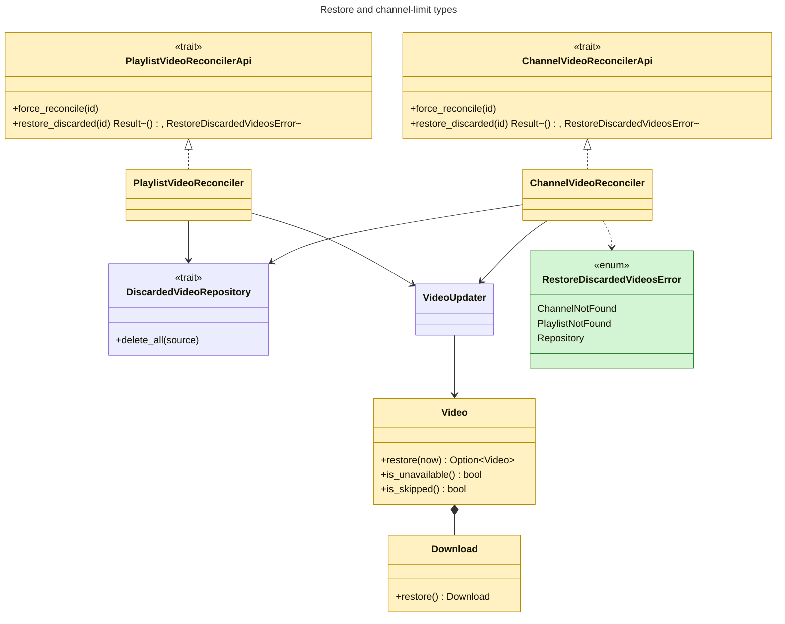
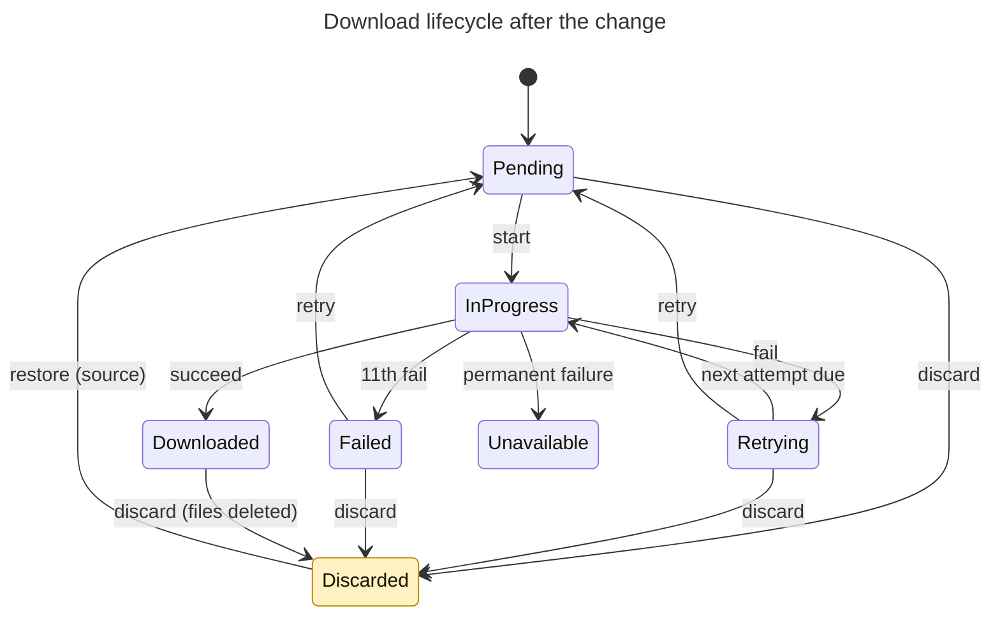
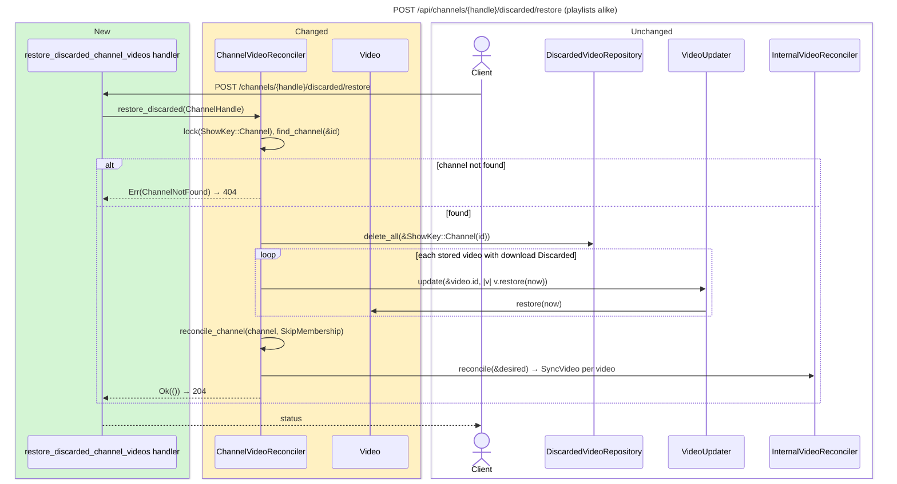
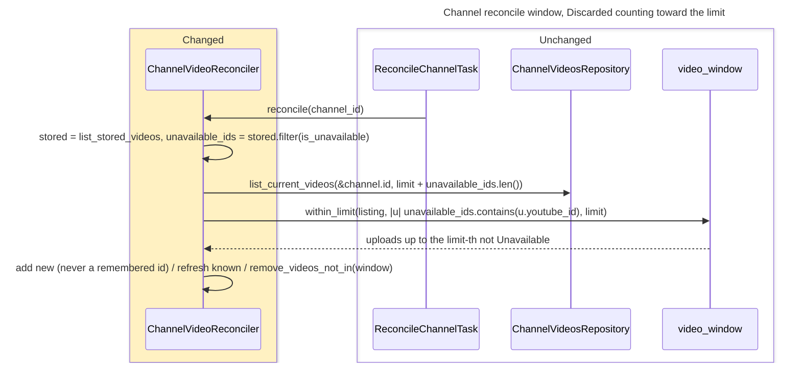

# Design

Requirements: `specs/`. Motivation: proposal.md.

Key decisions (one line each, so they aren't "fixed" later):
- **Only Unavailable is skipped by a channel's window**: a stored Discarded video and a remembered discarded upload both take their slot. `Video::is_skipped` keeps hiding both from lists; the window uses `Video::is_unavailable`.
- **Restore lives on the reconcilers** (`restore_discarded` next to `force_reconcile`). It runs under the show lock, reuses `list_stored_videos`, and runs the pass, so a concurrent reconcile can't re-remember or re-evict between the forget and the pass.
- **Stored Discarded videos are reset in place** (`Video::restore` → download Pending, no attempts), keeping id and episode number. The pass's `InternalVideoReconciler` schedules their `SyncVideo`, which schedules thumbnail and download.
- **A listing failure doesn't fail the restore** (`ListingFailure::SkipMembership`, as on-demand sync): the forget and the resets are kept, and remembered ids still in the source come back on the next successful pass.
- **A discard's `DeleteVideoFile` task, scheduled now, runs before a restored video's download**, which only starts after its sync: the old files are gone before the new ones are written.

## Diagrams

Colours: green = new, yellow = changed, red = removed, plain = unchanged.









## Types & Signatures

```rust
// src/domain/video/download.rs
impl Download {
    /// Pending with no attempts, no failure and no file when discarded; unchanged otherwise.
    pub fn restore(self) -> Self;
}
```

```rust
// src/domain/video/video.rs
impl Video {
    /// `None` unless its download is Discarded; else its download restored (Pending).
    pub fn restore(self, now: DateTime<Utc>) -> Option<Self>;
    /// Download Unavailable: outside a channel's video limit.
    pub fn is_unavailable(&self) -> bool;
    /// Unchanged: Unavailable or Discarded, hidden from lists (doc no longer mentions the limit).
    pub fn is_skipped(&self) -> bool;
}
```

```rust
// src/domain/video/errors.rs
#[derive(Debug)]
pub enum RestoreDiscardedVideosError {
    ChannelNotFound(ChannelHandle),
    PlaylistNotFound(PlaylistId),
    Repository(anyhow::Error),
}
impl fmt::Display for RestoreDiscardedVideosError;
impl std::error::Error for RestoreDiscardedVideosError;
impl From<anyhow::Error> for RestoreDiscardedVideosError; // → Repository
```

```rust
// src/domain/channel/video_window.rs — signature unchanged; doc: "not `is_skipped` (Unavailable)"
pub fn within_limit<T>(uploads: Vec<T>, is_skipped: impl Fn(&T) -> bool, limit: usize) -> Vec<T>;
```

```rust
// src/domain/services/channel_video_reconciler.rs
pub trait ChannelVideoReconcilerApi: Send + Sync {
    // reconcile, initial_reconcile, force_reconcile unchanged
    /// Forgets the channel's remembered discarded videos, puts its stored
    /// Discarded ones back to Pending, then runs one pass like `force_reconcile`.
    fn restore_discarded(&self, id: ChannelHandle) -> Result<(), RestoreDiscardedVideosError>;
}
impl ChannelVideoReconciler {
    /// `unavailable` (was `skipped`): one more upload per stored Unavailable video.
    fn list_current_videos(&self, channel: &Channel, unavailable: u32, on_listing_failure: ListingFailure) -> anyhow::Result<Option<Vec<ChannelVideoListing>>>;
    fn restore_stored_discarded(&self, stored: &[(ChannelVideo, Video)]) -> anyhow::Result<()>;
}
```

```rust
// src/domain/services/playlist_video_reconciler.rs
pub trait PlaylistVideoReconcilerApi: Send + Sync {
    // reconcile, initial_reconcile, force_reconcile unchanged
    /// As `ChannelVideoReconcilerApi::restore_discarded`, for a playlist.
    fn restore_discarded(&self, id: PlaylistId) -> Result<(), RestoreDiscardedVideosError>;
}
impl PlaylistVideoReconciler {
    fn restore_stored_discarded(&self, stored: &[(PlaylistVideo, Video)]) -> anyhow::Result<()>;
}
```

```rust
// src/application/http/channels/mod.rs
pub async fn restore_discarded_channel_videos(State(channel_video_reconciler): State<ChannelVideoReconciler>, Path(handle): Path<String>) -> Result<StatusCode, ApiError>;
// src/application/http/playlists/mod.rs
pub async fn restore_discarded_playlist_videos(State(playlist_video_reconciler): State<PlaylistVideoReconciler>, Path(id): Path<String>) -> Result<StatusCode, ApiError>;
// src/application/http/mod.rs
// .route("/channels/{handle}/discarded/restore", post(channels::restore_discarded_channel_videos))
// .route("/playlists/{id}/discarded/restore", post(playlists::restore_discarded_playlist_videos))
```

```ts
// web/src/api/client.ts
export async function restoreDiscardedChannelVideos(handle: string): Promise<void> // POST /channels/{handle}/discarded/restore
export async function restoreDiscardedPlaylistVideos(id: string): Promise<void>    // POST /playlists/{id}/discarded/restore
// web/src/api/queries.ts
export function useRestoreDiscardedVideos(): (source: { kind: 'channel' | 'playlist'; id: string }) => Promise<void> // invalidates library + home
// useDiscardVideo: also invalidates the tasks query
```

```tsx
// web/src/components/DiscardVideoDialog.tsx — ConfirmDialog extracted from DiscardVideoButton
export function DiscardVideoDialog(props: {
  videoId: string; title: string; downloaded: boolean
  open: boolean; onOpenChange: (open: boolean) => void
  /** Called after a successful discard. */ onDiscarded?: () => void
  /** When set, a failed discard closes the dialog and is reported here instead of inside it. */
  onFailed?: (message: string) => void
}): JSX.Element
// title `Discard "<title>"?`; description: downloaded
//   ? "Its files will be deleted and it won't be downloaded. You can restore it from its channel's or playlist's menu."
//   : "It won't be downloaded. You can restore it from its channel's or playlist's menu."
// confirmLabel "Discard", pendingLabel "Discarding…"
// web/src/components/DiscardVideoButton.tsx — label "Discard", renders DiscardVideoDialog
// web/src/components/VideoActionsMenu.tsx — new prop
//   discard?: { downloaded: boolean } // absent: no "Discard…" item
// web/src/components/VideoGrid.tsx — passes discard={{ downloaded: true }} (cards are Downloaded)
// web/src/components/VideoListPane.tsx — passes discard when canDiscard(video.status)
// web/src/components/tasks/AttentionCard.tsx — DiscardButton when task.task_type === 'download_video' && video_id;
//   passes onFailed to show "Discard failed: <message>" on the card
// web/src/components/DetailHeader.tsx — new prop
//   onRestoreDiscarded?: () => Promise<void> // absent (categories): no item
//   menu item "Restore discarded videos" (icon ArchiveRestore), right after "Edit settings", + ConfirmDialog
// web/src/components/ChannelDetail.tsx, PlaylistDetail.tsx — pass onRestoreDiscarded
```

## Call Stack

**Restore** — `POST /api/channels/{handle}/discarded/restore` (playlists alike):
1. `channels::restore_discarded_channel_videos(State<ChannelVideoReconciler>, Path(handle))` → `ChannelHandle::new(handle)?` → `run_blocking(|| reconciler.restore_discarded(id))`
2. `ChannelVideoReconciler::restore_discarded(id)`:
   1. `self.lock(&id)` → `self.find_channel(&id)?` → `None`: `ChannelNotFound(id)`
   2. `discarded_video_repository.delete_all(&ShowKey::Channel(id.clone()))`
   3. `restore_stored_discarded(&self.list_stored_videos(&channel)?)` → for each `video.download.is_discarded()`: `video_updater.update(&video.id, |v| v.restore(now))`
   4. `self.reconcile_channel(channel, ListingFailure::SkipMembership)` → membership pass (re-adds forgotten ids in the window) → `InternalVideoReconciler::reconcile(&desired)` → `SyncVideo` per video → `VideoSyncPlan::for_video` schedules thumbnail + download for the restored Pending ones
3. Map: `ChannelNotFound` / `PlaylistNotFound` → 404, `Repository` → 500; ok → 204.

**Channel limit** — `ChannelVideoReconciler::sync_membership_with_youtube`: `stored = list_stored_videos(channel)` → `remembered` (unchanged; only for not re-adding) → `unavailable_ids = stored.filter(|(_, v)| v.is_unavailable())` → `list_current_videos(channel, unavailable_ids.len(), ..)` → `limit + unavailable` → `video_window::within_limit(listing, |u| unavailable_ids.contains(u.youtube_id), limit)` → add (skip remembered) / refresh / `remove_videos_not_in(window ids)` (remembers an evicted Discarded one, unchanged).

**Web discard** — `VideoActionsMenu` "Discard…" `onSelect` → `setConfirming(true)` → `DiscardVideoDialog` (rendered beside the menu) → `useDiscardVideo()(videoId)` → `discardVideo` → invalidate library, home, tasks; failure → `ConfirmDialog` reports it as today. `AttentionCard` → `DiscardButton` → same dialog with `downloaded: false` and `onFailed`; on failure the dialog closes and the card shows "Discard failed: …".

**Web restore** — `DetailHeader` menu "Restore discarded videos" → `ConfirmDialog` (`Restore discarded videos of "<name>"?`, "Discarded videos still in this playlist, or among this channel's most recent uploads, will be downloaded again.") → `onRestoreDiscarded()` → `useRestoreDiscardedVideos()({kind, id})` → client call → invalidate; failure → `window.alert('Failed to restore the discarded videos of "<name>": <error>')`.

## Test Plan

### 1. Behaviour tests

Channel limit — `src/application/tasks/reconcile_channel_task/tests.rs`:
1. `it_should_count_a_discarded_video_toward_the_limit` — limit 3, uploads A B C D, B stored Discarded → A B C stored, D not.
2. `it_should_request_one_more_upload_per_unavailable_video` — replaces `it_should_request_one_more_upload_per_skipped_video`: limit 2, Unavailable + Discarded stored, 5 listed → stored `yt2`, `yt_discarded`, `yt_unavailable` (3 requested).
3. `it_should_count_a_remembered_discarded_upload_toward_the_limit` — replaces `it_should_not_count_a_remembered_discarded_upload_toward_the_limit`: limit 2, A B C, B remembered → only A stored.

Restore a channel — `src/application/http/channels/tests.rs`:
4. `it_should_restore_a_stored_discarded_channel_video` — 204; B Pending, no attempts; a `SyncVideo` of B pending.
5. `it_should_re_add_a_remembered_channel_video_still_among_its_uploads` — C remembered and in the window → stored Pending, `VideoAddedToChannel` published, no longer remembered.
6. `it_should_forget_a_remembered_channel_video_past_the_limit` — limit 2, D remembered and 4th → not stored, not remembered.
7. `it_should_restore_discarded_channel_videos_when_listing_fails` — 204; stored Discarded now Pending; nothing remembered.
8. `it_should_fail_to_restore_the_discarded_videos_of_an_unknown_channel` — 404.

Restore a playlist — `src/application/http/playlists/tests.rs`:
9. `it_should_restore_a_stored_discarded_playlist_video` — 204; Pending; `SyncVideo` pending.
10. `it_should_re_add_a_remembered_video_back_in_the_playlist` — stored Pending, `VideoAddedToPlaylist` published, no longer remembered.
11. `it_should_fail_to_restore_the_discarded_videos_of_an_unknown_playlist` — 404.

Web — Vitest + `mockApi`:
12. `VideoDetail.test.tsx` "says a discarded video can be restored" — button "Discard"; confirmation mentions restoring from the source's menu (existing "Don't download" tests renamed to "Discard" in the same cycle).
13. `VideoListPane.test.tsx` "discards a row's video from its menu after confirming" — `POST /api/videos/v1/discard`, row gone, selection unchanged.
14. `VideoListPane.test.tsx` "offers no Discard… for a downloading row".
15. `VideoGrid.test.tsx` "discards a card's video after warning its files will be deleted".
16. `VideoGrid.test.tsx` "sends nothing when the discard is cancelled".
17. `TasksView.test.tsx` "discards a failing download after confirming" — card gone after refresh.
18. `TasksView.test.tsx` "says the discard failed".
19. `TasksView.test.tsx` "offers no Discard on a failing subtitle fetch".
20. `ChannelDetail.test.tsx` "restores the channel's discarded videos after confirming" — `POST /api/channels/@x/discarded/restore`.
21. `PlaylistDetail.test.tsx` "restores the playlist's discarded videos after confirming".
22. `PlaylistDetail.test.tsx` "sends nothing when the restore is cancelled".
23. `ChannelDetail.test.tsx` "tells the user when restoring fails".
24. `CategoryDetail.test.tsx` "offers no Restore discarded videos".

### 2. Infrastructure tests

None: no adapter changes (`DiscardedVideoRepository::delete_all` and `VideoRepository` are reused as they are).
