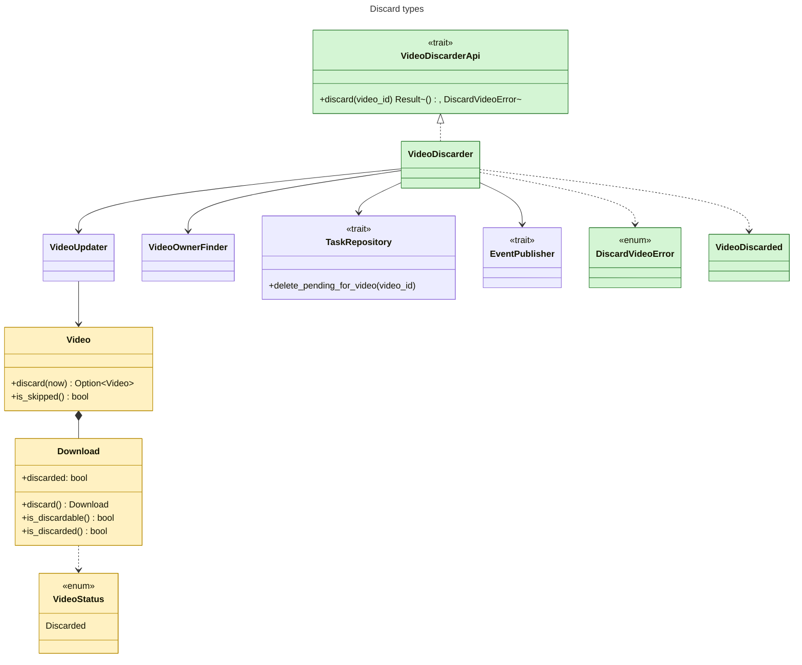
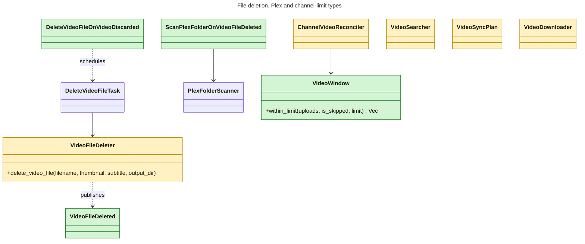
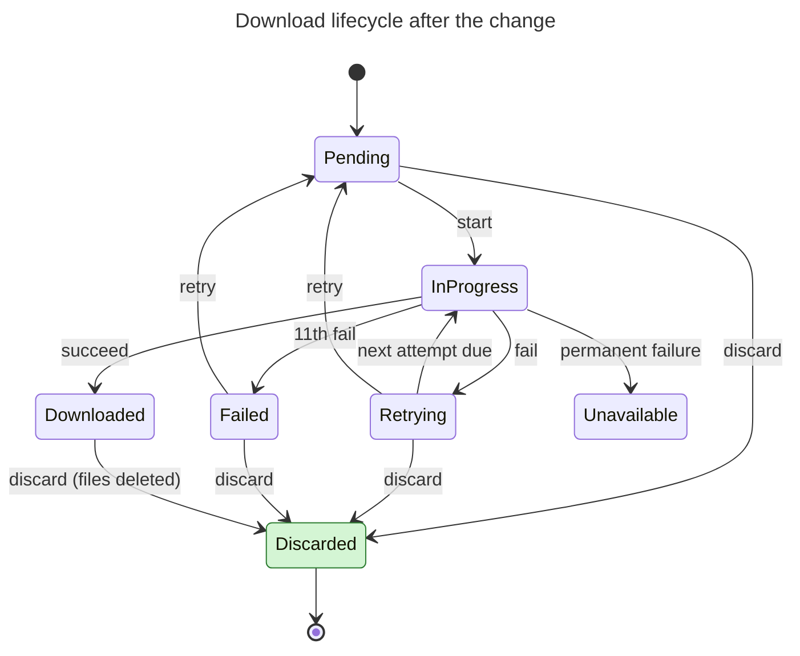
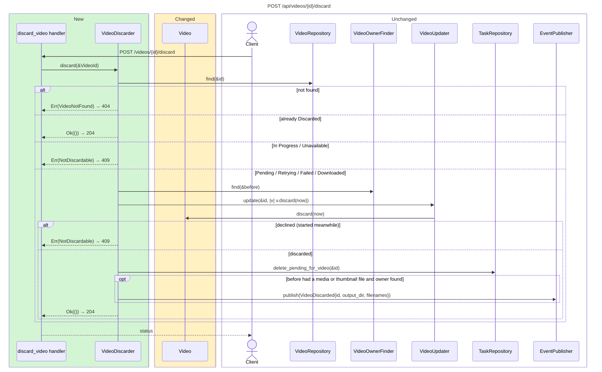
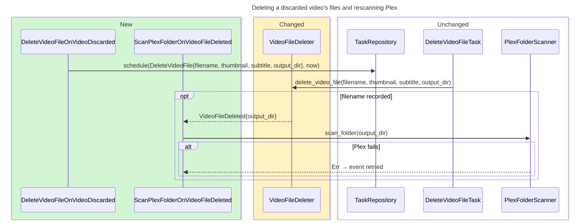
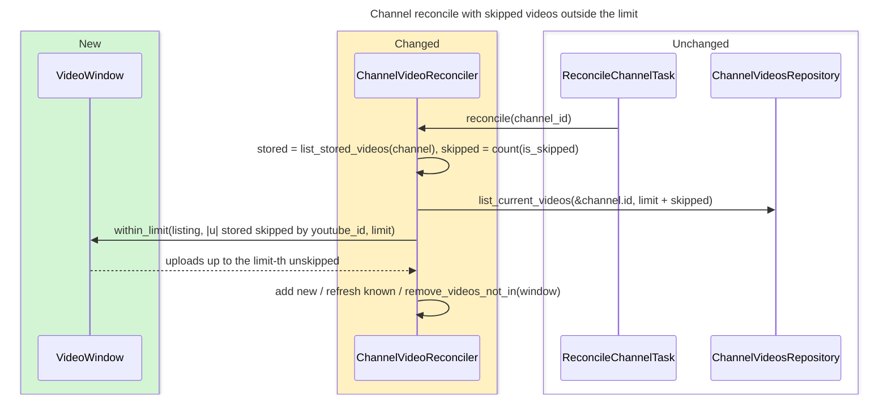

# Design

Requirements: `specs/`. Motivation: proposal.md.

Key decisions (one line each, so they aren't "fixed" later):
- **Distinct `Discarded`, not `Unavailable`**: Unavailable is yt-dlp's verdict and can be cleared by nothing; Discarded is the user's, and Downloaded videos can be discarded. Both are "skipped": hidden from lists and outside a channel's limit (`Video::is_skipped`).
- **Discarded is a flag on `Download`, like `started`**, over a Pending state with no attempts: the `StepStatus` vocabulary shared by every step stays unchanged. Stored as `videos.status = 'DISCARDED'`; no migration (no CHECK on the column).
- **Irreversible**: no undo transition or endpoint.
- **Every recorded file is deleted on discard**, not only a Downloaded video's: a not-yet-downloaded video may have a fetched thumbnail. `VideoDiscarded.filename` is optional; Plex is rescanned only when a media file was deleted.
- **The filesystem reconcile doesn't protect a Discarded video's episode files**: it protects a numbered video's episode base name while its download is pending, which a Discarded one never completes.
- **Recorded filenames are cleared on discard**: the filesystem reconcile protects every recorded filename regardless of status, so clearing them makes it sweep any file a late step leaves behind. The deletion itself still runs at once through `VideoDiscarded` → `DeleteVideoFile`, built from the video as read before the discard.
- **No discard while In Progress (409)**: a running yt-dlp can't be cancelled. The `VideoUpdater` transition runs on the stored version, so a download starting between read and write makes the discard decline (→ 409).
- **Video first, tasks second**: the video is marked Discarded before pending tasks are deleted, so a task that starts in between finds it settled.
- **`VideoFileDeleted` is published by `VideoFileDeleter`** after any video's files are deleted, so Plex is rescanned for evictions too, not only discards.

## Diagrams

Colours: green = new, yellow = changed, red = removed, plain = unchanged.













## Types & Signatures

```rust
// src/domain/video/video_status.rs
pub enum VideoStatus { Pending, InProgress, Downloaded, Retrying, Failed, Unavailable, Discarded /* "DISCARDED" */ }
```

```rust
// src/domain/video/download.rs
pub struct Download {
    pub state: StepState,
    pub started: bool,
    /// Discarded by the user, for good: state Pending with no attempts, never due.
    pub discarded: bool,
    pub failure: Option<String>,
    pub file: Option<DownloadedFile>,
}
impl Download {
    /// Discarded before In Progress before the step's status.
    pub fn status(&self) -> VideoStatus;
    /// false while discarded.
    pub fn is_due(&self, now: DateTime<Utc>) -> bool;
    pub fn is_discarded(&self) -> bool;
    /// Pending, Retrying, Failed or Downloaded; not started, not discarded.
    pub fn is_discardable(&self) -> bool;
    /// Discarded: state Pending, no attempts, no failure, no file.
    pub fn discard(self) -> Self;
    /// Unchanged while discarded (as while started).
    pub fn retry(self) -> Self;
}
```

```rust
// src/domain/video/video.rs
impl Video {
    /// `None` unless discardable; download discarded, thumbnail and subtitle filenames cleared.
    pub fn discard(self, now: DateTime<Utc>) -> Option<Self>;
    /// Unavailable or Discarded: hidden from lists, outside a channel's limit.
    pub fn is_skipped(&self) -> bool;
    /// Also false when Discarded.
    pub fn is_thumbnail_fetchable(&self) -> bool;
}
```

```rust
// src/domain/video/video_sync_plan.rs — no steps for a Discarded video
pub fn for_video(video: &Video, summaries_wanted: bool, categorization_wanted: bool, now: DateTime<Utc>) -> Self;
```

```rust
// src/domain/video/errors.rs
pub enum DiscardVideoError { VideoNotFound(VideoId), NotDiscardable(VideoId, VideoStatus), Repository(anyhow::Error) }
```

```rust
// src/domain/video/events.rs
/// A video was discarded with a recorded file (media or thumbnail) in its
/// owner's `output_dir`.
pub struct VideoDiscarded {
    pub video_id: String,
    pub output_dir: String,
    pub filename: Option<String>,
    pub thumbnail_filename: Option<String>,
    pub subtitle_filename: Option<String>,
}
impl VideoDiscarded { pub const EVENT_TYPE: &str = "video_discarded"; }

/// A video's files were deleted from its show folder `output_dir`.
pub struct VideoFileDeleted { pub output_dir: String }
impl VideoFileDeleted { pub const EVENT_TYPE: &str = "video_file_deleted"; }
```

```rust
// src/domain/services/video_discarder.rs
#[derive(Clone)]
pub struct VideoDiscarder {
    video_repository: Arc<dyn VideoRepository>,
    video_updater: VideoUpdater,
    video_owner_finder: Arc<VideoOwnerFinder>,
    task_repository: Arc<dyn TaskRepository>,
    event_publisher: Arc<dyn EventPublisher>,
    clock: Arc<dyn Clock>,
}
impl VideoDiscarder {
    pub fn new(
        video_repository: Arc<dyn VideoRepository>,
        video_owner_finder: Arc<VideoOwnerFinder>,
        task_repository: Arc<dyn TaskRepository>,
        event_publisher: Arc<dyn EventPublisher>,
        clock: Arc<dyn Clock>,
    ) -> Self;
}
pub trait VideoDiscarderApi: Send + Sync {
    /// Download Discarded for good, pending tasks deleted, `VideoDiscarded` published when it had a file.
    fn discard(&self, video_id: &VideoId) -> Result<(), DiscardVideoError>;
}
```

```rust
// src/domain/services/video_file_deleter.rs
impl VideoFileDeleter {
    pub fn new(video_file_repository: Arc<dyn VideoFileRepository>, event_publisher: Arc<dyn EventPublisher>, videos_path: impl Into<String>) -> Self;
}
// delete_video_file(...) unchanged signature; publishes VideoFileDeleted{output_dir} after deleting when `filename` is Some.
```

```rust
// src/domain/services/video_downloader.rs — Downloaded, Failed, Unavailable or Discarded
fn is_settled(video: &Video) -> bool;
// src/domain/services/video_searcher.rs — replaces is_unavailable
fn is_skipped(video: &anyhow::Result<Video>) -> bool;
// src/domain/services/quality_upgrader.rs — the transition recording the upgraded file declines unless Downloaded
```

```rust
// src/domain/channel/video_window.rs
/// The most recent `uploads` up to and including the `limit`-th one not `is_skipped`.
pub fn within_limit<T>(uploads: Vec<T>, is_skipped: impl Fn(&T) -> bool, limit: usize) -> Vec<T>;
// src/domain/services/channel_video_reconciler.rs
fn list_current_videos(&self, channel: &Channel, skipped: u32, on_listing_failure: ListingFailure) -> anyhow::Result<Option<Vec<ChannelVideoListing>>>;
```

```rust
// src/application/subscribers/delete_video_file_on_video_discarded.rs
pub struct DeleteVideoFileOnVideoDiscarded { task_repository: Arc<dyn TaskRepository>, clock: Arc<dyn Clock> }
// src/application/subscribers/scan_plex_folder_on_video_file_deleted.rs (registered only with Plex configured)
pub struct ScanPlexFolderOnVideoFileDeleted { scanner: PlexFolderScanner }
```

```rust
// src/application/http/videos/mod.rs
pub async fn discard_video(State(video_discarder): State<VideoDiscarder>, Path(id): Path<String>) -> Result<StatusCode, ApiError>;
// src/application/http/mod.rs: AppState.video_discarder; .route("/videos/{id}/discard", post(videos::discard_video))
// src/serve.rs: build VideoDiscarder, pass event_publisher to VideoFileDeleter, register both subscribers
```

```ts
// web/src/api/types.ts — 'DISCARDED' added to VideoStatus and StepStatus
// web/src/api/client.ts
export async function discardVideo(videoId: string): Promise<void> // POST /videos/{id}/discard
// web/src/api/queries.ts
export function useDiscardVideo(): (videoId: string) => Promise<void> // invalidates video lists like useRetryVideo
// web/src/lib/videoSteps.ts
export function canDiscard(status: VideoStatus): boolean // PENDING | RETRYING | FAILED | DOWNLOADED
// web/src/components/DiscardVideoButton.tsx — "Don't download" + ConfirmDialog
export function DiscardVideoButton(props: { videoId: string; title: string; downloaded: boolean }): JSX.Element
```

## Call Stack

**Discard** — `POST /api/videos/{id}/discard`
1. `videos::discard_video(State<VideoDiscarder>, Path(id))` → `VideoId::new(id)?` → `run_blocking(|| video_discarder.discard(&id))`
2. `VideoDiscarder::discard(&id)`:
   1. `video_repository.find(&id)` → `None`: `VideoNotFound`; `is_discarded()`: `Ok(())`; `!is_discardable()`: `NotDiscardable(id, status)`
   2. `video_owner_finder.find(&before)` → `Option<VideoOwner>`
   3. `video_updater.update(&id, |v| v.discard(now))` → `None`: re-find for `NotDiscardable(id, status)`
   4. `task_repository.delete_pending_for_video(&id)`
   5. `before.download.filename()` or `before.thumbnail.filename`, and owner → `event_publisher.publish(VideoDiscarded { video_id, output_dir: owner.target.output_dir, filename, thumbnail_filename, subtitle_filename })`
3. Map: `VideoNotFound` → 404, `NotDiscardable` → 409, `Repository` → 500; ok → 204.

**Files** — `DeleteVideoFileOnVideoDiscarded::handle(payload)` → `task_repository.schedule(&Task::DeleteVideoFile { filename, thumbnail_filename, subtitle_filename, output_dir }, now)` → `DeleteVideoFileTask` → `VideoFileDeleter::delete_video_file(..)` → `event_publisher.publish(VideoFileDeleted { output_dir })` when a filename was given → `ScanPlexFolderOnVideoFileDeleted::handle` → `PlexFolderScanner::scan_folder(Path::new(&output_dir))`.

**Never attempted** — `SyncVideoTask` → `VideoSyncPlan::for_video` → `[]` when discarded. `DownloadVideoTask` → `VideoDownloader::download` → `is_settled` → settled. Subtitles/chapters/quality/summary/categorization: their fetchable checks require Downloaded. `QualityUpgrader` record transition declines on a Discarded video. `VideoRetrier::retry` → `Download::retry` keeps it discarded.

**Lists** — `VideoSearcher::list_for_playlist` / `list_for_channel` → `.filter(|v| !is_skipped(v))`. Home, search and categories already list only Downloaded.

**Sweep** — `InternalVideoReconciler` → `numbered_episode_paths(videos)` skips Discarded videos, so files under their episode base name are swept once unrecorded.

**Channel limit** — `ChannelVideoReconciler::sync_membership_with_youtube`: `list_stored_videos(channel)` → `skipped = stored.filter(|(_, v)| v.is_skipped()).count()` → `list_current_videos(channel, skipped, ..)` → `channel_videos_repository.list_current_videos(&channel.id, limit + skipped)` → `video_window::within_limit(listing, |u| skipped_ids.contains(&u.youtube_id), limit)` → add / refresh / `remove_videos_not_in(window ids)`.

**Web** — `VideoDetail` → `DiscardVideoButton` (when `canDiscard(video.status)`) → `ConfirmDialog` ("… This can't be undone." + "Its files will be deleted." when downloaded) → `useDiscardVideo()(id)` → `discardVideo` → invalidate → video gone from the list; failure → `window.alert`.

## Test Plan

### 1. Behaviour tests

HTTP — `src/application/http/videos/tests.rs`:
1. `it_should_discard_a_retrying_video` — 204; Discarded, no attempts, no failure; its pending download task gone.
2. `it_should_cancel_every_pending_task_of_a_discarded_video` — thumbnail + download pending → none pending.
3. `it_should_discard_a_failed_video` — Failed with 11 attempts → Discarded.
4. `it_should_discard_a_downloaded_video_and_clear_its_files` — Discarded with no recorded file, thumbnail or subtitle filename.
5. `it_should_publish_video_discarded_for_a_downloaded_video` — event with owner's output dir and the recorded filenames.
6. `it_should_publish_nothing_when_discarding_a_video_never_downloaded`.
7. `it_should_leave_a_discarded_video_unchanged_when_discarded_again` — 204, nothing written, nothing published.
8. `it_should_refuse_to_discard_a_video_being_downloaded` — 409, video and tasks unchanged.
9. `it_should_refuse_to_discard_an_unavailable_video` — 409.
10. `it_should_fail_to_discard_an_unknown_video` — 404.
11. `it_should_omit_discarded_videos_from_a_channel_list`.
12. `it_should_omit_discarded_videos_from_a_playlist_list`.
13. `it_should_keep_a_discarded_download_on_retry` — download stays Discarded, no download scheduled.

Subscribers:
14. `delete_video_file_on_video_discarded::it_should_schedule_the_deletion_of_the_discarded_video_files` — `DeleteVideoFile` pending now with the event's filenames and output dir.
15. `scan_plex_folder_on_video_file_deleted::it_should_scan_the_show_folder_after_a_deletion`.

Tasks:
16. `delete_video_file_task::it_should_publish_video_file_deleted_after_deleting_a_video_file`.
17. `delete_video_file_task::it_should_publish_nothing_when_no_file_was_recorded`.
18. `sync_video_task::it_should_schedule_nothing_for_a_discarded_video`.
19. `download_video_task::it_should_settle_without_downloading_a_discarded_video` — no yt-dlp call, not re-queued.
20. `upgrade_quality_task::it_should_record_nothing_on_a_video_discarded_during_the_upgrade`.
21. `reconcile_channel_task::it_should_keep_a_discarded_video_discarded_on_resync` — title refreshed, still Discarded.
22. `reconcile_channel_task::it_should_request_one_more_upload_per_skipped_video` — limit 3, one Unavailable + one Discarded → requests 5.
23. `reconcile_channel_task::it_should_not_count_skipped_videos_toward_the_limit` — limit 3, uploads A B C D with B Unavailable → all four kept.
24. `reconcile_channel_task::it_should_evict_uploads_past_the_limit_th_unskipped_one` — limit 2, A B C none skipped, C stored → C evicted.

Web — Vitest + `mockApi`, `VideoDetail.test.tsx`:
25. "discards a retrying video after confirming" — `POST /api/videos/v1/discard`, video gone from the refetched list.
26. "warns that a downloaded video's files will be deleted".
27. "sends nothing when the confirmation is cancelled".
28. "offers no Don't download for a downloading video".
29. "tells the user when discarding fails".

Thumbnail of a video discarded before its download:
30. `it_should_publish_video_discarded_for_the_thumbnail_of_a_video_never_downloaded` (HTTP) — `VideoDiscarded` with `filename: None` and the thumbnail.
31. `delete_video_file_on_video_discarded::it_should_schedule_the_deletion_of_a_discarded_thumbnail` — `DeleteVideoFile` with `filename: None` and the thumbnail.
32. `reconcile_channel_task::it_should_delete_the_files_left_by_a_discarded_video` — a numbered Discarded video's unrecorded `.jpg` under its episode base name is swept.

### 2. Infrastructure tests

`SqliteVideoRepository`:
33. `it_should_round_trip_a_discarded_video` — `DISCARDED` decodes to discarded, Pending, no attempts, no file.
