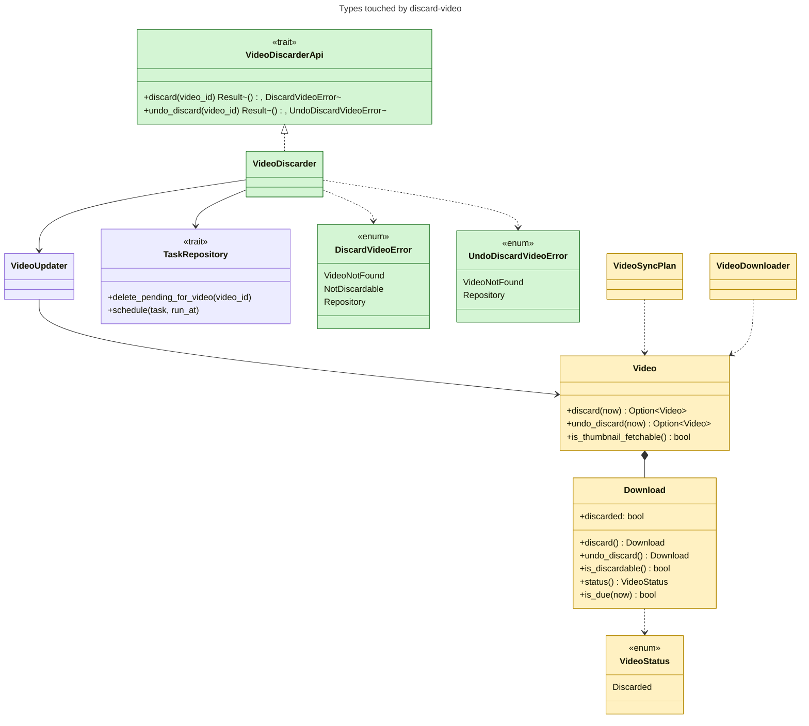
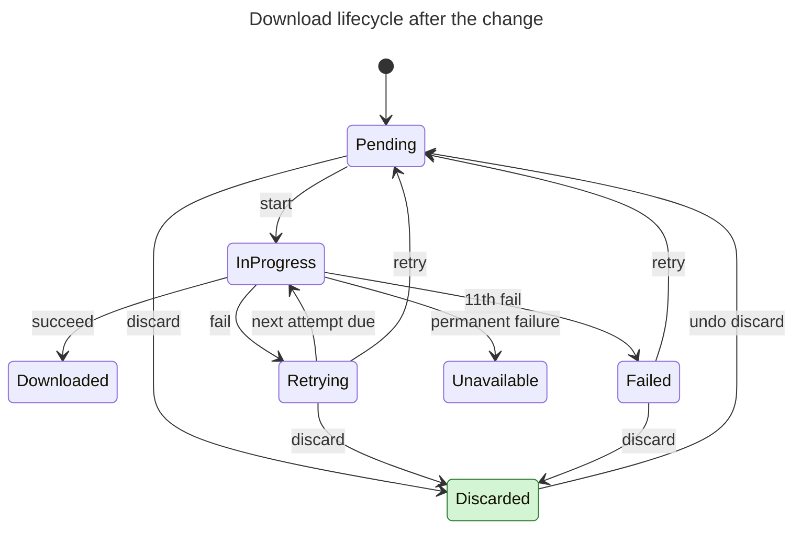
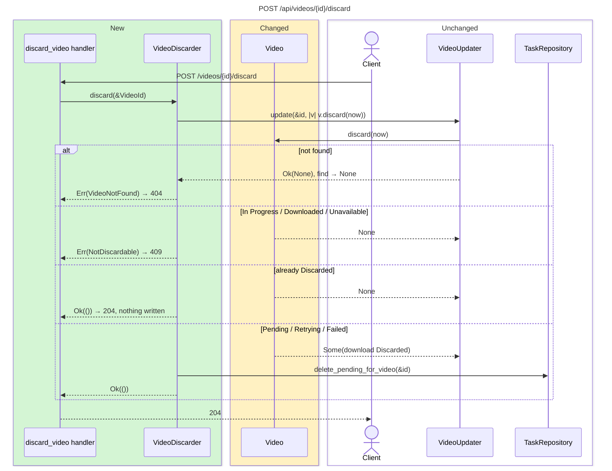
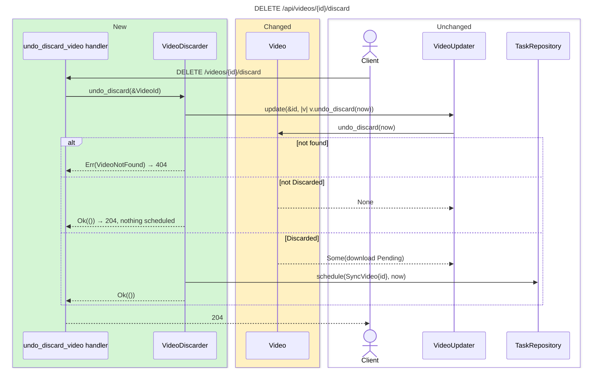
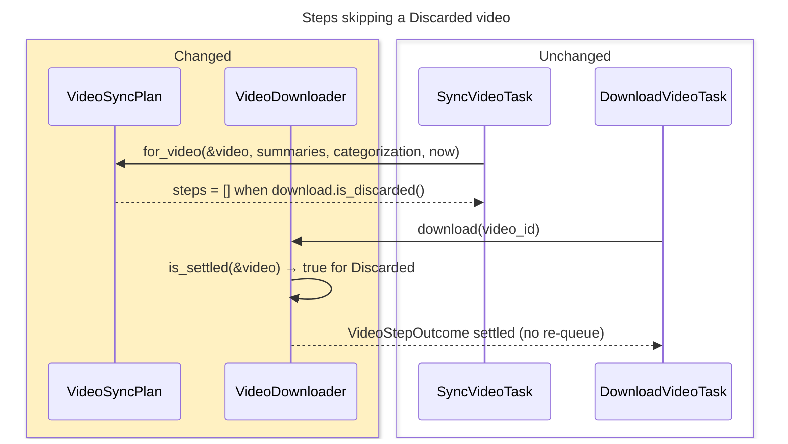

# Design

Requirements: `specs/video-discard`, `specs/video-listing`, `specs/video-retries`, `specs/web-ui`. Motivation: proposal.md.

Key decisions (one line each, so they aren't "fixed" later):
- **Distinct `Discarded`, not `Unavailable`**: Unavailable is yt-dlp's final verdict and is filtered out of every list (`video_searcher::is_unavailable`); a discard is a user choice that stays visible and can be undone.
- **Discarded is a flag on `Download`, like `started`**, on top of a Pending state with no attempts: the shared `StepStatus` vocabulary (used by every step) stays unchanged. Stored as `videos.status = 'DISCARDED'`; no migration (no CHECK on the column).
- **No discard while In Progress (409)**: a running yt-dlp can't be cancelled; the attempt ends (OOM → Retrying) and the user discards then. The `VideoUpdater` transition runs on the stored version, so a download that starts between read and write makes the discard decline.
- **No discard of a Downloaded video (409)**: deleting files is out of scope.
- **Video first, tasks second**: the video is marked Discarded before pending tasks are deleted, so a task that starts in between finds it settled.

## Diagrams

Colours: green = new, yellow = changed, red = removed, plain = unchanged.











## Types & Signatures

```rust
// src/domain/video/video_status.rs
pub enum VideoStatus {
    Pending, InProgress, Downloaded, Retrying, Failed, Unavailable,
    Discarded, // "DISCARDED"
}
```

```rust
// src/domain/video/download.rs
pub struct Download {
    pub state: StepState,
    pub started: bool,
    /// Discarded by the user: never attempted; state is Pending with no attempts.
    pub discarded: bool,
    pub failure: Option<String>,
    pub file: Option<DownloadedFile>,
}

impl Download {
    /// Discarded first, then In Progress, then the step's status.
    pub fn status(&self) -> VideoStatus;
    /// false while discarded.
    pub fn is_due(&self, now: DateTime<Utc>) -> bool;
    pub fn is_discarded(&self) -> bool;
    /// Pending, Retrying or Failed, not started nor discarded.
    pub fn is_discardable(&self) -> bool;
    /// Discarded, state Pending with no attempts, failure cleared.
    pub fn discard(self) -> Self;
    /// Not discarded, state Pending with no attempts.
    pub fn undo_discard(self) -> Self;
    /// Unchanged while discarded (as while started).
    pub fn retry(self) -> Self;
}
```

```rust
// src/domain/video/video.rs
impl Video {
    /// `None` when the download is not discardable (incl. already Discarded).
    pub fn discard(self, now: DateTime<Utc>) -> Option<Self>;
    /// `None` when the download is not Discarded.
    pub fn undo_discard(self, now: DateTime<Utc>) -> Option<Self>;
    /// Also false for a Discarded download.
    pub fn is_thumbnail_fetchable(&self) -> bool;
}
```

```rust
// src/domain/video/video_sync_plan.rs
impl VideoSyncPlan {
    /// No steps for a Discarded video.
    pub fn for_video(video: &Video, summaries_wanted: bool, categorization_wanted: bool, now: DateTime<Utc>) -> Self;
}
```

```rust
// src/domain/video/errors.rs
pub enum DiscardVideoError {
    VideoNotFound(VideoId),
    NotDiscardable(VideoId, VideoStatus),
    Repository(anyhow::Error),
}
pub enum UndoDiscardVideoError {
    VideoNotFound(VideoId),
    Repository(anyhow::Error),
}
```

```rust
// src/domain/services/video_discarder.rs
#[derive(Clone)]
pub struct VideoDiscarder {
    video_updater: VideoUpdater,
    video_repository: Arc<dyn VideoRepository>, // tells not-found from declined
    task_repository: Arc<dyn TaskRepository>,
    clock: Arc<dyn Clock>,
}

impl VideoDiscarder {
    pub fn new(
        video_repository: Arc<dyn VideoRepository>,
        task_repository: Arc<dyn TaskRepository>,
        clock: Arc<dyn Clock>,
    ) -> Self;
}

pub trait VideoDiscarderApi: Send + Sync {
    /// Download Discarded, pending tasks of the video deleted.
    fn discard(&self, video_id: &VideoId) -> Result<(), DiscardVideoError>;
    /// Download Pending, sync scheduled now; no-op when not Discarded.
    fn undo_discard(&self, video_id: &VideoId) -> Result<(), UndoDiscardVideoError>;
}
```

```rust
// src/domain/services/video_downloader.rs
/// Downloaded, Failed, Unavailable or Discarded.
fn is_settled(video: &Video) -> bool;
```

```rust
// src/application/http/videos/mod.rs
pub async fn discard_video(State(video_discarder): State<VideoDiscarder>, Path(id): Path<String>) -> Result<StatusCode, ApiError>;
pub async fn undo_discard_video(State(video_discarder): State<VideoDiscarder>, Path(id): Path<String>) -> Result<StatusCode, ApiError>;
```

```rust
// src/application/http/mod.rs
pub struct AppState { /* … */ pub video_discarder: VideoDiscarder }
// .route("/videos/{id}/discard", post(videos::discard_video).delete(videos::undo_discard_video))
```

```rust
// src/serve.rs — composition root
video_discarder: VideoDiscarder::new(video_repository.clone(), task_repository.clone(), clock.clone()),
```

```rust
// src/infrastructure/repositories/sqlite_video_repository.rs
/// DISCARDED → state Pending, no attempts, discarded = true.
fn decode_download(status: &str, failed: u32, last_errored_at: Option<String>, failure: Option<String>, filename: Option<String>, quality: Option<String>, duration_seconds: Option<i64>) -> anyhow::Result<Download>;
```

```ts
// web/src/api/types.ts
export type VideoStatus = 'PENDING' | 'IN_PROGRESS' | 'DOWNLOADED' | 'RETRYING' | 'FAILED' | 'UNAVAILABLE' | 'DISCARDED'
export type StepStatus = 'PENDING' | 'IN_PROGRESS' | 'RETRYING' | 'DONE' | 'UNAVAILABLE' | 'FAILED' | 'DISCARDED'
```

```ts
// web/src/api/client.ts
export async function discardVideo(videoId: string): Promise<void>      // POST /videos/{id}/discard
export async function undoDiscardVideo(videoId: string): Promise<void>  // DELETE /videos/{id}/discard
// web/src/api/queries.ts
export function useDiscardVideo(): (videoId: string) => Promise<void>
export function useUndoDiscardVideo(): (videoId: string) => Promise<void>
```

```ts
// web/src/lib/videoSteps.ts
export function canDiscard(status: VideoStatus): boolean   // PENDING | RETRYING | FAILED
export function canRetry(video: Pick<Video, 'status' | 'steps'>): boolean  // false when DISCARDED
// STATUS_LABELS.DISCARDED = 'Discarded'
```

```tsx
// web/src/components/DiscardVideoButton.tsx
/** "Don't download" for a discardable video, "Download anyway" for a Discarded one. */
export function DiscardVideoButton({ videoId, title, status }: { videoId: string; title: string; status: VideoStatus }): JSX.Element | null
// web/src/components/VideoListPane.tsx — DISCARDED: muted Ban icon, "You chose not to download this video."
```

## Call Stack

**Discard** — `POST /api/videos/{id}/discard`
1. `videos::discard_video(State<VideoDiscarder>, Path(id))` → `VideoId::new(id)?` → `run_blocking(|| video_discarder.discard(&id))`
2. `VideoDiscarder::discard(&id)`:
   1. `video_updater.update(&id, |video| video.discard(now))` → `Video::discard(now)` → `Download::discard()` when `is_discardable()`, else `None`
   2. `Some(_)` → `task_repository.delete_pending_for_video(&id)`
   3. `None` → `video_repository.find(&id)`: `None` → `VideoNotFound`; `Some(v)` discarded → `Ok(())`; else `NotDiscardable(id, v.download.status())`
3. Map: `VideoNotFound` → 404, `NotDiscardable` → 409, `Repository` → 500; ok → 204.

**Undo** — `DELETE /api/videos/{id}/discard`
1. `videos::undo_discard_video(State<VideoDiscarder>, Path(id))` → `run_blocking(|| video_discarder.undo_discard(&id))`
2. `VideoDiscarder::undo_discard(&id)`:
   1. `video_updater.update(&id, |video| video.undo_discard(now))`
   2. `Some(_)` → `task_repository.schedule(&Task::SyncVideo { video_id }, now)`
   3. `None` → `video_repository.find(&id)`: `None` → `VideoNotFound`; `Some(_)` → `Ok(())`
3. Map: `VideoNotFound` → 404, `Repository` → 500; ok → 204.

**Sync** — `SyncVideoTask` → `VideoSyncPlan::for_video(&video, …, now)` → `[]` when `video.download.is_discarded()`.

**Stale download task** — `DownloadVideoTask` → `VideoDownloader::download(video_id)` → `is_settled(&video)` (true for Discarded) → settled outcome, no re-queue.

**Retry** — `VideoRetrier::retry` → `Video::retry(now)` → `Download::retry()` returns self while discarded; `VideoSyncPlan` then schedules nothing for it.

**Resync** — `ChannelVideoReconciler` / `PlaylistVideoReconciler` refresh title/position through `VideoUpdater`, keeping `download` as stored (no code change; covered by a regression test).

**Web** — `VideoDetail` → `DiscardVideoButton` → `useDiscardVideo()` / `useUndoDiscardVideo()` → `discardVideo` / `undoDiscardVideo` → invalidate video queries (as `useRetryVideo`); failure → `window.alert("Failed to … \"<title>\": <error>")`.

## Test Plan

### 1. Behaviour tests

HTTP — `src/application/http/videos/tests.rs`:
1. `it_should_discard_a_retrying_video` — 204; download Discarded, no attempts, no failure; its pending download task gone.
2. `it_should_cancel_every_pending_task_of_a_discarded_video` — Pending video with thumbnail + download tasks pending → none pending.
3. `it_should_discard_a_failed_video` — Failed with 11 attempts → Discarded, no attempts.
4. `it_should_leave_a_discarded_video_unchanged_when_discarded_again` — 204, video unchanged.
5. `it_should_refuse_to_discard_a_video_being_downloaded` — In Progress → 409, video and tasks unchanged.
6. `it_should_refuse_to_discard_a_downloaded_video` — 409, file kept.
7. `it_should_refuse_to_discard_an_unavailable_video` — 409.
8. `it_should_fail_to_discard_an_unknown_video` — 404.
9. `it_should_undo_a_discard` — 204; download Pending, no attempts; `SyncVideo` pending now.
10. `it_should_leave_a_video_that_is_not_discarded_unchanged_on_undo` — Downloaded → 204, unchanged, no task.
11. `it_should_fail_to_undo_the_discard_of_an_unknown_video` — 404.
12. `it_should_list_a_discarded_video_with_its_steps` — channel listing: status `DISCARDED`, `download` step `DISCARDED`, 0 attempts, no next attempt, no failure.
13. `it_should_keep_a_discarded_download_on_retry` — Discarded + Failed thumbnail → download Discarded, thumbnail Pending; after sync no download task.

Tasks:
14. `sync_video_task::it_should_schedule_nothing_for_a_discarded_video` — Discarded, no thumbnail → no task scheduled.
15. `download_video_task::it_should_settle_without_downloading_a_discarded_video` — downloader not invoked, video still Discarded, task completed (not re-queued).
16. `reconcile_channel_task::it_should_keep_a_discarded_video_discarded_on_resync` — renamed on YouTube → title updated, download Discarded, no download scheduled.

Web — Vitest + `mockApi`:
17. `VideoDetail.test.tsx` "discards a retrying video from Don't download" — `POST /api/videos/v1/discard` → refetched video reads "Discarded"; no "Don't download", no "Retry now", no failing steps.
18. `VideoDetail.test.tsx` "offers no Don't download for a downloaded or downloading video".
19. `VideoDetail.test.tsx` "tells the user when discarding fails" — alert, video unchanged.
20. `VideoDetail.test.tsx` "downloads a discarded video anyway" — `DELETE /api/videos/v1/discard` → reads "Pending", "Don't download" shown.
21. `VideoDetail.test.tsx` "tells the user when undoing a discard fails".
22. `VideoDetail.test.tsx` "offers no Retry now for a discarded video" — Discarded with Failed thumbnail.
23. `VideoListPane.test.tsx` "marks a discarded video with its own indicator" — "You chose not to download this video.", no warning.

### 2. Infrastructure tests

`SqliteVideoRepository`:
24. `it_should_round_trip_a_discarded_download` — insert Discarded video, find → equal (discarded, Pending, no attempts).
