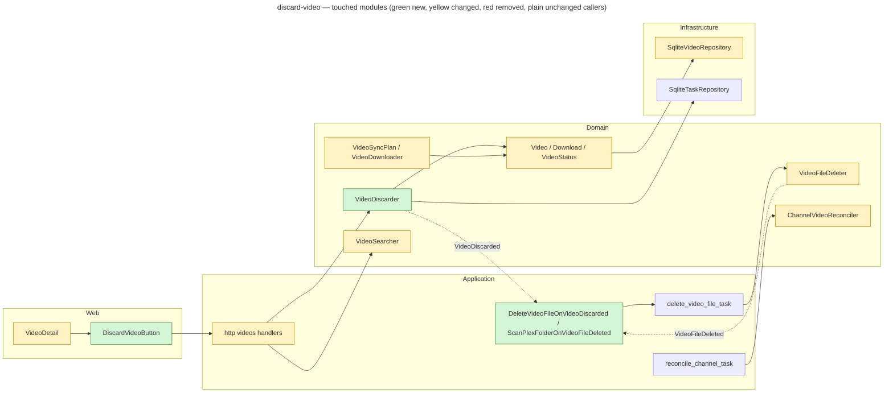

# Proposal

## Why

A tracked channel re-uploaded a 10.4 h, 10.5 GB livestream that can never download under the container's 256m `mem_limit` (ffmpeg OOMs writing the final MP4), and raising memory is not an option. The app has no way to stop it: the download retries 10 min, 1 h, 6 h, then daily up to 11 attempts, pulling the full 10.5 GB each time. The user also has no way to get rid of a downloaded video they don't want. And a video that can't be had (Unavailable, e.g. members-only) still takes one of a channel's `video_limit` slots, so a channel limited to 3 shows only 2.

## What Changes

- New download status **Discarded**: the user chose never to download the video. Irreversible, and hidden from every list like Unavailable.
- `POST /api/videos/{id}/discard` (204) discards a video whose download is Pending, Retrying, Failed or Downloaded: every pending task of the video is cancelled and it is never attempted again by any step, sync, reconcile or retry. In Progress and Unavailable answer 409, an already Discarded video 204 unchanged, an unknown one 404. No undo.
- Discarding a video deletes whatever files it has recorded (a Downloaded video's media, NFO, thumbnail and subtitles; a not-yet-downloaded video's fetched thumbnail) through the existing delete-video-file task, then, when a media file was deleted, asks Plex to scan its show folder.
- Plex is asked to scan a show folder after any video's files are deleted, so a video evicted from a channel or playlist also leaves Plex at once (today it lingers until Plex's own scan).
- Unavailable and Discarded videos no longer count toward a channel's `video_limit`: the reconcile asks for more uploads so the channel keeps `video_limit` videos that aren't skipped.
- Web UI: a "Don't download" button in the video detail pane, for any video not In Progress, behind a confirmation that says it can't be undone (and, for a downloaded video, that its files are deleted). On confirm the video leaves the list.
- Out of scope: a per-source max-duration filter, auto-detecting OOM failures, discarding while In Progress (a running yt-dlp can't be cancelled).

## Capabilities

### New Capabilities
- `video-discard`: discarding a video so it is never downloaded, cancelling its work and deleting its files.

### Modified Capabilities
- `video-listing`: playlist and channel lists omit Discarded videos as well as Unavailable ones.
- `video-retries`: retrying a video leaves a Discarded download unchanged.
- `channel-video-sync`: Unavailable and Discarded videos don't count toward `video_limit` in discovery and eviction.
- `plex-library-scan`: show folder scanned after a video's files are deleted.
- `playlist-reconciliation`: a Discarded video's episode files are no longer protected from the filesystem sweep (`channel-video-sync` likewise).
- `web-ui`: "Don't download" control with confirmation in the video detail pane.

## Impact

- Domain: `VideoStatus::Discarded`, `Download`/`Video` discard transitions, `VideoSyncPlan` (nothing for Discarded), `VideoDownloader::is_settled`, new `VideoDiscarder` + `DiscardVideoError`, `VideoDiscarded` and `VideoFileDeleted` events, `VideoFileDeleter` publishing `VideoFileDeleted`, `VideoSearcher` hiding Discarded, `ChannelVideoReconciler` skipped-aware window, `InternalVideoReconciler` no longer protecting a Discarded video's episode files.
- Application: `POST /videos/{id}/discard` handler; subscribers `DeleteVideoFileOnVideoDiscarded`, `ScanPlexFolderOnVideoFileDeleted` (registered only with Plex configured).
- Infrastructure: `SqliteVideoRepository` encodes/decodes `DISCARDED` in `videos.status` (no migration: no CHECK); `TaskRepository::delete_pending_for_video` reused.
- Web: `api/types.ts`, `api/client.ts`, `api/queries.ts`, `VideoDetail`, new `DiscardVideoButton` using `ConfirmDialog`, `lib/videoSteps.ts`.
- Behaviour change for existing users: channels with Unavailable videos gain videos up to their limit on the next reconcile.

