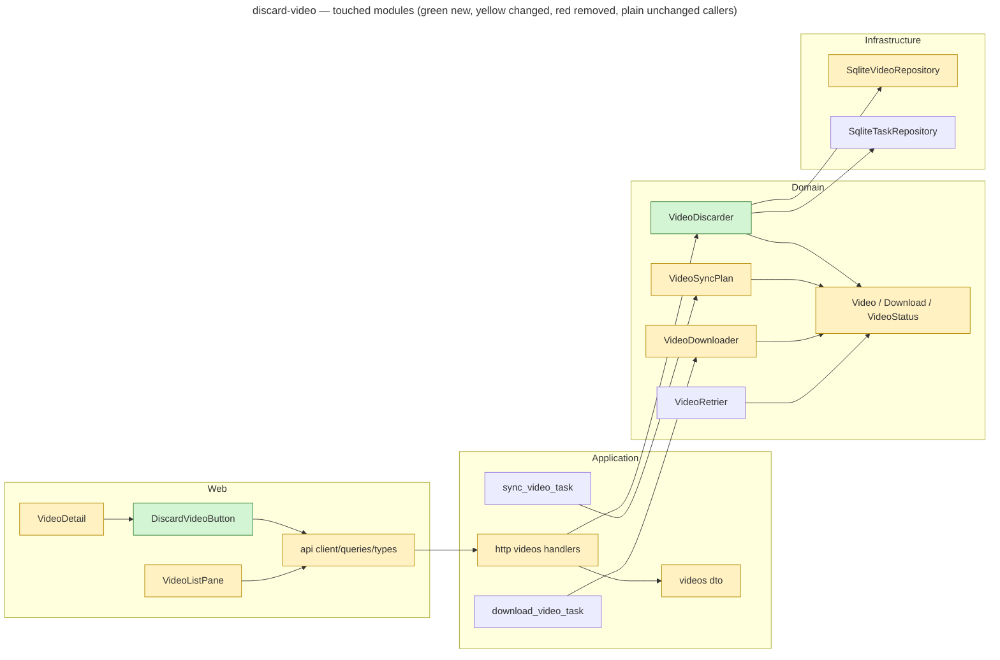

# Proposal

## Why

A tracked channel re-uploaded a 10.4 h, 10.5 GB livestream that can never download under the container's 256m `mem_limit` (ffmpeg OOMs writing the final MP4), and raising memory is not an option. The app has no way to stop it: the download retries 10 min, 1 h, 6 h, then daily up to 11 attempts, pulling the full 10.5 GB each time. The only end state that stops retries, Unavailable, is set by yt-dlp's verdict, is final and hides the video from every list.

## What Changes

- New download status **Discarded** (`DISCARDED`): the user chose not to download the video. Distinct from Unavailable: it is a user choice, stays listed, and can be undone.
- `POST /api/videos/{id}/discard` (204): discards a video whose download is Pending, Retrying or Failed. Its failed attempts and failure are cleared and every pending task of the video is cancelled. A video already Discarded answers 204 unchanged; one In Progress, Downloaded or Unavailable answers 409; an unknown one 404.
- `DELETE /api/videos/{id}/discard` (204): undoes it. The download becomes Pending with no failed attempts and the video is synced now, so its download is scheduled. A video not Discarded answers 204 unchanged; an unknown one 404.
- A Discarded video is never attempted again by any step: a video sync schedules nothing for it, a download task that runs for it does nothing, no thumbnail is fetched. Channel and playlist resyncs keep its status. Retrying the video leaves its download Discarded.
- Web UI: the video detail pane shows a "Don't download" button next to "Retry now" for a Pending, Retrying or Failed video, and for a Discarded one the status "Discarded" with a "Download anyway" button that undoes it. Lists mark a Discarded video with its own indicator. "Retry now" is not shown for a Discarded video.
- Out of scope: discarding a Downloaded video (deleting its file), discarding while In Progress (the running attempt can't be cancelled), a per-source max-duration filter, auto-detecting OOM failures, and a Discarded video that ages out of a channel's limit and is later seen again (it comes back as a new Pending video, as today).

## Capabilities

### New Capabilities
- `video-discard`: discarding a video so it is never downloaded, and undoing it (API, effect on tasks, syncs and other steps).

### Modified Capabilities
- `video-listing`: download status and `download` step may be `DISCARDED`.
- `video-retries`: retrying a video leaves a Discarded download unchanged.
- `web-ui`: video detail status reads "Discarded"; "Don't download" / "Download anyway" controls; "Retry now" hidden for a Discarded video.

## Impact

- Domain: `VideoStatus` (new `Discarded`), `Download` (discarded flag + transitions), `Video` (discard / undo, thumbnail rule), `VideoSyncPlan` (nothing for a Discarded video), `VideoDownloader::is_settled`, new `VideoDiscarder` service and errors.
- Application: two routes and handlers under `/videos/{id}/discard`; `DISCARDED` in the video DTOs.
- Infrastructure: `SqliteVideoRepository` encodes/decodes `DISCARDED` in the existing `videos.status` column (no migration, the column has no CHECK); `TaskRepository::delete_pending_for_video` reused.
- Web: `api/types.ts` (`DISCARDED`), `api/client.ts` + `api/queries.ts` (discard / undo), `VideoDetail`, new `DiscardVideoButton`, `lib/videoSteps.ts`, `VideoListPane` indicator, `test/helpers.tsx` fixtures.
- No API breaking changes; clients that switch on status get one new value.

