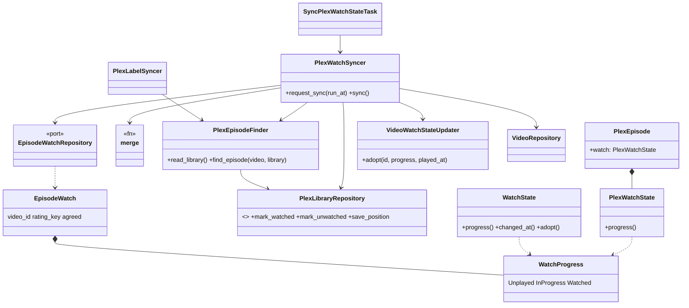
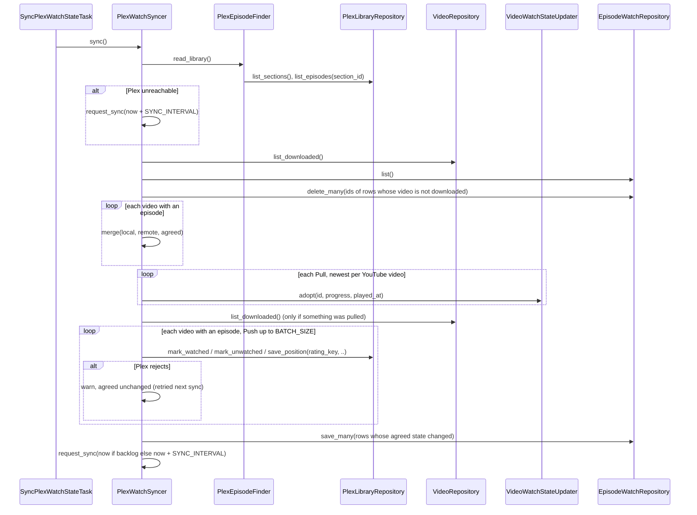
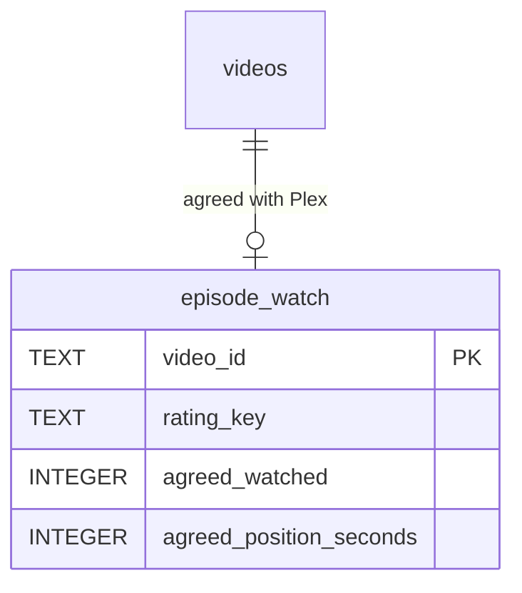

# Design

## Diagrams







## Types & Signatures

```sql
-- migrations/0031_episode_watch.sql (registered in infrastructure/shared/sqlite_migrations.rs)
-- The watch state yarrtube and Plex last agreed on, per stored video. No backfill:
-- a missing row means "agreed on unplayed", which is the first-sync seeding rule.
CREATE TABLE episode_watch (
  video_id TEXT PRIMARY KEY,
  rating_key TEXT NOT NULL,
  agreed_watched INTEGER NOT NULL,
  agreed_position_seconds INTEGER NOT NULL
);
```

```rust
// src/domain/video/watch_progress.rs (exported from domain/video/mod.rs)
/// A watch state reduced to what both yarrtube and Plex can represent.
#[derive(Debug, Clone, Copy, PartialEq, Eq)]
pub enum WatchProgress {
    Unplayed,
    InProgress(PlaybackPosition),
    Watched,
}
```

```rust
// src/domain/video/watch_state.rs
impl WatchState {
    /// Watched ⇒ Watched; position > 0 ⇒ InProgress; else Unplayed.
    pub fn progress(&self) -> WatchProgress;
    /// The latest of `watched_at` and `last_played_at`.
    pub fn changed_at(&self) -> Option<DateTime<Utc>>;
    /// The state Plex reports, played at `played_at`: Watched ⇒ watched_at and
    /// last_played_at = played_at, position 0; InProgress(p) ⇒ unwatched at p,
    /// last_played_at = played_at; Unplayed ⇒ unwatched at 0, last_played_at kept.
    pub fn adopt(self, progress: WatchProgress, played_at: DateTime<Utc>) -> Self;
}

// src/domain/video/video.rs
impl Video {
    pub fn adopt_watch_progress(self, progress: WatchProgress, played_at: DateTime<Utc>) -> Self;
}
```

```rust
// src/domain/plex/plex_watch_state.rs (exported from domain/plex/mod.rs)
/// The token user's watch state of an episode, as Plex lists it.
#[derive(Debug, Clone, Copy, PartialEq, Eq)]
pub struct PlexWatchState {
    pub view_count: u32,
    pub view_offset_ms: Option<i64>,
    pub last_viewed_at: Option<DateTime<Utc>>,
    pub duration_ms: Option<i64>,
}
impl PlexWatchState {
    pub fn unplayed() -> Self;
    /// An offset counts (InProgress, offset floored to seconds) unless the
    /// episode is watched and the offset is at or below 10% of its duration
    /// (a rewatch just started, like yarrtube's rule); else view_count > 0 ⇒
    /// Watched; else Unplayed.
    pub fn progress(&self) -> WatchProgress;
}

// src/domain/plex/plex_episode.rs
pub struct PlexEpisode {
    pub rating_key: String,
    pub section_id: String,
    pub file: String,
    pub watch: PlexWatchState, // new
}
```

```rust
// src/domain/plex_watch/episode_watch.rs (domain/plex_watch/mod.rs, declared in domain/mod.rs)
/// The watch state yarrtube and the Plex episode `rating_key` last agreed on.
#[derive(Debug, Clone, PartialEq, Eq)]
pub struct EpisodeWatch {
    pub video_id: VideoId,
    pub rating_key: String,
    pub agreed: WatchProgress,
}
impl EpisodeWatch {
    pub fn new(video_id: VideoId, episode: &PlexEpisode, agreed: WatchProgress) -> Self;
    /// What was agreed with `episode`: Unplayed when there is no row or it was
    /// agreed with another episode (Plex re-imported the file), so a re-imported
    /// episode's empty state never reads as "unwatched in Plex".
    pub fn agreed_with(row: Option<&EpisodeWatch>, episode: &PlexEpisode) -> WatchProgress;
}

// src/domain/plex_watch/watch_merge.rs
/// One side's state and when it last changed.
#[derive(Debug, Clone, Copy, PartialEq, Eq)]
pub struct WatchSide {
    pub progress: WatchProgress,
    pub changed_at: Option<DateTime<Utc>>,
}
#[derive(Debug, Clone, Copy, PartialEq, Eq)]
pub enum MergeOutcome {
    /// Both sides already show it: record it as agreed.
    InSync(WatchProgress),
    /// Copy Plex's state to yarrtube.
    Pull(WatchProgress),
    /// Copy yarrtube's state to Plex.
    Push(WatchProgress),
}
/// Equal ⇒ InSync; only Plex differs from `agreed` ⇒ Pull; only yarrtube ⇒ Push;
/// both ⇒ the later `changed_at` wins, a side without one loses, yarrtube on a tie.
pub fn merge(local: WatchSide, remote: WatchSide, agreed: WatchProgress) -> MergeOutcome;
```

```rust
// src/domain/services/plex_episode_finder.rs (extracted unchanged from PlexLabelSyncer)
/// The Plex library sections holding yarrtube's videos, as one sync reads them.
pub struct PlexLibrary {
    pub sections: Vec<PlexSection>,
    /// Every episode of `sections`, by its server-side file.
    pub episodes: HashMap<String, PlexEpisode>,
}
#[derive(Clone)]
pub struct PlexEpisodeFinder {
    plex_library_repository: Arc<dyn PlexLibraryRepository>,
    video_owner_finder: Arc<VideoOwnerFinder>,
    videos_path: String,
    plex_videos_path: String,
}
pub trait PlexEpisodeFinderApi: Send + Sync {
    fn read_library(&self) -> anyhow::Result<PlexLibrary>;
    /// The Plex episode of the video's file; None until downloaded and imported.
    fn find_episode<'a>(&self, video: &Video, library: &'a PlexLibrary)
        -> anyhow::Result<Option<&'a PlexEpisode>>;
}

// src/domain/services/plex_label_syncer.rs
// PlexLabelSyncer::new takes a PlexEpisodeFinder in place of video_owner_finder,
// videos_path and plex_videos_path; read_library/served_sections/episodes_by_file/
// find_episode move to PlexEpisodeFinder. No behaviour change.
```

```rust
// src/domain/services/video_watch_state_updater.rs
pub trait VideoWatchStateUpdaterApi: Send + Sync {
    // ...existing...
    /// Applies `Video::adopt_watch_progress(progress, played_at)` to the stored
    /// video `id` and every other stored copy of its YouTube video.
    fn adopt(&self, id: &VideoId, progress: WatchProgress, played_at: DateTime<Utc>)
        -> Result<(), UpdateWatchStateError>;
}
```

```rust
// src/domain/services/plex_watch_syncer.rs
/// How often a watch sync runs.
pub const SYNC_INTERVAL: Duration = Duration::minutes(5);
/// Episodes written to Plex per sync; more ⇒ the next sync runs now.
pub const BATCH_SIZE: usize = 500;

/// Keeps each downloaded video's watch state and its Plex episode's in sync,
/// both ways.
#[derive(Clone)]
pub struct PlexWatchSyncer {
    plex_library_repository: Arc<dyn PlexLibraryRepository>,
    plex_episode_finder: PlexEpisodeFinder,
    episode_watch_repository: Arc<dyn EpisodeWatchRepository>,
    video_repository: Arc<dyn VideoRepository>,
    video_watch_state_updater: VideoWatchStateUpdater,
    task_repository: Arc<dyn TaskRepository>,
    clock: Arc<dyn Clock>,
}
pub trait PlexWatchSyncerApi: Send + Sync {
    /// A pending sync moves forward to `run_at` if due later, else one is scheduled.
    fn request_sync(&self, run_at: DateTime<Utc>) -> anyhow::Result<()>;
    /// One sync: pull, then push, then request the next one. Plex unreachable ⇒
    /// logs, requests the next sync, `Ok`.
    fn sync(&self) -> anyhow::Result<()>;
}
```

```rust
// src/domain/task/task.rs
pub enum Task {
    // ...
    SyncPlexWatchState, // "sync_plex_watch_state", empty payload, TaskLane::Plex
}
```

```rust
// src/infrastructure/repositories/plex_library_repository.rs
pub trait PlexLibraryRepository: Send + Sync {
    // ...existing; list_episodes now fills PlexEpisode::watch from
    // viewCount / viewOffset / lastViewedAt / duration...
    /// `GET /:/scrobble?identifier=com.plexapp.plugins.library&key={rating_key}`;
    /// clears the offset.
    fn mark_watched(&self, rating_key: &str) -> anyhow::Result<()>;
    /// `GET /:/unscrobble?...&key={rating_key}`; clears view count, offset and
    /// last viewed time.
    fn mark_unwatched(&self, rating_key: &str) -> anyhow::Result<()>;
    /// `GET /:/progress?...&key={rating_key}&time={ms}&state=stopped`; position > 0
    /// (Plex ignores time=0).
    fn save_position(&self, rating_key: &str, position: PlaybackPosition) -> anyhow::Result<()>;
}
// FakePlexLibraryRepository: with_episode_watch(rating_key, PlexWatchState); the three
// calls update that state as Plex does and are recorded in mutations()
// ("scrobble:{key}", "unscrobble:{key}", "progress:{key}:{ms}"); rejecting(key) applies.
```

```rust
// src/infrastructure/repositories/sqlite_episode_watch_repository.rs
// (exposed in repositories/mod.rs, built in infrastructure_container.rs)
pub trait EpisodeWatchRepository: Send + Sync {
    fn list(&self) -> anyhow::Result<Vec<EpisodeWatch>>;
    /// Inserts or replaces each row by video_id.
    fn save_many(&self, rows: &[EpisodeWatch]) -> anyhow::Result<()>;
    fn delete_many(&self, video_ids: &[VideoId]) -> anyhow::Result<()>;
}
pub struct SqliteEpisodeWatchRepository { db: Database }
```

```rust
// src/application/tasks/sync_plex_watch_state_task/mod.rs
pub struct SyncPlexWatchStateTask { plex_watch_syncer: PlexWatchSyncer }
impl TaskHandler for SyncPlexWatchStateTask; // registered in tasks/mod.rs when Some
```

```ts
// web/src/lib/tasks.ts
// 'sync_plex_watch_state' ⇒ "Syncing Plex watch state", family `other`
```

## Call Stack

**Startup** (Plex configured) — `serve::prepare_task_queue(.., Some(&label_syncer), Some(&watch_syncer))` → `PlexWatchSyncer::request_sync(now)`. `serve.rs` builds one `PlexEpisodeFinder` shared by both syncers, and passes `Option<PlexWatchSyncer>` to `tasks::registry`.

**Sync** — executor (lane `Plex`) → `SyncPlexWatchStateTask::handle(task)` → `PlexWatchSyncer::sync()`
1. `PlexEpisodeFinder::read_library()` → `Err` ⇒ `warn!`, `request_sync(now + SYNC_INTERVAL)`, `Ok(())`
2. `VideoRepository::list_downloaded()`; `EpisodeWatchRepository::list()` ⇒ rows by `video_id`
3. `delete_many(rows whose video_id is not a downloaded video)`
4. Per downloaded video: `find_episode(&video, &library)` → `None` ⇒ skip (not imported yet). Else:
   - `local = WatchSide { video.watch.progress(), video.watch.changed_at() }`
   - `remote = WatchSide { episode.watch.progress(), episode.watch.last_viewed_at }`
   - `agreed = EpisodeWatch::agreed_with(rows.get(id), episode)`
   - `merge(local, remote, agreed)`
5. Pulls, one per YouTube video (the newest `remote.changed_at` when several copies' episodes changed): `VideoWatchStateUpdater::adopt(&id, progress, remote.changed_at.unwrap_or(now))` (every copy).
6. Something pulled ⇒ re-run steps 2 and 4 on fresh videos (each pulled copy is now InSync; the other copies of the same YouTube video now Push).
7. Per outcome:
   - `InSync(p)` ⇒ `EpisodeWatch::new(id, episode, p)` if it differs from the stored row
   - `Push(p)`, while fewer than `BATCH_SIZE` pushed:
     - `Watched` ⇒ `mark_watched(key)`
     - `InProgress(pos)` ⇒ `mark_unwatched(key)` if `episode.watch.view_count > 0`, then `save_position(key, pos)`
     - `Unplayed` ⇒ `mark_unwatched(key)`
     - `Ok` ⇒ `EpisodeWatch::new(id, episode, p)`; `Err` ⇒ `warn!`, row unchanged (still differs ⇒ retried next sync)
   - `Push` past `BATCH_SIZE` ⇒ backlog
   - `Pull` left after step 6 (changed again meanwhile) ⇒ nothing; next sync
8. `EpisodeWatchRepository::save_many(changed rows)`
9. backlog ⇒ `request_sync(now)`, else `request_sync(now + SYNC_INTERVAL)`

Echo-free by construction: after a push Plex reports `lastViewedAt = now`, but the row now records the pushed state as agreed, so the next sync sees both sides equal to it.

## Test Plan

Behaviour tests (application layer):

`src/application/tasks/sync_plex_watch_state_task/tests.rs` (real SQLite, `FakePlexLibraryRepository`, `FixedClock`)
1. `it_should_push_a_video_watched_in_yarrtube` — downloaded video marked watched, its episode unplayed ⇒ `scrobble:{key}`, row agreed Watched.
2. `it_should_pull_an_episode_watched_in_plex` — episode `view_count` 1 ⇒ video watched, position 0.
3. `it_should_push_a_playback_position` — video unwatched at 300s ⇒ `progress:{key}:300000`.
4. `it_should_pull_a_playback_position` — episode offset 215540 ms, viewed at T ⇒ video unwatched at 215s, last played T (in "Continue watching").
5. `it_should_unwatch_an_episode_before_saving_a_rewatch_position` — video rewatched to unwatched at 600s, episode watched ⇒ `unscrobble` then `progress:{key}:600000`.
6. `it_should_pull_an_episode_unwatched_in_plex` — agreed Watched, episode unplayed ⇒ video unwatched at 0.
7. `it_should_push_a_video_unplayed_after_being_watched` — agreed Watched, video unwatched at 0 ⇒ `unscrobble`.
8. `it_should_bring_every_copy_in_line_with_a_plex_change` — same YouTube video in a channel and a playlist, channel episode watched in Plex ⇒ both copies watched, playlist episode scrobbled, in one sync.
9. `it_should_not_echo_a_pushed_change` — sync pushes; a second sync (episode now viewed at now) makes no mutation and no video change.
10. `it_should_keep_the_most_recently_played_side_when_both_changed` — video in progress at T1, episode watched at T2 > T1 ⇒ pull; and the reverse ⇒ push.
11. `it_should_seed_from_whichever_side_was_played_on_the_first_sync` — no rows: watched-in-Plex episode pulled, watched-in-yarrtube video pushed, both unplayed ⇒ nothing.
12. `it_should_count_a_short_rewatch_in_plex_as_still_watched` — episode `view_count` 1, offset 5% of duration ⇒ video stays watched, no mutation.
13. `it_should_skip_a_video_plex_has_not_imported` — no episode for the file ⇒ no mutation, no row.
14. `it_should_push_to_an_episode_plex_reimported` — row agreed Watched with another rating key, new episode unplayed ⇒ `scrobble` on the new key, video stays watched.
15. `it_should_forget_a_video_no_longer_downloaded` — row for a video whose file is gone ⇒ row deleted.
16. `it_should_push_the_others_if_plex_rejects_one` — two pushes, one key rejected ⇒ other agreed; rejected row unchanged.
17. `it_should_retry_later_if_plex_is_unreachable` — `failing()` ⇒ no change, next `sync_plex_watch_state` at now + 5 min.
18. `it_should_schedule_the_next_sync_in_five_minutes`
19. `it_should_schedule_the_next_sync_now_if_pushes_exceeded_the_batch` — BATCH_SIZE + 1 pushes ⇒ BATCH_SIZE mutations, next sync at now.
20. `web/src/lib/tasks.test.ts`: `describes a Plex watch sync` — "Syncing Plex watch state", Other tab.

Existing `sync_plex_labels_task` tests stay green after the `PlexEpisodeFinder` extraction.

Infrastructure tests:

`PlexLibraryRepository` (`mockito`)
21. `it_should_list_an_episodes_watch_state` — `viewCount`, `viewOffset`, `lastViewedAt`, `duration` ⇒ `PlexWatchState`.
22. `it_should_list_an_unplayed_episode` — fields absent ⇒ `PlexWatchState::unplayed()`.
23. `it_should_mark_an_episode_watched` — `GET /:/scrobble` with `identifier` and `key`, token header.
24. `it_should_mark_an_episode_unwatched` — `GET /:/unscrobble`.
25. `it_should_save_an_episode_position_in_milliseconds` — `GET /:/progress` with `time=215000&state=stopped`.

`SqliteEpisodeWatchRepository`
26. `it_should_round_trip_each_agreed_progress` — Unplayed, InProgress(215), Watched.
27. `it_should_replace_a_row_on_save`
28. `it_should_delete_rows_by_video_id`
