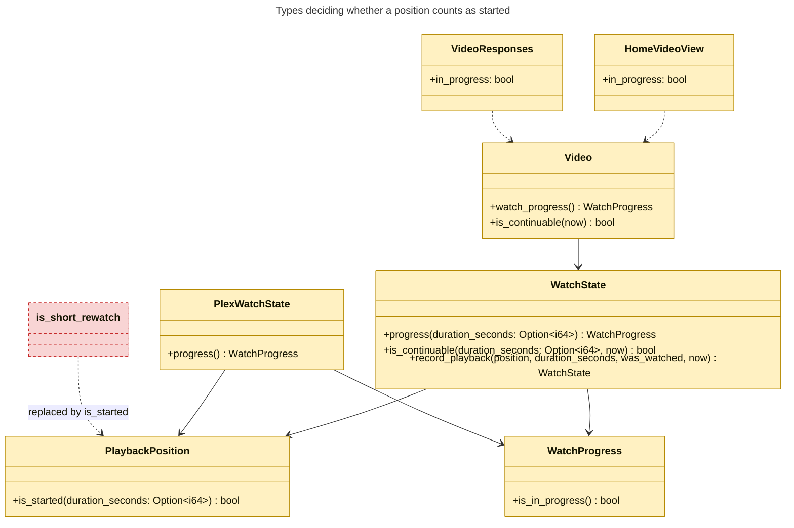
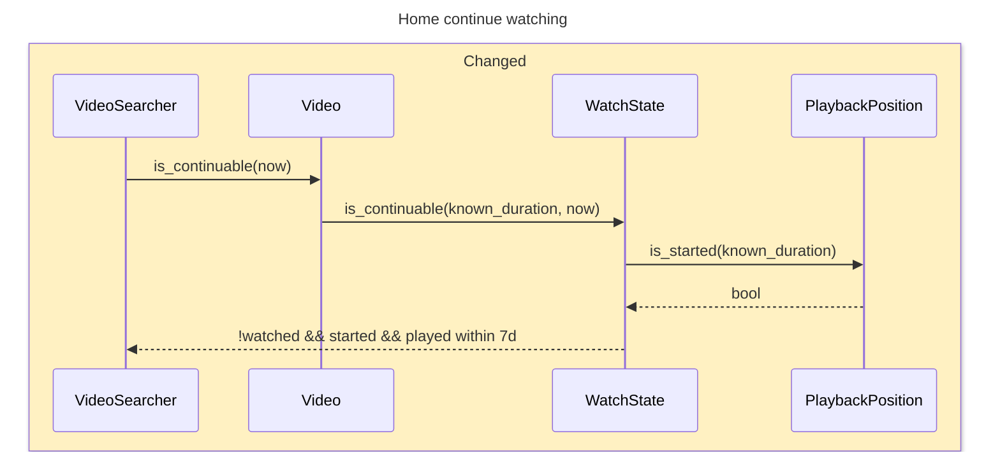
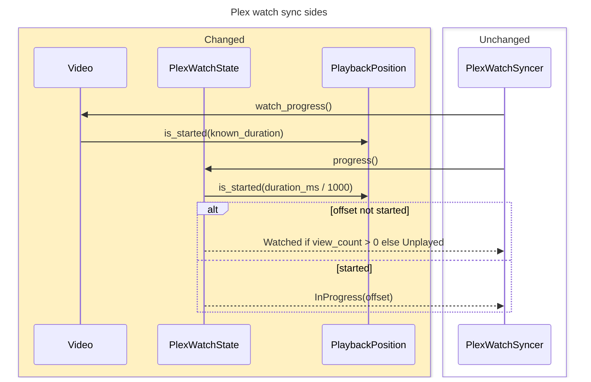
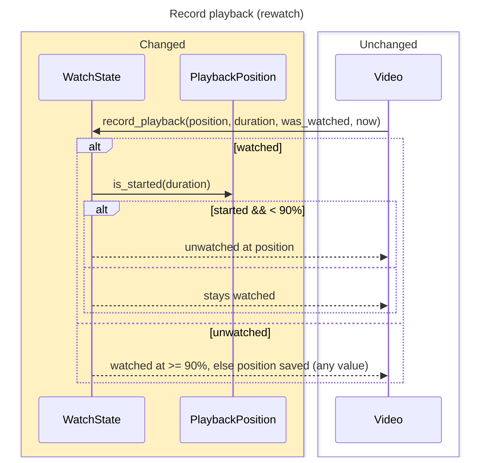

## Diagrams

Colours: green = new, yellow = changed, red = removed, plain = unchanged.









## Types & Signatures

```rust
// src/domain/video/playback_position.rs
const STARTED_MIN_SECONDS: i64 = 30;
const STARTED_MIN_SHARE_PERCENT: i64 = 20;
const STARTED_ENOUGH_SECONDS: i64 = 600;

impl PlaybackPosition {
    /// Past 30s and, with a known positive duration, at least 20% of it or 10 minutes.
    pub fn is_started(&self, duration_seconds: Option<i64>) -> bool;
}
```

```rust
// src/domain/video/watch_state.rs
// REWATCH_RESET_THRESHOLD removed
impl WatchState {
    /// Unwatched, started, last played within 7 days of `now`.
    pub fn is_continuable(&self, duration_seconds: Option<i64>, now: DateTime<Utc>) -> bool; // was is_in_progress(now)
    pub fn progress(&self, duration_seconds: Option<i64>) -> WatchProgress;
    // record_playback: signature unchanged; watched branch resets when position.is_started(duration) && share < 90%
}
```

```rust
// src/domain/video/watch_progress.rs
impl WatchProgress {
    pub fn is_in_progress(&self) -> bool;
}
```

```rust
// src/domain/video/video.rs
impl Video {
    /// `WatchState::progress` against the recorded duration.
    pub fn watch_progress(&self) -> WatchProgress;
    /// `WatchState::is_continuable` against the recorded duration.
    pub fn is_continuable(&self, now: DateTime<Utc>) -> bool;
}
```

```rust
// src/domain/plex/plex_watch_state.rs
// is_short_rewatch removed: resume_position filters with is_started(duration_ms / 1000)
impl PlexWatchState {
    pub fn progress(&self) -> WatchProgress; // unchanged signature
}
```

```rust
// src/domain/video/home_video_view.rs
pub struct HomeVideoView { /* … */ pub in_progress: bool }
```

```rust
// src/application/http/videos/dto.rs
pub struct VideoResponse { /* … */ pub in_progress: bool }
pub struct HomeVideoResponse { /* … */ pub in_progress: bool }
pub struct CategoryVideoResponse { /* … */ pub in_progress: bool }
```

```ts
// web/src/api/types.ts — Video, HomeVideo, CategoryVideo gain
in_progress: boolean
// web/src/lib/sourceVideos.ts — WatchableVideo gains in_progress; isInProgress uses it
```

## Call Stack

- Home: `GET /api/videos/home` → `VideoSearcher::home` → `continue_watching_in` → `Video::is_continuable(now)` → `WatchState::is_continuable(known_duration, now)` → `PlaybackPosition::is_started(known_duration)`.
- Listing: `VideoResponse::from(VideoView)` / `HomeVideoView::from(SourcedVideo)` → `in_progress: video.watch_progress().is_in_progress()`.
- Progress: `POST /api/videos/{id}/progress` → `VideoWatchStateUpdater` → `Video::update_watch_state(position, reported_duration, was_watched, now)` → `WatchState::record_playback(position, duration, was_watched, now)` → `PlaybackPosition::is_started(duration)` (rewatch branch).
- Plex: `SyncPlexWatchStateTask` → `PlexWatchSyncer` → `local_side(video)` → `Video::watch_progress()`; `remote_side(episode)` → `PlexWatchState::progress()` → `PlaybackPosition::is_started(duration_ms / 1000)`.
- Web: `matchesWatchFilter(video, 'in_progress')` → `isInProgress(video)` → `video.in_progress`. Player resume and thumbnail bar keep using `position_seconds`.

Known duration = recorded duration when positive, else unknown. Fixtures without a duration keep the 30-second rule, so existing tests stay valid.

## Test Plan

Behaviour tests:

1. `it_should_continue_only_videos_started_past_20_percent_on_home` (`http/videos/tests.rs`): 40-min videos played 1h ago at 420s and 480s → 480s under continue watching, 420s under latest.
2. `it_should_continue_a_long_video_played_for_10_minutes_on_home`: 2-hour video at 600s → continue watching.
3. `it_should_continue_a_video_without_duration_past_30_seconds_on_home`: existing `it_should_continue_only_videos_started_past_30_seconds_on_home` covers it (fixtures have no duration); keep as regression.
4. `it_should_report_whether_listed_channel_videos_are_in_progress`: channel videos of 40 min at 480s, at 300s, watched → `in_progress` true, false, false; positions as saved.
5. `it_should_report_an_old_started_video_in_progress_when_listing_channel_videos`: 40 min at 480s last played 10 days ago → `in_progress: true`.
6. `it_should_report_in_progress_on_home_videos`: continue watching entry has `in_progress: true`.
7. `it_should_report_in_progress_on_category_videos`: category video 40 min at 480s → `in_progress: true`.
8. `it_should_save_a_position_under_the_started_threshold`: unwatched 40-min, report 300s → `watched: false`, position 300.
9. `it_should_keep_a_watched_video_watched_early_in_a_rewatch`: watched 40-min, `was_watched`, report 420s → stays watched, position 0.
10. `it_should_mark_a_watched_video_unwatched_once_a_rewatch_counts_as_started` (replaces `…_past_10_percent_of_a_rewatch`): watched 40-min, report 600s → `watched: false`, position 600.
11. `it_should_not_push_a_position_under_20_percent` (`sync_plex_watch_state_task/tests.rs`): local 40-min at 300s, episode unplayed → no mutation, agreed Unplayed.
12. `it_should_push_a_position_past_20_percent`: local 40-min at 480s → episode position saved at 480.
13. `it_should_not_pull_a_plex_position_under_20_percent`: episode 40 min, offset 300s, unplayed → video stays unwatched at 0.
14. `it_should_count_a_rewatch_in_plex_under_20_percent_as_still_watched`: watched episode 40 min, offset 420s → video stays watched.
15. `isInProgress uses the in_progress flag` (`web/src/lib/sourceVideos.test.ts`): unwatched video with position > 0 and `in_progress: false` is not in progress; with `in_progress: true` it is.

Infrastructure tests: none (no adapter changes).
