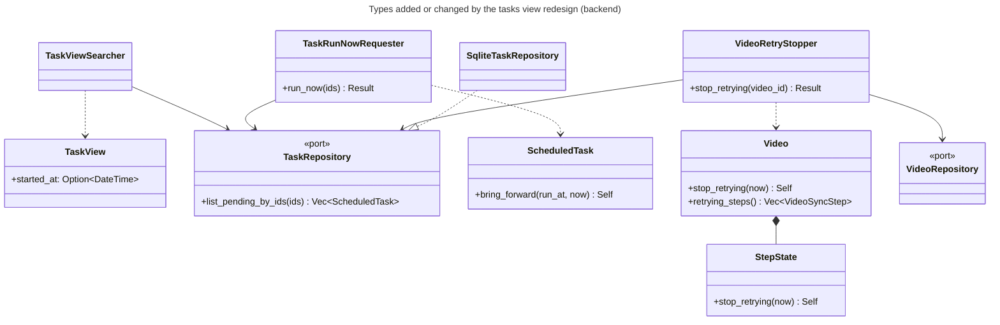
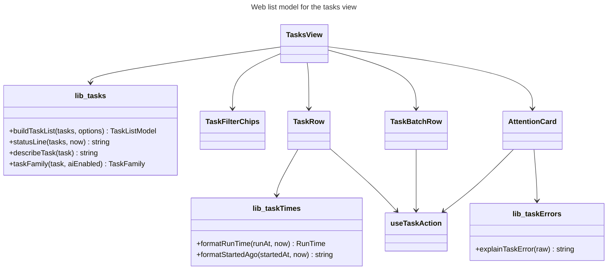
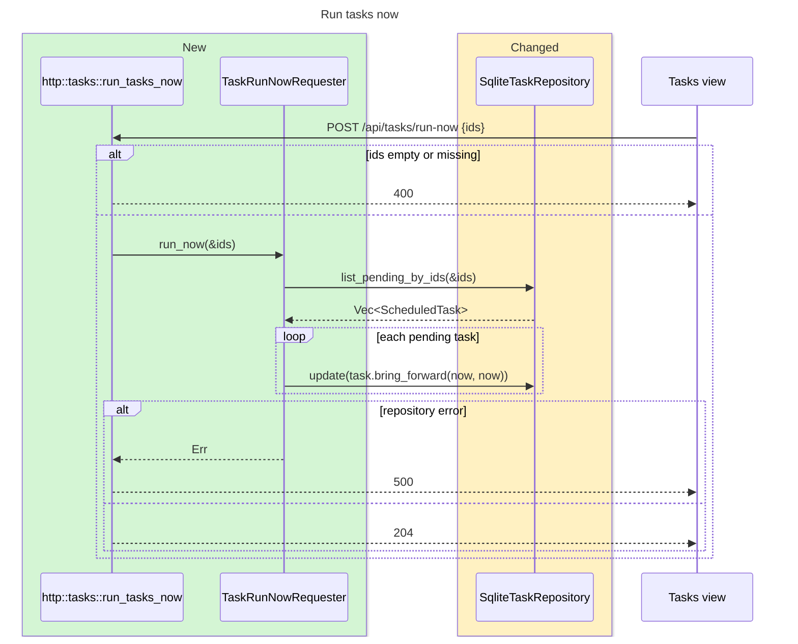
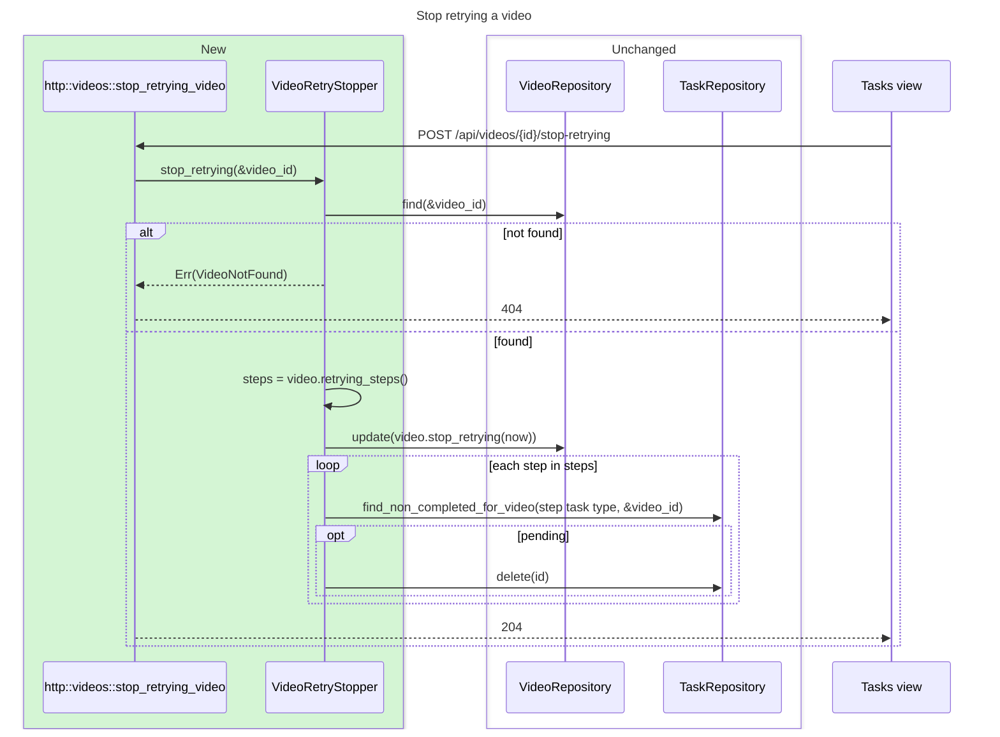
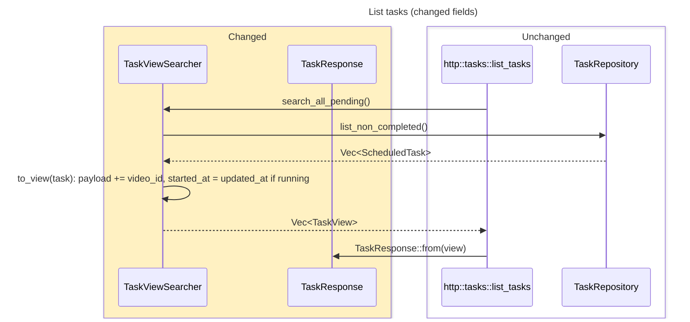
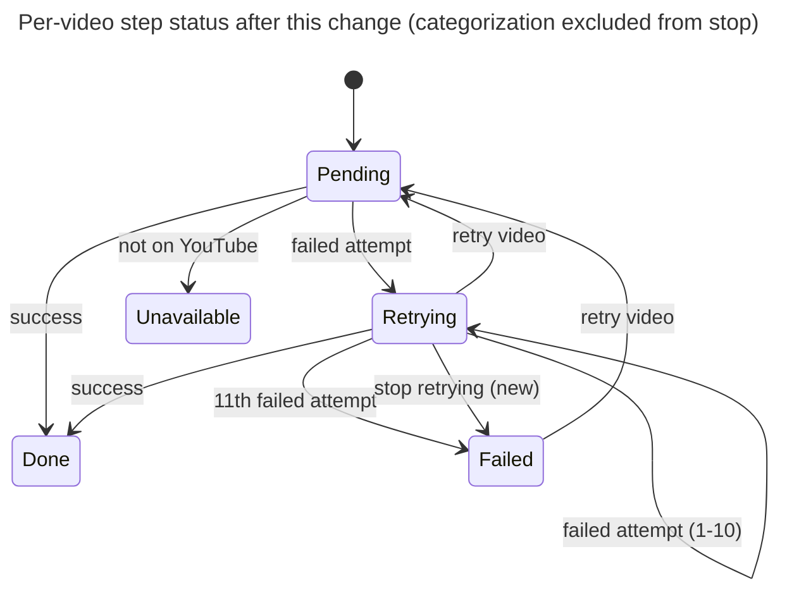

# Design

## Context

- `GET /api/tasks` returns `TaskResponse` built from `TaskView`; context is
  resolved into a `payload: HashMap<String, String>` by `TaskViewSearcher`
  (`playlist_id`, `channel_id`, names, `video_title`). Per-video tasks know
  their `video_id`, but the listing does not expose it.
- `tasks.updated_at` is set when a task is claimed
  (`UPDATE … SET status = 'running', updated_at = ?2`), so a running task's
  `updated_at` is its start time. No migration is needed.
- `ScheduledTask::bring_forward(run_at, now)` already exists and is used by
  `VideoRetrier`.
- Per-video failures are counted on the video's steps (`video-retries`),
  not on the task: prod's failing download shows `retries: 0` with a
  `last_error`. That is expected, and it is why the UI retries the video
  (`POST /api/videos/{id}/retry`) rather than bringing the task forward. A
  step's task that runs before it is due does nothing.
- `StepState::give_up(now)` already moves a step to Failed.
- Design source: https://claude.ai/artifact/36GX5JmSxQNgjTnyxpcirs.

## Goals / Non-Goals

**Goals:**
- Pure, unit-tested list model in `web/src/lib/` (families, sections,
  batches, copy, status line, run times, error text). Components only render
  it.
- Generic task run-now on the backend, used for single tasks and batches.

**Non-Goals:**
- Stopping a categorization (its give-up writes per-category verdicts that
  need the AI job's model, see `video_categorizer::give_up`).
- Progress bars: there is no progress data.
- Changing the sidebar's on-demand reconcile, which stays as it is.
- Listing finished or dead-lettered tasks.

## Decisions

- **Run now brings the scheduled task forward** (`POST /api/tasks/run-now`).
  Today's Run now starts a separate on-demand reconcile next to the
  scheduled one. Bringing the scheduled task forward works for every task
  type, keeps one task per source, and lets a batch be one request.
- **`video_id` goes in the payload map**, like `playlist_id`/`channel_id`.
  `started_at` is a top-level field, because it describes the attempt
  rather than the target.
- **Batching is a front-end concern**: reconciles are chained when each is
  ≤10 min after the previous one, in run-time order, and need at least 2.
  This only changes display.
- **Needs attention = pending task with `last_error`.** Waiting-for-Ollama
  tasks also land there. That is fine: their reason is shown in plain words.
- **Times use the browser's locale and time zone**
  (`Intl.DateTimeFormat(undefined, { hour: '2-digit', minute: '2-digit' })`).
  Tests pin `TZ=UTC` and the locale `en-GB` through the formatter's options
  argument, which defaults to `undefined` in the app.

## Risks / Trade-offs

- [Run now on 52 reconciles floods the light lane] → it already runs one at
  a time in run-time order, so this is the same load as the scheduled batch,
  just earlier.
- [yt-dlp error wording changes] → unknown text falls back to the raw first
  line, and the raw text is always one click away.
- [Batch boundaries shift as tasks run] → batches are recomputed on every
  poll. A batch only shrinks or splits, and no action targets a stale id
  because run-now ignores ids that are not pending.
- [Removing the Syncs-tab on-demand reconcile] → that endpoint stays, so
  the sidebar is unaffected.

## Diagrams

Colours: green = new, yellow = changed, red = removed, plain = unchanged.













## Types & Signatures

```rust
// src/domain/task/task_view.rs
pub struct TaskView {
    pub id: i64,
    pub task_type: String,
    pub status: TaskStatus,
    pub retries: i64,
    pub run_at: DateTime<Utc>,
    pub created_at: DateTime<Utc>,
    pub started_at: Option<DateTime<Utc>>, // new: updated_at while running
    pub last_error: Option<String>,
    pub payload: HashMap<String, String>, // + "video_id" for per-video tasks
}
```

```rust
// src/application/http/tasks/dto.rs
pub struct TaskResponse {
    // … existing fields …
    pub started_at: Option<DateTime<Utc>>,
}

#[derive(Debug, Deserialize)]
pub struct RunTasksNowRequest {
    pub ids: Vec<i64>,
}
```

```rust
// src/infrastructure/repositories/sqlite_task_repository.rs
pub trait TaskRepository: Send + Sync {
    // … existing …
    /// The pending tasks among `ids`; running or unknown ids are skipped.
    fn list_pending_by_ids(&self, ids: &[i64]) -> anyhow::Result<Vec<ScheduledTask>>;
}
```

```rust
// src/domain/services/task_run_now_requester.rs
#[derive(Clone)]
pub struct TaskRunNowRequester {
    task_repository: Arc<dyn TaskRepository>,
    clock: Arc<dyn Clock>,
}

pub trait TaskRunNowRequesterApi: Send + Sync {
    /// Each pending task among `ids` becomes due now; others are ignored.
    fn run_now(&self, ids: &[i64]) -> anyhow::Result<()>;
}
```

```rust
// src/domain/services/video_retry_stopper.rs
#[derive(Clone)]
pub struct VideoRetryStopper {
    video_repository: Arc<dyn VideoRepository>,
    video_updater: VideoUpdater,
    task_repository: Arc<dyn TaskRepository>,
    clock: Arc<dyn Clock>,
}

pub trait VideoRetryStopperApi: Send + Sync {
    /// Retrying steps (but the categorization) to Failed, their pending tasks removed.
    fn stop_retrying(&self, video_id: &VideoId) -> Result<(), StopRetryingVideoError>;
}
```

```rust
// src/domain/video/errors.rs
#[derive(Debug, thiserror::Error)]
pub enum StopRetryingVideoError {
    #[error("video {0} not found")]
    VideoNotFound(VideoId),
    #[error(transparent)]
    Repository(anyhow::Error),
}
```

```rust
// src/domain/video/step_state.rs
impl StepState {
    /// Failed when Retrying (keeps failed attempts), else unchanged.
    pub fn stop_retrying(self, now: DateTime<Utc>) -> Self;
}
// src/domain/video/{download,thumbnail,subtitles,chapters,downloaded_quality}.rs
// and the summary step: each gets `pub fn stop_retrying(self, now) -> Self`
// delegating to its StepState.

// src/domain/video/video.rs
impl Video {
    /// Every Retrying step but the categorization, now Failed.
    pub fn stop_retrying(self, now: DateTime<Utc>) -> Self;
    /// The steps (but the categorization) that are Retrying.
    pub fn retrying_steps(&self) -> Vec<VideoSyncStep>;
}
```

```rust
// src/application/http/tasks/mod.rs
pub async fn run_tasks_now(
    State(requester): State<TaskRunNowRequester>,
    Json(request): Json<RunTasksNowRequest>,
) -> Result<StatusCode, ApiError>;

// src/application/http/videos/mod.rs
pub async fn stop_retrying_video(
    State(stopper): State<VideoRetryStopper>,
    Path(id): Path<String>,
) -> Result<StatusCode, ApiError>;

// src/application/http/mod.rs
//   .route("/tasks/run-now", post(tasks::run_tasks_now))
//   .route("/videos/{id}/stop-retrying", post(videos::stop_retrying_video))
//   ApiServices += task_run_now_requester, video_retry_stopper
```

```ts
// web/src/api/types.ts
export interface Task {
  // … existing …
  started_at: string | null
  payload: Record<string, string | undefined> // + video_id
}

// web/src/api/client.ts
export function runTasksNow(ids: number[]): Promise<void>
export function stopRetryingVideo(videoId: string): Promise<void>
// retryVideo(videoId) already exists
```

```ts
// web/src/lib/tasks.ts
export type TaskFamily = 'downloads' | 'syncs' | 'ai' | 'upkeep'
export type TaskFilter = 'all' | TaskFamily
export type TaskSectionId = 'running' | 'attention' | 'nextHour' | 'later'

export interface BatchSource { taskId: number; name: string; kind: 'channel' | 'playlist'; sourceId: string }
export type TaskEntry =
  | { kind: 'task'; task: Task }
  | { kind: 'batch'; tasks: Task[]; sources: BatchSource[]; runAt: string }
export interface TaskSection { id: TaskSectionId; entries: TaskEntry[] }
export interface FilterChip { filter: TaskFilter; count: number }
export interface TaskListModel { chips: FilterChip[]; sections: TaskSection[] }

export function taskFamily(task: Task, aiEnabled: boolean): TaskFamily
export function isPerVideoTask(task: Task): boolean
export function offersRunNow(task: Task): boolean
export function describeTask(task: Task): string // base form if pending, "-ing" if running
export function sectionOf(task: Task, now: Date): TaskSectionId
export function batchReconciles(tasks: Task[]): TaskEntry[]
export function buildTaskList(
  tasks: Task[],
  options: { filter: TaskFilter; query: string; aiEnabled: boolean; now: Date },
): TaskListModel
export function statusLine(tasks: Task[], now: Date): string

// web/src/lib/taskTimes.ts
export interface RunTime { clock: string; relative: string } // relative = "Starting soon" when due
export function formatRunTime(runAt: string, now: Date, locale?: string): RunTime
export function formatStartedAgo(startedAt: string, now: Date): string

// web/src/lib/taskErrors.ts
export function explainTaskError(raw: string): string

// web/src/components/tasks/useTaskAction.ts
export function useTaskAction(action: () => Promise<void>): {
  run: () => Promise<void>; working: boolean; error: string | null
}
```

## Call Stack

- **List**: `TasksView` → `useTasks()` (`GET /api/tasks`) + `useAiEnabled()`
  + `useChannels()` (avatars) → `buildTaskList(tasks, {filter, query,
  aiEnabled, now})` → `TaskFilterChips` / per section `TaskRow` |
  `TaskBatchRow` | `AttentionCard`. Server: `list_tasks` →
  `TaskViewSearcher::search_all_pending()` → `TaskRepository::list_non_completed()`
  → `to_view(task)` (adds `video_id`, `started_at`) → `TaskResponse::from`.
- **Run now / Sync now / Sync all now**: button → `useTaskAction(() =>
  runTasksNow(ids))` → `POST /api/tasks/run-now {ids}` →
  `run_tasks_now(request)` (400 if `ids` empty) →
  `TaskRunNowRequester::run_now(&ids)` →
  `TaskRepository::list_pending_by_ids(&ids)` → per task
  `TaskRepository::update(&task.bring_forward(now, now))` → 204 →
  `invalidateTasks()`.
- **Retry now**: card → `useTaskAction(() => retryVideo(payload.video_id))`
  → existing `POST /api/videos/{id}/retry` → `VideoRetrier::retry` →
  `invalidateTasks()`.
- **Stop retrying**: card → `useTaskAction(() => stopRetryingVideo(video_id))`
  → `POST /api/videos/{id}/stop-retrying` → `stop_retrying_video(id)` →
  `VideoRetryStopper::stop_retrying(&id)` → `VideoRepository::find` (404 if
  none) → `video.retrying_steps()` → `VideoUpdater::update(|v|
  v.stop_retrying(now))` → per step
  `TaskRepository::find_non_completed_for_video(step.task_for(&video).task_type(), &id)`
  → `delete(id)` if pending → 204 → `invalidateTasks()`.

## Test Plan

1. Behaviour tests: Rust HTTP handlers (`src/application/http/*/tests.rs`,
   in-memory fakes)
   1. `it_should_include_video_id_for_a_download_task`: the listed download
      task has `payload.video_id`.
   2. `it_should_include_video_id_when_the_video_no_longer_exists`: the
      thumbnail task of a deleted video still has `video_id` and no
      `video_title`.
   3. `it_should_not_include_video_id_for_a_ytdlp_update`
   4. `it_should_include_started_at_for_a_running_task`: equals the claim
      time.
   5. `it_should_have_null_started_at_for_a_pending_task`
   6. `it_should_bring_a_pending_task_forward_when_run_now`: 204, and
      `run_at` = now.
   7. `it_should_bring_every_listed_task_forward`: 3 reconciles, all due now.
   8. `it_should_ignore_running_and_unknown_ids_when_run_now`: 204, and the
      running task is unchanged.
   9. `it_should_keep_retries_and_last_error_when_run_now`
   10. `it_should_reject_run_now_without_ids`: 400 for `{"ids": []}` and
       for `{}`.
   11. `it_should_fail_a_retrying_download_when_retrying_is_stopped`: 204,
       the download is Failed with 1 failed attempt, and no download task is
       pending.
   12. `it_should_leave_pending_steps_and_their_tasks_when_retrying_is_stopped`
   13. `it_should_leave_a_retrying_categorization_when_retrying_is_stopped`
   14. `it_should_change_nothing_when_no_step_is_retrying`: 204.
   15. `it_should_answer_404_when_stopping_retrying_an_unknown_video`
   16. `it_should_make_a_stopped_download_pending_again_when_the_video_is_retried`
2. Infrastructure tests: `SqliteTaskRepository` (real SQLite)
   1. `it_should_list_only_pending_tasks_among_the_given_ids`: pending,
      running and missing ids → only the pending one.
   2. `it_should_list_nothing_for_an_empty_id_list`
3. Web unit tests (`web/src/lib/*.test.ts`, Vitest, fake timers)
   1. `taskFamily`: downloads, syncs, AI on and off, upkeep, unknown type.
   2. `describeTask`: base form when pending, "-ing" when running, for every
      type, with placeholders when a name is missing.
   3. `sectionOf`: running / attention / next hour (incl. already due) /
      later.
   4. `batchReconciles`: a chain within 10 min forms 1 batch, a gap over
      10 min splits it, a lone reconcile stays a task, errored or running
      reconciles are not batched.
   5. `buildTaskList`: chip counts sum to All, empty chips hidden, filter,
      query on description and on a batch's source names, empty sections
      dropped.
   6. `statusLine`: idle with next due, next already due, downloads running,
      mixed running.
   7. `formatRunTime`: today, tomorrow, already due → "Starting soon";
      `formatStartedAgo`.
   8. `explainTaskError`: 403, private, age-gated, members-only, unavailable,
      unknown → first line without "ERROR:".
4. Web component tests (`web/src/components/TasksView.test.tsx`, `mockApi`)
   1. Opens on All with the status line and sections for the prod-like
      fixture, and shows no badges.
   2. Selecting a chip filters; a chip with no tasks is hidden.
   3. A batch expands and collapses, and Sync all now posts every id.
   4. Sync now posts one id. Run now on a Plex sync posts its id. A
      per-video task has no Run now.
   5. The attention card shows the plain reason; Show error / Hide error
      toggles the raw text.
   6. Retry now posts to `/api/videos/{id}/retry` and refreshes; Stop
      retrying posts to `/stop-retrying` and refreshes.
   7. A failed action shows an error and can be used again.
   8. Search filters within the chip, and "nothing matches" shows when
      nothing does.
   9. Empty listing → "All quiet. Nothing is scheduled."
