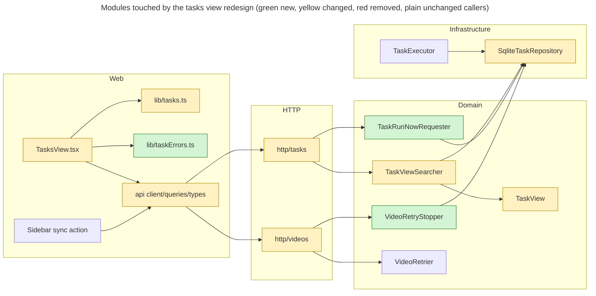

# Proposal

## Why

The tasks view answers "what kind of job is this?" when people come to it to
learn whether Yarrtube is doing anything, whether anything is broken, and when
new videos will arrive. In prod (72 tasks, none running, 1 failing download) it
opens on an empty "Active" tab, spreads 68 near-identical "pending · Run now"
rows across a Syncs tab, labels scheduled work as if it were running
("Syncing channel …"), and buries a download YouTube refused under "pending"
with raw yt-dlp output and no way to act on it. The redesign is drawn on the
Claude Design canvas https://claude.ai/artifact/36GX5JmSxQNgjTnyxpcirs.

## What Changes

- **BREAKING (UI)**: the five family tabs (Active, Downloads, Syncs, AI, Other)
  are replaced by one list with filter chips (All, Downloads, Syncs, AI,
  Plex & upkeep); a chip with no tasks is hidden; AI keeps its
  AI-enabled rule.
- A status line under the heading says what is happening now ("Nothing
  running. Next up in 2 min: …" / "Downloading 1 video. 71 more tasks are
  scheduled.").
- The list is split into sections that carry status instead of badges:
  **Running now**, **Needs attention** (tasks with a last error),
  **Next hour**, **Later**. The status badges go away.
- Each scheduled row shows its clock time first and the time left second
  ("20:20 · in 17 min"); a due-but-not-started task says "Starting soon";
  a running task says how long ago it started.
- Playlist and channel reconciliations that run within 10 minutes of each
  other are shown as one expandable batch ("Check 16 channels and playlists
  for new videos") with avatars, a **Sync all now** action and **Sync now**
  per source once expanded.
- Copy: scheduled work is described as a plan ("Check 3Blue1Brown for new
  videos", "Download …", "Update yt-dlp"); only running work uses "-ing".
- A failing per-video task gets a Needs-attention card: a plain-language
  error (common yt-dlp errors mapped to sentences), when the next try is,
  **Retry now** (existing `POST /api/videos/{id}/retry`), **Stop retrying**
  (new) and **Show error** revealing the raw text.
- **Run now** on any pending task that isn't a per-video step (reconciles,
  Plex syncs, yt-dlp update, file deletions), driven by a new endpoint that
  brings pending tasks forward to now. It replaces the Syncs-tab Run now that
  triggered an on-demand reconcile beside the scheduled task.
- The search field is always shown and filters within the selected chip.
- The phone layout keeps chip labels (chips scroll sideways) and uses 44 px
  touch targets.
- API: the task listing adds `video_id` for per-video tasks and `started_at`
  for running tasks.
- API: new `POST /api/tasks/run-now` (`{ "ids": [...] }`) and new
  `POST /api/videos/{id}/stop-retrying`.

## Capabilities

### New Capabilities

None.

### Modified Capabilities

- `web-ui`: the tasks-view requirements (tabs, tab bar, search, last error,
  run sync now, task descriptions) are replaced by the filter, section,
  batch, attention-card and run-now requirements.
- `task-listing`: listed tasks carry the targeted video's id and, while
  running, when they started.
- `task-scheduling`: pending tasks can be brought forward to run now.
- `video-retries`: a client can stop retrying a video, making its Retrying
  steps Failed at once.
- `plex-watch-sync`: the watch sync's tasks-view wording and filter.
- `e2e-tests`: tasks-view coverage moves from tabs to chips and sections,
  and covers Stop retrying.

## Impact

- Web: `web/src/components/TasksView.tsx` (rewritten, split into small
  components), `web/src/lib/tasks.ts` (families, sections, batching, copy,
  error mapping), `web/src/api/{types,client,queries}.ts`, their tests, and
  the tasks e2e specs under `e2e-tests/`.
- Rust: `domain/task/task_view.rs`, `domain/services/task_view_searcher.rs`,
  a new task run-now service and a new video retry stopper service,
  `TaskRepository` (bring pending tasks forward), `application/http/tasks`
  and `application/http/videos` (new handlers + DTO fields), `serve.rs`
  wiring.
- No schema change: `started_at` comes from the `updated_at` column set
  when a task is claimed.
- The on-demand reconcile endpoints stay, still used by the sidebar.

