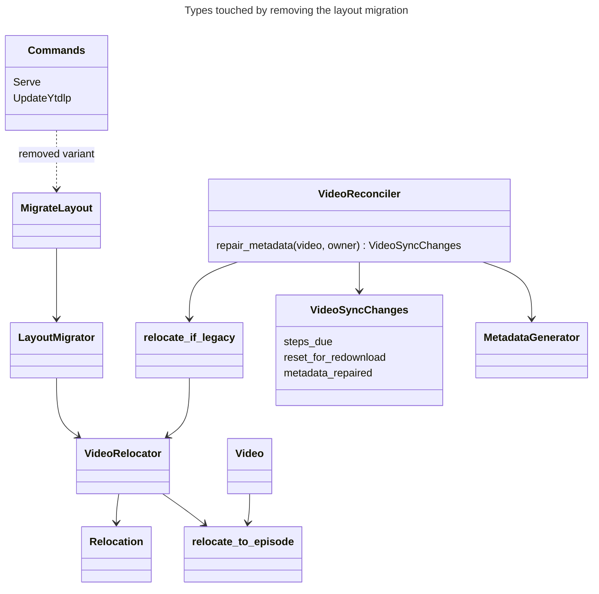
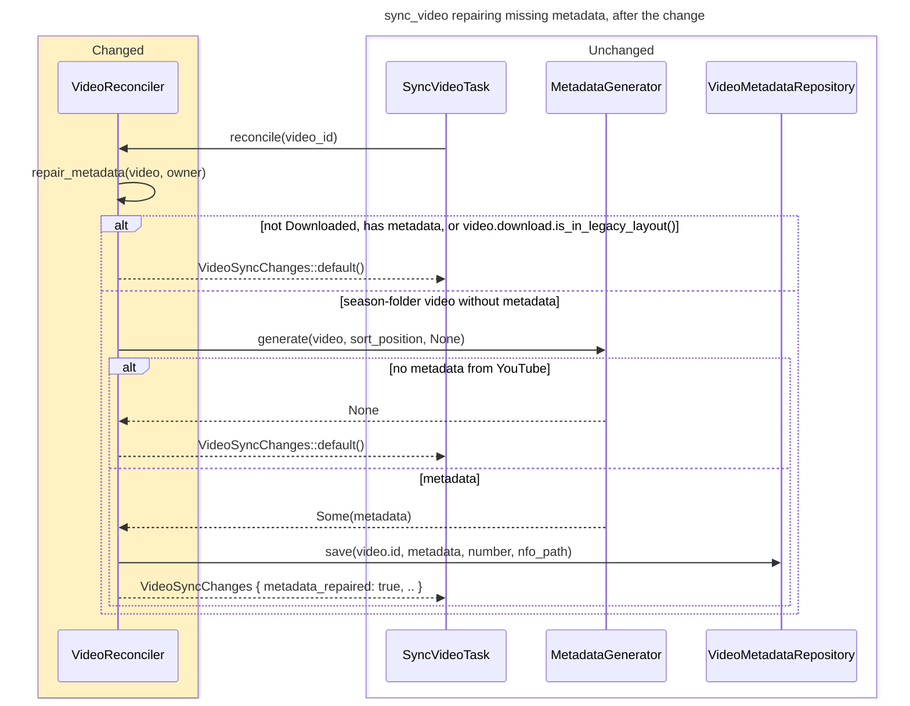

# Design

## Diagrams

Colours: green = new, yellow = changed, red = removed, plain = unchanged.





## Types & Signatures

```rust
// src/application/cli/mod.rs  (MigrateLayout variant and `pub mod migrate_layout` removed)
pub enum Commands {
    Serve,
    UpdateYtdlp,
}
```

```rust
// src/domain/video/video_sync_changes.rs  (`relocated` removed)
pub struct VideoSyncChanges {
    pub steps_due: Vec<VideoSyncStep>,
    pub reset_for_redownload: bool,
    pub metadata_repaired: bool,
}
```

```rust
// src/domain/services/video_reconciler.rs  (`video_relocator` field/param and `relocate_if_legacy` removed)
impl VideoReconciler {
    pub fn new(
        video_repository: Arc<dyn VideoRepository>,
        video_owner_finder: Arc<VideoOwnerFinder>,
        task_repository: Arc<dyn TaskRepository>,
        video_file_repository: Arc<dyn VideoFileRepository>,
        video_metadata_repository: Arc<dyn VideoMetadataRepository>,
        metadata_generator: Arc<MetadataGenerator>,
        clock: Arc<dyn Clock>,
        video_category_assigner: VideoCategoryAssigner,
        preferences_repository: Arc<dyn PreferencesRepository>,
        video_categorizer: Arc<VideoCategorizer>,
    ) -> Self;

    fn repair_metadata(&self, video: &Video, owner: &VideoOwner) -> VideoSyncChanges;
}
```

Deleted outright: `src/application/cli/migrate_layout.rs`,
`src/domain/services/layout_migrator.rs`,
`src/domain/services/video_relocator.rs` (`VideoRelocator`,
`VideoRelocatorApi`, `Relocation`, `SkipReason`), `Video::relocate_to_episode`,
`MOVIE_NFO_FILENAME`, `serve::video_relocator`. Kept: `is_in_legacy_layout`,
`top_level_entry`, `owning_entry` (deleting and protecting legacy files).

## Call Stack

- `main` → `Cli::parse()` → `Commands::{Serve, UpdateYtdlp}`; `migrate-layout`
  is now an unknown subcommand (clap usage error, exit 2).
- `SyncVideoTask::run(video_id)` → `VideoReconciler::reconcile(video_id)` →
  `repair_metadata(&video, &owner)`: returns `VideoSyncChanges::default()`
  when the video isn't Downloaded, already has metadata, or
  `video.download.is_in_legacy_layout()`; else
  `MetadataGenerator::generate(&video, owner.sort_position, None)` →
  `save_metadata(&video, metadata, &owner.target)` →
  `VideoMetadataRepository::save(&video.id, &metadata, &number, &nfo_path)`.
- `serve::video_reconciler(infrastructure)` builds `VideoReconciler::new(..)`
  without a relocator.

## Test Plan

1. Behaviour tests (`src/application/tasks/sync_video_task/tests.rs`):
   - `it_should_leave_a_legacy_video_without_metadata_untouched`: a
     Downloaded legacy video (`My Video/My Video.mp4`) with no metadata, and
     YouTube metadata available; after a sync its recorded filename is
     unchanged, the legacy file is still in its folder, no season folder or
     `.nfo` was written, no metadata is recorded, and the task reports
     `unchanged`. Replaces
     `it_should_relocate_a_legacy_video_when_its_metadata_is_recovered`.
   - `it_should_leave_a_legacy_video_in_place_when_its_metadata_is_still_unavailable`:
     existing, kept as is.
2. Infrastructure tests: none (no adapter changes).
