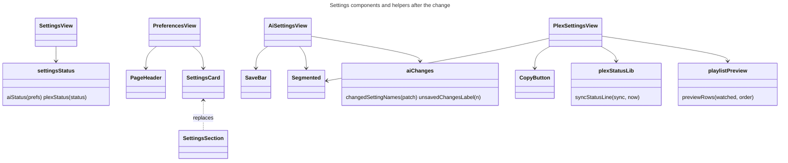
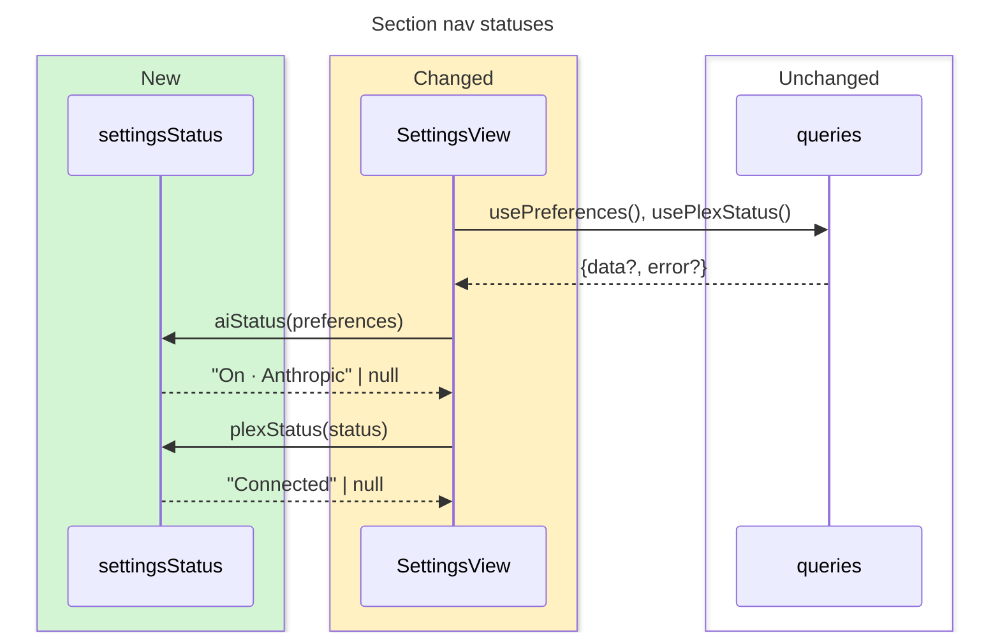
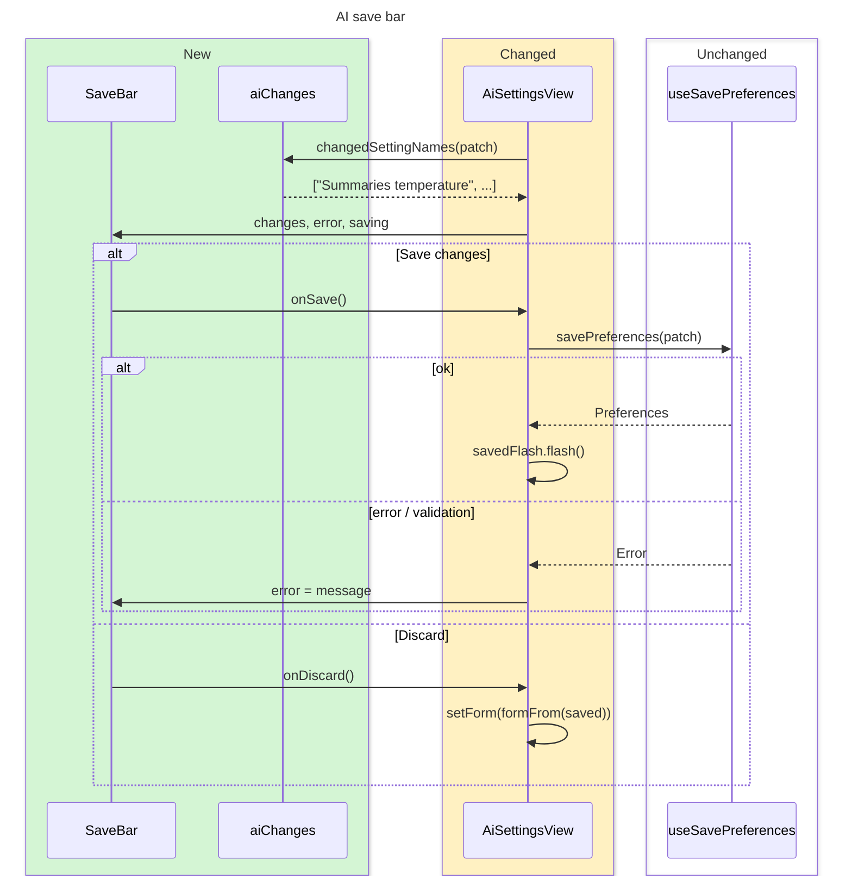
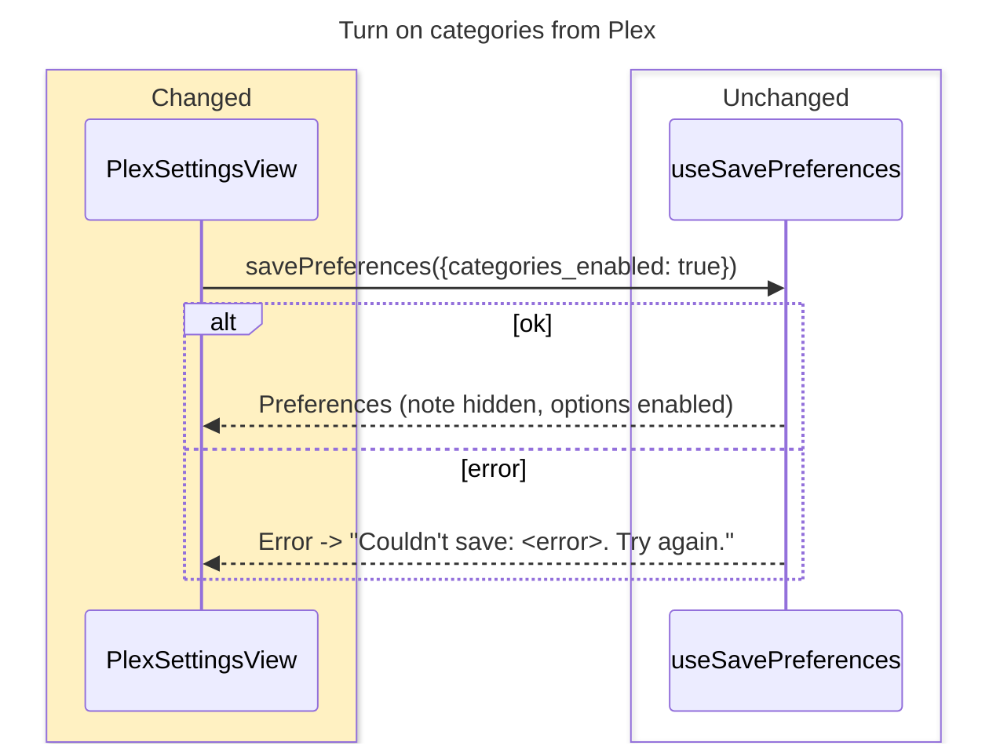

# Design

Web only. No backend, API or DTO change. Segmented choices use native radio inputs styled as segments, so `radiogroup`/`radio` semantics and the existing role-based tests keep working. Radix ToggleGroup is not used, because it exposes a `group` role.

## Diagrams

Colours: green = new, yellow = changed, red = removed, plain = unchanged.









## Types & Signatures

```ts
// web/src/lib/settingsStatus.ts
export function aiStatus(preferences: Preferences | undefined): string | null
export function plexStatus(status: PlexStatus | undefined): string | null
```

```ts
// web/src/lib/aiChanges.ts
/** Human names of the changed settings, deduped, in page order. */
export function changedSettingNames(patch: PreferencesPatch): string[]
export function unsavedChangesLabel(count: number): string // "1 unsaved change" | "2 unsaved changes"
```

```ts
// web/src/lib/plexStatus.ts (added)
export function syncStatusLine(sync: PlexSync, now?: Date): string
```

```ts
// web/src/lib/playlistPreview.ts
export interface PreviewRow { label: string; watched: boolean }
export function previewRows(watched: PlexPlaylistWatched, order: PlexPlaylistOrder): PreviewRow[]
```

```ts
// web/src/lib/errorMessage.ts (added)
export function couldntSave(error: string): string // "Couldn't save: <error>. Try again."
```

```tsx
// web/src/components/SettingsCard.tsx (replaces SettingsSection.tsx)
export function SettingsCard(props: {
  title: string
  description?: ReactNode
  action?: ReactNode // e.g. a feature switch beside the heading
  children?: ReactNode
}): JSX.Element
```

```tsx
// web/src/components/PageHeader.tsx
export function PageHeader(props: {
  title: string
  description?: ReactNode
  saved: boolean
  action?: ReactNode
}): JSX.Element
```

```tsx
// web/src/components/Segmented.tsx
export function Segmented<T extends string>(props: {
  name: string
  choices: { value: T; label: string }[]
  value: T
  disabled?: boolean
  onChange: (value: T) => void
}): JSX.Element
```

```tsx
// web/src/components/SaveBar.tsx
export function SaveBar(props: {
  changes: string[]
  error: string | null
  saving: boolean
  onDiscard: () => void
  onSave: () => void
}): JSX.Element | null
```

```tsx
// web/src/components/CopyButton.tsx
export function CopyButton(props: { text: string }): JSX.Element // aria-label "Copy <text>"
```

```tsx
// web/src/components/PromptDisclosure.tsx
export function PromptDisclosure(props: { isDefault: boolean; children: ReactNode }): JSX.Element
```

## Call Stack

- **Nav**: `SettingsView` → `usePreferences()` + `usePlexStatus()` → `aiStatus(preferences)`, `plexStatus(status)` → rendered under each `NavLink` label (hidden below `md`).
- **General toggle**: `PreferencesView.toggle(key, value)` → `savePreferences({[key]: value})` → `saved.flash()` | `setSaveError(couldntSave(msg))`.
- **AI edit**: `set(key, value)` → `patch = diff(form, saved)` → `changedSettingNames(patch)` → `<SaveBar changes=…>`.
- **AI save**: `SaveBar.onSave` → existing `save()` (validation → `savePreferences(patch)`) → `savedFlash.flash()` in `PageHeader` | `setSaveError(msg)` → `SaveBar.error`.
- **AI discard**: `SaveBar.onDiscard` → `setForm(formFrom(saved))`, `setSaveError(null)`.
- **Plex sync row**: `syncStatusLine(sync)` + button label `sync.last_error ? 'Retry now' : 'Sync now'` → `requestSync(kind)` unchanged.
- **Plex playlist option**: `Segmented.onChange(value)` → `save({plex_playlist_*: value})` → `previewRows(watched, order)`.
- **Turn on categories**: button → `save({categories_enabled: true})`.
- **Copy**: `CopyButton` → `navigator.clipboard.writeText(text)` → "Copied" for 2 s.

## Test Plan

Vitest + Testing Library. Only `fetch` is mocked (`mockApi`). One test = one cycle.

1. Behaviour tests
   - `settingsStatus.test.ts`: `it shows Off, On · Ollama and On · Anthropic for AI`. Asserts the three strings and `null` for undefined preferences.
   - `settingsStatus.test.ts`: `it shows Not set up, Not checked yet, Connected and Can't reach Plex`. Asserts each status and `null` for undefined.
   - `SettingsView.test.tsx`: `it shows each section's status under its name`. Asserts "On · Anthropic" and "Connected" in the nav.
   - `PreferencesView.test.tsx`: `it shows the renamed switches with their descriptions`. Asserts the switches "Categories", "Continue watching", "More about…", "Quick watches", "Latest videos", each description, and no "About" button.
   - `PreferencesView.test.tsx`: `it links categories to where they are also used`. Asserts the three link hrefs.
   - `PreferencesView.test.tsx`: `it disables More about while categories are off`.
   - `PreferencesView.test.tsx`: `it shows Couldn't save when a toggle fails`.
   - `aiChanges.test.ts`: `it names changed settings once each, in page order`. A model key from either provider gives "Summaries model".
   - `aiChanges.test.ts`: `it counts unsaved changes in singular and plural`.
   - `AiSettingsView.test.tsx`: `it shows the AI features switch beside the title`.
   - `AiSettingsView.test.tsx`: `it describes each provider option`.
   - `AiSettingsView.test.tsx`: `it shows no save bar until a field changes`.
   - `AiSettingsView.test.tsx`: `it lists the unsaved changes in the save bar`.
   - `AiSettingsView.test.tsx`: `it saves only the changed fields and shows Saved by the title`.
   - `AiSettingsView.test.tsx`: `it discards changes without a request`.
   - `AiSettingsView.test.tsx`: `it shows a rejected save's error in the save bar`.
   - `AiSettingsView.test.tsx`: `it shows Anthropic effort as a segmented choice outside Advanced`.
   - `AiSettingsView.test.tsx`: `it marks the prompt default or edited`.
   - `AiSettingsView.test.tsx`: `it names the missing Anthropic key and the restart`.
   - `plexStatus.test.ts`: `it puts last and next run on one line`.
   - `plexStatus.test.ts`: `it says when a failed sync retries`.
   - `playlistPreview.test.ts`: `it orders rows and drops the watched one when removing`.
   - `PlexSettingsView.test.tsx`: `it shows the server badge, version, libraries and last checked`.
   - `PlexSettingsView.test.tsx`: `it tells what to check when Plex is unreachable`.
   - `PlexSettingsView.test.tsx`: `it shows Retry now on a failed sync`.
   - `PlexSettingsView.test.tsx`: `it saves a playlist choice and updates the preview`.
   - `PlexSettingsView.test.tsx`: `it turns categories on from the Plex page`.
   - `PlexSettingsView.test.tsx`: `it shows the setup card when Plex isn't configured`.
   - `PlexSettingsView.test.tsx`: `it copies a variable name`.
2. Infrastructure tests: none. No adapter changes.
