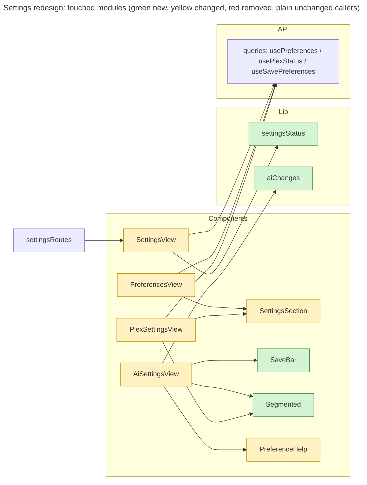

# Proposal

## Why

The Settings page grew section by section. Each section saves in its own way: General and Plex save as you go, while AI uses a Save button at the bottom. Help text is hidden behind "?" tooltips. Two switches are both labelled just "Enabled". Plex settings depend on categories, but the page only says to go turn them on somewhere else. This change applies the reviewed redesign (canvas: https://claude.ai/artifact/HKASVSHWj1auGYgsBCmcuQ) so the three sections look, read and save the same way.

## What Changes

- **Section nav**: each section shows its status under its name. General shows "Home and categories". AI shows "Off", "On · Ollama" or "On · Anthropic". Plex shows "Not set up", "Not checked yet", "Connected" or "Can't reach Plex".
- **Shared layout**: each group is a card with a heading. Every section shows "Saved" next to its title. Help moves from "?" tooltips to text under each label. **BREAKING** (UI only): the "About <label>" help buttons on General are removed.
- **General**:
  - The switch is renamed to "Categories". It shows links to where categories are also used: AI categorization, Plex category playlists and the home "More about" section.
  - The "Home" group becomes "Home sections". Its switches are renamed "Continue watching", "More about…", "Quick watches" and "Latest videos", each with a description under it.
- **AI**:
  - The "Enable AI" switch moves beside the page title and is renamed "AI features".
  - The provider choice becomes two option cards, each with a one-line trade-off.
  - The "Summaries" and "Categorization" switches get their section name plus a description, replacing "Enabled".
  - Anthropic's "Effort" moves out of "Advanced" and becomes a segmented choice.
  - Each prompt gets its own "Prompt" disclosure whose header says "default" or "edited".
  - "Save" moves to a bar that stays at the bottom while there are unsaved changes. The bar lists the changes and has "Discard".
- **Plex**:
  - Groups are renamed "Server" and "Sync".
  - The server card shows a status badge and a Version / Libraries / Last checked row.
  - The sync rows are renamed "Watched status" and "Categories to Plex", each with a description. Their status fits on one line: "Last run … · Next …", or on failure "Failed …: error. Retries …" with "Retry now".
  - The playlist options become segmented choices: "Keep them / Remove them" and "Newest first / Oldest first". A preview shows how the playlist reacts to the choice.
  - While categories are off, the section shows a "Turn on categories" button that turns them on from the Plex page.
  - When Plex isn't set up, the section shows a setup screen: what you get, one row per environment variable with a Copy button, and a link to the Plex guide.
- **Copy**: every renamed label, description and error follows the before/after sheet on the canvas. Errors start with "Couldn't" and say what to do next.
- e2e specs are updated to the new accessible names.

## Capabilities

### New Capabilities

None.

### Modified Capabilities

- `web-ui`: the Settings page nav gains statuses. The General section ("Preferences View", "Preferences Help", "Preferences Save Confirmation", "Home Category Switch Needs Categories") changes labels, descriptions and the cross-links.
- `ai-settings-ui`: the AI page layout, the master switch, the feature switches, the provider choice, Effort, the prompt disclosure and the save bar.
- `plex-settings-ui`: group names, the server status, sync rows, segmented playlist options with a preview, "Turn on categories", and the setup screen.

## Impact

- Web only, under `web/src/components/`: `SettingsView`, `SettingsSection`, `PreferencesView`, `AiSettingsView`, `PlexSettingsView`, plus their tests.
- New pure helpers in `web/src/lib/settingsStatus.ts` (nav statuses) and `web/src/lib/aiChanges.ts` (names of the unsaved AI fields).
- No backend, API or DTO change. Every value shown already comes from `GET /api/preferences` and `GET /api/plex`.
- e2e: `e2e-tests/tests/preferences.spec.js`, `aiSettings.spec.js` and `plexSettings.spec.js` use the renamed accessible names.

