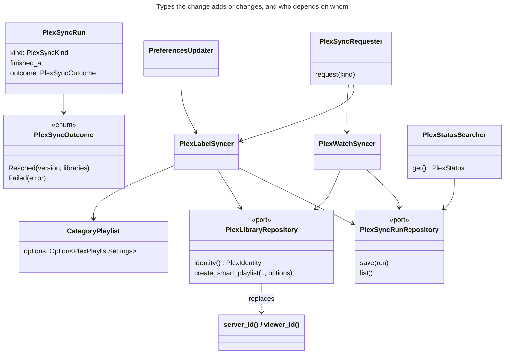
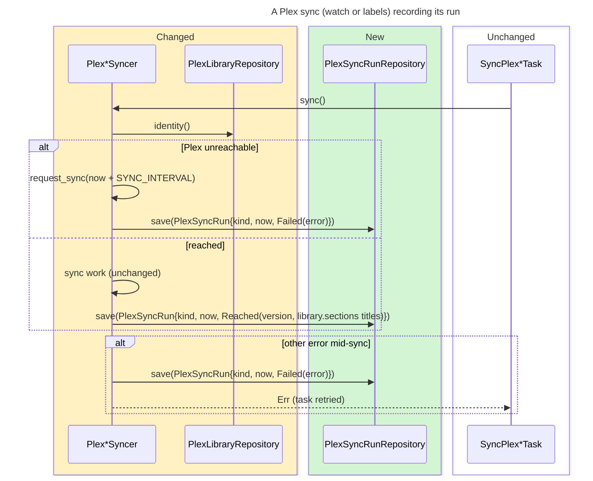
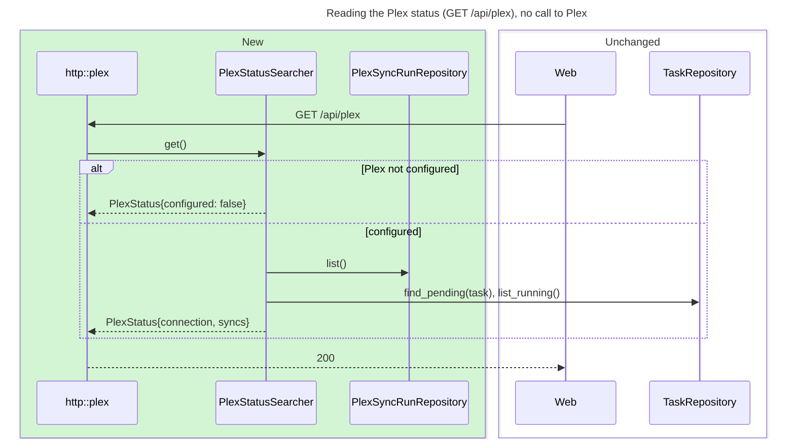
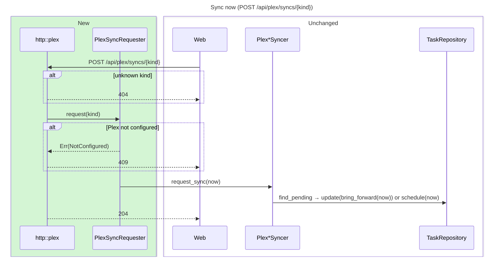
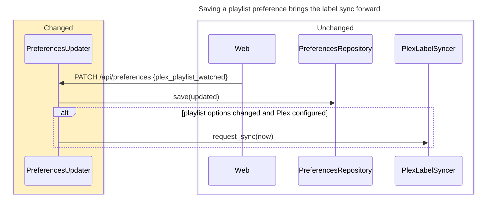
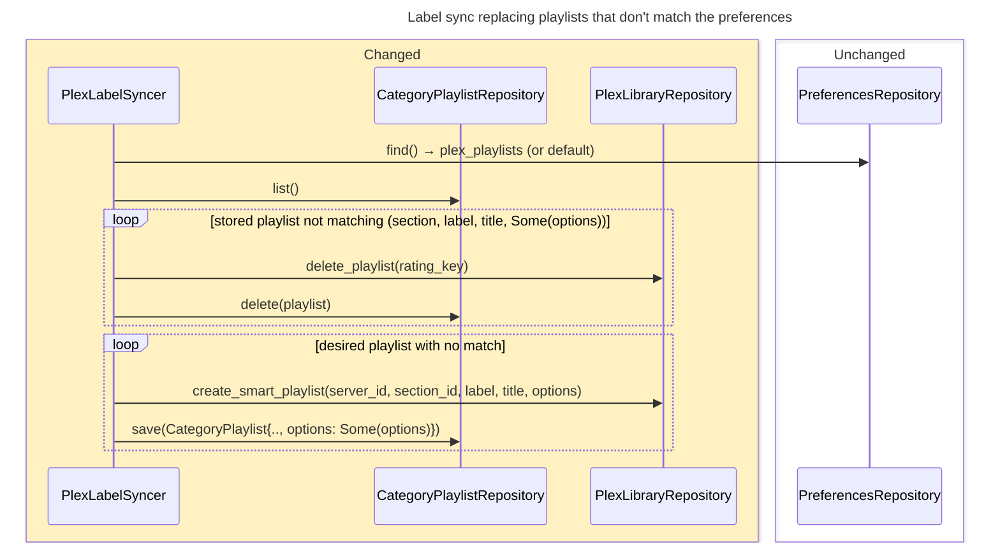
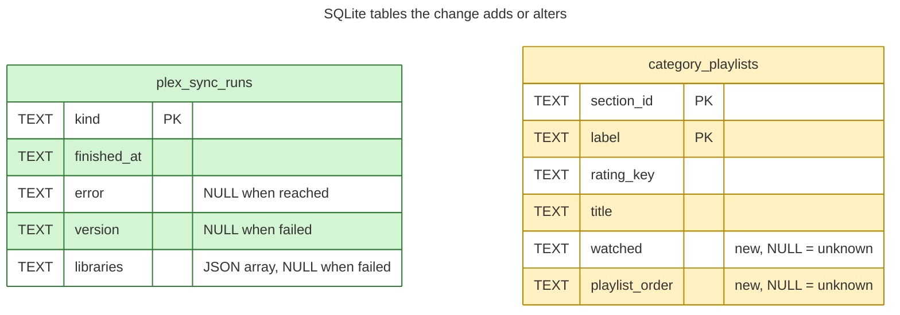

# Design

## Diagrams

Colours: green = new, yellow = changed, red = removed, plain = unchanged.















## Types & Signatures

```rust
// src/domain/preferences/plex_playlist_settings.rs
#[derive(Debug, Clone, Copy, PartialEq, Eq, Default)]
pub enum PlaylistWatched { #[default] Keep, Drop }          // "keep" | "drop"
#[derive(Debug, Clone, Copy, PartialEq, Eq, Default)]
pub enum PlaylistOrder { #[default] NewestFirst, OldestFirst } // "newest_first" | "oldest_first"
impl PlaylistWatched { pub fn new(value: &str) -> Result<Self, ValidationError>; pub fn as_str(&self) -> &'static str; }
impl PlaylistOrder { pub fn new(value: &str) -> Result<Self, ValidationError>; pub fn as_str(&self) -> &'static str; }
#[derive(Debug, Clone, Copy, PartialEq, Eq, Default)]
pub struct PlexPlaylistSettings { pub watched: PlaylistWatched, pub order: PlaylistOrder }

// src/domain/preferences/preferences.rs
pub struct Preferences { /* … */ pub plex_playlists: PlexPlaylistSettings }
impl Preferences {
    /// Whether `other` lists category playlists differently.
    pub fn changes_plex_playlists(&self, other: &Self) -> bool;
}
// src/domain/preferences/preferences_change.rs
pub struct PreferencesChange { /* … */ pub plex_playlist_watched: Option<PlaylistWatched>, pub plex_playlist_order: Option<PlaylistOrder> }

// src/domain/plex_status/plex_sync_kind.rs
#[derive(Debug, Clone, Copy, PartialEq, Eq, Hash)]
pub enum PlexSyncKind { WatchState, Labels } // "watch_state" | "labels"
impl PlexSyncKind { pub fn new(value: &str) -> Option<Self>; pub fn as_str(&self) -> &'static str; pub fn task(&self) -> Task; }

// src/domain/plex_status/plex_sync_run.rs
#[derive(Debug, Clone, PartialEq, Eq)]
pub enum PlexSyncOutcome { Reached { version: String, libraries: Vec<String> }, Failed { error: String } }
#[derive(Debug, Clone, PartialEq, Eq)]
pub struct PlexSyncRun { pub kind: PlexSyncKind, pub finished_at: DateTime<Utc>, pub outcome: PlexSyncOutcome }

// src/domain/plex_status/plex_status.rs
pub struct PlexConnection { pub checked_at: DateTime<Utc>, pub error: Option<String>, pub version: Option<String>, pub libraries: Vec<String> }
pub struct PlexSyncStatus { pub kind: PlexSyncKind, pub last_run: Option<PlexSyncRun>, pub next_run_at: Option<DateTime<Utc>>, pub running: bool }
pub struct PlexStatus { pub configured: bool, pub connection: Option<PlexConnection>, pub syncs: Vec<PlexSyncStatus> }
impl PlexConnection {
    /// From the latest run of any kind; version and libraries from the latest `Reached` one.
    pub fn from_runs(runs: &[PlexSyncRun]) -> Option<Self>;
}

// src/domain/plex/plex_identity.rs
pub struct PlexIdentity { pub server_id: String, pub version: String, /** "<machineIdentifier>/<token fingerprint>" */ pub viewer_id: String }

// src/domain/plex_label/category_playlist.rs
pub struct CategoryPlaylist { /* … */ /** `None`: created before options were recorded. */ pub options: Option<PlexPlaylistSettings> }

// src/infrastructure/repositories/plex_library_repository.rs
pub trait PlexLibraryRepository: Send + Sync {
    /// `GET /identity`: machine identifier and version. Replaces `server_id` and `viewer_id`.
    fn identity(&self) -> anyhow::Result<PlexIdentity>;
    fn create_smart_playlist(&self, server_id: &str, section_id: &str, label: &str, title: &str, options: &PlexPlaylistSettings) -> anyhow::Result<PlexPlaylist>;
    // … unchanged
}
/// `…/all?type=4&episode.label={label}[&episode.unwatched=1]&sort=originallyAvailableAt%3A{dir}%2Cindex%3A{dir}`
fn smart_playlist_uri(server_id: &str, section_id: &str, label: &str, options: &PlexPlaylistSettings) -> String;

// src/infrastructure/repositories/sqlite_plex_sync_run_repository.rs
pub trait PlexSyncRunRepository: Send + Sync {
    /// Replaces the kind's previous run.
    fn save(&self, run: &PlexSyncRun) -> anyhow::Result<()>;
    fn list(&self) -> anyhow::Result<Vec<PlexSyncRun>>;
}
pub struct SqlitePlexSyncRunRepository { db: Database }

// src/domain/services/plex_watch_syncer.rs, plex_label_syncer.rs
// new dep: plex_sync_run_repository: Arc<dyn PlexSyncRunRepository>
// PlexLabelSyncer new dep: preferences_repository: Arc<dyn PreferencesRepository>
// `sync()` unchanged signature; records one PlexSyncRun per call.

// src/domain/services/plex_status_searcher.rs
#[derive(Clone)]
pub struct PlexStatusSearcher { configured: bool, plex_sync_run_repository: Arc<dyn PlexSyncRunRepository>, task_repository: Arc<dyn TaskRepository> }
pub trait PlexStatusSearcherApi: Send + Sync { fn get(&self) -> anyhow::Result<PlexStatus>; }

// src/domain/services/plex_sync_requester.rs
#[derive(Clone)]
pub struct PlexSyncRequester { watch_syncer: Option<PlexWatchSyncer>, label_syncer: Option<PlexLabelSyncer>, clock: Arc<dyn Clock> }
pub trait PlexSyncRequesterApi: Send + Sync { fn request(&self, kind: PlexSyncKind) -> Result<(), RequestPlexSyncError>; }
// src/domain/plex_status/errors.rs
#[derive(Debug, thiserror::Error)]
pub enum RequestPlexSyncError { #[error("Plex isn't configured")] NotConfigured, #[error(transparent)] Repository(#[from] anyhow::Error) }

// src/domain/services/preferences_updater.rs
// new dep: plex_label_syncer: Option<PlexLabelSyncer>; requests a sync now when `changes_plex_playlists`.

// src/application/http/plex/mod.rs
pub async fn get_plex_status(State(s): State<PlexStatusSearcher>) -> Result<Json<PlexStatusResponse>, ApiError>;
pub async fn request_plex_sync(State(s): State<PlexSyncRequester>, Path(kind): Path<String>) -> Result<StatusCode, ApiError>;
// src/application/http/plex/dto.rs
pub struct PlexStatusResponse { pub configured: bool, pub connection: Option<PlexConnectionDto>, pub syncs: Vec<PlexSyncDto> }
pub struct PlexConnectionDto { pub checked_at: String, pub reachable: bool, pub error: Option<String>, pub version: Option<String>, pub libraries: Vec<String> }
pub struct PlexSyncDto { pub kind: String, pub last_run_at: Option<String>, pub last_error: Option<String>, pub next_run_at: Option<String>, pub running: bool }
// src/application/http/preferences/dto.rs: request + response gain plex_playlist_watched, plex_playlist_order (String)
// src/application/http/mod.rs: ApiServices gains plex_status_searcher, plex_sync_requester;
//   routes GET /plex, POST /plex/syncs/{kind}
```

```sql
-- migrations/0032_plex_settings.sql
CREATE TABLE IF NOT EXISTS plex_sync_runs (kind TEXT PRIMARY KEY, finished_at TEXT NOT NULL, error TEXT, version TEXT, libraries TEXT);
ALTER TABLE category_playlists ADD COLUMN watched TEXT;
ALTER TABLE category_playlists ADD COLUMN playlist_order TEXT;
```

```ts
// web/src/api/types.ts
export interface PlexStatus { configured: boolean; connection: PlexConnection | null; syncs: PlexSync[] }
export interface PlexConnection { checked_at: string; reachable: boolean; error: string | null; version: string | null; libraries: string[] }
export type PlexSyncKind = 'watch_state' | 'labels'
export interface PlexSync { kind: PlexSyncKind; last_run_at: string | null; last_error: string | null; next_run_at: string | null; running: boolean }
// Preferences gains plex_playlist_watched: 'keep' | 'drop'; plex_playlist_order: 'newest_first' | 'oldest_first'
// web/src/api/queries.ts
export function usePlexStatus(): UseQueryResult<PlexStatus, Error> // refetchInterval 5 s
export function useRequestPlexSync(): UseMutationResult<void, Error, PlexSyncKind>
// web/src/lib/plexStatus.ts
export function plexVersionLabel(version: string): string // "1.43.5.11079-b3b13e506" → "1.43.5.11079"
/** Running, or requested at `requestedAt` and not finished since. */
export function isSyncing(sync: PlexSync, requestedAt: Date | null): boolean
// web/src/components/SettingsView.tsx — section nav + <Outlet/>
export function SettingsView(): JSX.Element
// web/src/components/PlexSettingsView.tsx
export function PlexSettingsView(): JSX.Element
// web/src/App.tsx routes
// /settings → SettingsView { index → Navigate general; general → PreferencesView; ai → AiSettingsView; plex → PlexSettingsView }
// /preferences → Navigate /settings/general replace; /ai → Navigate /settings/ai replace
```

## Call Stack

**Watch sync** — `SyncPlexWatchStateTask::run` → `PlexWatchSyncer::sync()` → `read_plex()` (`plex_episode_finder.read_library()`, `plex_library_repository.identity()`) → unreachable: `request_sync(now + SYNC_INTERVAL)`, `record(Failed{e})`, `Ok` | reached: pull/merge/settle (unchanged, using `identity.viewer_id`), `request_next_sync(backlog)`, `record(Reached{identity.version, library.sections[].title})`; any later `Err` → `record(Failed{e})`, return `Err`. `record` = `plex_sync_run_repository.save(&PlexSyncRun{kind: WatchState, finished_at: clock.now(), outcome})`.

**Label sync** — same shape with `kind: Labels`; reads `identity()` once per sync (version + `server_id` for `create_playlist`), and `preferences_repository.find()?.unwrap_or_default().plex_playlists` before `reconcile_playlists(&library.sections, &options)`. `DesiredPlaylist::is(playlist)` also requires `playlist.options == Some(options)`; mismatches are deleted then recreated with `create_smart_playlist(.., &options)`.

**Status** — `GET /api/plex` → `get_plex_status` → `PlexStatusSearcher::get()` → not `configured` ⇒ `PlexStatus{configured: false, connection: None, syncs: []}`; else `runs = plex_sync_run_repository.list()`, `connection = PlexConnection::from_runs(&runs)`, per kind: `task_repository.find_pending(&kind.task())` → `next_run_at`, `task_repository.list_running()` any of `kind.task()` → `running`.

**Sync now** — `POST /api/plex/syncs/{kind}` → `PlexSyncKind::new(kind)` (`None` ⇒ 404) → `PlexSyncRequester::request(kind)` → syncer `None` ⇒ `NotConfigured` (409) → `syncer.request_sync(clock.now())` → 204.

**Playlist preference saved** — `PATCH /api/preferences` → `PreferencesUpdater::update(change)` → save → `stored.changes_plex_playlists(&updated)` and `plex_label_syncer` is `Some` ⇒ `request_sync(clock.now())`.

**Web** — gear menu "Settings" → `/settings/general`; `SettingsView` renders nav + `Outlet`; `PlexSettingsView` → `usePlexStatus()`; "Sync now" → `useRequestPlexSync().mutate(kind)`, stores `requestedAt`; button label/disabled from `isSyncing(sync, requestedAt)`; option radios → `useSavePreferences({plex_playlist_watched})`.

## Test Plan

1. Behaviour tests

   `src/application/tasks/sync_plex_watch_state_task/tests.rs`
   1. `it_should_record_the_plex_version_and_libraries_when_a_watch_sync_reaches_plex` — latest `WatchState` run is `Reached{"1.43.5.11079-b3b13e506", ["Subscriptions"]}` at now.
   2. `it_should_record_the_error_when_a_watch_sync_cant_reach_plex` — latest run is `Failed` with the fake's error.

   `src/application/tasks/sync_plex_labels_task/tests.rs`
   3. `it_should_record_the_plex_version_and_libraries_when_a_label_sync_reaches_plex`
   4. `it_should_record_the_error_when_a_label_sync_cant_reach_plex`
   5. `it_should_create_playlists_that_drop_watched_episodes_when_the_preference_says_drop` — fake records `create_playlist` with `Drop`.
   6. `it_should_create_playlists_oldest_first_when_the_preference_says_so`
   7. `it_should_keep_a_playlist_whose_options_match_the_preferences` — no delete/create.
   8. `it_should_replace_a_playlist_whose_options_differ_from_the_preferences` — old deleted in Plex and store, new created with current options, same title.
   9. `it_should_replace_a_playlist_whose_options_are_unknown`

   `src/application/http/plex/tests.rs`
   10. `it_should_report_plex_not_configured`
   11. `it_should_report_each_sync_with_its_next_run_before_any_run`
   12. `it_should_report_the_connection_from_the_latest_run`
   13. `it_should_keep_the_version_and_libraries_last_seen_when_the_latest_run_failed`
   14. `it_should_report_a_running_sync`
   15. `it_should_bring_the_pending_sync_forward_when_synced_now` — 204, one pending at now.
   16. `it_should_schedule_a_sync_now_when_none_is_pending`
   17. `it_should_leave_one_pending_sync_when_synced_now_twice`
   18. `it_should_respond_404_for_an_unknown_sync`
   19. `it_should_respond_409_when_plex_isnt_configured`

   `src/application/http/preferences/tests.rs`
   20. `it_should_read_the_plex_playlist_preferences_as_their_defaults`
   21. `it_should_save_a_plex_playlist_preference`
   22. `it_should_reject_an_invalid_plex_playlist_order`
   23. `it_should_request_a_label_sync_now_when_a_playlist_preference_changes`
   24. `it_should_not_request_a_label_sync_when_a_playlist_preference_is_saved_unchanged`
   25. `it_should_save_a_playlist_preference_without_plex_configured`

   Web (Vitest)
   26. `lib/plexStatus.test.ts`: `plexVersionLabel` drops the build suffix; `isSyncing` true while running, true after a request until a run finishes after it, false otherwise.
   27. `SettingsMenu.test.tsx`: lists Tasks, Settings, Report a bug; "Settings" navigates to `/settings/general`.
   28. `SettingsView.test.tsx`: section nav switches route and marks the open one; `/settings` → General; `/preferences` and `/ai` redirect.
   29. `PreferencesView.test.tsx`: headed "General", "Saved" next to it (existing tests adapted).
   30. `AddChannelDialog` / `EditChannelDialog` / `EditPlaylistDialog` tests: "AI settings" links to `/settings/ai` (existing tests adapted).
   31. `PlexSettingsView.test.tsx`: not configured shows the three variables and no "Sync now".
   32. — connected: "Connected", "Plex Media Server 1.43.5.11079", libraries, relative time.
   33. — unreachable: "Can't reach Plex", the error, last seen version.
   34. — no sync yet: "shows after the first sync".
   35. — sync rows: last run, error, next run.
   36. — "Sync now": POSTs, shows "Syncing…" disabled until a newer `last_run_at`.
   37. — "Sync now" request fails: error shown, button enabled.
   38. — playlist options: defaults selected; "Drop out" PATCHes only `plex_playlist_watched`, shows "Saved"; failed save reverts.
   39. — categories off: options disabled with the note.

2. Infrastructure tests

   `HttpPlexLibraryRepository` (mockito)
   1. `it_should_read_the_server_identity_with_its_version`
   2. `it_should_create_a_smart_playlist_filtered_by_label` (existing, passes default options; URI unchanged)
   3. `it_should_create_a_smart_playlist_of_unwatched_episodes_oldest_first` — `&episode.unwatched=1`, `sort=originallyAvailableAt%3Aasc%2Cindex%3Aasc`.

   `SqlitePlexSyncRunRepository`
   4. `it_should_list_the_latest_run_of_each_sync` — save reached + failed, list both.
   5. `it_should_replace_a_syncs_previous_run`

   `SqliteCategoryPlaylistRepository`
   6. `it_should_round_trip_a_playlists_options`
   7. `it_should_read_a_playlist_without_options_as_unknown`

   `SqlitePreferencesRepository`
   8. `it_should_round_trip_the_plex_playlist_preferences`
   9. `it_should_read_missing_plex_playlist_keys_as_defaults`
