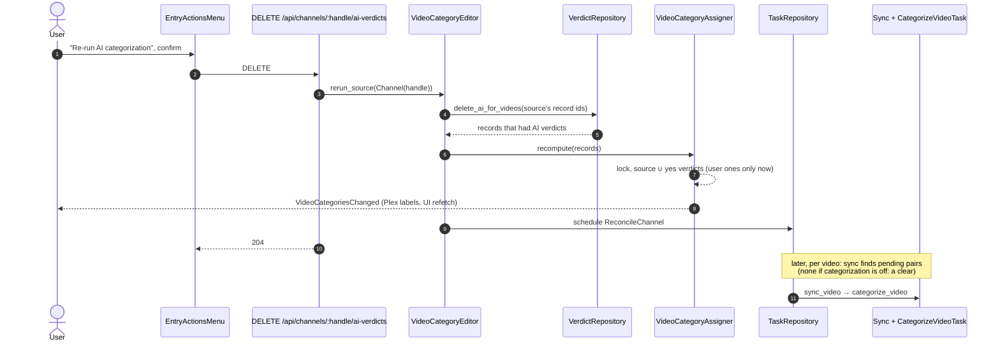

# Design

Product flow, chip states and what each action removes: see `proposal.md`.
Behaviour: see `specs/video-category-editing`, `specs/web-ui`,
`specs/category-crud`. Builds on `categorize-videos-on-reconcile`'s
`VideoCategoryVerdict`, `VideoCategoryVerdictRepository`,
`VideoCategoryAssigner::apply_verdict`.

## Diagrams

### Re-run a source, end to end



## Files

**Created**
- `src/domain/video_category/video_category_choice.rs`: `VideoCategoryChoice`, `CategoryOrigin`; one row of the dialog.
- `src/domain/video_category/errors.rs`: `EditVideoCategoriesError`.
- `src/domain/services/video_category_choice_searcher.rs`: reads a video's choices.
- `src/domain/services/video_category_editor.rs`: user verdicts and AI re-runs.
- `src/application/http/videos/category_dto.rs`: request/response DTOs for the video routes.
- `web/src/components/VideoCategoriesDialog.tsx` (+ `.test.tsx`): the Edit categories dialog.
- `e2e-tests/tests/videoCategories.spec.js`: edit a video's categories by hand.

**Changed**
- `src/infrastructure/repositories/sqlite_video_category_verdict_repository.rs`: scoped AI deletes, count per category.
- `src/domain/services/video_category_assigner.rs`: `recompute` for many records, one event.
- `src/domain/category/category_view.rs`, `src/domain/services/category_view_searcher.rs`: `ai_verdict_count`.
- `src/application/http/videos/mod.rs`: `GET/PUT /videos/{id}/categories[/{category_id}]`, `DELETE /videos/{id}/ai-verdicts`.
- `src/application/http/{channels,playlists,categories}/mod.rs`: `DELETE …/ai-verdicts`.
- `src/application/http/categories/dto.rs`: `ai_verdict_count`.
- `src/application/http/mod.rs`, `src/serve.rs`, `src/domain/services/mod.rs`: routes and wiring.
- `web/src/api/{types,client,queries}.ts`, `web/src/test/helpers.tsx`: DTO mirror, calls, `aVideoCategoryChoice`, `ai_verdict_count` in `aCategory`.
- `web/src/components/VideoActionsMenu.tsx` (+ test): "Edit categories…" item, gets `videoId`/`title` already.
- `web/src/components/EntryActionsMenu.tsx`, `DetailHeader.test.tsx`: source item + confirmation.
- `web/src/components/CategorySettingsDialog.tsx` (+ test): "Re-evaluate N videos" + confirmation.
- `doc/CATEGORIES.md`, `doc/AI.md`: editing by hand and re-running.

## Types & Signatures

```rust
// domain/video_category/video_category_choice.rs
pub enum CategoryOrigin { Source, Ai, User }          // as_str: "source" | "ai" | "user"
pub struct VideoCategoryChoice {
    pub category: CategoryView,                       // id, name, color
    pub belongs: bool,
    pub from: Option<CategoryOrigin>,                 // Source wins over any verdict
    pub verdict: Option<Verdict>,
}
impl VideoCategoryChoice {
    /// Every category, name order, from the source's membership and the video's verdicts.
    pub fn list(categories: &[CategoryView], source: &CategoryMember,
                verdicts: &[VideoCategoryVerdict]) -> Vec<Self>;
}

// domain/video_category/errors.rs
pub enum EditVideoCategoriesError {
    VideoNotFound, CategoryNotFound, SourceNotFound,
    FromSource(SourceKind),                           // "channel" | "playlist" in the message
    Repository(anyhow::Error),
}

// domain/video_category/video_category_verdict.rs
impl VideoCategoryVerdict {
    pub fn by_user(video_id: VideoRecordId, category_id: CategoryId, belongs: bool,
                   now: DateTime<Utc>) -> Self;
}

// domain/services/video_category_choice_searcher.rs
pub trait VideoCategoryChoiceSearcherApi: Send + Sync {
    fn search(&self, video_id: &VideoRecordId) -> Result<Vec<VideoCategoryChoice>, EditVideoCategoriesError>;
}

// domain/services/video_category_editor.rs
pub trait VideoCategoryEditorApi: Send + Sync {
    /// User verdict via `apply_verdict`; FromSource when the source is a member.
    fn set(&self, video_id: &VideoRecordId, category_id: &CategoryId, belongs: bool)
        -> Result<(), EditVideoCategoriesError>;
    /// Deletes AI verdicts, recomputes, schedules SyncVideo.
    fn rerun_video(&self, video_id: &VideoRecordId) -> Result<(), EditVideoCategoriesError>;
    /// Same for every record of the source; schedules its reconcile pass.
    fn rerun_source(&self, source: &CategoryMember) -> Result<(), EditVideoCategoriesError>;
    /// Deletes the category's AI verdicts, recomputes and syncs the records that had one.
    fn rerun_category(&self, category_id: &CategoryId) -> Result<(), EditVideoCategoriesError>;
}
pub struct VideoCategoryEditor {
    video_repository: Arc<dyn VideoRepository>,
    video_owner_finder: Arc<VideoOwnerFinder>,
    category_repository: Arc<dyn CategoryRepository>,
    channel_video_repository: Arc<dyn ChannelVideoRepository>,
    playlist_video_repository: Arc<dyn PlaylistVideoRepository>,
    video_category_verdict_repository: Arc<dyn VideoCategoryVerdictRepository>,
    video_category_assigner: VideoCategoryAssigner,
    task_repository: Arc<dyn TaskRepository>,
    clock: Arc<dyn Clock>,
}

// domain/services/video_category_assigner.rs
pub trait VideoCategoryAssignerApi: Send + Sync {
    /* … */
    /// Under the lock: each record to source ∪ yes verdicts; one event for those that changed.
    fn recompute(&self, video_ids: &[VideoRecordId]) -> anyhow::Result<()>;
}

// infrastructure/repositories/sqlite_video_category_verdict_repository.rs
pub trait VideoCategoryVerdictRepository: Send + Sync {
    /* … */
    /// Deletes decided_by = AI rows; returns the records that had one.
    fn delete_ai_for_videos(&self, video_ids: &[VideoRecordId]) -> anyhow::Result<Vec<VideoRecordId>>;
    fn delete_ai_for_category(&self, category_id: &CategoryId) -> anyhow::Result<Vec<VideoRecordId>>;
    fn count_ai_by_category(&self) -> anyhow::Result<HashMap<CategoryId, u64>>;
}

// domain/category/category_view.rs
pub struct CategoryView { /* … */ pub ai_verdict_count: u64 }

// application/http/videos/category_dto.rs
pub struct VideoCategoryChoiceResponse { id: String, name: String, color: String, belongs: bool,
    from: Option<String>, verdict: Option<String> }
pub struct VideoCategoriesResponse { categories: Vec<VideoCategoryChoiceResponse> }
pub struct SetVideoCategoryRequest { belongs: Option<serde_json::Value> }   // 400 unless bool
pub const INVALID_BELONGS: &str = "belongs must be true or false";

// application/http handlers
pub async fn list_video_categories(State(..), Path(id)) -> Result<Json<VideoCategoriesResponse>, ApiError>;
pub async fn set_video_category(State(..), Path((id, category_id)), Json(SetVideoCategoryRequest))
    -> Result<Json<VideoCategoriesResponse>, ApiError>;
pub async fn delete_video_ai_verdicts(State(..), Path(id)) -> Result<StatusCode, ApiError>;
pub async fn delete_channel_ai_verdicts(State(..), Path(handle)) -> Result<StatusCode, ApiError>;
pub async fn delete_playlist_ai_verdicts(State(..), Path(id)) -> Result<StatusCode, ApiError>;
pub async fn delete_category_ai_verdicts(State(..), Path(id)) -> Result<StatusCode, ApiError>;
```

```ts
// api/types.ts
type CategoryOrigin = 'source' | 'ai' | 'user'
type Verdict = 'yes' | 'no' | 'unavailable'
interface VideoCategoryChoice { id: string; name: string; color: string; belongs: boolean
  from: CategoryOrigin | null; verdict: Verdict | null }
interface VideoCategories { categories: VideoCategoryChoice[] }
interface Category { /* … */ ai_verdict_count: number }

// api/client.ts
getVideoCategories(videoId: string): Promise<VideoCategories>
setVideoCategory(videoId: string, categoryId: string, belongs: boolean): Promise<VideoCategories>
deleteVideoAiVerdicts(videoId: string): Promise<void>
deleteSourceAiVerdicts(source: { kind: 'channel' | 'playlist'; id: string }): Promise<void>
deleteCategoryAiVerdicts(categoryId: string): Promise<void>

// api/queries.ts
useVideoCategories(videoId: string, enabled: boolean)   // ['videos', id, 'categories']
// mutations invalidate it and the library (category lists, feeds)

// components/VideoCategoriesDialog.tsx
function VideoCategoriesDialog(props: { videoId: string; title: string; sourceName: string
  open: boolean; onOpenChange(open: boolean): void }): JSX.Element
```

## Call Stack

**Open dialog**: `VideoActionsMenu` "Edit categories…" → `VideoCategoriesDialog` → `GET /api/videos/{id}/categories` → `list_video_categories` → `VideoCategoryChoiceSearcher::search(&id)` → `VideoRepository::find`, `VideoOwnerFinder::find`, `CategoryRepository::list`, `VerdictRepository::find_many(&[id])` → `VideoCategoryChoice::list(..)`

**Click a chip**: `setVideoCategory(videoId, categoryId, !belongs)` → `PUT …/categories/{category_id}` → `set_video_category` → `VideoCategoryEditor::set(&id, &category_id, belongs)` → owner, `CategoryRepository::find` (404), `category.has_member(&owner.source)` (409) → `VideoCategoryVerdict::by_user(..)` → `VideoCategoryAssigner::apply_verdict(&verdict, &owner.source)` → handler returns `search(&id)`

**Re-run video**: dialog "Re-run AI" → `DELETE /api/videos/{id}/ai-verdicts` → `VideoCategoryEditor::rerun_video(&id)` → `VerdictRepository::delete_ai_for_videos(&[id])` → `assigner.recompute(&affected)` → `TaskRepository::schedule(&Task::SyncVideo { video_id }, now)` → 204 → refetch

**Re-run / clear source**: `EntryActionsMenu` item → `ConfirmDialog` → `DELETE /api/channels/{handle}/ai-verdicts` → `rerun_source(&CategoryMember::Channel(handle))` → `ChannelVideoRepository::list_for_channel` → `delete_ai_for_videos(&ids)` → `recompute(&affected)` → `schedule(&Task::ReconcileChannel { .. })` (playlists: same with `ReconcilePlaylist`)

**Re-evaluate category**: `CategorySettingsDialog` button → `ConfirmDialog` → `DELETE /api/categories/{id}/ai-verdicts` → `rerun_category(&id)` → `delete_ai_for_category(&id)` → `recompute(&affected)` → `schedule(SyncVideo)` per affected record

**Count**: `GET /api/categories` → `CategoryViewSearcher` → `VerdictRepository::count_ai_by_category()` → `CategoryView.ai_verdict_count`

## Test Plan

**1. Behaviour**

HTTP `videos` (`http/videos/mod.rs`)
1. `it_should_list_a_videos_categories_with_where_each_comes_from`: source, ai yes/no, user yes, none; name order.
2. `it_should_report_the_source_for_a_member_category_even_with_a_verdict`.
3. `it_should_return_not_found_for_the_categories_of_an_unknown_video`.
4. `it_should_add_a_category_by_hand_replacing_an_ai_no`: user yes, video in category, one event, body is the new list.
5. `it_should_remove_an_ai_category_by_hand`: user no, video out, one event.
6. `it_should_reject_setting_a_category_given_by_the_source`: 409, message names channel / playlist, nothing stored.
7. `it_should_reject_a_missing_or_non_boolean_belongs`: 400.
8. `it_should_return_not_found_for_an_unknown_video_or_category_when_setting`.
9. `it_should_rerun_a_videos_ai_categorization`: AI verdicts gone, user ones kept, AI categories gone, `sync_video` scheduled, 204.
10. `it_should_return_not_found_when_rerunning_an_unknown_video`.

`SyncVideoTask` / `CategorizeVideoTask`

11. `it_should_not_evaluate_a_pair_with_a_user_verdict`: user yes "Tech" → no chat for Tech.

HTTP `channels` / `playlists`

12. `it_should_clear_a_channels_ai_verdicts_keeping_user_ones`: one event naming the changed records, `reconcile_channel` scheduled, 204.
13. `it_should_clear_a_playlists_ai_verdicts_keeping_user_ones`.
14. `it_should_return_not_found_when_clearing_an_unknown_source`.

HTTP `categories`

15. `it_should_rerun_a_categorys_ai_verdicts`: only that category's AI verdicts gone, affected records synced, 204.
16. `it_should_return_not_found_when_rerunning_an_unknown_category`.
17. `it_should_count_ai_verdicts_per_category`: user verdicts not counted, 0 when none.

Web

18. `VideoCategoriesDialog`: `shows locked source chips, AI marks and filled chips`.
19. `VideoCategoriesDialog`: `sets a category by hand when a chip is clicked`.
20. `VideoCategoriesDialog`: `shows the error and keeps the chip when setting fails`.
21. `VideoCategoriesDialog`: `re-runs AI only while AI categorization is available`.
22. `VideoActionsMenu`: `offers Edit categories only while categories are on`.
23. `DetailHeader`: `offers Re-run AI categorization or Clear AI categories after confirmation`.
24. `CategorySettingsDialog`: `re-evaluates N videos after confirmation, hidden at 0`.

e2e

25. `videoCategories.spec.js`: add and remove a category by hand on a seeded video, chip and category page follow.

**2. Infrastructure**

`SqliteVideoCategoryVerdictRepository`
1. `it_should_delete_only_ai_verdicts_of_the_given_videos_returning_them`.
2. `it_should_delete_only_ai_verdicts_of_a_category_returning_their_videos`.
3. `it_should_count_ai_verdicts_per_category`.
