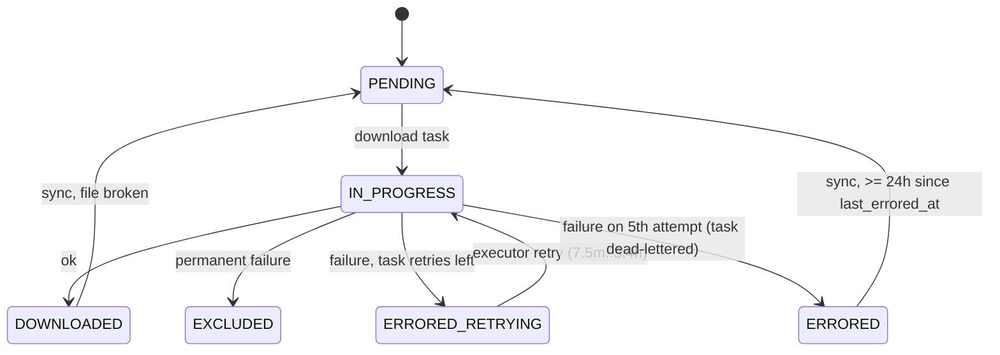
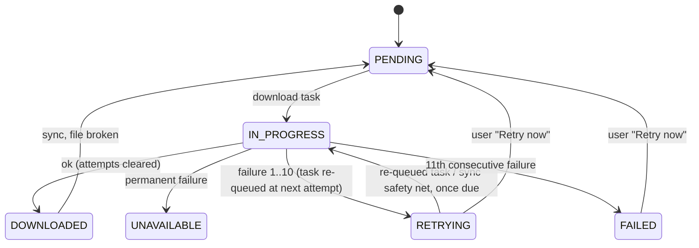

## Inventory (today)

Every place that retries, gives up on or recovers per-video work.

| # | Where | Trigger | Attempts | Timing | Gives up as |
|---|-------|---------|----------|--------|-------------|
| 1 | `task_executor.rs` `record_failure` + `scheduled_task.rs` `fail` | any handler `Err`/panic | 5 (`MAX_ATTEMPTS`) | 150 s × 3^n: 7.5 m, 22.5 m, 67 m, 3.4 h (~5 h total) | dead-letter row |
| 2 | `video_downloader.rs` `mark_errored` | download `Err` (yt-dlp fail, adapter error, placement error) | piggybacks #1 via `is_last_attempt` | as #1 | `ERRORED_RETRYING`, last attempt `ERRORED` (+ `last_errored_at`) |
| 3 | `video_downloader.rs` `exclude` | `DownloadFailure::is_permanent()` | 1 | none | `EXCLUDED`, task Ok |
| 4 | `video_reconciler.rs` `recover_if_due` + `video.rs` `is_due_for_recovery` | sync of an `ERRORED` video ≥ 24 h (`ERRORED_RECOVERY_COOLDOWN`) after `last_errored_at` | unlimited | first source pass after 24 h (pass every 1 min–24 h, default 3 h) | `reset_for_redownload` → `PENDING` → a fresh 5-attempt burst (#1) |
| 5 | `video_reconciler.rs` `warn_if_stranded` + `VideoSyncPlan` | sync of `IN_PROGRESS`/`ERRORED_RETRYING` with no download task | unlimited | next source pass | schedules download |
| 6 | `thumbnail_fetcher.rs` `fetch_and_place` | no thumbnail obtained | unlimited, not counted | every sync (source pass) while missing | never |
| 7 | `subtitle_fetcher.rs`, `chapter_fetcher.rs`, `quality_upgrader.rs` + `late_data_checks.rs` | failed/inconclusive check | 3 (old videos only) | 24 h (`RECHECK_AFTER`), via source pass | settled (`Unavailable` / no chapters / quality kept) |
| 8 | `video_summarizer.rs` `generate` | rejected call / unreadable transcript | #1 via `is_last_attempt` | as #1 | `Unavailable` on 5th, dead-letter |
| 9 | `video_summarizer.rs` `generate` | server fault during generation | #1 | as #1 | stays `Missing`, dead-letter; next sync retries forever |
| 10 | `video_categorizer.rs` `ask_each` | category rejected by its own call | #1 via `is_last_attempt` (+ in-run per-category fallback) | as #1 | `unavailable` verdict on 5th, dead-letter |
| 11 | `video_summarizer.rs` / `video_categorizer.rs` `prepare` | Ollama down / model missing | unlimited, not counted | every sync | never |

The steps also use different words: subtitles `MISSING`/`FETCHED`/`UNAVAILABLE` (where Unavailable means "no captions"), summary `MISSING`/`GENERATED`/`UNAVAILABLE` (where Unavailable means "gave up"), verdict `unavailable` ("gave up"), chapters and quality `settled` flags, a video `EXCLUDED` ("YouTube doesn't have it"), and no state at all for thumbnails or categorization runs.

## Vocabulary

| Status | Meaning | Download (`VideoStatus`) | Other steps (`StepStatus`) |
|---|---|---|---|
| Pending | not done yet, no failure | `PENDING` (+ `IN_PROGRESS` while it runs) | `PENDING` |
| Retrying | failed 1–10 times, next attempt scheduled | `RETRYING` | `RETRYING` |
| Done | succeeded | `DOWNLOADED` | `DONE` |
| Unavailable | YouTube doesn't have it; final, never retried | `UNAVAILABLE` | `UNAVAILABLE` (subtitles, chapters) |
| Failed | gave up after 11 attempts; "Retry now" resets it | `FAILED` | `FAILED` (+ `failed` verdicts for pending categories) |

## States

Download, before:



Download, after:



Every other step, after:

```mermaid
stateDiagram-v2
  [*] --> PENDING
  PENDING --> DONE: success
  PENDING --> UNAVAILABLE: conclusive "not on YouTube" (old video; subtitles, chapters)
  PENDING --> PENDING: conclusive "not yet" (young video; recheck in 24h)
  PENDING --> RETRYING: failure 1
  RETRYING --> RETRYING: failure 2..10 (re-queued at next attempt)
  RETRYING --> DONE: success (attempts cleared)
  RETRYING --> FAILED: 11th consecutive failure
  RETRYING --> PENDING: user "Retry now"
  FAILED --> PENDING: user "Retry now"
```



## Policy & Migration

| | Before | After |
|---|---|---|
| Backoff | per mechanism (executor ×3 from 150 s; late data 24 h; thumbnail/Ollama every sync) | one: 10 m, 1 h, 6 h, then 24 h after the 1st, 2nd, 3rd, 4th+ consecutive failure |
| Cap | download none; late data 3 (old only); AI 5; thumbnail/Ollama-down none | 11 attempts (~7.3 days) for every step |
| Who reschedules | executor; sync | the step's own task (`RunAgainAt`); sync as safety net |
| Recovery | 24 h reconcile recovery (download only) | user "Retry now" (`POST /api/videos/{id}/retry`) |
| Dead-letter | every given-up download/AI task | infrastructure errors only |

- `next attempt = last failure + retry_delay(failed_attempts)` is derived, not stored. For late data, the last failure is the last check time.
- Sync runs only per source pass (≥ 1 min, default 3 h) and on events, which is too slow for the 10-minute step. `download_video` dedupes running tasks, so a step can't schedule a new task for itself. Re-queueing the same row (`RunAgainAt`) avoids both problems. A task that runs before its step is due re-queues itself for the due time.
- Source moves: a task pending with `run_at` in the future doesn't block a move. Every per-video step resolves its owner's show folder when it runs.
- Migration `0028_video_step_statuses.sql` (`0027` is `video_version`):
  - **Download:**
    - `ERRORED_RETRYING` → `RETRYING`, attempts 1, `last_errored_at = updated_at`.
    - `ERRORED` → `RETRYING`, attempts 4, `last_errored_at = COALESCE(last_errored_at, updated_at)`. Due 24 h after the last error, then 7 more daily tries.
    - `EXCLUDED` → `UNAVAILABLE`.
    - `download_failure` is backfilled from the pending `download_video` task's `last_error`, else the latest dead-letter row.
  - **Subtitles:**
    - `FETCHED` → `DONE`.
    - `UNAVAILABLE` with `failed_attempts >= 3` → `FAILED` (attempts 11), else `UNAVAILABLE`.
    - `MISSING` with attempts > 0 → `RETRYING`, else `PENDING`.
  - **Chapters / quality:**
    - settled with `failed_attempts >= 3` → `FAILED` (11).
    - Chapters settled with no chapters and no failures → `UNAVAILABLE`.
    - Other settled → `DONE`.
    - Unsettled with attempts → `RETRYING`, else `PENDING`.
  - **Summary:** `MISSING` → `PENDING`, `GENERATED` → `DONE`, `UNAVAILABLE` → `FAILED`.
  - **Thumbnail:** `DONE` when a filename is recorded, else `PENDING`.
  - **Categorization:** `PENDING`.
  - **Verdicts:** `UNAVAILABLE` → `FAILED`.
  - Drops `subtitle_state`, `summary_state`, `chapters_settled`, `quality_settled`.
  - In-flight tasks run under the new binary and re-queue or settle; their `retries` resets on re-queue. Dead-letter rows stay.
- Rollback: the old binary needs the dropped columns. Downgrading means restoring the database backup taken before upgrading (release note).

## Files

- `migrations/0028_video_step_statuses.sql`: new status and attempt columns, the value mapping, the reason backfill, the dropped columns.
- `src/infrastructure/shared/sqlite_migrations.rs`: registers 0028 and holds its migration tests.
- `src/domain/video/step_status.rs` (new): `StepStatus`.
- `src/domain/video/retry_attempts.rs` (new): `RetryAttempts`, `retry_delay`, `MAX_ATTEMPTS`: the one policy.
- `src/domain/video/step_state.rs` (new): `StepState` (status + attempts), the shared transitions.
- `src/domain/video/video_step_outcome.rs` (new): `VideoStepOutcome`.
- `src/domain/video/late_data_checks.rs`: becomes `StepState` + `last_checked_at`; `record` sets the status; the young/old rule stays.
- `src/domain/video/subtitle_state.rs`, `summary_state.rs`: deleted (replaced by `StepState`).
- `src/domain/video/video_status.rs`: `PENDING | IN_PROGRESS | DOWNLOADED | RETRYING | FAILED | UNAVAILABLE`.
- `src/domain/video/video.rs`: per-step fields, transitions, `retry`; `last_errored_at`, `mark_errored_retrying`, `mark_excluded`, `is_download_settled`, `is_due_for_recovery`, `ERRORED_RECOVERY_COOLDOWN` go.
- `src/domain/video/video_sync_plan.rs`: every step gated on `is_due`.
- `src/domain/video/mod.rs`, `errors.rs` (`RetryVideoError`).
- `src/domain/video_category/video_category_verdict.rs`: `Verdict::Unavailable` → `Verdict::Failed`.
- `src/domain/task/task_outcome.rs` (new): `TaskOutcome`.
- `src/domain/task/scheduled_task.rs`: `run_again_at`; `is_last_attempt` goes.
- `src/domain/services/video_downloader.rs`, `thumbnail_fetcher.rs`, `subtitle_fetcher.rs`, `chapter_fetcher.rs`, `quality_upgrader.rs`, `video_summarizer.rs`, `video_categorizer.rs`: return `VideoStepOutcome` and record step states; `Err` only for repository errors.
- `src/domain/services/video_retrier.rs` (new): the retry use case.
- `src/domain/services/video_reconciler.rs`: `recover_if_due` goes; stranded means `InProgress` only.
- `src/domain/services/preferences_updater.rs`, `category_updater.rs`, `video_category_editor.rs`: renamed reset calls and categorization back to Pending.
- `src/domain/services/*` reading `SubtitleState`/`SummaryState`/settled/`Excluded` (searcher, layout migrator, plex label syncer, ...): switch to the new fields. The skeleton task finds them with the compiler.
- `src/infrastructure/repositories/task_handler.rs`: `handle(&Task) -> anyhow::Result<TaskOutcome>`.
- `src/infrastructure/repositories/task_executor.rs`: `Done` deletes, `RunAgainAt` updates to pending.
- `src/domain/show/show_work.rs`: `has_work_in_progress` takes `now`. Only Pending or In Progress videos block, and a pending task with a future `run_at` (a later retry) doesn't.
- `src/infrastructure/repositories/sqlite_video_repository.rs`: the new columns in `insert`/`update`/row mapping; `reset_failed_summaries` (bumps `version`, like the method it replaces). Every other write of a step state goes through `VideoUpdater::update` with a pure transition (see `video-write-consistency`).
- `src/infrastructure/repositories/sqlite_video_category_verdict_repository.rs`: `delete_failed`, `delete_failed_for_category`, `delete_failed_for_video`.
- `src/application/tasks/*.rs` (all 16 handlers): the new signature; step handlers map `VideoStepOutcome`.
- `src/application/http/videos/mod.rs`, `dto.rs`, `src/application/http/mod.rs`: `retry_video` route, `steps` DTO, the status values.
- Composition root: wires `VideoRetrier`.
- `web/src/api/types.ts`, `web/src/api/queries.ts`: `VideoStatus`, `Verdict`, `StepStatus`, `VideoSteps`, `useRetryVideo`.
- `web/src/lib/videoSteps.ts` (+ test): status label and failing-steps lines at `now`.
- `web/src/components/VideoDetail.tsx`, `VideoListPane.tsx` (+ tests), and every component reading `EXCLUDED` or `unavailable`.
- `web/src/test/helpers.tsx`: `aVideo` with `steps`.
- `e2e-tests/helpers/video.js`, `e2e-tests/tests/erroredDownload.spec.js`.
- `doc/INSTALLATION.md` (`YARRTUBE_RETRY_BASE_DELAY_SECONDS` covers infrastructure only, plus the back-up-before-upgrading note).

## Types & Signatures

```rust
// domain/video/step_status.rs
pub enum StepStatus { Pending, Retrying, Done, Unavailable, Failed }

// domain/video/retry_attempts.rs
pub const MAX_ATTEMPTS: u32 = 11;
const RETRY_DELAYS: [Duration; 4] = [minutes(10), hours(1), hours(6), hours(24)]; // last repeats
pub fn retry_delay(failed: u32) -> Duration;
#[derive(Debug, Clone, Copy, PartialEq, Eq, Default)]
pub struct RetryAttempts { pub failed: u32, pub last_failed_at: Option<DateTime<Utc>> }
impl RetryAttempts {
    pub fn record_failure(self, now: DateTime<Utc>) -> Self;
    pub fn gave_up(&self) -> bool;                            // failed >= MAX_ATTEMPTS
    pub fn next_attempt_at(&self) -> Option<DateTime<Utc>>;   // None when none failed or gave up
}

// domain/video/step_state.rs
#[derive(Debug, Clone, Copy, PartialEq, Eq)]
pub struct StepState { pub status: StepStatus, pub attempts: RetryAttempts }
impl StepState {
    pub fn pending() -> Self;
    pub fn succeed(self) -> Self;                    // Done, attempts cleared
    pub fn unavailable(self) -> Self;                // Unavailable, attempts cleared
    pub fn fail(self, now: DateTime<Utc>) -> Self;   // Retrying, or Failed on the MAX_ATTEMPTS-th
    pub fn retry(self) -> Self;                      // Retrying | Failed → pending(); else unchanged
    pub fn is_due(&self, now: DateTime<Utc>) -> bool;  // Pending | Retrying && next_attempt_at <= now
    pub fn next_attempt_at(&self) -> Option<DateTime<Utc>>; // Some only while Retrying
}

// domain/video/late_data_checks.rs
pub struct LateDataChecks { pub state: StepState, pub last_checked_at: Option<DateTime<Utc>> }
impl LateDataChecks {
    /// Complete → Done; Incomplete → Unavailable when old, else Pending; Failed → state.fail.
    pub fn record(self, outcome: LateDataOutcome, published_at: DateTime<Utc>, now: DateTime<Utc>) -> Self;
    pub fn is_due(&self, now: DateTime<Utc>) -> bool; // Pending: never checked or RECHECK_AFTER since; Retrying: backoff
}
// removed: MAX_FAILED_ATTEMPTS, failures_exhausted, settles

// domain/video/video_step_outcome.rs
pub enum VideoStepOutcome {
    Settled,                                            // done, unavailable, failed, nothing to do
    RetryAt { at: DateTime<Utc>, reason: String },      // retrying, or ran before due
}

// domain/video/video_status.rs
pub enum VideoStatus { Pending, InProgress, Downloaded, Retrying, Failed, Unavailable }

// domain/video/video.rs
pub struct Video {
    // ...unchanged fields...
    pub status: VideoStatus,
    pub download_attempts: RetryAttempts,     // download_failed_attempts, last_errored_at
    pub download_failure: Option<String>,
    pub thumbnail: StepState,                 // + thumbnail_filename (unchanged)
    pub subtitles: LateDataChecks,            // replaces subtitle_state + subtitle_checks
    pub chapters_checks: LateDataChecks,      // state replaces chapters_settled
    pub quality_checks: LateDataChecks,       // state replaces quality_settled
    pub summary: StepState,                   // replaces summary_state
    pub categorization: StepState,
}
impl Video {
    pub fn mark_errored(self, reason: impl Into<String>, now: DateTime<Utc>) -> Self; // Retrying | Failed (11th)
    pub fn mark_unavailable(self, now: DateTime<Utc>) -> Self;                         // was mark_excluded
    pub fn mark_downloaded(..) -> Self;                       // + attempts and failure cleared
    pub fn is_download_due(&self, now: DateTime<Utc>) -> bool;
    pub fn next_download_at(&self) -> Option<DateTime<Utc>>;
    pub fn record_thumbnail_failure(self, now: DateTime<Utc>) -> Self;
    pub fn is_thumbnail_due(&self, now: DateTime<Utc>) -> bool;
    pub fn record_summary_failure(self, now: DateTime<Utc>) -> Self;
    pub fn record_categorization_failure(self, now: DateTime<Utc>) -> Self;
    pub fn mark_categorized(self, now: DateTime<Utc>) -> Self;   // Done
    /// Every Retrying | Failed step → Pending, attempts cleared; Failed download → Pending.
    pub fn retry(self, now: DateTime<Utc>) -> Self;
}
// removed: last_errored_at, subtitle_state, summary_state, chapters_settled, quality_settled,
//          mark_errored_retrying, mark_excluded, is_download_settled, is_due_for_recovery

// domain/video_category/video_category_verdict.rs
pub enum Verdict { Yes, No, Failed }   // was Unavailable

// domain/video/errors.rs
pub enum RetryVideoError { VideoNotFound, Repository(anyhow::Error) }

// domain/services/* (Err only when the video can't be read or stored)
fn download(&self, video_id: VideoId) -> anyhow::Result<VideoStepOutcome>;
fn fetch(&self, video_id: &VideoId) -> anyhow::Result<VideoStepOutcome>;     // thumbnail, subtitles
fn fetch(&self, video: &Video) -> anyhow::Result<VideoStepOutcome>;          // chapters
fn upgrade(&self, video_id: &VideoId) -> anyhow::Result<VideoStepOutcome>;
fn summarize(&self, video: &Video) -> anyhow::Result<VideoStepOutcome>;
fn categorize(&self, video: &Video) -> anyhow::Result<VideoStepOutcome>;

// domain/show/show_work.rs
pub fn has_work_in_progress(videos: &[Video], tasks: &[ScheduledTask], events: &[ScheduledEvent],
    show_dir: &Path, now: DateTime<Utc>) -> bool;

// domain/services/video_retrier.rs
pub struct VideoRetrier {
    video_updater: VideoUpdater,
    video_category_verdict_repository: Arc<dyn VideoCategoryVerdictRepository>,
    task_repository: Arc<dyn TaskRepository>,
    clock: Arc<dyn Clock>,
}
pub trait VideoRetrierApi: Send + Sync {
    /// Retrying/Failed steps back to Pending, failed verdicts deleted, queued steps
    /// brought forward to now, sync scheduled now.
    fn retry(&self, video_id: &VideoId) -> Result<(), RetryVideoError>;
}

// infrastructure/repositories
fn reset_failed_summaries(&self, now: DateTime<Utc>) -> anyhow::Result<()>;   // was reset_unavailable_summaries
fn delete_failed(&self) -> anyhow::Result<()>;                                // verdicts, was delete_unavailable
fn delete_failed_for_category(&self, id: &CategoryId) -> anyhow::Result<()>;
fn delete_failed_for_video(&self, id: &VideoId) -> anyhow::Result<()>;

// domain/task/task_outcome.rs
pub enum TaskOutcome { Done, RunAgainAt { run_at: DateTime<Utc>, reason: String } }
impl From<VideoStepOutcome> for TaskOutcome;

// domain/task/scheduled_task.rs
pub fn run_again_at(self, run_at: DateTime<Utc>, reason: String, now: DateTime<Utc>) -> Self;
// removed: is_last_attempt

// infrastructure/repositories/task_handler.rs
pub trait TaskHandler: Send + Sync { fn handle(&self, task: &Task) -> anyhow::Result<TaskOutcome>; }

// application/http/videos: POST /api/videos/{id}/retry → 204 | 404
pub async fn retry_video(State(video_retrier): State<VideoRetrier>, Path(id): Path<String>)
    -> Result<StatusCode, ApiError>;

// application/http/videos/dto.rs (VideoResponse, CategoryVideoResponse)
pub status: String,                      // PENDING | IN_PROGRESS | DOWNLOADED | RETRYING | FAILED | UNAVAILABLE
pub steps: VideoStepsResponse,
pub struct VideoStepsResponse {
    pub download: StepResponse, pub thumbnail: StepResponse, pub subtitles: StepResponse,
    pub chapters: StepResponse, pub quality: StepResponse, pub summary: StepResponse,
    pub categorization: StepResponse,
}
pub struct StepResponse {
    pub status: String,                  // PENDING | RETRYING | DONE | UNAVAILABLE | FAILED (download: IN_PROGRESS too)
    pub failed_attempts: u32,
    pub next_attempt_at: Option<DateTime<Utc>>,
    pub failure: Option<String>,         // download only, for now
}
```

```ts
// web/src/api/types.ts
export type VideoStatus = 'PENDING' | 'IN_PROGRESS' | 'DOWNLOADED' | 'RETRYING' | 'FAILED' | 'UNAVAILABLE'
export type StepStatus = 'PENDING' | 'IN_PROGRESS' | 'RETRYING' | 'DONE' | 'UNAVAILABLE' | 'FAILED'
export type VideoStepName = 'download' | 'thumbnail' | 'subtitles' | 'chapters' | 'quality' | 'summary' | 'categorization'
export interface Step { status: StepStatus; failed_attempts: number; next_attempt_at: string | null; failure: string | null }
export type VideoSteps = Record<VideoStepName, Step>
export type Verdict = 'yes' | 'no' | 'failed'
// Video, CategoryVideo: status: VideoStatus; steps: VideoSteps

// web/src/api/queries.ts
export function useRetryVideo(): UseMutationResult<void, Error, string>   // POST /api/videos/{id}/retry

// web/src/lib/videoSteps.ts
export function statusLabel(status: VideoStatus): string    // Pending | Downloading | Downloaded | Retrying | Failed | Unavailable
export function failingStepLines(steps: VideoSteps, now: Date): string[]
// 'Download: retrying, next attempt in 2 hours · HTTP Error 503', 'Summary: failed, gave up after 11 attempts'
export function canRetry(steps: VideoSteps): boolean        // any Retrying | Failed
```

## Call Stack

Step fails (download shown; every step has the same shape):
```
TaskExecutor::execute(running)
  DownloadVideoTask::handle(&Task::DownloadVideo { video_id })
    VideoDownloader::download(video_id)
      find_downloadable(&id)       -> not due: RetryAt { video.next_download_at, download_failure }
      video_updater.update(&id, |v| v.is_download_due(now).then(|| v.start_download(now)))
      run_download(&video, quality, staging) -> Ok(Failed { failure }) | Err(adapter) | placement Err
      record_failure(&id, reason) -> video_updater.update(&id, |v| Some(v.mark_errored(reason, now))) (Retrying | Failed)
      -> Ok(RetryAt { at, reason }) | Ok(Settled) when Failed
    -> Ok(TaskOutcome::from(outcome))
  RunAgainAt -> repository.update(&running.run_again_at(run_at, reason, now))
  Done       -> repository.delete(id)
  Err        -> record_failure -> ScheduledTask::fail -> retry / dead-letter
```

Late data (subtitles shown; chapters and quality the same):
```
FetchSubtitlesTask::handle -> SubtitleFetcher::fetch(&id)
  not fetchable / Done | Unavailable | Failed -> Settled; not due -> RetryAt { next_attempt_at }
  fetch_and_place Err | inconclusive -> record_check(Failed) -> subtitles.record(Failed, published_at, now)
    -> RetryAt { next_attempt_at } | Settled when Failed
  conclusive -> record_check(Complete | Incomplete) -> Done | Unavailable | Pending -> Settled
```

AI (summary shown; categorization records one attempt per run with any rejection or Ollama down, and on Failed stores `failed` verdicts):
```
SummarizeVideoTask::handle -> VideoSummarizer::summarize(&video)
  prepare: NotWanted -> Settled; Blocked (Ollama down, model missing) -> record_failure
  generate: Rejected | Server -> record_failure: video_updater.update(&id, |v| Some(v.record_summary_failure(now)))
    -> RetryAt { summary.next_attempt_at } | Settled when Failed
  ok -> mark_summary_generated (Done) -> Settled
```

Retry:
```
POST /api/videos/{id}/retry -> retry_video(State<VideoRetrier>, id)
  VideoRetrier::retry(&video_id)
    video_updater.update(&id, |v| Some(v.retry(now)))?   -> None: VideoNotFound → 404
    video_category_verdict_repository.delete_failed_for_video(&id)
    bring_forward_queued_steps(&video)   // each step task pending → bring_forward(now); update
    task_repository.schedule(&Task::SyncVideo { video_id }, now)
  -> 204
```

Sync (safety net):
```
VideoReconciler::reconcile(&id)
  reset_if_broken; repair_metadata; warn_if_stranded (InProgress only)
  schedule_steps -> VideoSyncPlan::for_video(&video, summaries_wanted, categorization_wanted, now)
    Download: is_download_due; FetchThumbnail: is_thumbnail_due
    FetchSubtitles / FetchChapters / UpgradeQuality: checks.is_due
    Summarize: wanted && summarizable && summary.is_due; Categorize: wanted && categorization.is_due
```

## Test Plan

1. Behaviour tests (acceptance through adapters, `TestDatabase`, hand-written fakes, `FixedClock`; whole-value `assert_eq!`):
   - `download_video_task`
     1. `it_should_schedule_the_next_attempt_if_the_download_fails`: Pending → Retrying, 1 attempt, reason; `RunAgainAt { now + 10 min, reason }`.
     2. `it_should_wait_longer_after_each_failed_attempt`: Retrying with 1, due → 2; `RunAgainAt { now + 1 h }`.
     3. `it_should_retry_daily_from_the_fourth_failure`: 4 → 5; `RunAgainAt { now + 24 h }`.
     4. `it_should_give_up_after_the_eleventh_failed_attempt`: 10 → Failed, 11; `Done`.
     5. `it_should_record_the_failure_if_yt_dlp_cannot_run`.
     6. `it_should_record_the_failure_if_the_download_cannot_be_placed`.
     7. `it_should_mark_the_video_unavailable_if_the_failure_is_permanent`: Unavailable; `Done` (adapted).
     8. `it_should_requeue_without_downloading_if_the_next_attempt_is_not_due`.
     9. `it_should_download_a_retrying_video_once_due`: Downloaded, attempts and reason cleared.
     10. `it_should_skip_a_failed_video`.
     11. `it_should_fail_if_the_video_cannot_be_read`: repository on an unmigrated connection → `Err`.
   - `fetch_thumbnail_task`
     12. `it_should_schedule_the_next_attempt_if_no_thumbnail_is_obtained`: thumbnail Retrying.
     13. `it_should_fail_the_thumbnail_after_the_eleventh_failed_attempt`.
     14. `it_should_mark_the_thumbnail_done_once_fetched`.
   - `fetch_subtitles_task`
     15. `it_should_schedule_the_next_check_if_the_subtitle_check_fails`: Retrying; `RunAgainAt { now + 10 min }`.
     16. `it_should_fail_the_subtitles_after_the_eleventh_failed_check`: young video → Failed.
     17. `it_should_keep_young_subtitles_pending_after_a_conclusive_check`: Retrying with 4 → Pending, 0.
     18. `it_should_mark_old_subtitles_unavailable_without_captions`.
   - `fetch_chapters_task`
     19. `it_should_schedule_the_next_check_if_the_chapters_fetch_fails`.
     20. `it_should_fail_the_chapters_after_the_eleventh_failed_fetch`.
   - `upgrade_quality_task`
     21. `it_should_schedule_the_next_check_if_the_quality_check_fails`.
     22. `it_should_fail_the_quality_after_the_eleventh_failed_check`.
   - `summarize_video_task`
     23. `it_should_schedule_the_next_attempt_if_the_summary_is_rejected`.
     24. `it_should_count_ollama_down_as_a_failed_summary_attempt`.
     25. `it_should_fail_the_summary_after_the_eleventh_failed_attempt`.
     26. `it_should_mark_the_summary_done_once_generated`: attempts cleared.
   - `categorize_video_task`
     27. `it_should_schedule_the_next_attempt_if_a_category_is_rejected`.
     28. `it_should_count_ollama_down_as_a_failed_categorization_attempt`.
     29. `it_should_fail_pending_categories_after_the_eleventh_failed_attempt`: categorization Failed, `failed` verdicts.
     30. `it_should_mark_the_categorization_done_when_nothing_is_rejected`.
   - `sync_video_task`
     31. `it_should_schedule_the_download_of_a_retrying_video_once_due`.
     32. `it_should_not_schedule_steps_that_are_not_due`: Retrying download, thumbnail, summary failed 3 min ago → nothing (replaces the recovery tests).
     33. `it_should_not_schedule_failed_steps`.
   - `http/videos` (retry)
     34. `it_should_retry_a_failed_video`: 204; Pending, attempts cleared; sync pending now.
     35. `it_should_retry_the_failed_steps_of_a_downloaded_video`: summary Pending, `failed` verdicts deleted, `yes` kept, Unavailable subtitles kept.
     36. `it_should_bring_forward_a_queued_retry`.
     37. `it_should_fail_to_retry_an_unknown_video`: 404.
   - `http/videos` (listing)
     38. `it_should_list_a_retrying_video_with_its_steps`.
     39. `it_should_list_a_downloaded_video_with_a_failed_summary`.
   - `http/channels` or `playlists` (move)
     40. `it_should_move_a_source_whose_only_unfinished_video_waits_for_a_retry`.
   - `http/preferences` / `http/categories` (resets)
     41. `it_should_reset_failed_summaries_when_the_summary_settings_change` (renamed).
     42. `it_should_reset_failed_verdicts_when_the_categorization_model_changes` (renamed).
2. Infrastructure tests:
   - `task_executor`
     43. `it_should_requeue_a_task_its_handler_asks_to_run_again`.
     44. `it_should_dead_letter_a_task_whose_handler_fails_on_the_fifth_attempt` (kept, new signature).
   - `sqlite_migrations`
     45. `it_should_map_download_statuses_when_migrating` (`ERRORED_RETRYING` → `RETRYING`/1, `ERRORED` → `RETRYING`/4, `EXCLUDED` → `UNAVAILABLE`).
     46. `it_should_backfill_the_download_failure_from_the_download_task_when_migrating`.
     47. `it_should_map_subtitle_states_when_migrating`.
     48. `it_should_map_settled_chapters_and_quality_when_migrating`.
     49. `it_should_map_summary_states_and_verdicts_when_migrating`.
   - `sqlite_video_repository`
     50. `it_should_round_trip_every_step_state`.
   - `sqlite_video_category_verdict_repository`
     51. `it_should_delete_only_the_failed_verdicts_of_a_video`.
   - web (Vitest)
     52. `videoSteps.test.ts`: labels; retrying and failed lines; overdue; `canRetry`.
     53. `VideoDetail.test.tsx`: failing-step lines, "Retry now" posts and refetches, no button when healthy, an error on a failed retry.
